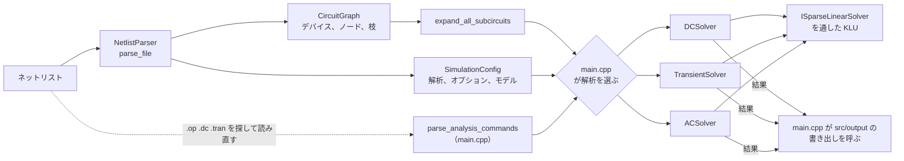
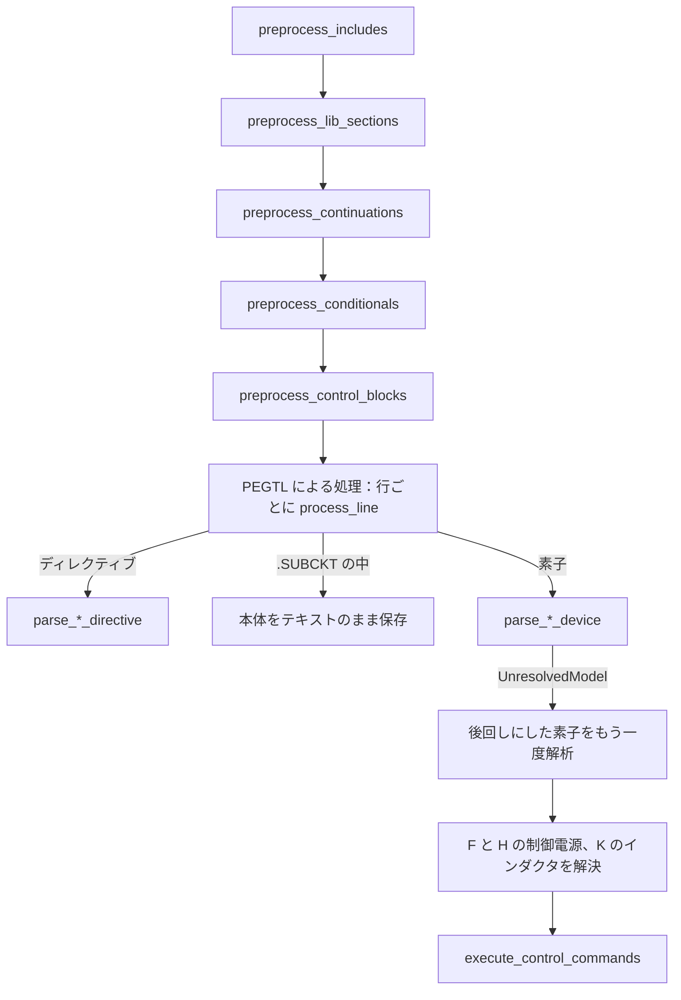

# 設計

[English](ARCHITECTURE.md) · [プロジェクトの README](../README.ja.md) · この文書は英語版を正とします。日本語版はその訳で、両者が食い違う場合は英語版に従います。

**2026-11-15 更新**、コミット `eaf0629` に合わせています。この文書は、kirimaspice の作りを説明します。
ライブラリの部品、ネットリストがそれらを通る道筋、設計がまだ意図どおりになっていない箇所です。コードを
読んで書きました。実行しても確かめたものは、そう書いています。場所は行番号ではなく、ファイルと関数で
示します。コードに手を入れるときは [DEVELOPMENT](DEVELOPMENT.ja.md) を、用語は[用語集](GLOSSARY.ja.md)を
見てください。

## 目次

- [全体](#全体)
- [ディレクトリ](#ディレクトリ)
- [プログラムの 1 回の実行](#プログラムの-1-回の実行)
- [パーサー](#パーサー)
- [回路](#回路)
- [デバイス](#デバイス)
- [方程式と線形ソルバー](#方程式と線形ソルバー)
- [DC 解析](#dc-解析)
- [過渡解析](#過渡解析)
- [AC 解析](#ac-解析)
- [ライブラリにあるほかの解析](#ライブラリにあるほかの解析)
- [設計がまだ意図どおりでない箇所](#設計がまだ意図どおりでない箇所)

## 全体

kirimaspice は、静的ライブラリ `kirimaspice_lib` と、コマンドラインを読んでライブラリを呼ぶプログラム
`kirimaspice`（`src/main.cpp`）からなります。ライブラリはネットリストを回路と設定に変換し、デバイスから
修正節点解析（MNA）の方程式を組み立て、KLU で解き、結果を書き出します。



## ディレクトリ

ヘッダーは `include/kirimaspice/<ディレクトリ>/`、ソースは `src/<ディレクトリ>/` にあり、名前空間は
おおむね `kirimaspice::<ディレクトリ>` です。例外は次のとおりです。`core/types.hpp` と `core/matrix_types.hpp`
は `kirimaspice` にあります。`FourierAnalyzer`、`DistortionSolver`、`PoleZeroSolver`、`TransferFunctionSolver`
は、`kirimaspice::solvers` ではなく `kirimaspice` にあります。`core/device_utils.hpp` の後半は
`kirimaspice::device_utils` にあります。

| ディレクトリ | 中身 |
| --- | --- |
| `parser` | `NetlistParser`。前処理、行、ディレクティブ、素子の行、式 |
| `circuit` | `CircuitGraph`。ノード、デバイス、枝。`SubcircuitDefinition` と展開 |
| `devices` | 基底クラス `Device` とデバイスモデル |
| `solvers` | DC、過渡、AC とほかの解析。`ConvergenceChecker`。線形ソルバーのインターフェースと KLU |
| `analysis` | モンテカルロ、ワーストケース、NLopt による最適化、BSIM4 のパラメータ抽出 |
| `measure` | `.MEASURE` 風の測定をする `MeasureEngine` |
| `output` | SPICE3 raw（ASCII とバイナリ）、SSF、AC の CSV、Touchstone、WAV |
| `core` | 型（`SimulationConfig`、`IntegrationMethod`）、行列（`SparseMatrix`、`MNASystem`）、定数、デバイスの補助 |
| `util`、`utils` | ヘッダーだけ。`util` に文字列の補助、倍率（`units.hpp`）、電源の書式。`utils` に `MemoryPool` |

## プログラムの 1 回の実行

`src/main.cpp` は次のことをします。

1. オプション（`-o`、`--raw-out`、`--raw-binary-out`、`--wav-*`、`--solver-*`）を読み、ソルバーの
   オプションをソルバーの工場に渡します。
2. `NetlistParser::parse_file` を呼びます。これは回路と `SimulationConfig` を返します。`.TEMP` があると、
   最初の温度が基準の温度になります。
3. `CircuitGraph::expand_all_subcircuits` を呼びます。展開はパーサーではなく、プログラムの仕事です。
4. 解析を選びます。`parse_analysis_commands` が最上位のファイルを読み直し、正規表現で、後ろに 2 つの語が
   続く `.tran` と、`.dc`、`.op` を、コメントも含めたすべての行から探します。`.op` は `.options` にも当てはまります
   （[KNOWN_ISSUES](../KNOWN_ISSUES.ja.md#コマンドラインと出力)）。DC スイープはパーサーが `.DC` を見つけた
   ときに、AC 解析は `.AC` の周波数を見つけたときに実行します。`.op` や `.dc` が求める動作点は、DC スイープに
   置き換わります。
5. `run_analyses` を通して解析を実行し、結果を書き出します。`.TEMP` の値ごとに、その温度を入れた
   `SimulationConfig` で 1 回ずつ実行します（`.TEMP` がなければ 1 回です）。

| ネットリストにあるもの | 実行するもの | 標準出力 | ファイル |
| --- | --- | --- | --- |
| 完全な `.DC`（パーサーが読む） | DC スイープ | 要約 | raw（ASCII、バイナリ） |
| `.op` か `.dc`（文字列の検索）で、スイープなし | 動作点 | `V(...)` と `I(...)` | SSF、raw（ASCII、バイナリ） |
| `.tran a b`（文字列の検索） | 過渡解析。その後に `.FOUR` を、その行の信号ごとに | 表 | SSF、raw（ASCII、バイナリ）、WAV |
| `.AC`（パーサーが読む） | AC | なし | 必ず `<base>_ac.csv` |
| どれもない | 動作点 | `V(...)` だけ | なし |

複数の解析が raw ファイルを書くと、それぞれがプロットを後ろに足します。SSF ファイルは、それぞれが
書き直します。`.TEMP` に複数の値を並べると、raw ファイルにはすべての実行のプロットが入り、各実行の
SSF、WAV、AC の CSV の名前には、その温度が付きます（`out_27C.ssf`、`out_ac_27C.csv`）。`.FOUR` の行は、
過渡解析のソルバーの中で評価します。

## パーサー

`NetlistParser::parse_file`（`src/parser/netlist_parser.cpp`）は、段階を追って処理します。

1. テキストの前処理。`.INCLUDE`（再帰的で、循環を検出します。`.INC` はその短い形です）、`.LIB` の節
   （10 段まで入れ子にできます）、継続行です。空の行は捨て（空白だけの行は残します）、継続行はつなぎ、
   インクルードしたファイルは差し込み、段階 2 の `.IF` と `.CONTROL` の行は取り除くので、`ParseError` の
   行番号は前処理の後の行を数えます。
2. 解析の前に分かっているパラメータで評価する `.IF`／`.ELIF`／`.ELSE`／`.ENDIF` と、`.CONTROL` のブロック。
3. PEGTL による処理。文法はテキストをタイトルの行とほかの行に分けるだけで、それぞれの行は
   `process_line` に渡ります。その中の解析は、手書きの字句の切り出し（`util::split_netlist_tokens`）です。
4. あとで定義されるモデルを指していたために後回しにした行（下の「後回しにする素子」）を、もう一度解析します。
5. 素子どうしの参照の解決。`F` と `H` の制御電源、`K` のインダクタです。
6. `.CONTROL` のブロックのコマンド。



ディレクティブは `.SUBCKT` の本体かどうかを調べる前に処理するので、サブ回路の中の `.MODEL` はグローバルに
なります。そこにある `.PARAM` は本体と一緒に保存し、インスタンスごとにその中だけで効きます。`.SUBCKT` の中の素子の行はテキストのまま保存し、展開のときに解析します。入れ子の
`.SUBCKT` の定義はエラーです。知らないディレクティブは、`.MEASURE` も含め、メッセージなしで捨てます。

**使う前に定義されていないモデル。** ダイオード、BJT、MOSFET、MESFET の解析は、モデルがまだ分からないと
`UnresolvedModel` を投げます。`process_line` はその行を保存し、PEGTL の処理の後で保存した行をもう一度
解析します。そこでもモデルがなければ `ParseError` です。

**式**は ExprTk を使い、4 か所でそれぞれ別の記号表を用意します。中括弧の素子の値（`ExpressionEvaluator` を
通した `read_element_value`）、`.PARAM`（それまでに定義した `.FUNC` も登録します）、サブ回路の
パラメータ（`SubcircuitDefinition::substitute_parameters`。グローバルの `.PARAM` の値の上に、サブ回路の既定値、
インスタンスの値、本体の `.PARAM` の行が重なります）、
`B` 電源（`CircuitGraph`）です。
はじめの 3 つは同じ定数 `pi` と `e`（`util::kExpressionConstants`）を知っていて、ExprTk と同じく、名前の
大文字と小文字を区別しません。

結果は `NetlistParseResult { std::unique_ptr<CircuitGraph>, SimulationConfig }` です。`SimulationConfig`
（`include/kirimaspice/core/types.hpp`）は、解析、オプション、モデルを持ちます。`find_model` は大文字と
小文字を区別せずにモデルを引きます。

## 回路

`CircuitGraph`（`src/circuit/circuit_graph.cpp`）は、ノードとデバイスを持ちます。

- ノードは 0 から番号を付けます。ノード 0 がグラウンドで、名前は `0` です。`is_ground_name` は、大文字と
  小文字を問わず `gnd` もそこへ対応させます（[NETLIST_CONVENTIONS](spec/NETLIST_CONVENTIONS.ja.md) の
  規則 5）。
- デバイスは `std::shared_ptr<Device>` として、名前と順番で持ちます。
- 電流が方程式の未知数になるデバイスは、`voltage_sources_` にも入れ、その中の位置を枝の番号にします。
  独立電圧源（DC と波形）、電圧の形の `B` 電源、`E`、`H` です。インダクタには枝がなく、DC では 10⁶ S の
  コンダクタンスです。
- ノード k は方程式の k − 1 行目、枝 b は (ノードの数 − 1) + b 行目です。系の大きさは、グラウンドを除いた
  ノードの数と枝の数の和です。
- Boost.Graph の `adjacency_list` は、ノードごとの頂点とデバイスごとの辺を受け取りますが、どこからも
  読まれません。

`expand_all_subcircuits` は、サブ回路の定義を並べ、循環がないかを調べ（`SubcircuitRegistry`）、展開した
`X` の行がさらにインスタンスを足すことがあるので、なくなるまでインスタンスを展開します。
`expand_subcircuit_instance` は、パラメータを置き換え、ピンを外側のノードに対応させ、グラウンドと
グローバルなノードはそのまま残し、内側のノードとデバイスに `X1.n`、`X1.R1` という名前を付けます。保存した
本体の行は自分で解析し、知っているのは `R`、`C`、`L`、`V`、`I`、`M`、`X` だけです。ほかの行は警告に
なります（[KNOWN_ISSUES](../KNOWN_ISSUES.ja.md#ネットリストの入力)）。

## デバイス

デバイスはすべて `Device`（`include/kirimaspice/devices/device.hpp`）から派生します。

| メソッド | 使い道 |
| --- | --- |
| `nodes()` | 端子 |
| `is_linear()`、`is_dynamic()` | ソルバーがどの書き込みを呼ぶか |
| `stamp_dc_linear`、`stamp_dc_nonlinear`、`stamp_gmin` | DC。線形の部分、今の解での Newton 法の線形化、gmin のコンダクタンス |
| `stamp_transient(mna, v, dt, method, ...)` | 過渡解析。積分法のコンパニオンモデル |
| `stamp_ac`、`linearize_at` | AC。動作点での小信号の書き込み |
| `save_state`、`restore_state`、`reset_state`、`accept_solution` | 過渡解析の履歴。ステップごとに残すか戻す |
| `get_charge`、`get_flux`、`get_physical_lte` | 電荷と磁束からの局所打ち切り誤差 |
| `get_noise_sources` | ノイズ |
| `get_parameter`、`set_parameter`、`get_perturbable_parameters` | 感度、ワーストケース、最適化 |

書き込み（スタンプ）はデバイスの線形化したコンパニオンを書くので、ソルバーは補正量ではなく新しい解に
ついて G·x = b を解きます。書き込みは `const` のメソッドで、必要な履歴は `mutable` のメンバーに持ちます。

温度はインターフェースに入っていません。温度に依存するモデルはそれぞれ `set_temperature` を持ち、
`apply_temperature_to_devices`（`src/solvers/temperature_utils.cpp`）が種類ごとにそれを呼びます。レベル 3、
MESFET、SCR、TRIAC、受動素子はそこに入っておらず、この関数は飛ばします。

| 種類 | ファイル |
| --- | --- |
| 受動素子、結合、線路 | resistor、capacitor、inductor、mutual_inductance、tline_lossless、tline_lossy |
| 電源 | voltage_source、current_source（どちらも `waveform.hpp` の波形と一緒に）、behavioral_source、vcvs、vccs、cccs、ccvs |
| ダイオードとバイポーラ | diode、bjt_base、bjt_npn、bjt_pnp |
| MOSFET | mosfet_base、mosfet_level1、mosfet_level3、mosfet_bsim1、mosfet_bsim3（bsim3_core と一緒に）、mosfet_bsim4（bsim4_core とそのパラメータと一緒に）、mosfet_sic、finfet |
| パワー素子とそのほか | gan_hemt、vdmos、igbt、jfet、mesfet、scr、triac |

MOSFET のモデルは、`Polarity`（`polarity.hpp`）についてのクラステンプレートです。GaN HEMT、IGBT、JFET、
MESFET、SCR、VDMOS は、それぞれ自分の極性の列挙型（`GaNPolarity` など）についてのテンプレートで、ヘッダーに
だけあります。レベル 1、レベル 3、BSIM1、BSIM3、BSIM4、SiC、FinFET は、それぞれの `.cpp` で明示的に
実体化します。バイポーラトランジスタは `BJT_NPN` と `BJT_PNP` の 2 つのクラスで、`Device` から直接
派生します。`BJT_Base` はどちらも使っていません。ライブラリには JFET がありますが、パーサーに `J` 素子は
ありません。

## 方程式と線形ソルバー

- `SparseMatrix`（`include/kirimaspice/core/matrix_types.hpp`）は (行, 列, 値) の並びです。`add_entry` は
  0 も残すので、回路の非零の形は反復の間で変わりません。`to_csc` は重複を足し合わせて、KLU が受け取る
  圧縮列形式にします。`MNASystem` は G、b、x を持ち、`ComplexMNASystem` はその AC 版です。
- ソルバーは `ISparseLinearSolver` を通して線形ソルバーを使います。`choose_backend`
  （`src/solvers/solver_factory.cpp`）は、コマンドライン、環境変数、ビルドの既定の順に選びます。動く
  バックエンドは KLU だけで、`SuperLUDISTSolver` はどのメソッドも `false` を返します。
- Newton 法のループでは、最初の反復で解析と分解を行い、非零の形が変わらない間は、あとの反復で保存した
  記号解析を使って分解し直します。
- `ParallelDeviceStamper` は、OpenMP のスレッドでデバイスをそれぞれ別の系に書き込み、まとめます。DC では
  デバイスが 10 000 個以上のときに使い、過渡解析のしきい値 1 000 000 は、実際には使わないのと同じです。

## DC 解析

`DCSolver::solve`（`src/solvers/dc_solver.cpp`）は、オプションで求められていれば、この優先順で電源
ステッピング、gmin ステッピング、継続法を行い、そうでなければ Newton 法のループ `solve_standard` を行います。
`PSEUDO_TRANSIENT=1` のときは、それが失敗すると疑似過渡法に切り替えます（既定では切り替えません）。

- **Newton 法のループ。** 書き込みから系を組み立て、分解し、解き、収束を調べます
  （`DCSolver::check_convergence`）。
- **収束。** まず一歩の大きさを調べます。ノードが不合格になるのは、変化が `vntol` と、値の `reltol` 倍の
  両方を超えたときだけです（枝の電流は `abstol`）。次に、新しい解でキルヒホッフの電流則を調べます
  （`kirchhoff_current_law_holds`）。各デバイスをそこで空の系に書き込むと、その寄与
  G<sub>d</sub>·x − b<sub>d</sub> はデバイス自身の電流になります。各行の和は、その行で最大の寄与の
  `reltol` 倍に `abstol`（枝の行は `vntol`）と、丸めの分として項の大きさの 10<sup>−12</sup> 倍を加えた
  値より小さくなければなりません。反復で解いた gmin（gmin ステッピング、動的 gmin）と固定したノードも
  寄与に含めます。過渡解析の 1 ステップの Newton 反復も、そのステップの各デバイスの `stamp_transient` で
  同じ判定をします（`TransientSolver::check_convergence`）。そのため、書き込みはデバイスの履歴を変えては
  いけません。履歴を進めるのは `accept_solution` です。
- **制限。** 未知数が 4 個を超える非線形の回路では、最初の 10 回の反復で、Newton 法の一歩全体を 5 V 以下に
  縮めます（動的 gmin を使うときを除きます）。ダイオードと NPN トランジスタは、反復の間に接合電圧が動く幅も
  制限し（`core::limit_junction_step`。SPICE と同じです）、IGBT は V<sub>CE</sub> を SPICE3 の FET の
  V<sub>DS</sub> の規則で制限します（`core::limit_fet_drain_step`）。制限した書き込みから得た解は収束と
  見なしません（`any_device_limited`）。
- **DC スイープ。** 入れ子の `.DC` では、最初の電源が内側のループです
  （[NETLIST_CONVENTIONS](spec/NETLIST_CONVENTIONS.ja.md) の規則 4）。点は 1 つずつ順に解き、それぞれ
  前の点からではなく、初期の推定値から始めます。

## 過渡解析

`TransientSolver::solve`（`src/solvers/transient_solver.cpp`）は、温度を設定し、始点を求め、時間を進めます。

- **始点。** `UIC` があれば `initialize_uic_mode` が `.IC` から始めます。なければ始点は動作点で、`.IC` の
  ノードをその値に固定して解き（`DCSolver::hold_node_voltages`。それぞれ 10¹⁰ S のコンダクタンス）、
  過渡解析ではそれを外します。
- **方法**（`IntegrationMethod`）。後退オイラー法、台形則（既定）、BDF2（`gear`、`gear2`、`bdf2`）、
  BDF3（`gear3`、`bdf3`）、TR-BDF2 で、`.OPTIONS METHOD=` で選びます。各デバイスの `stamp_transient` が、
  その方法のコンパニオンモデルを書きます。ただし、SiC MOSFET、GaN HEMT、VDMOS、FinFET、MESFET は方法に
  かかわらず容量を後退オイラー法で積分し、IGBT は台形則のときにそうします
  （[KNOWN_ISSUES](../KNOWN_ISSUES.ja.md#デバイスモデル)）。
- **固定刻み。プログラムが使う経路です。** `run_fixed_timestepping` は `tstep` で刻み、`tmax` は使いません。
  最初のステップ（BDF2 では最初の 2 ステップ）は後退オイラー法で進み、BDF3 は、履歴が 1 点か 2 点の間は
  BDF2 のステップで進みます。失敗したステップは、後退オイラー法でやり直し、それでも駄目なら刻みを半分にして、
  15 回までやり直します。打ち切り誤差による制御はありません。

  ```mermaid
  flowchart LR
    S["その方法で 1 ステップ"] -->|収束| OK["受け入れて次のステップへ"]
    S -->|失敗| B["同じ刻みで後退オイラー法"]
    B -->|収束| OK
    B -->|失敗| Q{"15 回半分にしたか、<br/>刻みが最小か"}
    Q -->|いいえ| H["刻みを半分にする"] --> S
    Q -->|はい| E["過渡解析は失敗"]
  ```
- **可変刻み。ライブラリの中だけです。** `solve_timestep_adaptive` は、次数の違う 2 つの方法の組か、
  予測子と修正子から局所打ち切り誤差を見積もり、20 歩受け入れた後はデバイスの `get_physical_lte` も
  使います。次数も変えられます。この経路を使うネットリストのオプションはありません。
- **ステップの受け入れ。** `accept_timestep_solution` は、要素 0 をグラウンドにしたノードの電圧を、
  すべてのデバイスの `accept_solution` に渡します。相互インダクタンスは、そのインダクタの後、最後に
  受け入れます。
- **TR-BDF2** は、γ·Δt（γ = 2 − √2）の台形則の段と、Δt までの BDF2 の段を進めます。

## AC 解析

`ACSolver::solve`（`src/solvers/ac_solver.cpp`）は、動作点を解き、そこでデバイスを線形化し
（`linearize_at`）、周波数ごとに `stamp_ac` を複素数の系に書き込みます。大きさ n の複素数の系は、
大きさ 2n の実数の系 [Re −Im; Im Re] として、実数のバックエンドで解きます。周波数は OpenMP で並列に、
それぞれ別のソルバーで解きます。入力は `AC` を書いた電源です（[NETLIST_CONVENTIONS](spec/NETLIST_CONVENTIONS.ja.md)
の規則 2）。

## ライブラリにあるほかの解析

| 解析 | 場所 | ネットリストから使えるか |
| --- | --- | --- |
| フーリエ（`.FOUR`） | 過渡解析のソルバーが呼ぶ `FourierAnalyzer` | 使える。`.TRAN` と一緒に |
| 温度スイープ（`.TEMP`） | DC と過渡解析のソルバーの `solve_temp_sweep` | `.TEMP` は使えるが、これらの関数は通らない。プログラムが `.TEMP` の値ごとに自分で解析を実行する（`main.cpp` の `run_analyses`） |
| ノイズ | `NoiseSolver`。`get_noise_sources` についての随伴法 | 使えない。`.NOISE` がない |
| 感度 | `SensitivityAnalyzer`。`set_parameter` による差分 | 使えない。`.SENS` は解析する |
| 伝達関数 | `TransferFunctionSolver`。入力の電源についての差分 | 使えない。`.TF` は解析する |
| 極と零点 | `PoleZeroSolver`。仮の実装 | 使えない。`.PZ` は解析する |
| ひずみ | `DistortionSolver`。小信号の大きさの比 | 使えない。`.DISTO` は解析する |
| S パラメータ | `SParameterSolver`。`TouchstoneWriter` と一緒に | 使えない。`.PORT` は解析する |
| パラメータスイープ（`.STEP`） | `ParameterSweepExecutor`。点ごとにネットリストを解析し直す | 使えない。`.STEP` は解析する |
| モンテカルロ、ワーストケース | `MonteCarloExecutor`、`WCaseAnalyzer`（`src/analysis`） | 使えない |
| 最適化、BSIM4 の抽出 | NLopt を使う `CircuitOptimizer`、`BSIM4ParameterExtractor` | 使えない |
| 測定 | `MeasureEngine`（`src/measure`） | 使えない。`.MEASURE` は捨てる |

これらはライブラリの呼び出しとしてテストしています。プログラムが解析しても実行しないディレクティブは
[KNOWN_ISSUES](../KNOWN_ISSUES.ja.md#ネットリストの入力) にあります。

## 設計がまだ意図どおりでない箇所

- **BSIM4 は、ノイズのために電流をもう一度計算します。** デバイスの式は 1 か所にだけ書くという決まりに
  反しています（[KNOWN_ISSUES](../KNOWN_ISSUES.ja.md#デバイスモデル)）。ほかの解析は `BSIM4Core` を通して
  BSIM4 を評価しますが、`MOSFET_BSIM4::get_noise_sources` は代わりに簡略化した関数を使い、
  `BSIM4ParameterExtractor` も同じです。SiC MOSFET、GaN HEMT、VDMOS は、DC、AC、ノイズのどれでも、
  電流を 1 つの `drain_current` で評価し、IGBT は `collector_current` で評価します。
- **解析を 2 か所で選びます。** パーサーの設定（`.DC`、`.AC`）と、`main.cpp` の正規表現（`.op`、`.dc`、
  `.tran`）です。後者は、プログラムにシミュレーションの論理を持たせ、ネットリストの意味をもう一度決めて
  います。
- **温度を種類ごとに設定します。** `apply_temperature_to_devices` は、一覧にない種類を飛ばします
  （[デバイス](#デバイス)を参照）。
- **素子の行を 2 か所で解析します。** 最上位はパーサーが、サブ回路の本体は `expand_subcircuit_instance` が
  解析し、後者が知っている素子は少なくなっています。
- **Newton 法のループを何度も書いています。** `solve_standard`、電源ステッピングと gmin ステッピング、
  過渡解析のステップ、TR-BDF2 の 2 つの段です。
- **ExprTk を 4 回、別々の記号表で用意しています。** そのため、式から見える名前が、書いた場所によって
  違います。
- **ソルバーが `const CircuitGraph&` のデバイスを変えます。** スイープの電源の値、温度、過渡解析の始めの
  状態のリセットです。続けて実行する解析は、その状態を共有します。
- **静的な状態があります。** ソルバーの工場はコマンドラインの選択を静的変数に持ち、`bsim4_core.cpp` と
  `mutual_inductance.cpp` のいくつかの関数は、OpenMP が並列に実行しうる経路で関数内の静的変数を持ちます。
- **使われていない部分。** `CircuitGraph` の Boost.Graph、BSIM4 が `extra_node_count` で宣言する内部ノード
  （ソルバーは 0 個として扱います）、SuperLU_DIST のバックエンド、止めてある DC スイープの並列化、`BJT_Base`、
  `BSIM4Core::compute_cdrain` の解析的な微分、テストだけが呼ぶ `CircuitGraph::add_sin_voltage_source`、
  `add_pulse_voltage_source`、`add_pwl_voltage_source` です（パーサーは `add_voltage_source_with_waveform`
  を使います）。
