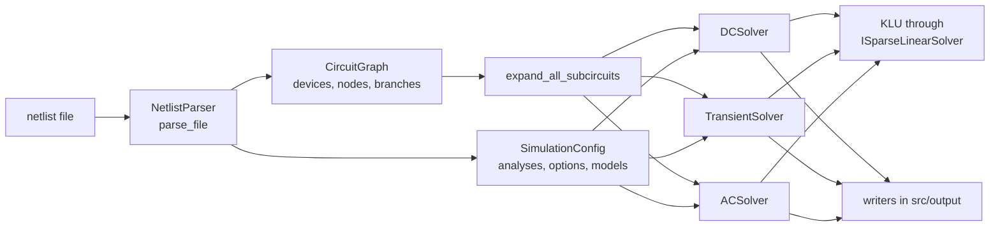

# Architecture

[日本語](ARCHITECTURE.ja.md) · [Project README](../README.md) · This English text is the main version; the Japanese version follows it, and where they differ, this text holds.

**Updated 2026-11-14** for commit `8b1582c`. This document describes how
kirimaspice is built: the parts of the library, the path a netlist takes
through them, and the places where the design is not yet as intended. It
was written by reading the code; what was also run says so. Places are
given by file and function, not by line. For working on the code, see
[DEVELOPMENT](DEVELOPMENT.md); for terms, the [Glossary](GLOSSARY.md).

## Contents

- [Overview](#overview)
- [Directories](#directories)
- [A run of the program](#a-run-of-the-program)
- [Parser](#parser)
- [Circuit](#circuit)
- [Devices](#devices)
- [Equations and linear solvers](#equations-and-linear-solvers)
- [DC analysis](#dc-analysis)
- [Transient analysis](#transient-analysis)
- [AC analysis](#ac-analysis)
- [Other analyses in the library](#other-analyses-in-the-library)
- [Where the design is not yet as intended](#where-the-design-is-not-yet-as-intended)

## Overview

kirimaspice is a static library, `kirimaspice_lib`, and a program,
`kirimaspice`, that reads the command line and calls the library
(`src/main.cpp`). The library parses a netlist into a circuit and a
configuration, builds the equations of modified nodal analysis (MNA) from
the devices, solves them with KLU, and writes the results.

## Directories

The headers are in `include/kirimaspice/<directory>/`, the sources in
`src/<directory>/`, and the namespaces are `kirimaspice::<directory>`.

| Directory | Holds |
| --- | --- |
| `parser` | `NetlistParser`: preprocessing, lines, directives, element lines, expressions |
| `circuit` | `CircuitGraph`: nodes, devices, branches; `SubcircuitDefinition` and expansion |
| `devices` | the `Device` base class and the device models |
| `solvers` | DC, transient, AC and the other analyses; `ConvergenceChecker`; the linear-solver interface and KLU |
| `analysis` | Monte Carlo, worst case, optimization with NLopt, BSIM4 parameter extraction |
| `measure` | `MeasureEngine` for `.MEASURE`-style measurements |
| `output` | SPICE3 raw (ASCII and binary), SSF, AC CSV, Touchstone, WAV |
| `core` | types (`SimulationConfig`, `IntegrationMethod`), matrices (`SparseMatrix`, `MNASystem`), constants, device helpers |
| `util`, `utils` | string helpers, scale factors (`units.hpp`), source syntax |

## A run of the program

`src/main.cpp` does the following:

1. Reads the options (`-o`, `--raw-out`, `--raw-binary-out`, `--wav-*`,
   `--solver-*`) and passes the solver options to the solver factory.
2. Calls `NetlistParser::parse_file`, which returns the circuit and a
   `SimulationConfig`. With `.TEMP`, the first temperature becomes the
   base temperature.
3. Calls `CircuitGraph::expand_all_subcircuits`. Expansion is the
   program's step, not the parser's.
4. Chooses the analyses. `parse_analysis_commands` reads the top-level
   file again and looks for `.tran`, `.dc` and `.op` with regular
   expressions, on every line, comments included; `.op` also matches
   `.options` ([KNOWN_ISSUES](../KNOWN_ISSUES.md#command-line-and-output)).
   A DC sweep runs when the parser found `.DC`, and an AC analysis when it
   found `.AC` frequencies.
5. Runs each analysis and writes its results:

| Analysis | Standard output | Files |
| --- | --- | --- |
| DC sweep | a summary | raw (ASCII, binary) |
| Operating point | `V(...)` and `I(...)` | SSF, raw (ASCII, binary) |
| Transient | a table | SSF, raw (ASCII, binary), WAV |
| AC | nothing | always `<base>_ac.csv` |

When more than one analysis writes a raw file, each appends a plot to it.
With `.TEMP`, the operating point and the transient run once per
temperature; with `.DC`, only the first temperature runs. A `.FOUR` line
is evaluated inside the transient solver.

## Parser

`NetlistParser::parse_file` (`src/parser/netlist_parser.cpp`) works in
steps:

1. Preprocessing of the text: `.INCLUDE` (recursive, with cycle
   detection; `.INC` is not recognised), `.LIB` sections (nested up to
   10 deep), and continuation lines. Blank lines are dropped, so the line
   number of a `ParseError` counts the preprocessed lines.
2. `.IF`/`.ELIF`/`.ELSE`/`.ENDIF`, evaluated with the parameters known
   before parsing, and `.CONTROL` blocks.
3. A PEGTL pass. The grammar only splits the text into a title line and
   other lines; each line goes to `process_line`, where the parsing is
   hand-written tokenising (`split_whitespace`).
4. The lines held back because they named a model defined later
   ("deferred elements", see below), parsed again.
5. The resolution of references between elements: the controlling
   sources of `F` and `H`, the inductors of `K`.
6. The commands of a `.CONTROL` block.

Directives are handled before the check for a `.SUBCKT` body, so a
`.MODEL` inside a subcircuit is global; a `.PARAM` there is kept with the
body and is local to each instance. Inside a `.SUBCKT`,
element lines are stored as text and parsed at expansion. Nested
`.SUBCKT` definitions are an error. Unknown directives, `.MEASURE` among
them, are dropped without a message.

**Models defined after use.** The parsers of diodes, BJTs, MOSFETs and
MESFETs throw `UnresolvedModel` when the model is not known yet.
`process_line` stores the line, and after the PEGTL pass the stored lines
are parsed again; a model still missing is then a `ParseError`.

**Expressions** use ExprTk, set up in four places, each with its own
symbol table: element values in braces (`read_element_value` through the
`ExpressionEvaluator`), `.PARAM` (which also registers the `.FUNC`s
defined so far), subcircuit parameters
(`SubcircuitDefinition::substitute_parameters`, which sees the global
`.PARAM` values below the subcircuit's defaults, the instance values and
the `.PARAM` lines of the body), and `B` sources (`CircuitGraph`).

The result is `NetlistParseResult { std::unique_ptr<CircuitGraph>,
SimulationConfig }`. `SimulationConfig` (`include/kirimaspice/core/types.hpp`)
holds the analyses, the options and the models; `find_model` looks a model
up without regard to case.

## Circuit

`CircuitGraph` (`src/circuit/circuit_graph.cpp`) owns the nodes and the
devices:

- Nodes are numbered from 0. Node 0 is ground, named `0`;
  `is_ground_name` also maps `gnd` in any case to it
  ([NETLIST_CONVENTIONS](spec/NETLIST_CONVENTIONS.md), rule 5).
- Devices are held as `std::shared_ptr<Device>`, by name and in order.
- Every device whose current is an unknown of the equations is also kept
  in `voltage_sources_`, and its branch number is its position there:
  independent voltage sources (DC and waveforms), voltage-form `B`
  sources, `E` and `H`. Inductors have no branch: in DC they are a
  conductance of 10⁶ S.
- Node k is row k − 1 of the equations, and branch b is row
  (number of nodes − 1) + b. The size of the system is the number of
  nodes without ground plus the number of branches.
- A Boost.Graph `adjacency_list` receives a vertex per node and edges per
  device, but nothing reads it.

`expand_all_subcircuits` orders the subcircuit definitions, checks them
for cycles (`SubcircuitRegistry`), and expands instances until none is
left, since an expanded `X` line can add more. `expand_subcircuit_instance`
substitutes the parameters, maps the pins to the outer nodes, keeps ground
and global nodes, and names the inner nodes and devices `X1.n` and
`X1.R1`. It parses the stored body lines itself and knows only `R`, `C`,
`L`, `V`, `I`, `M` and `X`; other lines give a warning
([KNOWN_ISSUES](../KNOWN_ISSUES.md#netlist-input)).

## Devices

Every device derives from `Device` (`include/kirimaspice/devices/device.hpp`):

| Method | Used for |
| --- | --- |
| `nodes()` | the terminals |
| `is_linear()`, `is_dynamic()` | which stamps the solvers call |
| `stamp_dc_linear`, `stamp_dc_nonlinear`, `stamp_gmin` | DC: the linear part, the Newton linearisation at the present solution, the gmin conductances |
| `stamp_transient(mna, v, dt, method, ...)` | transient: the companion model of the integration method |
| `stamp_ac`, `linearize_at` | AC: the small-signal stamp at the operating point |
| `save_state`, `restore_state`, `reset_state`, `accept_solution` | the history of a transient, kept or rolled back per step |
| `get_charge`, `get_flux`, `get_physical_lte` | the local truncation error from charges and fluxes |
| `get_noise_sources` | noise |
| `get_parameter`, `set_parameter`, `get_perturbable_parameters` | sensitivity, worst case, optimization |

A stamp writes the linearised companion of the device, so a solver solves
G·x = b for the new solution, not for a correction. Stamps are `const`
methods; the history they need is held in `mutable` members.

Temperature is not part of the interface: each model has its own
`set_temperature`, and `apply_temperature_to_devices`
(`src/solvers/temperature_utils.cpp`) calls it type by type.

| Family | Files |
| --- | --- |
| passive, coupling, lines | resistor, capacitor, inductor, mutual_inductance, tline_lossless, tline_lossy |
| sources | voltage_source, current_source, time_varying_voltage_source (with `waveform.hpp`), behavioral_source, vcvs, vccs, cccs, ccvs |
| diodes and bipolar | diode, bjt_base, bjt_npn, bjt_pnp |
| MOSFET | mosfet_base, mosfet_level1, mosfet_level3, mosfet_bsim1, mosfet_bsim3 (with bsim3_core), mosfet_bsim4 (with bsim4_core and its parameters), mosfet_sic, finfet |
| power and others | gan_hemt, vdmos, igbt, jfet, mesfet, scr, triac |

N- and P-type devices are one class template over the polarity
(`polarity.hpp`). GaN HEMT, IGBT, JFET, MESFET, SCR and VDMOS are
header-only templates; level 1, level 3, BSIM1, BSIM3, BSIM4, SiC and
FinFET are instantiated explicitly in their `.cpp` files. The library has
a JFET, but the parser has no `J` element.

## Equations and linear solvers

- `SparseMatrix` (`include/kirimaspice/core/matrix_types.hpp`) is a list of
  (row, column, value) entries. `add_entry` keeps zeros, so the pattern of
  a circuit stays the same from one iteration to the next. `to_csc` sums
  duplicate entries into the compressed-column form KLU takes.
  `MNASystem` holds G, b and x; `ComplexMNASystem` is its AC counterpart.
- The solvers reach a linear solver through `ISparseLinearSolver`.
  `choose_backend` (`src/solvers/solver_factory.cpp`) takes the command
  line, then the environment, then the build default. KLU is the only
  working backend: `SuperLUDISTSolver` returns `false` from every method.
- In a Newton loop, the first iteration analyses and factorises, and the
  later ones refactorise with the stored symbolic analysis while the
  pattern stays the same.
- `ParallelDeviceStamper` stamps devices on OpenMP threads, each into its
  own system, and merges them. It is used above 10 000 devices in DC; the
  transient threshold, 1 000 000, keeps it off in practice.

## DC analysis

`DCSolver::solve` (`src/solvers/dc_solver.cpp`) runs, in this order of
preference, source stepping, gmin stepping or continuation when an option
asks for it, and otherwise `solve_standard`, the Newton loop, with
pseudo-transient continuation as a fallback.

- **Newton loop.** Build the system from the stamps, factorise, solve,
  compute the residual G·x − b, and check convergence.
- **Convergence** (`ConvergenceChecker`): the residual of each node and
  branch, then the change of the solution, where a node fails only when
  its change exceeds both `vntol` and `reltol` times its value.
- **Limiting.** For the first ten iterations of a nonlinear circuit with
  more than four unknowns, the whole Newton step is scaled to at most 5 V
  (unless dynamic gmin is on). The diode and the NPN transistor also limit
  how far a junction voltage moves from one iteration to the next
  (`core::limit_junction_step`, as SPICE does), and an iterate that a
  limited stamp produced is not accepted as converged
  (`any_device_limited`).
- **DC sweep.** A nested `.DC` has the first source as the inner loop
  ([NETLIST_CONVENTIONS](spec/NETLIST_CONVENTIONS.md), rule 4). The points
  are solved one after another; each starts from the initial guess, not
  from the previous point.

## Transient analysis

`TransientSolver::solve` (`src/solvers/transient_solver.cpp`) applies the
temperature, finds the starting point, and steps in time.

- **Start.** With `UIC`, `initialize_uic_mode` starts from `.IC`;
  otherwise the start is an operating point, solved with the `.IC` nodes
  held at their values (`DCSolver::hold_node_voltages`, a conductance of
  10¹⁰ S each), which the transient then releases.
- **Methods** (`IntegrationMethod`): backward Euler, trapezoidal (the
  default), BDF2 and BDF3 (`gear`), and TR-BDF2, chosen with
  `.OPTIONS METHOD=`. Each device's `stamp_transient` writes the companion
  model of the method.
- **Fixed steps, the path the program uses.** `run_fixed_timestepping`
  steps by `tstep`; `tmax` is not used. While the history is too short for
  the method, a step is taken with backward Euler. A step that fails is
  tried again with backward Euler, then with the step halved, up to 15
  times. There is no control by the truncation error.
- **Adaptive steps, in the library only.** `solve_timestep_adaptive`
  estimates the local truncation error from a pair of methods of
  different order, or from a predictor and a corrector, and after 20
  accepted steps also from the devices' `get_physical_lte`; it can change
  the order. No netlist option turns this path on.
- **Accepting a step.** `accept_timestep_solution` passes the node
  voltages, with ground as element 0, to every device's `accept_solution`;
  mutual inductances are accepted last, after their inductors.
- **TR-BDF2** takes a trapezoidal stage over γ·Δt (γ = 2 − √2) and a BDF2
  stage to Δt.

## AC analysis

`ACSolver::solve` (`src/solvers/ac_solver.cpp`) solves an operating point,
linearises the devices there (`linearize_at`), and for each frequency
stamps `stamp_ac` into a complex system. The complex system of size n is
solved as a real system of size 2n, [Re −Im; Im Re], with the real
backend. The frequencies are solved in parallel with OpenMP, each with
its own solver. The inputs are the sources written with `AC`
([NETLIST_CONVENTIONS](spec/NETLIST_CONVENTIONS.md), rule 2).

## Other analyses in the library

| Analysis | Where | Reached from a netlist |
| --- | --- | --- |
| Fourier (`.FOUR`) | `FourierAnalyzer`, called by the transient solver | yes, with `.TRAN` |
| Temperature sweep (`.TEMP`) | `solve_temp_sweep` of the DC and transient solvers | yes |
| Noise | `NoiseSolver`, adjoint method over `get_noise_sources` | no; there is no `.NOISE` |
| Sensitivity | `SensitivityAnalyzer`, finite differences through `set_parameter` | no; `.SENS` is parsed |
| Transfer function | `TransferFunctionSolver`, finite differences on the input source | no; `.TF` is parsed |
| Pole-zero | `PoleZeroSolver`, a placeholder | no; `.PZ` is parsed |
| Distortion | `DistortionSolver`, ratios of small-signal magnitudes | no |
| S-parameters | `SParamSolver`, with `TouchstoneWriter` | no; `.PORT` is parsed |
| Parameter sweep (`.STEP`) | `ParameterSweep`, which parses the netlist again per point | no |
| Monte Carlo, worst case | `MonteCarloExecutor`, `WCaseAnalyzer` (`src/analysis`) | no |
| Optimization, BSIM4 extraction | `CircuitOptimizer`, `BSIM4ParameterExtractor`, with NLopt | no |
| Measurements | `MeasureEngine` (`src/measure`) | no; `.MEASURE` is dropped |

These are tested as library calls; [KNOWN_ISSUES](../KNOWN_ISSUES.md#netlist-input)
lists the directives the program parses but does not run.

## Where the design is not yet as intended

- **BSIM4 noise has its own current model.** The other analyses evaluate
  BSIM4 through `BSIM4Core`; `MOSFET_BSIM4::get_noise_sources` uses
  simplified functions instead, and so does `BSIM4ParameterExtractor`.
  This breaks the rule that a device's equations are written once.
- **Element lines are parsed in two places**: by the parser at the top
  level, and by `expand_subcircuit_instance` for subcircuit bodies, which
  knows fewer elements.
- **The Newton loop is written several times**: in `solve_standard`, in
  source and gmin stepping, in the transient step, and in the two
  TR-BDF2 stages.
- **ExprTk is set up four times**, with different symbol tables, so an
  expression sees different names depending on where it is written.
- **Solvers change the devices of a `const CircuitGraph&`**: source values
  in a sweep, temperatures, and the state reset at the start of a
  transient. Analyses that run one after another share that state.
- **Some state is static.** The solver factory keeps the command-line
  choice in statics, and a few functions in `bsim4_core.cpp` and
  `mutual_inductance.cpp` keep function-local statics on paths that
  OpenMP can run in parallel.
- **Unused parts.** The Boost.Graph of `CircuitGraph`, the extra internal
  nodes that BSIM4 declares through `extra_node_count` (the solvers take
  none), the SuperLU_DIST backend, and the parallel DC sweep, which is
  disabled.
