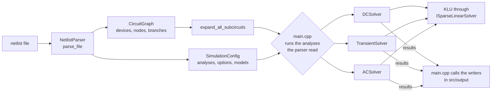
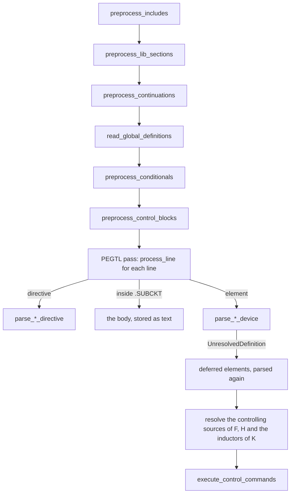
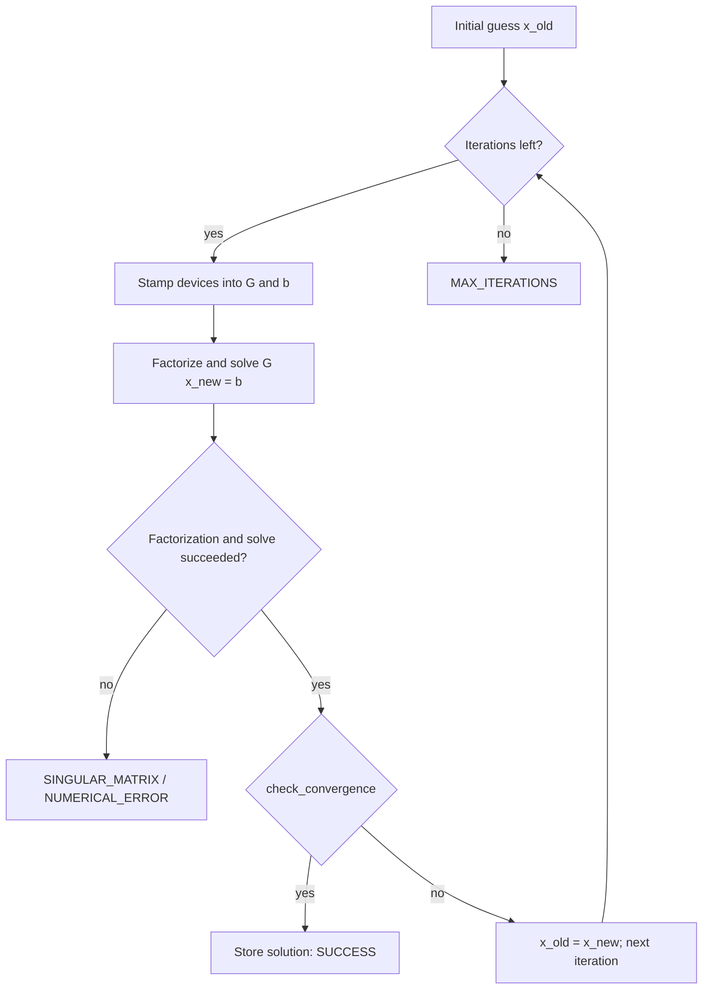
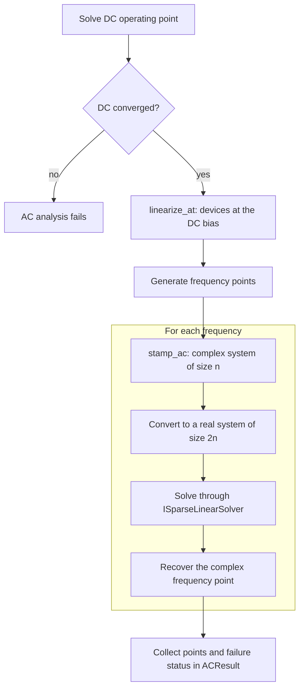

# Architecture

[日本語](ARCHITECTURE.ja.md) · [Project README](../README.md) · This English text is the main version; the Japanese version follows it, and where they differ, this text holds.

**Updated 2026-11-21** for commit `2826a81`. This document describes how
kirimaspice is built: the parts of the library, the path a netlist takes
through them, and the places where the design is not yet as intended. It
was written by reading the code; what was also run says so. Places are
given by file and function, not by line. For working on the code, see
[DEVELOPMENT](DEVELOPMENT.md); for terms, the [Glossary](GLOSSARY.md).

## Contents

- [Overview](#overview)
- [Directories](#directories)
- [A run of the program](#a-run-of-the-program)
- [Parser](#parser)
- [Circuit](#circuit)
- [Devices](#devices)
- [Equations and linear solvers](#equations-and-linear-solvers)
- [DC analysis](#dc-analysis)
- [Transient analysis](#transient-analysis)
- [AC analysis](#ac-analysis)
- [Other analyses in the library](#other-analyses-in-the-library)
- [Where the design is not yet as intended](#where-the-design-is-not-yet-as-intended)

## Overview

kirimaspice is a static library, `kirimaspice_lib`, and a program,
`kirimaspice`, that reads the command line and calls the library
(`src/main.cpp`). The library parses a netlist into a circuit and a
configuration, builds the equations of modified nodal analysis (MNA) from
the devices, solves them with KLU, and writes the results.



## Directories

The headers are in `include/kirimaspice/<directory>/`, the sources in
`src/<directory>/`, and the namespaces are mostly `kirimaspice::<directory>`.
The exceptions: `core/types.hpp` and `core/matrix_types.hpp` are in
`kirimaspice`; `FourierAnalyzer`, `DistortionSolver`, `PoleZeroSolver` and
`TransferFunctionSolver` are in `kirimaspice`, not `kirimaspice::solvers`;
and the second half of `core/device_utils.hpp` is in
`kirimaspice::device_utils`.

| Directory | Holds |
| --- | --- |
| `parser` | `NetlistParser`: preprocessing, lines, directives, element lines, expressions |
| `circuit` | `CircuitGraph`: nodes, devices, branches; `SubcircuitDefinition` and expansion |
| `devices` | the `Device` base class and the device models |
| `solvers` | DC, transient, AC and the other analyses; `ConvergenceChecker`; the linear-solver interface and KLU |
| `analysis` | Monte Carlo, worst case, optimization with NLopt, BSIM4 parameter extraction |
| `measure` | `MeasureEngine` for `.MEASURE`-style measurements |
| `output` | SPICE3 raw (ASCII and binary), SSF, AC CSV, Touchstone, WAV |
| `core` | types (`SimulationConfig`, `IntegrationMethod`), matrices (`SparseMatrix`, `MNASystem`), constants, device helpers |
| `util`, `utils` | headers only: string helpers, scale factors (`units.hpp`) and source syntax in `util`; `MemoryPool` in `utils` |

## A run of the program

`src/main.cpp` does the following:

1. Installs a logger that writes messages to standard error as
   `kirimaspice: <level>: <text>` after standard output is flushed
   (`StderrAfterStdout`), and reads the options (`-o`, `--raw-out`,
   `--raw-binary-out`, `--wav-*`, `--log-level`, `--version`, `--help`).
   An unknown option, a missing value or a second netlist is an error
   with exit code 2. The exit codes are kirimasim's: 0 finished, 1 an
   analysis failed, 2 an error of the command line or the input (an
   output file that cannot be written, `output::OutputFileError`,
   included), 3 an internal error.
2. Calls `NetlistParser::parse_file`, which returns the circuit and a
   `SimulationConfig`. With `.TEMP`, the first temperature becomes the
   base temperature.
3. Calls `CircuitGraph::expand_all_subcircuits`. Expansion is the
   program's step, not the parser's.
4. Takes the analyses from what the parser recorded in `SimulationConfig`:
   `op_requested` (`.OP`), `dc_sweep_enabled` (a complete `.DC`),
   `tran_requested` (a complete `.TRAN`) and `ac_requested` (`.AC`, or the
   `ac` command of a `.control` block). So an analysis line counts as every
   other directive, after continuation lines, `.INCLUDE`, `.LIB` and `.IF`;
   a netlist with none of them runs the operating point as for `.OP`. With
   `.OP` and a DC sweep, both run.
5. Runs the analyses through `run_analyses`, once per `.TEMP` value with
   that temperature in its `SimulationConfig` (once without `.TEMP`), and
   writes their results:

| Netlist has | Runs | Standard output | Files |
| --- | --- | --- | --- |
| a complete `.DC` | DC sweep | a summary | raw (ASCII, binary) |
| `.OP`, or no analysis line | operating point | `V(...)` and `I(...)` | SSF, raw (ASCII, binary) |
| a complete `.TRAN` | transient, then `.FOUR` for each of its signals | the results of `.FOUR`, then the table of `.PRINT TRAN` | SSF, raw (ASCII, binary), WAV |
| `.AC` | AC | nothing | always `<base>_ac.csv` |

When more than one analysis writes a raw file, each appends a plot to it;
the SSF file is rewritten by each. Under a `.TEMP` list of several values
the raw files hold the plots of every run, and the SSF, WAV and AC CSV
names of a run carry its temperature (`out_27C.ssf`, `out_ac_27C.csv`).
A `.FOUR` line is evaluated inside the transient solver.

## Parser

`NetlistParser::parse_file` (`src/parser/netlist_parser.cpp`) works in
steps:

1. Preprocessing of the text: the CR of each CR LF line end is removed
   as a file is read; then `.INCLUDE` (recursive, with cycle
   detection; `.INC` is its short form), `.LIB` sections (nested up to
   10 deep), and continuation lines. Empty lines are dropped (lines of
   blanks are kept), continuation lines are joined, included files are
   inserted, and the `.IF` and `.CONTROL` lines of step 2 are removed, so
   the line number of a `ParseError` counts the preprocessed lines.
2. Resolve the global `.PARAM` definitions, keeping any parameter overrides
   supplied by the caller. Use these values to select conditional branches,
   then extract the `.CONTROL` block.
3. A PEGTL pass. The grammar only splits the text into a title line and
   other lines; each line goes to `process_line`, where the parsing is
   hand-written tokenising (`util::split_netlist_tokens`). Text that the
   grammar cannot read is a `ParseError`, not dropped.
4. The lines held back because they named a model or a subcircuit
   defined later ("deferred elements", see below), parsed again.
5. The resolution of references between elements: the controlling
   sources of `F` and `H`, the inductors of `K`.
6. The commands of a `.CONTROL` block.



Directives are handled before the check for a `.SUBCKT` body, so a
`.MODEL` inside a subcircuit is global (a second definition of a model
name is named in a warning); a `.PARAM` there is kept with the
body and is local to each instance. Inside a `.SUBCKT`,
element lines are stored as text and parsed at expansion, by the same
element parsers (see [Circuit](#circuit)). Nested
`.SUBCKT` definitions are an error. A directive the parser does not read
is ignored with one warning (`.MEASURE` and `.TITLE` as not
supported); every directive read is recorded in
`SimulationConfig::directives_read`, from which the program names those
it does not run. An element of a letter outside `BCDEFGHIKLMOQRSTVXYZ` is
a `ParseError` (`is_element_letter`).

**Models and subcircuits defined after use.** The parsers of diodes,
BJTs, MOSFETs and MESFETs throw `UnresolvedDefinition` when the model is
not known yet, and that of `X` when the subcircuit is not.
`process_line` stores the line, and after the PEGTL pass the stored lines
are parsed again; a definition still missing is then a `ParseError`.

**Expressions** use ExprTk, set up in four places, each with its own
symbol table: element values in braces (`read_element_value` through the
`ExpressionEvaluator`), `.PARAM` (`evaluate_param_value`, with every
`.FUNC`; `read_global_definitions` reads the global `.FUNC` and `.PARAM`
lines before every other line and solves the definitions), subcircuit parameters
(`SubcircuitDefinition::substitute_parameters`, which sees the global
`.PARAM` values below the subcircuit's defaults, the instance values and
the `.PARAM` lines of the body), and `B` sources (`CircuitGraph`).
The first three know the same constants, `pi` and `e`
(`util::kExpressionConstants`), and, as ExprTk, compare names without
case. All four take the `.FUNC` functions from one place,
`util::ExpressionFunctions`, with the parameters of their scope, which a
function's body sees. In a body, a `B` line's expression is not evaluated
there: the instance's parameters are written into it as values
(`util::substitute_parameter_names`), as the top level does with the
global ones, and `substitute_parameters` hands the line on with them.

The result is `NetlistParseResult { std::unique_ptr<CircuitGraph>,
SimulationConfig }`. `SimulationConfig` (`include/kirimaspice/core/types.hpp`)
holds the analyses, the options and the models; `find_model` looks a model
up without regard to case.

## Circuit

`CircuitGraph` (`src/circuit/circuit_graph.cpp`) owns the nodes and the
devices:

- Nodes are numbered from 0. Node 0 is ground, named `0`;
  `is_ground_name` also maps `gnd` in any case to it
  ([NETLIST_CONVENTIONS](spec/NETLIST_CONVENTIONS.md), rule 5).
- Node names are folded to lower case in `add_node`, `get_node_id` and
  `has_node`, so they are compared without case; the writers name the
  signals `v(<node>)` and `i(<source>)` in lower case through
  `include/kirimaspice/output/signal_names.hpp`.
- `unknown_name` names the unknown of a row, `V(<node>)` or
  `I(<source>)`; when KLU finds a matrix singular, the solvers report its
  column through `solvers::factorization_failure` as `singular matrix:
  check V(b)`.
- Devices are held as `std::shared_ptr<Device>`, by name and in order.
- Every device whose current is an unknown of the equations is also kept
  in `voltage_sources_`, and its branch number is its position there:
  independent voltage sources (DC and waveforms), voltage-form `B`
  sources, `E` and `H`. Inductors have no branch: in DC they are a
  conductance of 10⁶ S.
- Node k is row k − 1 of the equations, and branch b is row
  (number of nodes − 1) + b. The size of the system is the number of
  nodes without ground plus the number of branches.
- A Boost.Graph `adjacency_list` receives a vertex per node and edges per
  device, but nothing reads it.

`expand_all_subcircuits` orders the subcircuit definitions, checks them
for cycles (`SubcircuitRegistry`), and expands instances until none is
left, since an expanded `X` line can add more. `expand_subcircuit_instance`
substitutes the parameters, maps the pins to the outer nodes, keeps ground
and global nodes, and names the inner nodes and devices `X1.n` and
`X1.R1`. It hands each body line to the `SubcircuitLineReader` that the
parser attached to the circuit (`BodyLineReader` in the parser):
`rename_body_line` renames the element, its nodes and the elements it
refers to, and `parse_element`, the element parsers of the top level, reads
the line with the models and parameters of the whole netlist. The
expansion then resolves the controls of `F` and `H`, the sources of the
`I(...)` of `B` expressions and the inductors of `K` that it added.

## Devices

Every device derives from `Device` (`include/kirimaspice/devices/device.hpp`):

| Method | Used for |
| --- | --- |
| `nodes()` | the terminals |
| `is_linear()`, `is_dynamic()` | which stamps the solvers call |
| `stamp_dc_linear`, `stamp_dc_nonlinear`, `stamp_gmin` | DC: the linear part, the Newton linearisation at the present solution, the gmin conductances |
| `stamp_transient(mna, v, dt, method, ...)` | transient: the companion model of the integration method |
| `stamp_ac`, `linearize_at` | AC: the small-signal stamp at the operating point |
| `save_state`, `restore_state`, `reset_state`, `accept_solution` | the history of a transient, kept or rolled back per step |
| `get_charge`, `get_flux`, `get_physical_lte` | the local truncation error from charges and fluxes |
| `get_noise_sources` | noise |
| `get_parameter`, `set_parameter`, `get_perturbable_parameters` | sensitivity, worst case, optimization |

A stamp writes the linearised companion of the device, so a solver solves
G·x = b for the new solution, not for a correction. Stamps are `const`
methods; the history they need is held in `mutable` members.

Temperature is not part of the interface: models that depend on it have
their own `set_temperature`, and `apply_temperature_to_devices`
(`src/solvers/temperature_utils.cpp`) calls it type by type.
`DCSolver::solve`, `DCSolver::solve_sweep` and `TransientSolver::solve`
call it at their start with `SimulationConfig::temperature`, 27 °C unless
`.TEMP` or `.OPTIONS TEMP` gives another, so every analysis evaluates the
devices at the circuit temperature, also without `.TEMP`; the other
analyses take their operating point from `DCSolver::solve`. Level 3, the
MESFET, the SCR, the TRIAC and the passive devices other than the
resistor are not among them, and the function skips them. The diode, the
BJT, the level-1 MOSFET and the resistor keep a parameter set through
`set_parameter` at TNOM and scale it to the present temperature.

| Family | Files |
| --- | --- |
| passive, coupling, lines | resistor, capacitor, inductor, mutual_inductance, tline_lossless, tline_lossy |
| sources | voltage_source, current_source (both with a waveform of `waveform.hpp`), behavioral_source, vcvs, vccs, cccs, ccvs |
| diodes and bipolar | diode, bjt (bjt_npn and bjt_pnp are aliases) |
| MOSFET | mosfet_base, mosfet_level1, mosfet_level3, mosfet_bsim1, mosfet_bsim3 (with bsim3_core), mosfet_bsim4 (with bsim4_core and its parameters), mosfet_sic, finfet |
| power and others | gan_hemt, vdmos, igbt, jfet, mesfet, scr, triac |

The MOSFET models are class templates over `Polarity` (`polarity.hpp`).
The GaN HEMT, IGBT, JFET, MESFET, SCR and VDMOS are templates over their
own polarity enums (`GaNPolarity` and so on), in their headers only; level
1, level 3, BSIM1, BSIM3, BSIM4, SiC and FinFET are instantiated
explicitly in their `.cpp` files. The bipolar transistor is
`BJT<BJTPolarity>`, instantiated for NPN and PNP in `bjt.cpp`;
`BJT_NPN` and `BJT_PNP` are aliases. Its currents and analytic derivatives
come from `BJT::evaluate` in DC, AC, transient and noise analysis. Its
junction charges give the capacitances. The JFET (`J`, `NJF` and `PJF`
cards) takes its gate junctions' capacitances through
`device_utils::CapacitorHistory`, as the diode does.

## Equations and linear solvers

- `SparseMatrix` (`include/kirimaspice/core/matrix_types.hpp`) is a list of
  (row, column, value) entries. `add_entry` keeps zeros, so the pattern of
  a circuit stays the same from one iteration to the next. `to_csc` sums
  duplicate entries into the compressed-column form KLU takes.
  `MNASystem` holds G, b and x; `ComplexMNASystem` is its AC counterpart.
- The solvers reach a linear solver through `ISparseLinearSolver`.
  `choose_backend` (`src/solvers/solver_factory.cpp`) takes an override a
  library caller set (`set_cli_backend_override`, which one unit test and
  one benchmark use), then the build default; the program sets none, and
  the environment is not read. KLU is the only
  working backend: `SuperLUDISTSolver` returns `false` from every method.
- In a Newton loop, the first iteration analyses and factorises, and the
  later ones refactorise with the stored symbolic analysis while the
  pattern stays the same.
- `ParallelDeviceStamper` stamps devices on OpenMP threads, each into its
  own system, and merges them. It is used at 10 000 devices or more in
  DC; the transient threshold, 1 000 000, keeps it off in practice.

## DC analysis

The diagram shows the main loop of `solve_standard`. Selection of this
path or a stepping/continuation path is described below; the internal
loops of the other paths are not shown. Step limiting and dynamic gmin
are omitted, but convergence includes the step test and current balance.



`DCSolver::solve` (`src/solvers/dc_solver.cpp`) runs, in this order of
preference, source stepping, gmin stepping or continuation when an option
asks for it, and otherwise `solve_standard`, the Newton loop; with
`PSEUDO_TRANSIENT=1`, pseudo-transient continuation is its fallback (it is
off by default). Gmin stepping and dynamic gmin end with a solve of the
circuit without their shunt to ground, so a circuit with no path to
ground fails with them as without them.

- **Initial guess.** Zero, and the value of `.NODESET` at the nodes it
  names (`DCSolver::initialize_solution`); nothing is guessed from the
  kinds of the devices or their connections. With `.NODESET`,
  `DCSolver::solve` first solves with those nodes held at their values (as
  `.IC` holds its nodes) and then goes on from that point with the hold
  released, as SPICE does, so a nodeset chooses among the operating points
  of a circuit that has several.
- **Newton loop.** Build the system from the stamps, factorise, solve,
  and check convergence (`DCSolver::check_convergence`).
- **Convergence.** First the step: a node fails only when its change
  exceeds both `vntol` and `reltol` times its value (`abstol` for branch
  currents). Then Kirchhoff's current law at the new solution
  (`kirchhoff_current_law_holds`): each device is stamped there into an
  empty system, its contribution G<sub>d</sub>·x − b<sub>d</sub> is its own
  current, and each row's sum must be below `reltol` times its largest
  contribution plus `abstol` (`vntol` for branch rows), plus 10<sup>−12</sup>
  of the magnitudes of its terms for rounding. The gmin that the iteration
  solved with (gmin stepping, dynamic gmin) and the held nodes are
  contributions too. The Newton iteration of a transient step takes the
  same test with each device's `stamp_transient` of that step
  (`TransientSolver::check_convergence`), so a stamp must not change the
  device's history; `accept_solution` advances it.
- **Limiting.** The Newton step as a whole is not limited; as in SPICE,
  the devices limit their own voltages. The diode and the bipolar
  transistor (NPN and PNP) limit
  how far a junction voltage moves from one iteration to the next
  (`core::limit_junction_step`, as SPICE does), the IGBT limits its V<sub>CE</sub>
  by SPICE3's rule for a FET's V<sub>DS</sub> (`core::limit_fet_drain_step`),
  and the level-1 MOSFET and the MESFET limit V<sub>GS</sub> by SPICE3's rule
  for a FET's gate (`core::limit_fet_gate_step`, V<sub>GD</sub> in reverse
  mode) and V<sub>DS</sub> by the drain rule; an iterate that a limited stamp produced is not accepted as
  converged (`any_device_limited`). The voltages they limit from are part
  of the state that `reset_state`, `save_state` and `restore_state`
  handle.
- **DC sweep.** A nested `.DC` has the first source as the inner loop
  ([NETLIST_CONVENTIONS](spec/NETLIST_CONVENTIONS.md), rule 4). The points
  are solved one after another; each starts from the initial guess, not
  from the previous point.

## Transient analysis

`TransientSolver::solve` (`src/solvers/transient_solver.cpp`) applies the
circuit temperature (27 °C by default), finds the starting point, and
steps in time.

- **Start.** With `UIC`, `initialize_uic_mode` starts from `.IC` and the
  `IC=` of capacitors and inductors (`apply_initial_condition`);
  otherwise the start is an operating point, solved with the `.IC` nodes
  held at their values (`DCSolver::hold_node_voltages`, a conductance of
  10¹⁰ S each), which the transient then releases.
- **Methods** (`IntegrationMethod`): backward Euler, trapezoidal (the
  default), BDF2 (`gear`, `gear2`, `bdf2`), BDF3 (`gear3`, `bdf3`), and
  TR-BDF2, chosen with `.OPTIONS METHOD=`. Each device's
  `stamp_transient` writes the companion model of the method. The diode,
  BJT, BSIM3, BSIM4 and IGBT integrate their capacitances through
  `device_utils::capacitor_companion`, and the SiC MOSFET, GaN HEMT,
  VDMOS, FinFET and MESFET through `device_utils::CapacitorHistory`, which
  keeps the history it needs. BSIM4 also uses the shared integration rule
  for its `CAPMOD=2` terminal charges, saving the accepted charges and
  currents so they can be restored after a rejected step.
- **Fixed steps, the path the program uses.** The step is the shorter of
  TSTEP and TMAX (`main.cpp`; the parser sets TMAX to TSTEP when it is
  absent or 0). `run_timestepping_loop` ends a segment at each source
  breakpoint (`Waveform::breakpoints`: the corners of `PULSE`, the points
  of `PWL`, the delays of `SIN` and `EXP`), so a point lies on each; the
  steps then return to the grid, and the integration restarts there with
  a backward-Euler step (`history_count_` is reset). Backward Euler takes
  the first step (the first two under BDF2), and BDF3 takes BDF2 steps while its
  history has one or two points. A step that fails is tried again with
  backward Euler, then with the step halved, up to 15 times. There is no
  control by the truncation error.

  ```mermaid
  flowchart LR
    S["step with the method"] -->|converged| OK[accept, next step]
    S -->|failed| B["backward Euler, same step"]
    B -->|converged| OK
    B -->|failed| Q{"15 halvings done, or<br/>the step at its minimum?"}
    Q -->|no| H["halve the step"] --> S
    Q -->|yes| E[the transient fails]
  ```
- **Adaptive steps, in the library only.** `solve_timestep_adaptive`
  estimates the local truncation error from a pair of methods of
  different order, or from a predictor and a corrector, and after 20
  accepted steps also from the devices' `get_physical_lte`; it can change
  the order. No netlist option turns this path on.
- **Accepting a step.** `accept_timestep_solution` passes the node
  voltages, with ground as element 0, to every device's `accept_solution`;
  mutual inductances are accepted last, after their inductors.
- **TR-BDF2** takes a trapezoidal stage over γ·Δt (γ = 2 − √2), with the
  sources at t + γ·Δt, and a BDF2 stage to Δt. The transmission lines
  ignore the accept of the first stage, so their clock stays on the time
  points.

## AC analysis

The operating point is shared by all frequencies. The boxed part runs
independently for each frequency; OpenMP can distribute those solves.



`ACSolver::solve` (`src/solvers/ac_solver.cpp`) solves an operating point,
linearises the devices there (`linearize_at`), and for each frequency
stamps `stamp_ac` into a complex system. The complex system of size n is
solved as a real system of size 2n, [Re −Im; Im Re], with the real
backend. The frequencies are solved in parallel with OpenMP, each with
its own solver. The inputs are the sources written with `AC`
([NETLIST_CONVENTIONS](spec/NETLIST_CONVENTIONS.md), rule 2).

## Other analyses in the library

| Analysis | Where | Reached from a netlist |
| --- | --- | --- |
| Fourier (`.FOUR`) | `FourierAnalyzer`, called by the transient solver | yes, with `.TRAN` |
| Temperature sweep (`.TEMP`) | `solve_temp_sweep` of the DC and transient solvers | `.TEMP` is, but not through these functions: the program runs the analyses once per `.TEMP` value itself (`run_analyses` in `main.cpp`) |
| Noise | `NoiseSolver`, adjoint method over `get_noise_sources`, at the frequencies of the AC sweep (`solvers::ac_frequency_points`) | yes, `.NOISE`: the input-referred noise over the gain from the input source (`NoiseSolver::solve` with the source's name), the totals by `solvers::integrated_noise` |
| Sensitivity | `SensitivityAnalyzer`, finite differences through `set_parameter` | no; `.SENS` is parsed |
| Transfer function | `TransferFunctionSolver`, the small-signal circuit at omega = 0 (`ACSolver::solve_excited`) with 1 at the input, then 1 A into the output | yes |
| Pole-zero | `PoleZeroSolver`, a placeholder | no; `.PZ` is parsed |
| Distortion | `DistortionSolver`, ratios of small-signal magnitudes | no; `.DISTO` is parsed |
| S-parameters | `SParameterSolver`, with `TouchstoneWriter` | no; `.PORT` is parsed |
| Parameter sweep (`.STEP`) | `ParameterSweepExecutor`, which parses the netlist again per point | yes, the first `.STEP` line, by parsing the netlist again in `main.cpp` |
| Monte Carlo, worst case | `MonteCarloExecutor`, each run seeded by `run_seed` from the base seed and the run; `WCaseAnalyzer`, whose nominal is the all-typical case (`src/analysis`) | no |
| Optimization, BSIM4 extraction | `CircuitOptimizer`, `BSIM4ParameterExtractor`, with NLopt | no |
| Measurements | `MeasureEngine` (`src/measure`) | no; `.MEASURE` is ignored with a warning |

These are tested as library calls; [KNOWN_ISSUES](../KNOWN_ISSUES.md#netlist-input)
lists the directives the program parses but does not run.

## Where the design is not yet as intended

- **BSIM4 computes its current a second time for noise**, against the
  rule that a device's equations are written once
  ([KNOWN_ISSUES](../KNOWN_ISSUES.md#device-models)): the other analyses
  evaluate it through `BSIM4Core`; `MOSFET_BSIM4::get_noise_sources` uses
  simplified functions instead, and so does `BSIM4ParameterExtractor`.
  The SiC MOSFET, the GaN HEMT and the VDMOS evaluate their current in one
  `drain_current` for DC, AC and noise, and the IGBT in `collector_current`.
- **The capacitor, the inductor and the mutual inductance write their
  own companion formulas** instead of `device_utils::capacitor_companion`,
  which the diode, the BJT, BSIM3, BSIM4 and the IGBT take; the numbers
  are the same ([KNOWN_ISSUES](../KNOWN_ISSUES.md#source-code)).
- **Temperature is applied type by type** in
  `apply_temperature_to_devices`, which skips the types it does not list
  (see [Devices](#devices)).
- **The Newton loop is written several times**: in `solve_standard`, in
  source and gmin stepping, in the transient step, and in the two
  TR-BDF2 stages.
- **ExprTk is set up four times**, with different symbol tables, so an
  expression sees different names depending on where it is written.
- **Solvers change the devices of a `const CircuitGraph&`**: source values
  in a sweep, temperatures, and the state reset at the start of a
  transient. Analyses that run one after another share that state.
- **Some state is static.** The solver factory keeps the overrides set
  through `set_cli_backend_override` and its siblings in statics, and a few functions in `bsim4_core.cpp` and
  `mutual_inductance.cpp` keep function-local statics on paths that
  OpenMP can run in parallel.
- **Unused parts.** The Boost.Graph of `CircuitGraph`, the extra internal
  nodes that BSIM4 declares through `extra_node_count` (the solvers take
  none), the SuperLU_DIST backend, the parallel DC sweep, which is
  disabled, the analytic derivatives of
  `BSIM4Core::compute_cdrain`, and `CircuitGraph::add_sin_voltage_source`,
  `add_pulse_voltage_source` and `add_pwl_voltage_source`, which only
  tests call (the parser uses `add_voltage_source_with_waveform`).
