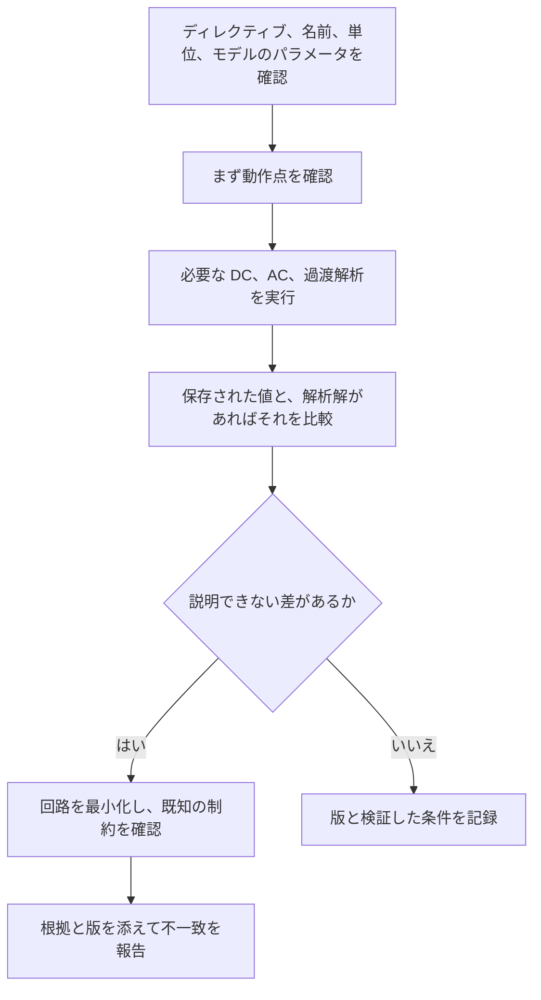

# ngspice からネットリストを移す

[English](PORTING.md) · [プロジェクトの README](../README.ja.md) · この文書は英語版を正とします。日本語版はその訳で、両者が食い違う場合は英語版に従います。

**2026-11-21 更新**、コミット `2826a81` に合わせています。この手引きは、ngspice 用に書いたネットリストを
kirimaspice で動かすためのものです。同じ点、コマンドの対応、ネットリストで確かめることを、ふつう出会う順に
書きます。違いはどれも、kirimaspice と ngspice-47 を動かして見つけたものです。詳しいことと測った値は
[KNOWN_ISSUES](../KNOWN_ISSUES.ja.md) に、書式は[リファレンスマニュアル](REFERENCE_MANUAL.ja.md)にあります。

## 目次

- [同じ点](#同じ点)
- [実行する](#実行する)
- [ネットリストを確かめる](#ネットリストを確かめる)
- [結果を比べる](#結果を比べる)

## 同じ点

SPICE の方言が分かれるところでは、kirimaspice は 5 つの規則で ngspice に従います。どれも ngspice-47 で
確かめました（[NETLIST_CONVENTIONS](spec/NETLIST_CONVENTIONS.ja.md)）。

1. 倍率は ngspice と同じで、大文字と小文字を問いません。`M` はミリ、`MEG` はメガ、`MIL` は 25.4×10⁻⁶、
   `A` はアトです。
2. AC 解析の入力になるのは、`AC` を書いた電源だけです。
3. `V`、`E`、`H` と電圧の形の `B` 電源の電流は、`+` 端子に流れ込む向きを正とします。電流を供給する電源は
   負になります。
4. 入れ子の `.DC` では、最初の電源が内側のループです。
5. `gnd` は、大文字と小文字を問わずグラウンドです。

モデルとサブ回路の名前は大文字と小文字を区別せず、`.MODEL` は、それを使うダイオード、バイポーラ
トランジスタ、MOSFET、MESFET の後に書いてもかまいません。
ngspice-47 は、kirimaspice が書く ASCII とバイナリの raw ファイルを読み込めます
（[リファレンスマニュアル](REFERENCE_MANUAL.ja.md#出力形式)）。

## 実行する

| ngspice では | kirimaspice では |
| --- | --- |
| `ngspice -b circuit.cir` | `build/kirimaspice circuit.cir` |
| `ngspice -b -r out.raw circuit.cir` | `build/kirimaspice circuit.cir --raw-out out.raw`、または `python3 tools/ngspice_shim.py -b -r out.raw circuit.cir` |
| `.control` のブロックの中の解析をその順で、そこの `noise`、`pz`、`sens` | `op`、`dc`、`tran`、`ac` はプログラムの順で、種類ごとに 1 回実行する。ほかは[ライブラリ](ARCHITECTURE.ja.md#ライブラリにあるほかの解析)で |
| `plot`、`meas`、`wrdata`（`print` は、その前の解析の `.PRINT` の表に信号を出す） | raw ファイルを [Python のツール](USER_MANUAL.ja.md#python-のツールを使う)で読む。AC の結果は必ず `<base>_ac.csv` にある |

プログラムはバッチでだけ動きます。表示するのは、動作点、過渡解析の後の `.PRINT TRAN` の信号、DC スイープの要約で、AC 解析では
何も表示しません。スイープの値は raw ファイルにあります。それぞれの解析が何を表示し、何を書くかは
[リファレンスマニュアル](REFERENCE_MANUAL.ja.md#プログラムが解析を選ぶ仕組み)にあります。

## ネットリストを確かめる

### 解析とディレクティブ

- [ ] **解析はドットのディレクティブで。** プログラムが実行するのは `.OP`、`.DC`、`.TRAN`、`.AC` と、
  過渡解析の後の `.FOUR`、そして `.control` のブロックの `op`、`dc`、`tran`、`ac` のコマンドで、順はプログラムのものです。
- [ ] **`.DC` は 1 つか 2 つの電源の値だけ。** 値の数がほかの `.DC` の行（2 つ目のスイープが欠ける、2 つ目の
  後にも値がある）はエラーです。ngspice-47 は余分な値を無視します。
- [ ] **ここでは何もしないディレクティブ：**

  | 状態 | ディレクティブ |
  | --- | --- |
  | 実行する | `.OP`、`.DC`、`.TRAN`、`.AC`、`.FOUR`、`.PRINT TRAN` |
  | 読むが使わない | `.SENS`、`.PZ`、`.DISTO`、`.MC`、`.WCASE`、`.OPTIMIZE`、`.PORT` |
  | 無視する | `.MEASURE`、`.TITLE`、`.END`（その後の行も読む） |

  2 行目と 3 行目のものは、`.END` を除いて、警告で名指しします。

- [ ] **`.TEMP`。** 値が 1 つなら、ngspice と同じく `.OPTIONS TEMP` です。値を並べると（ngspice-47 は
  これを受け付けません）、それぞれの値ですべての解析を実行し、SSF、WAV、AC の CSV のファイルの名前に
  その温度を付けます。
- [ ] **解析のないネットリスト。** ngspice は何もしません。kirimaspice は `.OP` と同じく動作点を計算し、
  電圧と電流を表示し、出力のファイルを書きます。

### 名前と数値

- [ ] **数の後ろには文字だけ。** ngspice-47 は `1k5` を 1k、`1.5.3k` を 1.5 と読みますが、ここではエラーです。

### 電源

- [ ] **波形の後には `DC` か `AC` だけ。** `PULSE`、`SIN`、`EXP`、`PWL`、`SFFM` は、ngspice-47 と同じく、
  省いた引数の既定値も含めて電圧源でも電流源でも使えます。波形の後に `DC` か `AC` 以外のものがあると
  エラーです。
- [ ] **`TR` か `TF` が 0 の `PULSE` は理想的な段差です。** 角ではその前の値を取り、角の後のステップから
  新しい値になるので、解析解どおりの段差の応答になります。ngspice-47 は 0 の `TR` や `TF` を `TSTEP` で
  上げるので、結果が `TSTEP` によって変わります（1 kΩ と 1 µF に `PULSE(0 1 0 0 0 1m 2m)` を加えると、
  1 ms で理想の段差の 0.6321 V に対して 0.6131 V）。両方を合わせたいときは、意図する立ち上がりを書いてください。
- [ ] **`B` 電源の式の `I(...)` が指せるのは、電圧源と、`E`、`H`、電圧の形の `B` 電源です。** ngspice は
  `I(R1)` のようにほかの素子の電流も読みます。0 V の電源を直列に入れて、その電流を読んでください
  （[KNOWN_ISSUES](../KNOWN_ISSUES.ja.md#ネットリストの入力)）。

### サブ回路とパラメータ

- [ ] **サブ回路のパラメータ。** 既定値は、ピンの後に `名前=値` で書きます。その前の `PARAMS:` はあってもなくてもかまいません。
  ngspice と同じく、サブ回路の本体からはグローバルの `.PARAM` の値が見え、`.SUBCKT` の中の `.PARAM` は
  そのサブ回路の中だけで効きます。
- [ ] **`.FUNC` は `.PARAM` の式の中だけで。** 素子の値には使えません。
- [ ] **`.IF` で使うグローバルパラメータ。** 同じ名前には最後のグローバル定義の値を使います。
  分岐の中や条件より後に書いた定義も対象です。評価する条件に未定義の名前があるとエラーになります。

### モデル

- [ ] **モデルが読むパラメータ。** ダイオードは `IS`、`N`、`CJO`、`VJ`、`M`、`RS`、`TT`、`BV`、`IBV` を読み、
  ほかのモデルもパラメータの一部しか読みません。カードと素子の行の残りの名前は、どのモデルも警告で名指し
  します。ただし、レベル 3 はカードの使わないいくつかの名前を警告なしに受け付けます
  （[リファレンスマニュアル](REFERENCE_MANUAL.ja.md#モデル)）。
- [ ] **MOSFET のカードそれぞれの `LEVEL`。** ここでのレベルは 1、3、8/49（BSIM3）、10（SiC）、
  11（GaN HEMT）、12（FinFET）、14/54（BSIM4）、20（VDMOS）、21（IGBT）です
  （[リファレンスマニュアル](REFERENCE_MANUAL.ja.md#モデル)）。ネットリストのそれぞれのカードが、その番号で
  同じデバイスを指しているかを確かめてください（ここでは ngspice のレベルの一覧と比べていません）。ほかの
  `LEVEL` は、ngspice と同じくエラーで、ngspice の MOS9 である `LEVEL=9` もエラーです
  （[KNOWN_ISSUES](../KNOWN_ISSUES.ja.md#デバイスモデル)）。
- [ ] **`S` と `Y` のパラメータは素子の行に。** `.MODEL` には SCR や TRIAC の型がありません。
- [ ] **`J` 素子に `RD` と `RS` はない。** JFET のカードの直列抵抗は、名前を挙げて警告し、使いません。
  ドレインとソースに抵抗を直列に入れてください。

### 過渡解析

- [ ] **時間刻み。** プログラムは `tstep`（`tmax` が短ければ `tmax`）の固定の刻みで進み、電源の角にも刻みを
  合わせます。打ち切り誤差による制御はありません。ngspice は刻みを自分で選ぶので、kirimaspice には、回路のいちばん速い変化に足りる
  小さな `tstep` を与えてください。
- [ ] **最初のステップ。** 台形則では、最初のステップは後退オイラー法です。
- [ ] **時間刻みのオプション。** `TRTOL`、`CHGTOL`、`LTE_*` のオプション、`ERROR_EST`、`MAXORD` は効きません。

## 結果を比べる

比較で確かめられるのは、その実行条件での結果です。次の順に進め、入力の違いと数値計算・モデルの不一致を
切り分けます。

同じネットリストを両方で実行し、ngspice の版（`ngspice -v`）を記録してください。表示された値は丸め方が
違うので、raw ファイルのノードの電圧で比べます。解析解があるなら、両方をそれと比べます。いくつかの回路で
kirimaspice がどれだけ近いかは、[例題](../examples/README.ja.md)にあります。2 つのシミュレータが食い違う
ときは、ネットリスト、両方の結果、版を付けて報告してください（[CONTRIBUTING](../CONTRIBUTING.ja.md)）。
このような比較に商用シミュレータは使いません（[FAQ](FAQ.ja.md#商用シミュレータと比べていますか)）。
