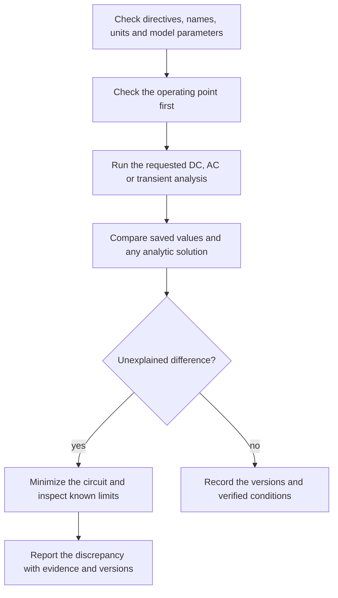

# Moving a netlist from ngspice

[日本語](PORTING.ja.md) · [Project README](../README.md) · This English text is the main version; the Japanese version follows it, and where they differ, this text holds.

**Updated 2026-11-15** for commit `eaf0629`. This guide is for running with
kirimaspice a netlist written for ngspice. It says what is the same, how
the commands map, and what to check in the netlist, in the order in which
it is usually met. Each difference was found by running kirimaspice and
ngspice-47; the details and measurements are in
[KNOWN_ISSUES](../KNOWN_ISSUES.md), and the syntax in the
[Reference Manual](REFERENCE_MANUAL.md).

## Contents

- [What is the same](#what-is-the-same)
- [Run it](#run-it)
- [Check the netlist](#check-the-netlist)
- [Compare the results](#compare-the-results)

## What is the same

Where SPICE dialects differ, kirimaspice follows ngspice in five rules,
each checked against ngspice-47
([NETLIST_CONVENTIONS](spec/NETLIST_CONVENTIONS.md)):

1. Scale factors are those of ngspice, in any case: `M` is milli, `MEG` is
   mega, `MIL` is 25.4×10⁻⁶ and `A` is atto.
2. Only sources written with `AC` are inputs of an AC analysis.
3. The current of `V`, `E`, `H` and voltage-form `B` sources is positive
   into the `+` terminal, so a supply that delivers current is negative.
4. In a nested `.DC`, the first source is the inner loop.
5. `gnd`, in any case, is ground.

Model and subcircuit names are not case-sensitive, and a `.MODEL` may stand
after the diodes, bipolar transistors, MOSFETs and MESFETs that use it.
ngspice-47 loads the ASCII and binary raw files that kirimaspice writes
([Reference Manual](REFERENCE_MANUAL.md#output-formats)).

## Run it

| With ngspice | With kirimaspice |
| --- | --- |
| `ngspice -b circuit.cir` | `build/kirimaspice circuit.cir` |
| `ngspice -b -r out.raw circuit.cir` | `build/kirimaspice circuit.cir --raw-out out.raw`, or `python3 tools/ngspice_shim.py -b -r out.raw circuit.cir` |
| analyses in a `.control` block (`op`, `dc`, `tran`, `ac`, `run`) | dot directives outside `.control`: `.op`, `.dc`, `.tran`, `.ac` |
| `print`, `plot`, `meas`, `wrdata` | the raw file, read with the [Python tools](USER_MANUAL.md#use-the-python-tools); the AC result is always in `<base>_ac.csv` |

The program runs in batch only. It prints the operating point and the
transient table, a summary of a DC sweep, and nothing for an AC analysis;
the values of a sweep are in the raw file. What each analysis prints and
writes is in the [Reference Manual](REFERENCE_MANUAL.md#how-the-program-chooses-analyses).

## Check the netlist

### Analyses and directives

- [ ] **Analyses as dot directives.** The program runs `.OP`, `.DC`,
  `.TRAN` and `.AC`, and `.FOUR` after a transient. Analyses inside
  `.control` are not run as in ngspice.
- [ ] **`.OP` with `.DC`.** A `.DC` sweep replaces the operating point,
  also when `.OP` is there; ngspice runs both.
- [ ] **Directives that do nothing here:**

  | Status | Directives |
  | --- | --- |
  | run | `.OP`, `.DC`, `.TRAN`, `.AC`, `.FOUR` |
  | read, not used | `.SENS`, `.TF`, `.PZ`, `.DISTO`, `.STEP`, `.MC`, `.WCASE`, `.OPTIMIZE`, `.PORT`, `.PRINT`, `.SAVE` |
  | ignored | `.NOISE`, `.MEASURE`, `.TITLE`, `.END` (lines after it are read) |

- [ ] **`.TEMP`.** One value is `.OPTIONS TEMP`, as in ngspice. A list of
  values, which ngspice-47 rejects, runs every analysis at each value and
  names the SSF, WAV and AC CSV files after the temperature.
- [ ] **A netlist without analyses.** ngspice does nothing; kirimaspice
  computes the operating point as for `.OP`, prints the voltages and
  currents and writes the output files.

### Names and numbers

- [ ] **The case of node and element names.** They are case-sensitive
  here (`OUT` and `out` are two nodes); ngspice folds case.
- [ ] **No scale factors inside braces or in `.OPTIONS` values.** Write
  `{0.001}`, not `{1m}`.
- [ ] **`.IC` and `.NODESET` with an upper-case `V(`.** `v(out)=1` is
  skipped with a warning.

### Sources

- [ ] **All waveform arguments written out.** `PULSE`, `SIN`, `EXP`, `PWL`
  and `SFFM` work on voltage and current sources as in ngspice, but the
  arguments that ngspice defaults from `.TRAN` (`TR`, `TF`, `PW`, `PER` of
  `PULSE`, `FREQ` of `SIN`, the `EXP` times, `FC` of `SFFM`) must be given.
  Anything after the waveform other than `DC` or `AC` is an error.
- [ ] **`B` expressions cannot use `I(...)` or `.PARAM` names**
  ([KNOWN_ISSUES](../KNOWN_ISSUES.md#netlist-input)).

### Subcircuits and parameters

- [ ] **Parameters of a subcircuit.** Write defaults as `NAME=value` after
  the pins; `PARAMS:` is not accepted. As in ngspice, a subcircuit body
  sees the global `.PARAM` values, and a `.PARAM` inside a `.SUBCKT` is
  local to it.
- [ ] **`.FUNC` only in `.PARAM` expressions**, not in element values.
- [ ] **`.IF` conditions without `.PARAM` names.** `.IF` cannot read them,
  and keeps every branch when it cannot evaluate the condition.
- [ ] **One `.PARAM` per name.** A second one is ignored with a warning.

### Models

- [ ] **The parameters the models read.** The diode reads only `IS` and
  `N`, and the other models read part of their parameters; some levels
  warn about the rest, others ignore it without a message
  ([Reference Manual](REFERENCE_MANUAL.md#models)).
- [ ] **The `LEVEL` of each MOSFET card.** The levels here are 1, 3,
  8/49 (BSIM3), 9 (BSIM1), 10 (SiC), 11 (GaN HEMT), 12 (FinFET), 14/54
  (BSIM4), 20 (VDMOS) and 21 (IGBT)
  ([Reference Manual](REFERENCE_MANUAL.md#models)). Check that each card
  of the netlist means the same device by its number (not compared with
  ngspice's list of levels here). Any other `LEVEL` is an error, as in
  ngspice.
- [ ] **`S` and `Y` parameters on the element line.** `.MODEL` has no
  SCR or TRIAC type.
- [ ] **No `J` elements.** The library has a JFET, but the parser has no
  `J` element.

### Transient

- [ ] **The time step.** The program steps by `tstep`, fixed: `tmax` has
  no effect and there is no control by the truncation error. ngspice
  chooses its steps, so give kirimaspice a `tstep` small enough for the
  fastest change of the circuit.
- [ ] **The first step.** With the trapezoidal rule, the first step is a
  backward Euler step.
- [ ] **Options of the time step.** `TRTOL`, `CHGTOL`, the `LTE_*`
  options, `ERROR_EST` and `MAXORD` have no effect.

## Compare the results

A comparison checks the conditions of that run. Use the following order
to distinguish input differences from a numerical or model discrepancy.

Run the same netlist with both, and record the ngspice version
(`ngspice -v`). Compare node voltages from the raw files rather than
printed values, which are rounded differently. Where an analytic solution
exists, compare both with it: the [examples](../examples/README.md) show
how close kirimaspice is for a few circuits. When the two simulators
disagree, report it with the netlist, both results and the versions
([CONTRIBUTING](../CONTRIBUTING.md)). Commercial simulators are not used for
such comparisons ([FAQ](FAQ.md#do-you-check-against-commercial-simulators)).
