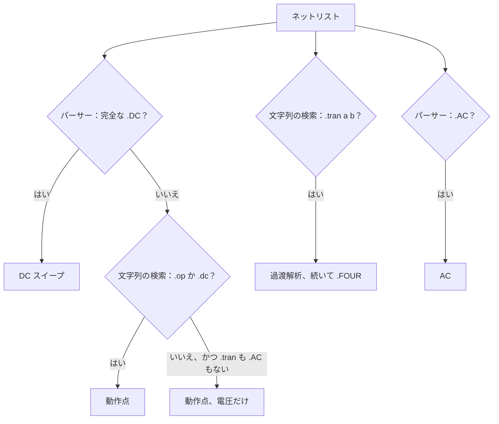

# kirimaspice リファレンスマニュアル

[English](REFERENCE_MANUAL.md) · この文書は英語版を正とします。日本語版はその訳で、両者が食い違う場合は英語版に従います。

プログラム `kirimaspice` のコマンドライン、ネットリストの言語、出力ファイルのリファレンスです。
**2026-11-14** にコミット `91af284` のソースから書き、**2026-11-15** にコミット `db0fef6` で
もう一度見直し、同じ日にコミット `eaf0629` までの修正に合わせて更新しました。書いた振る舞いは、
それらのビルド（macOS 27.2、arm64、GCC 16.2.0、`kirimaspice v0.0.0`）を実行して確かめました。
コードで読んだだけで実行していない項目には、そう書いてあります。最初の実行の手引きは
[ユーザーマニュアル](USER_MANUAL.ja.md)に、間違っていることや足りないことは
[KNOWN_ISSUES.md](../KNOWN_ISSUES.ja.md) にあります。

## 目次

- [コマンドライン](#コマンドライン)
- [環境変数](#環境変数)
- [終了コード](#終了コード)
- [ネットリストの書式](#ネットリストの書式)
- [素子](#素子)
- [モデル](#モデル)
- [ディレクティブ](#ディレクティブ)
- [オプション](#オプション)
- [出力形式](#出力形式)
- [ビルドのオプション](#ビルドのオプション)
- [ソースファイル](#ソースファイル)

## コマンドライン

```text
kirimaspice <ネットリスト> [オプション]
```

ネットリストは最初の引数でなければなりません。値を取るオプションは `--opt 値` と `--opt=値` の
どちらも受け付けます。ただし、`-o` は `-o 値` だけ、ソルバーのオプションは `--opt=値` だけです。
プログラムが知らないオプションは、何も言わずに無視します。
出力のオプションがファイルを書くのは、一部の実行だけです。どの実行で書くかは、
[プログラムが解析を選ぶ仕組み](#プログラムが解析を選ぶ仕組み)の表にあります。

| オプション | 効果 |
| --- | --- |
| `-h`、`--help` | 使い方を表示し、0 で終わる |
| `-o <ファイル>` | 動作点または過渡解析の結果を `<ファイル>` に SSF で書き（両方を実行したときは、ファイルの動作点を過渡解析が置き換える）、AC の CSV の名前を `<ファイル>` から決める |
| `--raw-out <ファイル>` | 動作点、DC スイープ、過渡解析の結果を ASCII の SPICE3 raw ファイルに書く |
| `--raw-binary-out <ファイル>` | 同じものをバイナリの SPICE3 raw ファイルに書く |
| `--wav-out <ファイル>` | 過渡解析の結果を WAV ファイルに書く |
| `--wav-sample-rate <Hz>` | WAV のサンプリング周波数（既定 44100） |
| `--wav-bits <n>` | WAV のサンプルの大きさ：8、16、24、32（既定 16） |
| `--solver-backend=<名前>` | 線形ソルバー：`KLU`（既定）または `SUPERLU_DIST` |
| `--solver-fallback-order=<a>,<b>` | 指定したバックエンドがビルドされていないときに試す順 |
| `--strict-backend` | 切り替えずにエラーで止める |
| `--superlu-dist-topology=<t>`、`--superlu-dist-grid=<g>` | SuperLU_DIST への指示 |

SuperLU_DIST は既定ではビルドされず、そのバックエンドは仮置きです。指定すると
`Falling back to klu ...` をログに出し、`--strict-backend` を付けると終了コード 1 で止まります。

## 環境変数

| 変数 | 効果 |
| --- | --- |
| `KIRIMASPICE_SOLVER_BACKEND` | `--solver-backend` と同じバックエンドの指定。コマンドラインが優先 |
| `KIRIMASPICE_SOLVER_FALLBACK_ORDER` | 上の変数のための、カンマ区切りの切り替えの順（既定 `klu`） |
| `KIRIMASPICE_SOLVER_STRICT` | `1` にすると、上の変数で指定したバックエンドがないときにエラー |
| `KIRIMASPICE_TLINE_LOSSY_IIR` | `1` にすると、`O` 線路で 2 次の IIR の損失フィルタを使う（コードで読んだだけで、実行していない） |
| `KIRIMASPICE_DEBUG_DUMP` | 開発用：設定すると（値は何でもよい）、DC の各求解の 2 回目のニュートン反復の MNA の系を、カレントディレクトリの `debug_coo.txt`、`debug_csc.txt`、`debug_b.txt`、`debug_x.txt` に書く。求解のたびに前のものを上書きする |
| `KIRIMASPICE_BSIM1_DEBUG` | 開発用：BSIM1 のデバイスのデバッグログ（値を名前とするデバイスだけに絞れる） |

## 終了コード

| コード | 意味 |
| --- | --- |
| 0 | 指定した解析が終わった、または `--help` |
| 1 | ネットリストがない、ファイルを読めない、解釈のエラー、解析の失敗、オプションの値が受け付けられない、strict でバックエンドがない |
| そのほか | 捕まえられないエラー。例：数でない `--wav-sample-rate`（macOS では 134） |

解析を指定しないネットリストは、動作点が収束しなくても 0 を返します。

## ネットリストの書式

### 行

- ネットリストは次の順に処理します。`.INCLUDE` のファイルを入れる、`.LIB` のセクションを入れる、
  `+` の継続行を前の行につなぎ、空の行を除く、`.IF` のブロックを決める、`.CONTROL` のブロックを
  取り出す。残った行を 1 行ずつ読みます。

  ```mermaid
  flowchart LR
    F[ネットリストのファイル] --> I[".INCLUDE / .INC：ファイルを入れる"]
    I --> L[".LIB：セクションを入れる"]
    L --> C["+ の行をつなぎ、空の行を除く"]
    C --> IF[".IF / .ELIF / .ELSE：分岐を 1 つ残す"]
    IF --> CT[".CONTROL：取り出す"]
    CT --> T["最初の行：タイトル"]
    T --> R["残りの行を 1 行ずつ"]
    R --> D["モデルかサブ回路が後にある素子：最後にもう一度読む"]
  ```

- インクルードするファイルは、それをインクルードするファイルのディレクトリから探します。セクションの
  ない `.LIB <ファイル>` はファイル全体を入れます。`.LIB` のセクションの中の `.INCLUDE` は、何も言わずに
  除きます。
- 残った最初の行がタイトルです。
- 最初の空白でない文字が `*` の行はコメントです。`;` から行末までもコメントです。ほかのコメントの
  文字はありません。
- `+` で始まる行は、前の行の続きです。間にコメントの行や空の行があっても、前の行は終わりません。前の行の
  `;` のコメントは、その行の終わりまでです。
- `.` で始まる行はディレクティブで、それ以外の行は素子です。素子は最初の文字（大文字でも小文字でも）で
  決まります。
- `.END` の後の行も同じように読みます。知らないディレクティブは何も言わずに無視します。知らない
  素子の文字には `Unknown device type` の警告を出します。
- メッセージの行番号は、これらの手順の後に残った行を数えたもので、ファイルの行ではありません。
  `.INCLUDE`、`.LIB`、`.IF` そのもののエラーは、その手順の時点のテキストでの行番号を示します。

### 名前

- ノードと素子の名前は、大文字と小文字を区別します。モデルとサブサーキットの名前は区別しません。
- `0` がグラウンドです。トップレベルでもサブサーキットの中でも、大文字小文字を問わず `gnd` という
  名前のノードもグラウンドです。
- サブサーキットのインスタンスの中のノードは `<インスタンス>.<ノード>` という名前になります
  （例：`X1.n1`）。

### 数

数は、10 進または指数表記の数に、ngspice と同じく、大文字小文字を問わない倍率を付けたものです（倍率は
省けます）。数の後ろの倍率でない文字と、倍率の後ろの文字は無視します（`10mA` は 0.01、`10MHz` は 0.01）。

| 倍率 | 値 |
| --- | --- |
| `T` | 10¹² |
| `G` | 10⁹ |
| `MEG` | 10⁶ |
| `K` | 10³ |
| `MIL` | 25.4×10⁻⁶ |
| `M` | 10⁻³ |
| `U` | 10⁻⁶ |
| `N` | 10⁻⁹ |
| `P` | 10⁻¹² |
| `F` | 10⁻¹⁵ |
| `A` | 10⁻¹⁸ |

`M` は大文字でも小文字でもミリで、メガは `MEG` です。

### 式

波かっこ `{...}` で囲んだ値は ExprTk で評価します。それまでに定義したパラメーター、定数 `pi` と `e`、
ExprTk の組み込み関数、そして `.PARAM` の中だけは `.FUNC` で定義した関数を使えます。波かっこの中では
倍率の接尾辞を受け付けません（`{1m}` はエラー）。波かっこのまとまりは、空白を含んでいても 1 つの
字句で、`=` の直後のものは同じ字句に続きます。そのため `IS={ISAT}` も `IS={a * 2}` も、`.MODEL` の
行でも、それぞれ 1 つのパラメーターです。電源の波形の引数では、波かっこの中に空白を入れられます。

## 素子

`<n+>` と `<n->` はノード、`<値>` は数か波かっこの式です。`名前=値` の形のパラメーターは順を問わず、
名前は大文字と小文字を区別しません。どの行でも、`=` の両側に空白を入れられます（`W = 10u`、
`.param rv ={2*1000}`）。素子の名前は、`X` のインスタンスも含め、1 度だけ使えます。書いたとおりに
同じ名前の 2 つ目の素子はエラーです。

| 素子 | 書式 | 補足 |
| --- | --- | --- |
| 抵抗 | `R<名前> <n+> <n-> <値>` | 後ろの字句は無視 |
| キャパシタ | `C<名前> <n+> <n-> <値>` | 後ろの字句（`IC=` など）は無視 |
| インダクタ | `L<名前> <n+> <n-> <値>` | 後ろの字句は無視 |
| 相互インダクタンス | `K<名前> <L1> <L2> <k>` | `<L1>`、`<L2>` はインダクタの名前。0 から 1 の外の `<k>` はエラー |
| 電圧源 | `V<名前> <n+> <n-> [[DC] <値>] [AC [<振幅> [<位相>]]] [<波形>]` | 下を参照 |
| 電流源 | `I<名前> <n+> <n-> [[DC] <値>] [AC [<振幅> [<位相>]]] [<波形>]` | 下を参照 |
| VCVS | `E<名前> <n+> <n-> <nc+> <nc-> <利得>` |
| CCCS | `F<名前> <n+> <n-> <V制御> <利得>` | `<V制御>` は `V` 電源に限る |
| VCCS | `G<名前> <n+> <n-> <nc+> <nc-> <gm>` |
| CCVS | `H<名前> <n+> <n-> <V制御> <r>` | `<V制御>` は `V` 電源に限る |
| ビヘイビア電源 | `B<名前> <n+> <n-> I=<式>` または `V=<式>` | 下を参照 |
| ダイオード | `D<名前> <アノード> <カソード> [<モデル>] [IS=<v>] [N=<v>]` |
| バイポーラトランジスタ | `Q<名前> <c> <b> <e> <NPN\|PNP\|モデル> [パラメーター]` |
| MOSFET と関連するデバイス | `M<名前> <d> <g> <s> [<b>] <NMOS\|PMOS\|モデル> [パラメーター]` | モデルの `LEVEL` でデバイスを選ぶ |
| MESFET | `Z<名前> <d> <g> <s> [<NMF\|PMF\|モデル>] [パラメーター]` |
| SCR | `S<名前> <アノード> <カソード> <ゲート> [パラメーター]` |
| TRIAC | `Y<名前> <mt2> <mt1> <ゲート> [パラメーター]` |
| 無損失線路 | `T<名前> <a+> <a-> <b+> <b-> Z0=<v> TD=<v>` | どちらも必須で正。`Z0` の代わりに `ZO` も可 |
| 有損失線路 | `O<名前> <a+> <a-> <b+> <b-> R=<v> L=<v> C=<v> G=<v> TD=<v>` | 単位長さあたり。`TD`、`L`、`C` は正。長さは `TD`/√(`L`·`C`)。DC と AC は線路の正確な 2 ポートを、過渡解析は近似を使う（[既知の問題](../KNOWN_ISSUES.ja.md#デバイスモデル)） |
| サブサーキットのインスタンス | `X<名前> <ノード...> <サブサーキット> [名前=<v> ...]` |

素子は、サブサーキットの中でもトップレベルと同じ意味です。本体の行は同じ素子のパーサーが読み、素子の
名前、ノード、素子が参照するほかの素子の名前（`F` と `H` の制御、`K` のインダクタ、`B` の `V(...)` の
ノード）をインスタンスの中の名前 `X1.R1`、`X1.n1` に変えます。

### 電源

- DC の値、AC の入力、波形は、どの順に書いても、どれを省いても構いません（`V1 a b` だけのものは
  エラーです）。値の前の `DC` は省けます。`V1 a b DC` と `V1 a b AC 1` の DC の値は 0 V です。行に
  それ以外のものがあるとエラーです。
- SPICE（と ngspice-47）と同じく、動作点と `.DC` は DC の値を取り、行に DC の値がなければ時刻 0 での
  波形の値を取ります。過渡解析は時刻 0 の波形から始め、波形に従います。AC は AC の入力を取ります。
  `.DC` は、波形のある電源でも DC の値を掃引します。
- 波形は次のとおりで、電圧源でも電流源でも同じです。

  | 波形 | 引数 | 値 |
  | --- | --- | --- |
  | `PULSE` | `V1 V2 TD TR TF PW PER`、7 つすべて | `TD` より前は `V1`、その後に立ち上がり、`PW` の間 `V2`、立ち下がりで、`PER` ごとに繰り返す |
  | `SIN` | `VO VA FREQ [TD [THETA [PHASE]]]` | `TD` より前は `VO + VA sin(PHASE)`、その後は `VO + VA e^(−THETA (t − TD)) sin(2π FREQ (t − TD) + PHASE)`。`PHASE` は度 |
  | `EXP` | `V1 V2 TD1 TAU1 TD2 TAU2`、6 つすべて | `TD1` より前は `V1`、その後は `V1 + (V2 − V1)(1 − e^(−(t − TD1)/TAU1))`。`TD2` からは、それに `(V1 − V2)(1 − e^(−(t − TD2)/TAU2))` を加える |
  | `PWL` | `T1 V1 T2 V2 ...` | 点の間は直線。`T1` より前は `V1`、最後の点の後は最後の値。時刻は減ってはならない |
  | `SFFM` | `VO VA FC [MDI FS]` | `VO + VA sin(2π FC t + MDI sin(2π FS t))` |

  引数は、かっこで囲むか、かっこなしでキーワードの後に続け、空白かカンマで区切ります。どの引数も
  波かっこの式にできます。SPICE が `.TRAN` から決める既定値（たとえば `PULSE` の `TR` と `TF`、
  `SIN` の `FREQ`）は取りません。それらの引数は書く必要があり、引数の数が違うとエラーです。
  ngspice-47 は、DC の値のない `SFFM` の電源を動作点で 0 V としますが、kirimaspice は `VO`（時刻 0
  での値）を取ります。
- AC 解析の入力になるのは、行に `AC` がある電源だけです。振幅を省いた `AC` は振幅 1 で、位相（度）の
  既定値は 0 です。`AC` のない電源は振幅 0 です。サブサーキットの中でも同じです。
- 電圧源と、`E`、`H`、電圧の形の `B` 電源の電流は、表示でもファイルでも、`+` 端子から電源の中を通る
  向きを正とします。そのため、電流を供給している電源の電流は負です。`F` と `H` は、この電流を制御に
  使います。
- `F` と `H` が名前で指す電圧源は、ネットリストの後のほうにあっても構いません。

### ビヘイビア電源

`B` は、`V=` か `I=` で始まる最初の字句を使います。式は波かっこで囲むか（`V={2*V(in)}`）、波かっこが
なければ、ngspice と同じく、空白も含めて行の終わりまでです（`V=V(a) + 1`）。式では `V(<ノード>)` または `v(<ノード>)`（ノードの名前は素子の行と同じで、`V(A)` と `V(a)` は別の
ノード、`V(n.1)` も 1 つのノードです）、`TIME`、`pi`（`e` は
不可）、ExprTk の組み込み関数を使えます。`.PARAM` の名前と `I(<電源>)` は使えません。`TIME` は
過渡解析の時刻で、動作点（過渡解析の始めの動作点も含む）では 0 です。
解釈できない式は、`B` の行のエラーになります。
どちらの形も動作点、過渡解析、AC 解析で動きます。AC 解析では、`B` 電源は動作点で線形化したもので、
それ自体の AC の入力はありません。ニュートン法と AC 解析は、式の微分を中心差分で取ります。

### 単純なデバイスのパラメーター

パーサーが読むパラメーターです。素子の行や `.MODEL` のカードにあるほかのパラメーターは、何も言わずに
無視します。インスタンスのパラメーターはモデルのものを上書きします。

| 素子 | パラメーター（既定値） |
| --- | --- |
| `D` | `IS`（1e-14 A）、`N`（1） |
| `Q` | `IS`（1e-14 A）、`BF`（100）、モデルの `NF` またはインスタンスの `N`（1）、`ISE`（0）、`NE`（1.5）、`ISC`（0）、`NC`（2）、ノイズの `KF`（0）、`AF`（1）、`FF`（1） |
| `M`、レベル 1 | `KP`（2e-5 A/V²）、`W`（10 µm）、`L`（1 µm）、カードの `VTO` または `VTH` と素子の行の `VTH`（NMOS 0.7 V、PMOS −0.7 V）、ノイズの `KF`（0）、`AF`（1）、`EF`（1）、`GAMMA`（0.667） |
| `Z` | `LEVEL`/`MODEL`（式の選択）、`BETA`（0.1）、`VTO`（−2 V。素子の行が `PMF` なら +2 V）、`LAMBDA`（0.05）、`ALPHA`（2）、`B`（0.3）、`VP`（3 V）、`CGS`（1 pF）、`CGD`（0.5 pF）、`CDS`（0.1 pF）、`KF`、`AF`、`EF`、`TNOM`（27 °C） |
| `S` | `VBF`（400 V）、`IGT`（20 mA）、`IH`（10 mA）、`IL`（30 mA）、`VGT`（1 V）、`RON`（0.1 Ω）、`VTM`（1.5 V）、`DV_DT`（10）、`TNOM`（27 °C） |
| `Y` | `VBO`（400 V）、`IGT`（20 mA）、`IH`（10 mA）、`VGT`（1 V）、`RON`（0.1 Ω）、`VTM`（1.5 V）、`DV_DT` または `DVDT`（10）、`TNOM`（27 °C） |

- レベル 1 の MOSFET は、式にバルク端子がなく、チャネル長変調もキャパシタンスもありません。その
  `GAMMA` はチャネルの熱雑音の係数で、SPICE の基板効果の係数ではありません。
- `S` と `Y` のパラメーターは素子の行にだけ書けます。`.MODEL` に SCR と TRIAC の型はなく、それらの
  行にあるモデルの名前で、それより前に定義されていないものは、何も言わずに無視します。
- 3 端子の `M` では、バルクをソースにつなぎます。パーサーは、6 番目の字句が `NMOS` か `PMOS` で
  始まるか、ネットリストにあるモデルの名前であれば、その行を 4 端子とみなします。

## モデル

```text
.MODEL <名前> <型>(<パラメーター>=<値> ...)
.MODEL <名前> <型> <パラメーター>=<値> ...
```

- `<型>` は `NPN`、`PNP`、`D`（または `DIODE`）、`NMOS`、`PMOS`、`NMF`、`PMF` で、大文字小文字を
  問いません。ほかの型はエラーです。
- パラメーター名は大文字と小文字を区別しません。空白を入れた `名前 = 値` も受け付け、値には
  波かっこの式も使えます。
- カードと素子の行の `TNOM` は、どのデバイスでも SPICE と同じく °C です。`.TEMP` と `.OPTIONS TEMP`
  も °C です。`TNOM` の既定値は 27 °C です。
- モデルの名前は、大文字と小文字を区別せずに比べます。前の `.MODEL` と大文字小文字だけが違う名前の
  `.MODEL` は、前のものを置き換えます。
- `.MODEL` の行はネットリスト全体に効きます。`D`、`Q`、`M`、`Z` の素子は、モデルより前にあっても
  構いません。どこにも定義されていないモデルを使う素子はエラーで、その素子の行を示します
  （`Undefined diode model`、`Undefined BJT model`、`Undefined MESFET model`、`Undefined MOSFET model`）。

`NMOS` と `PMOS` では、`LEVEL` でデバイスを選びます。

| `LEVEL` | デバイス | カードの知らないパラメーター | 素子の行のパラメーター |
| --- | --- | --- | --- |
| 1（既定） | レベル 1（2 乗則） | 何も言わずに無視 | `KP`、`W`、`L`、`VTH`、`KF`、`AF`、`EF`、`GAMMA` |
| 3 | SPICE のレベル 3 | 警告 | `W`、`L` |
| 9 | BSIM1。簡略化したもの（[既知の問題](../KNOWN_ISSUES.ja.md#デバイスモデル)） | 警告 | `W`、`L` |
| 8、49 | BSIM3。簡略化したもの（[既知の問題](../KNOWN_ISSUES.ja.md#デバイスモデル)） | 警告 | `W`、`L` |
| 14、54 | BSIM4（`VERSION` が 4.83 でないモデルカードには警告を出す） | 何も言わずに無視 | `W`（`NF` 本のフィンガー全体の幅）、`L`、`NF`、`M`、`AS`、`AD`、`PS`、`PD`、`NRD`、`NRS`、`MULT_I`、`MULT_Q`、`MULT_FN` |
| 10 | SiC MOSFET | 警告 | すべて、名前で |
| 11 | GaN HEMT | 警告 | すべて、名前で |
| 12 | FinFET | 警告 | `L` だけ（ほかは何も言わずに無視） |
| 20 | VDMOS | 警告 | すべて、名前で |
| 21 | IGBT（`M` の端子はコレクタ、ゲート、エミッタ） | 警告 | すべて、名前で |

ほかの `LEVEL` は、ngspice-47 と同じく、`.MODEL` の行のエラーです。素子の行の `AD`、`AS`、`PD`、`PS`、
`NRD`、`NRS` は、何も言わずに無視します（コードで読んだもの）。

レベル 3、9、8/49、14/54 のパラメーター名は、それぞれの Berkeley のモデルのマニュアルに従います。
レベル 3 は SPICE のレベル 3 の式を、TOX、NSUB、NSS、TPG、XJ、LD、WD、VTO、PHI、GAMMA、UO、KP、THETA、
VMAX、ETA、KAPPA、DELTA、NFS で計算します。カードにない PHI、GAMMA、VTO は NSUB（と TPG、NSS）から
求めます。LAMBDA、RS、RD、CJ、CJSW、MJSW は、レベル 3 のカードにあっても警告なしに受け付け、使いません。
パラメーターの一覧は `src/parser/netlist_parser.cpp` の `parse_mosfet_device` に、BSIM4 では
`src/devices/mosfet_bsim4_params.cpp` の `bsim4_params_from_model` にあります。レベル 10、11、12、20、21 は、
デバイス自身の（その極性の）既定値から始め、カードの、次に素子の行のパラメーターを名前で受け取ります。

### FinFET（`LEVEL=12`）

FinFET は、kirimaspice 独自の簡略化した二乗則のモデルです（`src/devices/finfet.cpp`）。BSIM-CMG
ではありません。端子はドレイン、ゲート、ソースで、`M` の行のバルクのノードは受け付けますが使い
ません。`.MODEL` のカードのパラメーターはすべてデバイスに渡し、FinFET にないパラメーターや範囲外の
値は、警告を出して無視します。素子の行のパラメーターは `L` だけを読み、それはカードより優先します。

| パラメーター | 意味 | NMOS の既定値 | PMOS の既定値 |
| --- | --- | --- | --- |
| `NFIN` | フィンの数 | 1 | 1 |
| `HFIN` | フィンの高さ [m] | 30e-9 | 30e-9 |
| `TFIN` | フィンの厚さ [m]。読みますが、電流には使いません | 7e-9 | 7e-9 |
| `L` | ゲート長 [m] | 1e-6 | 1e-6 |
| `VTH`、`VTH0` または `VTO` | 符号つきのしきい値 [V] | 0.4 | −0.4 |
| `U0` | 低電界の移動度 [m²/Vs] | 0.03 | 0.025 |
| `VSAT` | 飽和速度 [m/s]。読みますが、電流には使いません | 1e5 | 8e4 |
| `SS` | サブスレッショルドスイング [V/桁] | 0.07 | 0.075 |
| `DIBL` | V<sub>DS</sub> 1 V あたりのしきい値の低下 [V/V] | 0.05 | 0.06 |
| `TOX` | ゲート酸化膜の厚さ [m] | 1e-9 | 1e-9 |
| `CGS`、`CGD` | ゲート・ソース間とゲート・ドレイン間の容量 [F] | 1e-15、1e-16 | 1e-15、1e-16 |
| `KF`、`AF` | フリッカーノイズの係数と指数 | 0、1 | 0、1 |
| `KT1` | 符号つきのしきい値の温度係数 [V/K] | −1e-3 | 1e-3 |
| `TNOM` | 公称温度 [°C] | 27 | 27 |

NMOS のドレインからソースへの電流を V<sub>GS</sub> と V<sub>DS</sub> で書きます。PMOS は同じ式を
V<sub>SG</sub> と V<sub>SD</sub> で使い、電流はソースからドレインへ流れます。

- W<sub>eff</sub> = `NFIN`·`HFIN`、C<sub>ox</sub> = 3.9 ε<sub>0</sub>/`TOX`、
  β = `U0`·(`TNOM`/T)<sup>1.5</sup>·C<sub>ox</sub>·W<sub>eff</sub>/`L`。
- V<sub>th</sub>(T) = `VTH` + `KT1`·(T − `TNOM`)。PMOS ではその絶対値を使います。
  V<sub>DS</sub> > 0 のとき V<sub>th,eff</sub> = V<sub>th</sub>(T) − `DIBL`·V<sub>DS</sub>。
- しきい値以上では、V<sub>ov</sub> = V<sub>GS</sub> − V<sub>th,eff</sub> として、V<sub>DS</sub> <
  V<sub>ov</sub> なら β (V<sub>ov</sub> V<sub>DS</sub> − V<sub>DS</sub><sup>2</sup>/2)、それ以上なら
  β V<sub>ov</sub><sup>2</sup>/2 です。
- しきい値より下では β V<sub>t</sub><sup>2</sup> exp(V<sub>ov</sub> / (n V<sub>t</sub>))
  (1 − exp(−V<sub>DS</sub>/V<sub>t</sub>)) で、n = `SS`/(V<sub>t</sub> ln 10) です。ゲート電圧が
  `SS` 変わるごとに、電流は 1 桁変わります。
- ドレインとソースの間に 10<sup>−12</sup> S があります。`CGS` と `CGD` は一定で、過渡解析では
  後退オイラーで積分します。ノイズ源は 4kT·(2/3)·g<sub>m</sub> と
  `KF`·|I<sub>D</sub>|<sup>`AF`</sup>/f です。

このモデルが含まないものは [KNOWN_ISSUES](../KNOWN_ISSUES.ja.md#デバイスモデル) にあります。

## ディレクティブ

「使う」はプログラムがそのディレクティブに従って動くこと、「読むだけ」はパーサーが記録するものの
プログラムは使わないこと（ライブラリは使える）を表します。

| ディレクティブ | 書式 | 状態 |
| --- | --- | --- |
| `.OP` | `.OP` | 使う：動作点（文字列の検索で見つける。[下](#プログラムが解析を選ぶ仕組み)を参照） |
| `.DC` | `.DC <電源> <開始> <終了> <刻み> [<電源2> <開始2> <終了2> <刻み2>]` | 使う。`<電源>` は電圧源か電流源で、`<電源2>` の値ごとに掃引する。刻み 0 はエラー |
| `.TRAN` | `.TRAN <tstep> <tstop> [<tstart> [<tmax>]] [UIC]` | 使う。プログラムは `tstep` で刻み、`tmax` は読むが効かない。SPICE と同じく、シミュレーションは 0 から行い、`tstart` 以降の点を残す。`tstart` ちょうどにも点を置く |
| `.AC` | `.AC DEC\|OCT\|LIN <n> <fstart> <fstop>` | 使う。`DEC`、`OCT`：round(`<n>` × デケード数またはオクターブ数) + 1 点を、`<fstart>` から `<fstop>` まで対数で等間隔に、両端を含めて取る（`.AC DEC 3 10 50` は 10、22.36、50 Hz。ngspice-47 では 10、21.54、46.42 Hz）。`LIN`：全部で `<n>` 点。`<n>` は 1 以上の整数で、それ以外はエラー |
| `.TEMP` | `.TEMP <t1> [<t2> ...]`（°C） | 使う。値が 1 つなら `.OPTIONS TEMP=<t1>` と同じ（値を 1 つしか取らない ngspice-47 と同じ）。複数なら、値ごとにすべての解析を実行する（[下](#プログラムが解析を選ぶ仕組み)を参照） |
| `.OPTIONS`、`.OPTION` | `.OPTIONS <名前>=<値> ...` | 使う。[オプション](#オプション)を参照 |
| `.IC` | `.IC V(<ノード>)=<値> ...` | 過渡解析が使う。`UIC` があればこの値から始め、なければ動作点でノードをこの値に固定する。`V` は大文字 |
| `.NODESET` | `.NODESET V(<ノード>)=<値> ...` | 初期値として使う。`V` は大文字 |
| `.PARAM` | `.PARAM <名前>=<値> ...` | 使う。同じ名前は最初の定義が残る |
| `.FUNC` | `.FUNC <名前>(<a>[,<b>[,<c>]]) {<式>}` | `.PARAM` の式の中でだけ使う。引数は 3 つまで |
| `.MODEL` | [モデル](#モデル)を参照 | 使う |
| `.SUBCKT` / `.ENDS` | `.SUBCKT <名前> <ピン...> [名前=<既定値> ...]` | 使う。定義の入れ子は不可。`PARAMS:` は不可。`.ENDS` のない `.SUBCKT` はエラー |
| `.GLOBAL` | `.GLOBAL <ノード> ...` | サブサーキットの展開で使う |
| `.INCLUDE`、`.INC` | `.INCLUDE <ファイル>` | 使う。ネットリストのディレクトリからの相対パス |
| `.LIB` / `.ENDL` | `.LIB <ファイル> [<セクション>]` | 使う。セクションがなければファイル全体 |
| `.IF` / `.ELIF` / `.ELSE` / `.ENDIF` | `.IF (<式>)` | 使うが、`.PARAM` の値は見えない。評価できない式ではすべての分岐を残す |
| `.END` | `.END` | 無視。その後の行も読む |
| `.PRINT`、`.SAVE` | `.PRINT DC\|TRAN\|AC <信号>`、`.SAVE <信号>` | 読むだけ |
| `.FOUR` | `.FOUR <周波数> <信号> ...`。それぞれ `v(<ノード>)` か `i(<電源>)` | `.TRAN` と一緒に使う。過渡解析の後に、それぞれの信号の最後の 1 周期の高調波と THD を表示する |
| `.STEP`、`.SENS`、`.MC`、`.TF`、`.PZ`、`.DISTO`、`.PORT`、`.WCASE`、`.OPTIMIZE` | | 読むだけ |
| `.CONTROL` / `.ENDC` | | パーサーが取り出して実行する。プログラムは、そこから解析を選ばない（[KNOWN_ISSUES.md](../KNOWN_ISSUES.ja.md) を参照） |
| `.TITLE`、`.MEASURE`、そのほか | | 無視 |

### プログラムが解析を選ぶ仕組み

- DC スイープは、パーサーが完全な `.DC` の行を読んだときに、AC は `.AC` を読んだときに実行します。
- 動作点と過渡解析は、ネットリストのファイル（インクルードしたファイルは除く）の各行を、そのままの形で、
  大文字小文字を問わず行のどこでも、コメントも含めて、`.op`、`.dc`、または後に 2 つの語が続く `.tran`
  で検索して選びます。そのため `.OPTIONS` の行は動作点を選びます。`.DC` の行は、`.OP` もあるときでも、
  動作点の代わりにスイープを選びます。
- どれもないときは、動作点を計算し、ノード電圧だけを表示し、ファイルは書きません。
- `.TEMP` に複数の値を並べると、ここまでのすべてを、値ごとに 1 回、`=== Temperature <t> °C ===` の
  行の後に実行します。raw ファイルには、すべての実行のプロットが順に入ります。実行ごとの SSF、WAV、
  AC の CSV のファイルは、拡張子の前にその実行の温度が入った名前になります（`out_27C.ssf`、
  `out_ac_27C.csv`）。



実行の順は、DC スイープ、動作点、過渡解析、AC です。それぞれの実行が表示するものと書くものは、
次のとおりです。

| 実行 | 標準出力 | `-o`（SSF） | `--raw-out`、`--raw-binary-out` | `--wav-out` | AC の CSV |
| --- | --- | --- | --- | --- | --- |
| DC スイープ | 要約 | — | 書く | — | — |
| 動作点 | 電圧と電流 | 書く。後の過渡解析が置き換える | 書く | — | — |
| 過渡解析 | 表、続いて `.FOUR` | 書く | 書く | 書く | — |
| AC | なし | — | — | — | 必ず書く。名前は `-o` またはネットリストから |
| 既定の動作点 | 電圧だけ | — | — | — | — |

## オプション

どのオプションも `<名前>=<値>` の形で、名前は大文字と小文字を区別しません。表に書いていない限り、
値は接尾辞のない数です。形の崩れたオプションや知らないオプションは、警告を出して無視します。

| オプション | 既定値 | 意味 |
| --- | --- | --- |
| `TEMP` | 27 | 温度（°C） |
| `GMIN` | 1e-12 | 最小コンダクタンス（S） |
| `ABSTOL` | 1e-12 | 電流の絶対許容誤差（DC と過渡） |
| `RELTOL` | 1e-3 | 相対許容誤差（DC と過渡） |
| `VNTOL` | 1e-6 | 電圧の許容誤差（DC と過渡） |
| `ITL1` | 100 | DC の反復の上限 |
| `ITL2` | 0（`ITL1` を使う） | DC スイープの 1 点あたりの反復の上限 |
| `ITL4` | 20 | 過渡解析の 1 ステップあたりの反復の上限 |
| `ITL5` | 100000 | 過渡解析のステップ数の上限 |
| `ITL6` | 0（`ITL1` を使う） | ソースステッピングの 1 段あたりの反復の上限 |
| `METHOD` | `trap` | `trap`/`trapezoidal`、`euler`/`be`/`bdf1`、`gear`/`gear2`/`bdf2`、`gear3`/`bdf3`、`tr_bdf2`/`trbdf2` |
| `MAXORD`、`MAXORDER` | 3 | 最高次数。1 から 6（プログラムでは効かない） |
| `TRTOL` | 7 | 打ち切り誤差の許容の係数（プログラムでは効かない） |
| `CHGTOL` | 1e-14 | 電荷の許容誤差（C）（プログラムでは効かない） |
| `LTE_ABSTOL`、`LTE_RELTOL` | 1e-6、1e-3 | 局所打ち切り誤差の許容（プログラムでは効かない） |
| `ERROR_EST`、`ERRMETHOD` | `physical` | `physical`/`charge`/`embedded`、`predictor_corrector`/`pc`/`dvdt`、`combined`/`both`（プログラムでは効かない） |
| `GMIN_STEPPING` | 0 | 1 で gmin ステッピングを有効にする |
| `GMIN_STEPS`、`GMIN_START`、`GMIN_END` | 5、1e-6、1e-12 | その段数と範囲 |
| `SOURCE_STEPPING` | 0 | 1 でソースステッピングを有効にする |
| `SOURCE_STEPS`、`SOURCE_START` | 10、0.01 | その段数と最初の割合 |
| `DYN_GMIN` | 0 | 1 で動的 gmin を有効にする |
| `DYN_GMIN_START`、`DYN_GMIN_MIN`、`DYN_GMIN_MAX` | 1e-12、1e-12、1e-3 | その範囲 |
| `DYN_GMIN_INC`、`DYN_GMIN_DEC` | 10、0.2 | その倍率 |
| `DYN_GMIN_STALL`、`DYN_GMIN_IMPROVE`、`DYN_GMIN_TARGET` | 4、0.1、1e-9 | その制御 |
| `CONTINUATION` | 0 | 1 で連続法を有効にする |
| `CONTINUATION_STEPS`、`CONTINUATION_START` | 8、0.05 | その段数と最初の値 |
| `PSEUDO_TRANSIENT` | 0 | 1 で疑似過渡を有効にする |
| `PSEUDO_DT`、`PSEUDO_STEPS`、`PSEUDO_CAP` | 1e-9、30、1e-12 | その刻み、回数、キャパシタンス |
| `VOLTAGE_LIMITING` | 1 | 接合電圧の制限。0 で無効 |

「プログラムでは効かない」と書いたオプションは、適応的な時間刻みにだけ効きますが、プログラムはそれを
使いません。プログラムの過渡解析は `tstep` で刻みます。動作点が収束しないときにそれぞれの方法をどう
使うかは `src/solvers/dc_solver.cpp` にあり、このマニュアルでは説明しません。

## 出力形式

### 標準出力

ログの行（`[<時刻>] [info]`、`[warning]`、`[error]`）と結果は、どちらも標準出力に出ます。結果は
次のとおりです。

- 動作点：`=== DC Operating Point ===` の後に、`V(0) = 0 V`、ノードごとに `V(<ノード>) = <値> V`、
  電圧源と `E`、`H`、電圧の形の `B` 電源ごとに `I(<電源>) = <値> A`。
- DC スイープ：要約だけ。
- 過渡解析：`=== Transient Analysis Results ===` と、タブ区切りの表。`Time (s)` の列と、ノードごとの
  `V(<ノード>)` の列（`V(0)` を含む）があり、時点ごとに 1 行。
- AC：なし。

`.TEMP` に複数の値を並べると、それぞれの実行の結果は `=== Temperature <t> °C ===` の行の後に続きます。

### SPICE3 raw、ASCII（`--raw-out`）

ヘッダには `Title`（ネットリストのタイトルではなく `kirimaspice <プロット名>`）、`Date`、`Plotname`、
`Flags: real`、`No. Variables`、`No. Points`、`Variables` があり、その後に `Values` が続きます。

| 解析 | `Plotname` | 変数 |
| --- | --- | --- |
| 動作点 | `DC Operating Point` | `v(<ノード>)`、続いて `i(<電源>)` |
| DC スイープ | `DC Sweep` または `DC Sweep (2D)` | 掃引する電源（型 `sweep`）、`v(<ノード>)`、`i(<電源>)` |
| 過渡解析 | `Transient Analysis` | `time`、`v(<ノード>)`、`i(<電源>)` |

グラウンド（ノード `0`）は変数に入りません。実行した解析ごとに、同じファイルにプロットを 1 つ追加します。
点ごとに、変数 1 つにつき値が 1 つあり、最初の値は点の番号と同じ行にあります。

### SPICE3 raw、バイナリ（`--raw-binary-out`）

ヘッダは同じで、名前は大文字（`V(<ノード>)`、`I(<電源>)`）です。その後に `Binary:` と、値を
8 バイトの IEEE の倍精度で、マシンのバイト順（x86-64 と arm64 ではリトルエンディアン）に、点ごとに
並べます。2 つの電源の DC スイープでは、バイナリファイルは違います。プロット名は `DC Sweep`、タイトルは
`kirimaspice DC Sweep Analysis` で、掃引の変数は 1 つだけです。その名前は `<電源>-<電源2>` で、
`<電源>` の値を持ちます。

ngspice-47 は、どちらの raw ファイルも読み込めます。2026-11-14 に、kirimaspice が書いた 502 点の過渡解析の
プロットを、ASCII でもバイナリでも、ngspice の `load` コマンドで同じ値として読めました。ほかのプロットや、
ほかの読み込み側は未確認です。

### SSF（`-o`）

固定のヘッダ（`SSF`）、`key=value` のメタデータの一覧（`file.format`、`file.version` 4.3、
`file.generator`、`file.analysis`、`file.timestamp`、`axis.0.*`、`signal.<n>.name`、`.node` または
`.device`、`.quantity`、`.unit`。信号には `v(0)` も含む）、zstd で圧縮したデータのブロックからなる
バイナリファイルです。仕様はこの
リポジトリでは公開していません。書き出すのは `src/output/ssf_writer.cpp` です。

### AC の CSV

ファイル `<base>_ac.csv` です（`.TEMP` に値を並べたときは `_ac_<t>C.csv`）。`<base>` は、`-o` の
パス（なければネットリストのパス）から、その最後の要素の拡張子を除いたものです。`#` で始まる行に、`AC Analysis Result`、タイトル、日時、シミュレータ、解析の種類、
点とノードの数、周波数の範囲、状態、線形ソルブの回数、時間があります。その後に見出しと、周波数ごとに 1 行が続きます。

```text
frequency,v(<node>)_real,v(<node>)_imag,v(<node>)_mag_dB,v(<node>)_phase_deg,...
```

位相の単位は度、dB の振幅は 20·log₁₀|V| です。枝電流は書きません。

### WAV（`--wav-out`）

PCM で、ノード（グラウンドを除く）ごとに 1 チャンネルです。過渡解析の結果をサンプリング周波数で
線形補間します。±1 V が最大振幅で、それを超える値は切り詰めます。8 ビットのサンプルは符号なし、
16、24、32 ビットのサンプルは符号付きの整数です。

## ビルドのオプション

| CMake のオプション | 既定値 | 効果 |
| --- | --- | --- |
| `CMAKE_CXX_STANDARD` | 23 | 23、または次の規格を試す 26。ほかの値はエラー |
| `BUILD_TESTS` | ON | テストをビルドする |
| `BUILD_BENCHMARKS` | OFF | ベンチマークをビルドする |
| `ENABLE_COVERAGE` | OFF | `--coverage` を付ける（GCC と Clang） |
| `SANITIZE_ADDRESS` | OFF | AddressSanitizer 付きでビルドする（GCC と Clang） |
| `KIRIMASPICE_WITH_SUPERLUDIST` | OFF | SuperLU_DIST の仮置き |
| `KIRIMASPICE_WITH_SUNDIALS` | OFF | マクロを定義するだけ |
| `KIRIMASPICE_SOLVER` | `KLU` | 既定のバックエンドの名前 |

`CMakeLists.txt` によれば、`cmake --install build` は `kirimaspice`、静的ライブラリ `kirimaspice_lib`、
`include/` の下のヘッダをインストールします（ファイルで読んだだけで、実行していません）。

## ソースファイル

- コマンドライン：`src/main.cpp`
- ネットリストのパーサー：`src/parser/netlist_parser.cpp`。数：`include/kirimaspice/util/units.hpp`。
  既定値：`include/kirimaspice/core/types.hpp` の `SimulationConfig`
- サブサーキットの展開：`src/circuit/circuit_graph.cpp`
- 出力：`src/output/`
