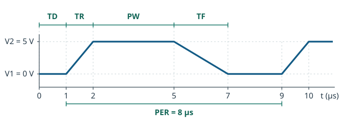
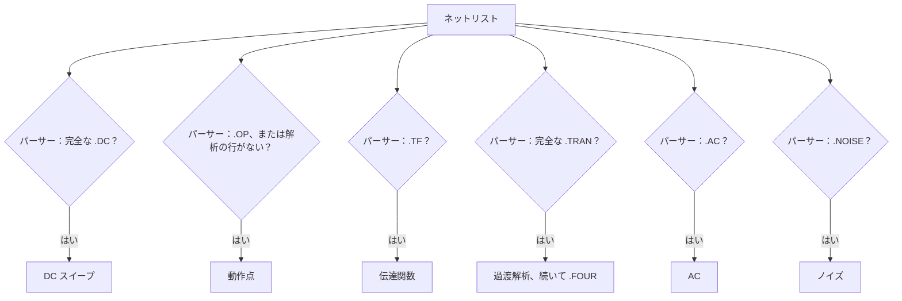

# kirimaspice リファレンスマニュアル

[English](REFERENCE_MANUAL.md) · この文書は英語版を正とします。日本語版はその訳で、両者が食い違う場合は英語版に従います。

プログラム `kirimaspice` のコマンドライン、ネットリストの言語、出力ファイルのリファレンスです。
**2026-11-14** にコミット `91af284` のソースから書き、**2026-11-15** にコミット `db0fef6` で
もう一度見直し、その後もプログラムに合わせて更新してきました。**2026-11-21** に、全体をコミット
`2826a81` のコードとビルド（macOS 27.2、arm64、GCC 16.2.0、`kirimaspice 0.0.0`）に照らして見直し、
そのとき直した項目はそのビルドを実行して確かめました。コミット `9bc2043` までの修正で変わった項目は、
同じ日に更新しました。
コードで読んだだけで実行していない項目には、そう書いてあります。最初の実行の手引きは
[ユーザーマニュアル](USER_MANUAL.ja.md)に、間違っていることや足りないことは
[KNOWN_ISSUES.md](../KNOWN_ISSUES.ja.md) にあります。

## 目次

- [コマンドライン](#コマンドライン)
- [環境変数](#環境変数)
- [終了コード](#終了コード)
- [ネットリストの書式](#ネットリストの書式)
- [素子](#素子)
- [モデル](#モデル)
- [ディレクティブ](#ディレクティブ)
- [オプション](#オプション)
- [出力形式](#出力形式)
- [ビルドのオプション](#ビルドのオプション)
- [ソースファイル](#ソースファイル)

## コマンドライン

```text
kirimaspice [オプション] <ネットリスト>
kirimaspice --version | --help
```

オプションはネットリストの前にも後にも書けます。ネットリストは 1 つです。値を取るオプションは
`--opt 値` と `--opt=値` のどちらも受け付けます（`-o` は `-o 値` だけ）。プログラムが知らないオプション、
値のないオプション、2 つ目のネットリストはエラーです。プログラムはどれかを
言い、終了コード 2 で終わります。
出力のオプションがファイルを書くのは、一部の実行だけです。どの実行で書くかは、
[プログラムが解析を選ぶ仕組み](#プログラムが解析を選ぶ仕組み)の表にあります。

| オプション | 効果 |
| --- | --- |
| `-h`、`--help` | 使い方を表示し、0 で終わる |
| `--version` | `kirimaspice <版>` を表示し、0 で終わる |
| `-o <ファイル>` | 動作点または過渡解析の結果を `<ファイル>` に SSF で書き（両方を実行したときは、ファイルの動作点を過渡解析が置き換える）、AC の CSV の名前を `<ファイル>` から決める |
| `--raw-out <ファイル>` | 動作点、DC スイープ、過渡解析の結果を ASCII の SPICE3 raw ファイルに書く |
| `--raw-binary-out <ファイル>` | 同じものをバイナリの SPICE3 raw ファイルに書く |
| `--wav-out <ファイル>` | 過渡解析の結果を WAV ファイルに書く |
| `--wav-sample-rate <Hz>` | WAV のサンプリング周波数（既定 44100） |
| `--wav-bits <n>` | WAV のサンプルの大きさ：8、16、24、32（既定 16） |
| `--log-level <レベル>` | 標準エラーに出すメッセージの最も低いレベル：`error`、`warning`、`info`（既定）、`debug`。ほかの値はエラー |

線形ソルバーは KLU です。ほかを選ぶオプションはありません。ライブラリの SuperLU_DIST のバックエンドは
仮置きです。

## 環境変数

| 変数 | 効果 |
| --- | --- |
| `KIRIMASPICE_DEBUG_DUMP` | 開発用：設定すると（値は何でもよい）、DC の各求解の 2 回目のニュートン反復の MNA の系を、カレントディレクトリの `debug_coo.txt`、`debug_csc.txt`、`debug_b.txt`、`debug_x.txt` に書く。求解のたびに前のものを上書きする |

## 終了コード

| コード | 意味 |
| --- | --- |
| 0 | 指定した解析が終わった、または `--help`、`--version` |
| 1 | 解析が失敗した（解析の行がないネットリストの動作点も） |
| 2 | コマンドラインか入力の誤り：ネットリストがない、2 つ目のネットリスト、知らないオプションや値のないオプション、オプションの値が受け付けられない（数でない `--wav-sample-rate`、知らない `--log-level` など）、ファイルを読めない、解釈のエラー、回路を組み立てるときの誤り、出力ファイルを書けない |
| 3 | 内部の誤り：解析の途中の例外、または `std::exception` から派生しない例外 |
| そのほか | シグナルでプログラムが止まった |

これらのコードは、姉妹のシミュレータ kirimasim（その `docs/spec/CLI.md` の 5 節）と同じです。両方を動かす
スクリプトが同じように読めるようにするためです。

## ネットリストの書式

### 行

- 行の終わりは LF でも CR LF でも構いません。CR LF の CR は、それぞれのファイルを読むときに除きます。
- ネットリストは次の順に処理します。`.INCLUDE` のファイルを入れる、`.LIB` のセクションを入れる、
  `+` の継続行を前の行につなぎ、空の行を除く、`.IF` のブロックを決める、`.CONTROL` のブロックを
  取り出す。残った行を 1 行ずつ読みます。文法が読めない行（行の中に CR がある行）は構文エラーです。

  ```mermaid
  flowchart LR
    F[ネットリストのファイル] --> I[".INCLUDE / .INC：ファイルを入れる"]
    I --> L[".LIB：セクションを入れる"]
    L --> C["+ の行をつなぎ、2 行目からの空の行を除く"]
    C --> IF[".IF / .ELIF / .ELSE：分岐を 1 つ残す"]
    IF --> CT[".CONTROL：取り出す"]
    CT --> T["最初の行：タイトル"]
    T --> R["残りの行を 1 行ずつ"]
    R --> D["モデルかサブ回路が後にある素子：最後にもう一度読む"]
  ```

- インクルードするファイルは、それをインクルードするファイルのディレクトリから探します。インクルードした
  ファイルの中の `.LIB` のファイルは、そのファイルのディレクトリにあればそこから、なければネットリストの
  中のものと同じく、ネットリストのディレクトリから探します。セクションの
  ない `.LIB <ファイル>` はファイル全体を入れます。`.LIB` のセクションの中の `.INCLUDE` は、ファイルを
  入れず、`unknown directive .INCLUDE is ignored` と警告します。
- ngspice-47 と同じく、1 行目がタイトルです。空でもタイトルです。
- 最初の空白でない文字が `*` の行はコメントです。`;` から行末までもコメントです。ほかのコメントの
  文字はありません。
- `+` で始まる行は、前の行の続きです。間にコメントの行や空の行があっても、前の行は終わりません。前の行の
  `;` のコメントは、その行の終わりまでです。
- `.` で始まる行はディレクティブで、それ以外の行は素子です。素子は最初の文字（大文字でも小文字でも）で
  決まります。
- `.END` の後の行も、ngspice-47 と同じく、同じように読みます。インクルードしたファイルの中の `.END` も
  同じです（2026-11-21 に実行）。パーサーが読まないディレクティブは無視し、名前ごとに 1 回警告します
  （`unknown directive`。`.MEASURE`、`.TITLE` は `is not supported`）。プログラムは、読んでも
  実行しないディレクティブを 1 回ずつ名指しします（`is read, but this program does not run it`）。下の表にない
  文字の素子（`W` など）は、サブ回路の本体の中でも、解釈のエラー `Unknown element letter` になります。
- メッセージの行番号は、これらの手順の後に残った行を数えたもので、ファイルの行ではありません。
  `.INCLUDE`、`.LIB`、`.IF` そのもののエラーは、その手順の時点のテキストでの行番号を示します。

### 名前

- ノード、素子、モデル、サブサーキットの名前は、SPICE と同じく大文字と小文字を区別しません。`OUT` と `out` は
  1 つのノードで、小文字で保ち、小文字で書きます。
- `0` がグラウンドです。トップレベルでもサブサーキットの中でも、大文字小文字を問わず `gnd` という
  名前のノードもグラウンドです。
- サブサーキットのインスタンスの中のノードは `<インスタンス>.<ノード>` という名前になります
  （例：`x1.n1`）。素子の名前は大文字小文字をそのまま保ちます（`X1.R1`）。

### 数

数は、10 進または指数表記の数に、ngspice と同じく、大文字小文字を問わない倍率を付けたものです（倍率は
省けます）。数の後ろの倍率でない文字と、倍率の後ろの文字は無視します（`10mA` は 0.01、`10MHz` は 0.01）。
数の後ろのそれ以外のものはエラーです。`2*1k`、`1k5`、`1.5.3k` は数ではありません。ngspice-47 は `1k5` を
1k、`1.5.3k` を 1.5 と読みます。

| 倍率 | 値 |
| --- | --- |
| `T` | 10¹² |
| `G` | 10⁹ |
| `MEG` | 10⁶ |
| `K` | 10³ |
| `MIL` | 25.4×10⁻⁶ |
| `M` | 10⁻³ |
| `U` | 10⁻⁶ |
| `N` | 10⁻⁹ |
| `P` | 10⁻¹² |
| `F` | 10⁻¹⁵ |
| `A` | 10⁻¹⁸ |

`M` は大文字でも小文字でもミリで、メガは `MEG` です。

### 式

波かっこ `{...}` で囲んだ値は ExprTk で評価します。グローバルのパラメーター（`.PARAM` の行の位置によらない）、定数 `pi` と `e`、
ExprTk の組み込み関数、そして `.FUNC` で定義した関数（行の位置によらない）を使えます。波かっこの中の数は、
ngspice-47 と同じく倍率の接尾辞と単位を取れます（`{2*1k}` は 2000。`util::expand_scale_factors`）。`{` で始まり、閉じる `}` のない値はエラーです。
波かっこのまとまりは、空白を含んでいても 1 つの
字句で、`=` の直後のものは同じ字句に続きます。そのため `IS={ISAT}` も `IS={a * 2}` も、`.MODEL` の
行でも、それぞれ 1 つのパラメーターです。電源の波形の引数では、波かっこの中に空白を入れられます。
波かっこのない `.PARAM` の値は、数か、数でなければ式です（`.param r = 2*1000` は ngspice-47 と同じく
2000）。この式でも倍率は受け付けません（`.param r = 2*1k` はエラー）。

## 素子

`<n+>` と `<n->` はノード、`<値>` は数か波かっこの式です。`名前=値` の形のパラメーターは順を問わず、
名前は大文字と小文字を区別しません。どの行でも、`=` の両側に空白を入れられます（`W = 10u`、
`.param rv ={2*1000}`）。素子の名前は大文字と小文字を区別せず、`X` のインスタンスも含め、1 度だけ使えます。
`R1` と `r1` は同じ素子で、2 つ目はエラーです。

| 素子 | 書式 | 補足 |
| --- | --- | --- |
| 抵抗 | `R<名前> <n+> <n-> <値> [TC1=<v>] [TC2=<v>]` | SPICE と同じく R(T) = R (1 + TC1 (T − TNOM) + TC2 (T − TNOM)²)、TNOM は 27 °C。ほかの字句は、名前を挙げて警告し、使わない |
| キャパシタ | `C<名前> <n+> <n-> <値> [IC=<V>]` | `IC=`：`UIC` の過渡解析の始まりの、`<n+>` から `<n->` への電圧。`UIC` なしでは使わない。ほかの字句は、名前を挙げて警告し、使わない |
| インダクタ | `L<名前> <n+> <n-> <値> [IC=<A>]` | `IC=`：`UIC` の過渡解析の始まりに、`<n+>` からインダクタを通って `<n->` へ流れる電流。`UIC` なしでは使わない。ほかの字句は、名前を挙げて警告し、使わない |
| 相互インダクタンス | `K<名前> <L1> <L2> <k>` | `<L1>`、`<L2>` はインダクタの名前。0 から 1 の外の `<k>` はエラー。いくつかの `K` で互いに結合したインダクタは、ngspice-47 と同じく、インダクタンス行列全体の逆行列を使う |
| 電圧源 | `V<名前> <n+> <n-> [[DC] <値>] [AC [<振幅> [<位相>]]] [<波形>]` | 下を参照 |
| 電流源 | `I<名前> <n+> <n-> [[DC] <値>] [AC [<振幅> [<位相>]]] [<波形>]` | 下を参照 |
| VCVS | `E<名前> <n+> <n-> <nc+> <nc-> <利得>` または `E<名前> <n+> <n-> POLY(<n>) <nc1+> <nc1-> ... <p0> <p1> ...` | `POLY`：下を参照 |
| CCCS | `F<名前> <n+> <n-> <V制御> <利得>` または `F<名前> <n+> <n-> POLY(<n>) <V1> ... <p0> <p1> ...` | `<V制御>` は `V` 電源に限る |
| VCCS | `G<名前> <n+> <n-> <nc+> <nc-> <gm>` または `G<名前> <n+> <n-> POLY(<n>) <nc1+> <nc1-> ... <p0> <p1> ...` |
| CCVS | `H<名前> <n+> <n-> <V制御> <r>` または `H<名前> <n+> <n-> POLY(<n>) <V1> ... <p0> <p1> ...` | `<V制御>` は `V` 電源に限る |
| ビヘイビア電源 | `B<名前> <n+> <n-> I=<式>` または `V=<式>` | 下を参照 |
| ダイオード | `D<名前> <アノード> <カソード> [<モデル>] [IS=<v>] [N=<v>]` |
| バイポーラトランジスタ | `Q<名前> <c> <b> <e> <NPN\|PNP\|モデル> [パラメーター]` |
| MOSFET と関連するデバイス | `M<名前> <d> <g> <s> [<b>] <NMOS\|PMOS\|モデル> [パラメーター]` | モデルの `LEVEL` でデバイスを選ぶ |
| MESFET | `Z<名前> <d> <g> <s> [<NMF\|PMF\|モデル>] [パラメーター]` |
| JFET | `J<名前> <d> <g> <s> <モデル> [<面積>]` | `NJF` か `PJF` のカード。面積は `BETA`、`IS`、`CGS`、`CGD` に掛かる。その後の `OFF`、`IC=` などの字句は、名前を挙げて警告し、使わない |
| SCR | `S<名前> <アノード> <カソード> <ゲート> [パラメーター]` | `名前=値` のパラメーターだけ。`.MODEL` に SCR の型はないので、モデル名はエラー |
| TRIAC | `Y<名前> <mt2> <mt1> <ゲート> [パラメーター]` | `名前=値` のパラメーターだけ。`.MODEL` に TRIAC の型はないので、モデル名はエラー |
| 無損失線路 | `T<名前> <a+> <a-> <b+> <b-> Z0=<v> TD=<v>` | どちらも必須で正。`Z0` の代わりに `ZO` も可。過渡解析の刻みは `TD` より長くならない |
| 有損失線路 | `O<名前> <a+> <a-> <b+> <b-> R=<v> L=<v> C=<v> G=<v> TD=<v>` | 単位長さあたり。`TD`、`L`、`C` は正。長さは `TD`/√(`L`·`C`)。DC と AC は線路の正確な 2 ポートを使う。過渡解析は、損失を両端にまとめた無損失線路を最大 16 区間つなぎ、刻みは区間の遅れより長くならない（[既知の問題](../KNOWN_ISSUES.ja.md#デバイスモデル)） |
| サブサーキットのインスタンス | `X<名前> <ノード...> <サブサーキット> [名前=<v> ...]` |

`POLY` の形では、SPICE と同じく、出力は `<n>` 個の制御 x1 ... xn（`E` と `G` ではノードの組の電圧で、
`<a> <b>` または `(<a>,<b>)` と書く。`F` と `H` では電源の電流）の多項式です。係数は順に、1、x1 ... xn、
2 つの積 x1·x1、x1·x2、...、x1·xn、x2·x2、...、xn·xn、3 つの積、と続きます。各次数の積は、因子を小さい順に
並べたものを辞書式の順に並べます。係数は 2 つ以上要ります。この行は、その多項式の `B` 電源として読みます。
`E` と `H` は電圧の形、`G` と `F` は電流の形で、符号は線形の形と同じです。名前はそのままなので、`I(E1)` で
読めます。

素子は、サブサーキットの中でもトップレベルと同じ意味です。本体の行は同じ素子のパーサーが読み、素子の
名前、ノード、素子が参照するほかの素子の名前（`F` と `H` の制御（`POLY` の形でも）、`K` のインダクタ、`B` の `V(...)` の
ノードと `I(...)` の電源）をインスタンスの中の名前 `X1.R1`、`x1.n1` に変えます。

### 電源

- DC の値、AC の入力、波形は、どの順に書いても、どれを省いても構いません（`V1 a b` だけのものは
  エラーです）。値の前の `DC` は省けます。`V1 a b DC` と `V1 a b AC 1` の DC の値は 0 V です。行に
  それ以外のものがあるとエラーです。
- SPICE（と ngspice-47）と同じく、動作点と `.DC` は DC の値を取り、行に DC の値がなければ時刻 0 での
  波形の値を取ります。過渡解析は時刻 0 の波形から始め、波形に従います。AC は AC の入力を取ります。
  `.DC` は、波形のある電源でも DC の値を掃引します。
- 波形は次のとおりで、電圧源でも電流源でも同じです。

  | 波形 | 引数 | 値 |
  | --- | --- | --- |
  | `PULSE` | `V1 V2 [TD [TR [TF [PW [PER]]]]]`。`TD` は 0、`TR` と `TF` は `TSTEP`、`PW` と `PER` は `TSTOP` | `TD` より前は `V1`、その後に立ち上がり、`PW` の間 `V2`、立ち下がりで、`PER` ごとに繰り返す。`TR` や `TF` が 0 なら、角の上では前の値で、そのすぐ後から新しい値（ngspice-47 は 0 の `TR` や `TF` を `TSTEP` にわたる傾きにする） |
  | `SIN` | `VO VA [FREQ [TD [THETA [PHASE]]]]`。`FREQ` は 1/`TSTOP`、ほかは 0 | `TD` より前は `VO + VA sin(PHASE)`、その後は `VO + VA e^(−THETA (t − TD)) sin(2π FREQ (t − TD) + PHASE)`。`PHASE` は度 |
  | `EXP` | `V1 V2 [TD1 [TAU1 [TD2 [TAU2]]]]`。ngspice-47 と同じく、`TD1`、`TAU1`、`TAU2` は `TSTEP`、`TD2` は `TD1` + `TSTEP` | `TD1` より前は `V1`、その後は `V1 + (V2 − V1)(1 − e^(−(t − TD1)/TAU1))`。`TD2` からは、それに `(V1 − V2)(1 − e^(−(t − TD2)/TAU2))` を加える |
  | `PWL` | `T1 V1 T2 V2 ...` | 点の間は直線。`T1` より前は `V1`、最後の点の後は最後の値。時刻は減ってはならない |
  | `SFFM` | `VO VA [FC [MDI [FS [TD [PHASEM [PHASEC]]]]]]`。ngspice-47 と同じく、`FC` は 5/`TSTOP`、`MDI` は 90、`FS` は 500/`TSTOP`（0 の `FS` でも）、ほかは 0。`MDI` は 0 から `FC`/`FS` の間に収め、警告する | `TD` までは 0、その後は t = 時刻 − `TD` で `VO + VA sin(2π FC t + PHASEC + MDI sin(2π FS t + PHASEM))`。位相は度。そのため、ngspice-47 と同じく、DC の値のない電源の動作点は 0 |

  引数は、かっこで囲むか、かっこなしでキーワードの後に続け、空白かカンマで区切ります。どの引数も
  波かっこの式にできます。省いた引数は、ネットリストの `.TRAN`（電源より後にあってもよい）の `TSTEP` と
  `TSTOP` から、上の既定値を取ります。`.TRAN` がなければ `TSTEP` は 0、`TSTOP` は上限なしです（そのとき
  `EXP` には `TAU1` と `TAU2` が要ります）。引数が少なすぎても多すぎてもエラーです。

  `PULSE(0 5 1u 1u 2u 3u 8u)` では、最初の立ち上がりは 1 µs、次の立ち上がりは 9 µs に始まります。
  `PW` は高い電圧を保つ時間（2～5 µs）です。引数では `TF` が `PW` より先に来ますが、波形では平坦部の後に立ち下がります。

  

- AC 解析の入力になるのは、行に `AC` がある電源だけです。振幅を省いた `AC` は振幅 1 で、位相（度）の
  既定値は 0 です。`AC` のない電源は振幅 0 です。サブサーキットの中でも同じです。
- 電圧源と、`E`、`H`、電圧の形の `B` 電源の電流は、表示でもファイルでも、`+` 端子から電源の中を通る
  向きを正とします。そのため、電流を供給している電源の電流は負です。`F` と `H` は、この電流を制御に
  使います。
- `F` と `H` が名前で指す電圧源は、ネットリストの後のほうにあっても構いません。

### ビヘイビア電源

`B` は、`V=` か `I=` で始まる最初の字句を使います。式は波かっこで囲むか（`V={2*V(in)}`）、波かっこが
なければ、ngspice と同じく、空白も含めて行の終わりまでです（`V=V(a) + 1`）。式では `V(<ノード>)` または `v(<ノード>)`（ノードの名前は素子の行と同じく大文字小文字を区別せず、
`V(A)` と `V(a)` は同じノード、`V(n.1)` も 1 つのノードです）、トップレベルでもサブサーキットの中でも
V(n1) − V(n2) を表す `V(<n1>,<n2>)`（どちらのノードもグラウンドでも構いません）、`TIME`、`pi`（`e` は
不可）、ExprTk の組み込み関数、`.FUNC` で定義した関数、そして ngspice-47 と同じく、グローバルの `.PARAM` の名前（大文字小文字を
区別しない）を使えます（`V(` の引数は、パラメーターと同じ名前でもノードです）。サブサーキットの本体の中では、
波かっこの有無によらず、そのインスタンスのパラメーターも使えます（ngspice-45.2 は本体の中の `V={g*V(i)}` と
`V=g*V(i)` を同じに読みます）。素子の電流 `I(<名前>)` も使えます。その素子がネットリストのどこにあっても
構いません。サブサーキットの中の `I(Vs)` は、その本体の `Vs` です。電圧源と、`E`、`H`、電圧の形の `B` 電源では、
その電源の電流で、表示と同じ向き（`+` 端子へ流れ込む向き）が正です。端子のあるほかの素子では、ngspice-45.2 と
同じく、素子の最初の端子へ流れ込む電流です。`R`、`C`、`L`、`D`、電流源では最初のノードから 2 番目のノードへの
電流、`Q` ではコレクタ電流、`M` と `J` ではドレイン電流、`X` では最初のピンへ流れ込む電流です。プログラムは
ngspice と同じ方法で読みます。その端子に 0 V の電源 `v_<名前>` を直列に入れ、端子のノードと新しいノード
`<ノード>_vmeas_<k>` の間に置きます。この電源とノードは回路の一部で、結果にも出ます（`R1 in 0 1k` の
`I(R1)` なら `I(v_R1)` と `V(in_vmeas_0)`）。端子のない `K` の行の `I(K1)` と、最上位（または同じ
サブサーキット）のどの素子にもない名前はエラーです。`TIME` は
過渡解析の時刻で、動作点（過渡解析の始めの動作点も含む）では 0 です。
解釈できない式と、`TIME` を 0、すべての電圧と電流を 0 として一度評価したときに失敗する式（本体を解釈できない
`.FUNC` や、自分自身を呼ぶ `.FUNC` を呼ぶもの）は、`B` の行のエラーになります。
どちらの形も動作点、過渡解析、AC 解析で動きます。AC 解析では、`B` 電源は動作点で線形化したもので、
それ自体の AC の入力はありません。ニュートン法と AC 解析は、式の微分を中心差分で取ります。

### 単純なデバイスのパラメーター

パーサーが読むパラメーターです。`D`、`Q`、`Z`、レベル 1 の `M` の素子の行や `.MODEL` のカードにあるほかの
パラメーターは使わず、警告で名指しします。カードのものはカードごとに 1 回、素子の行のものはその行で名指しします。インスタンスのパラメーターはモデルのものを上書きします。

| 素子 | パラメーター（既定値） |
| --- | --- |
| `D` | `IS`（1e-14 A）、`N`（1）、`CJO` または `CJ0`（0）、`VJ` または `PB`（1 V）、`M` または `MJ`（0.5）、`RS`（0 Ω）、`TT`（0 s）、`BV`（なし）、`IBV`（1 mA）。既定値は ngspice-47 と同じ。`IS` と `N` は素子の行にも書ける。カードや行のほかの名前（`TNOM`、`EG`、`XTI`、`FC` も）は、警告で名指しし、使わない |
| `Q` | `IS`（1e-14 A）、`BF`（100）、`NF` またはインスタンスの `N`（1）、`BR`（1）、`NR`（1）、`VAF` または `VA`（∞）、`VAR` または `VB`（∞）、`IKF` または `IK`（∞）、`IKR`（∞）、`RB`、`RBM`、`IRB`（0）、`ISE`（0）、`NE`（1.5）、`ISC`（0）、`NC`（2）、`CJE`（0）、`VJE` または `PE`（0.75 V）、`MJE` または `ME`（0.33）、`CJC`（0）、`VJC` または `PC`（0.75 V）、`MJC` または `MC`（0.33）、`TF`、`TR`（0）、`XTI`（3）、`XTB`（0）、`EG`（1.11 eV）、`TNOM`（27 °C）、ノイズの `KF`（0）、`AF`（1）、`FF`（1）。カードが先で、素子の行が後 |
| `M`、レベル 1 | カードがあれば ngspice-47 の既定値：`KP`（2e-5 A/V²）、`W`、`L`（100 µm）、カードの `VTO` または `VTH` と素子の行の `VTH`。デバイスの符号付き（0。正の値の PMOS はディプレッション型）、`GAMMA`（0、基板効果）、`PHI`（0.6 V）、`LAMBDA`（0）、ノイズの `KF`（0）、`AF`（1）、`EF`（1）。カードや行のほかの名前（`M=` も）は警告で名指しする。カードなしの行の `NMOS` や `PMOS` は `W` 10 µm、`L` 1 µm、`VTH` ±0.7 V |
| `J` | `NJF` か `PJF`。ngspice-45.2 と同じく ngspice のレベル 1（Shichman と Hodges。チャネルの両方向）：`VTO`（−2 V。どちらの極性でも）、`BETA`（1e-4 A/V²）、`LAMBDA`（0）、ゲートの接合それぞれの `IS`（1e-14 A）と `N`（1）、それと並列の GMIN、`CGS` と `CGD`（0）、空乏容量 C0/√(1 − V/`PB`)（`FC`·`PB` より上は直線で延長）、`PB`（1 V）、`FC`（0.5）、`RD` と `RS`（0 Ω。ドレインとソースに直列に入る抵抗で、面積で割る）、`TNOM`（27 °C）、`EG`（1.11 eV。IS(T) = IS exp((T/TNOM − 1) EG/(N Vt))）。温度 T では、`VTO` は `VTOTC`·(T − TNOM) だけ動き、カードに `VTOTC` がなければ −`TCV`·(T − TNOM) だけ動く。`BETA` は `BETA`·1.01^(`BETATCE`·(T − TNOM)) で、カードに `BETATCE` がなければ `BETA`·(T/TNOM)^`BEX`（4 つとも既定は 0。0 と書いたものも、書いたものとして扱う）。`PB`、`CGS`、`CGD` は、ダイオードの VJ と CJO の温度則に M = 0.5 で従う。`B` は 1 だけ。ほかは、名前を挙げて警告し、使わない（[既知の問題](../KNOWN_ISSUES.ja.md#デバイスモデル)） |
| `Z` | `LEVEL`/`MODEL`（ngspice-47 と同じく 1 が既定でただ一つのレベルで Statz、V<sub>DS</sub> = 3/α より下で β v<sub>ov</sub><sup>2</sup>/(1 + B v<sub>ov</sub>) (1 + λ V<sub>DS</sub>) (1 − (1 − α V<sub>DS</sub>/3)<sup>3</sup>)。ほかの `LEVEL` はエラー。[既知の問題](../KNOWN_ISSUES.ja.md#デバイスモデル)）、`BETA`（0.1）、`VTO`（−2 V。素子の行が `PMF` か、`PMF` のカードなら +2 V）、`LAMBDA`（0.05）、`ALPHA`（2）、`B`（0.3）、`CGS`（1 pF）、`CGD`（0.5 pF）、`CDS`（0.1 pF）、`KF`、`AF`、`EF`、`TNOM`（27 °C） |
| `S` | `VBF`（400 V）、`IGT`（20 mA）、`IH`（10 mA）、`IL`（30 mA）、`VGT`（1 V）、`RON`（0.1 Ω）、`VTM`（1.5 V）、`DV_DT`（10）、`TNOM`（27 °C） |
| `Y` | `VBO`（400 V）、`IGT`（20 mA）、`IH`（10 mA）、`VGT`（1 V）、`RON`（0.1 Ω）、`VTM`（1.5 V）、`DV_DT` または `DVDT`（10）、`TNOM`（27 °C） |

- レベル 1 の MOSFET は SPICE のものです。飽和領域で `Id = KP/2 W/L (VGS − Vth)² (1 + LAMBDA VDS)`、線形領域で
  `KP W/L ((VGS − Vth) VDS − VDS²/2) (1 + LAMBDA VDS)`、`Vth = VTO + GAMMA (√(PHI − VBS) − √PHI)` で、基板が順方向に
  バイアスされたときは、ngspice-47 と同じく、根の代わりに `√PHI − VBS/(2√PHI)` を使います。チャネルの熱雑音は
  4kT (2/3) gm です。キャパシタンスとバルクの接合はありません。温度について、KP、PHI、VTO は、シリコンの
  バンドギャップを通した SPICE のレベル 1 の法則に従います（KP は (T/TNOM)<sup>−1.5</sup> に比例し、PHI(T) と
  ビルトイン電圧から VTO(T) が決まります）。TNOM は 27 °C です。
- ダイオードは、SPICE の GMIN と同じく、DC、過渡解析、AC で接合に並列な 10<sup>−12</sup> S を持ちます。
  `GMIN` のオプションはこれを変えません。温度について、IS、VJ、CJO は、`XTI` 3、`EG` 1.11 eV、TNOM 27 °C で
  SPICE のダイオードの法則に従います。SPICE と同じく、`RS` はアノードと内部ノード `<名前>#internal` の間に、
  接合はそのノードとカソードの間にあります。`TT` は拡散容量 TT·gd を接合容量に加えます。`BV` があると、
  −BV で `IBV` を流し、それより下では N·Vt ごとに e 倍に逆電流が増えます。
- 温度について、バイポーラトランジスタは IS、BF、BR、ISE、ISC を、`XTI`、`XTB`、`EG` で SPICE の
  Gummel–Poon の法則に従って変えます。接合電位と容量は変わりません
  （[既知の問題](../KNOWN_ISSUES.ja.md#ネットリストの入力)）。
- `S` と `Y` のパラメーターは素子の行にだけ書けます。`.MODEL` に SCR と TRIAC の型はなく、それらの
  行にあるモデルの名前で、それより前に定義されていないものは、何も言わずに無視します。
- 3 端子の `M` では、バルクをソースにつなぎます。パーサーは、6 番目の字句が `NMOS` か `PMOS` で
  始まるか、ネットリストにあるモデルの名前であれば、その行を 4 端子とみなします。

## モデル

```text
.MODEL <名前> <型>(<パラメーター>=<値> ...)
.MODEL <名前> <型> <パラメーター>=<値> ...
```

- `<型>` は `NPN`、`PNP`、`D`（または `DIODE`）、`NMOS`、`PMOS`、`NMF`、`PMF`、`NJF`、`PJF` で、大文字小文字を
  問いません。ほかの型はエラーです。
- パラメーター名は大文字と小文字を区別しません。空白を入れた `名前 = 値` も受け付け、値には
  波かっこの式も使えます。
- カードと素子の行の `TNOM` は、それを読むどのデバイスでも SPICE と同じく °C です。`.TEMP` と
  `.OPTIONS TEMP` も °C です。`TNOM` の既定値は 27 °C です。ダイオードとレベル 1 の MOSFET は `TNOM` を
  読まず（警告で名指しします）、27 °C を使います。
- モデルの名前は、大文字と小文字を区別せずに比べます。`.SUBCKT` の中の `.MODEL` は、そのサブサーキットの
  本体に限られ、そこではトップレベルの同じ名前のモデルを隠し、外からは見えません。トップレベルのものは
  どこからでも見えます。1 つの範囲で同じ名前（大文字小文字を問わず）の `.MODEL` が 2 つあれば、ngspice-47 と
  同じく最初のものを使い、2 つ目を警告で名指しします。
- `.MODEL` の行はネットリスト全体に効きます。`D`、`Q`、`M`、`Z` の素子は、モデルより前にあっても
  構いません。どこにも定義されていないモデルを使う素子はエラーで、その素子の行を示します
  （`Undefined diode model`、`Undefined BJT model`、`Undefined MESFET model`、`Undefined MOSFET model`）。

`NMOS` と `PMOS` では、`LEVEL` でデバイスを選びます。

| `LEVEL` | デバイス | カードの知らないパラメーター | 素子の行のパラメーター |
| --- | --- | --- | --- |
| 1（既定） | レベル 1（2 乗則） | 警告、カードごとに 1 回 | `KP`、`W`、`L`、`VTH`、`KF`、`AF`、`EF`。ほかは警告で名指しする |
| 3 | SPICE のレベル 3 | 警告 | `W`、`L`（100 µm。SPICE の `DEFW` と `DEFL`）。ほかは警告で名指しする |
| 8、49 | BSIM3。簡略化したもの（[既知の問題](../KNOWN_ISSUES.ja.md#デバイスモデル)） | 警告 | `W`、`L`（5 µm）。ほかは警告で名指しする |
| 14、54 | BSIM4（`VERSION` が 4.8.3 でも 4.83 でもないモデルカードには警告を出す） | カードごとに 1 回警告 | `W`（`NF` 本のフィンガー全体の幅）、`L`（5 µm）、`NF`、`MIN`、`M`、`AS`、`AD`、`PS`、`PD`、`NRD`、`NRS`、`MULT_I`、`MULT_Q`（全電荷・容量の倍率）、`MULT_FN`。ほかは警告で名指しする |
| 10 | SiC MOSFET | 警告 | すべて、名前で |
| 11 | GaN HEMT（`VTO` はほかのレベルと同じく素子の符号付き。既定は N が −2 V、P が +2 V。`KT1`、`KT2` は N に相当する電圧のしきい値を動かす。`VBD` より上では、チャネルが開いていても閉じていても、ドレインに 1 mS × (V<sub>DS</sub> − `VBD`) を加える） | 警告 | すべて、名前で |
| 12 | FinFET | 警告 | `L` だけ。ほかは警告で名指しする |
| 20 | VDMOS | 警告 | すべて、名前で |
| 21 | IGBT（`M` の端子はコレクタ、ゲート、エミッタ。過渡解析では、コレクタはチャネル電流と蓄積キャリアの電流の大きい方を流す。蓄積キャリアの電流は寿命 `TAU` でチャネル電流に従うので、ターンオフの後は exp(−t/`TAU`) で減る） | 警告 | すべて、名前で |

ほかの `LEVEL` は、ngspice-47 と同じく、`.MODEL` の行のエラーです。ngspice の MOS9 である `LEVEL=9` と、
その BSIM1 である `LEVEL=4` も、このプログラムにはないのでエラーです。レベル 3、8/49、12 では、素子の行の
ほかの名前（`AD`、`AS`、`PD`、`PS`、`NRD`、`NRS`、`M` も）は、警告で名指しし、使いません。

レベル 3、9、8/49、14/54 のパラメーター名は、それぞれの Berkeley のモデルのマニュアルに従います。
レベル 3 は SPICE のレベル 3 の式を、TOX、NSUB、NSS、TPG、XJ、LD、WD、VTO、PHI、GAMMA、UO、KP、THETA、
VMAX、ETA、KAPPA、DELTA、NFS で計算します。カードにない PHI、GAMMA、VTO は NSUB（と TPG、NSS）から
求めます。LAMBDA、RS、RD、CJ、CJSW、MJSW は、レベル 3 のカードにあっても警告なしに受け付け、使いません。
パラメーターの一覧は `src/parser/netlist_parser.cpp` の `parse_mosfet_device` に、BSIM4 では
`src/devices/mosfet_bsim4_params.cpp` の `bsim4_params_from_model` にあります。レベル 10、11、12、20、21 は、
デバイス自身の（その極性の）既定値から始め、カードの、次に素子の行のパラメーターを名前で受け取ります。

### BSIM4 の容量（`LEVEL=14` または `54`）

モデルカードの既定値 `CAPMOD=2` では、過渡解析が 4 端子の電荷を積分します。AC 解析は同じ電荷を
各端子の電圧で微分した値を使います。`XPART` は飽和時のドレインとソースへの電荷分配を選びます。
`0 <= XPART < 0.5`（既定値 0）では 40/60、0.5 では 50/50、0.5 より大きいと 0/100 です。
負値にすると内部電荷を無効にします。`CAPMOD=0` と `1` は簡略化した Meyer 近似を使います。

`CF` はゲート両端の外側のフリンジ容量に使います。省略すると `TOXE` と `EPSROX` から求め、
`CF=0` と明示するとこの寄与が 0 になります。実装が扱う既定の拡散領域形状では、省略した
`PS` と `PD` をフィンガー配置から求めます。指定した周囲長がゲート端を含むかは `PERMOD` で決まり、
既定値は 1（含む）です。

### FinFET（`LEVEL=12`）

FinFET は、kirimaspice 独自の簡略化した二乗則のモデルです（`src/devices/finfet.cpp`）。BSIM-CMG
ではありません。端子はドレイン、ゲート、ソースで、`M` の行のバルクのノードは受け付けますが使い
ません。`.MODEL` のカードのパラメーターはすべてデバイスに渡し、FinFET にないパラメーターや範囲外の
値は、警告を出して無視します。素子の行のパラメーターは `L` だけを読み、それはカードより優先します。

| パラメーター | 意味 | NMOS の既定値 | PMOS の既定値 |
| --- | --- | --- | --- |
| `NFIN` | フィンの数 | 1 | 1 |
| `HFIN` | フィンの高さ [m] | 30e-9 | 30e-9 |
| `TFIN` | フィンの厚さ [m]。読みますが、電流には使いません | 7e-9 | 7e-9 |
| `L` | ゲート長 [m] | 1e-6 | 1e-6 |
| `VTH`、`VTH0` または `VTO` | 符号つきのしきい値 [V] | 0.4 | −0.4 |
| `U0` | 低電界の移動度 [m²/Vs] | 0.03 | 0.025 |
| `VSAT` | 飽和速度 [m/s]。読みますが、電流には使いません | 1e5 | 8e4 |
| `SS` | サブスレッショルドスイング [V/桁] | 0.07 | 0.075 |
| `DIBL` | V<sub>DS</sub> 1 V あたりのしきい値の低下 [V/V] | 0.05 | 0.06 |
| `TOX` | ゲート酸化膜の厚さ [m] | 1e-9 | 1e-9 |
| `CGS`、`CGD` | ゲート・ソース間とゲート・ドレイン間の容量 [F] | 1e-15、1e-16 | 1e-15、1e-16 |
| `KF`、`AF` | フリッカーノイズの係数と指数 | 0、1 | 0、1 |
| `KT1` | 符号つきのしきい値の温度係数 [V/K] | −1e-3 | 1e-3 |
| `TNOM` | 公称温度 [°C] | 27 | 27 |

NMOS のドレインからソースへの電流を V<sub>GS</sub> と V<sub>DS</sub> で書きます。PMOS は同じ式を
V<sub>SG</sub> と V<sub>SD</sub> で使い、電流はソースからドレインへ流れます。

- W<sub>eff</sub> = `NFIN`·`HFIN`、C<sub>ox</sub> = 3.9 ε<sub>0</sub>/`TOX`、
  β = `U0`·(`TNOM`/T)<sup>1.5</sup>·C<sub>ox</sub>·W<sub>eff</sub>/`L`。
- V<sub>th</sub>(T) = `VTH` + `KT1`·(T − `TNOM`)。PMOS ではその絶対値を使います。
  V<sub>DS</sub> > 0 のとき V<sub>th,eff</sub> = V<sub>th</sub>(T) − `DIBL`·V<sub>DS</sub>。
- しきい値以上では、V<sub>ov</sub> = V<sub>GS</sub> − V<sub>th,eff</sub> として、V<sub>DS</sub> <
  V<sub>ov</sub> なら β (V<sub>ov</sub> V<sub>DS</sub> − V<sub>DS</sub><sup>2</sup>/2)、それ以上なら
  β V<sub>ov</sub><sup>2</sup>/2 です。
- しきい値より下では β V<sub>t</sub><sup>2</sup> exp(V<sub>ov</sub> / (n V<sub>t</sub>))
  (1 − exp(−V<sub>DS</sub>/V<sub>t</sub>)) で、n = `SS`/(V<sub>t</sub> ln 10) です。ゲート電圧が
  `SS` 変わるごとに、電流は 1 桁変わります。
- ドレインとソースの間に 10<sup>−12</sup> S があります。`CGS` と `CGD` は一定で、過渡解析では
  その積分法で積分します。ノイズ源は 4kT·(2/3)·g<sub>m</sub> と
  `KF`·|I<sub>D</sub>|<sup>`AF`</sup>/f です。

このモデルが含まないものは [KNOWN_ISSUES](../KNOWN_ISSUES.ja.md#デバイスモデル) にあります。

## ディレクティブ

「使う」はプログラムがそのディレクティブに従って動くこと、「読むだけ」はパーサーが記録するものの
プログラムは使わないこと（ライブラリは使える）を表します。

| ディレクティブ | 書式 | 状態 |
| --- | --- | --- |
| `.OP` | `.OP` | 使う：動作点（[下](#プログラムが解析を選ぶ仕組み)を参照） |
| `.DC` | `.DC <電源> <開始> <終了> <刻み> [<電源2> <開始2> <終了2> <刻み2>]` | 使う。`<電源>` は電圧源か電流源で、`<電源2>` の値ごとに掃引する。刻み 0 はエラー。値の数が 4 でも 8 でもない行もエラー（4 より少なければ警告を出して飛ばす。ngspice-47 は 9 番目の値を無視する） |
| `.TRAN` | `.TRAN <tstep> <tstop> [<tstart> [<tmax>]] [UIC]` | 使う。プログラムは `tstep`（`tmax` が短ければ `tmax`）で刻み、電源の折れ点（`PULSE` と `PWL` の角、`SIN` と `EXP` の遅延）ごとにも刻みを合わせる。SPICE と同じく、シミュレーションは 0 から行い、`tstart` 以降の点を残す。`tstart` ちょうどにも点を置く。`tstart` は `tstop` より小さくなければならず、0 の `tmax` は指定なしとみなし、負の `tmax` はエラー |
| `.AC` | `.AC DEC\|OCT\|LIN <n> <fstart> <fstop>` | 使う。`DEC`、`OCT`：ngspice-47 と同じく、`<fstart>` から一定の比で、`<fstop>` + 比 × `<fstop>` × `RELTOL` 以下の間取る。`OCT` は 2<sup>1/n</sup> 倍。`DEC` は、`<fstop>` が `<fstart>` の 10 倍に満たなければ 10<sup>1/n</sup> 倍（`.AC DEC 3 10 50` は 10、21.54、46.42 Hz）、そうでなければ floor(`<n>` × デケード数) 刻みで `<fstop>` に届く比（`.AC DEC 2 1 50` は 1、3.684、13.57、50 Hz）。`LIN`：全部で `<n>` 点、両端を含む（[既知の問題](../KNOWN_ISSUES.ja.md#解析)）。`<n>` は 1 以上の整数で、それ以外はエラー |
| `.TEMP` | `.TEMP <t1> [<t2> ...]`（°C） | 使う。値が 1 つなら `.OPTIONS TEMP=<t1>` と同じ（値を 1 つしか取らない ngspice-47 と同じ）。複数なら、値ごとにすべての解析を実行する（[下](#プログラムが解析を選ぶ仕組み)を参照） |
| `.OPTIONS`、`.OPTION` | `.OPTIONS <名前>=<値> ...` | 使う。[オプション](#オプション)を参照 |
| `.IC` | `.IC V(<ノード>)=<値> ...` | 過渡解析が使う。`UIC` があればこの値から始め、なければ動作点でノードをこの値に固定する。`V` は大文字 |
| `.NODESET` | `.NODESET V(<ノード>)=<値> ...` | SPICE と同じに使う：まずそのノードをその値に固定して動作点を解き、その後固定を外して、そこから解き続ける（ソースや gmin のステッピング、継続法のときは初期値としてだけ使う）。`V` は大文字 |
| `.PARAM` | `.PARAM <名前>=<値> ...` | 使う。ngspice-47 と同じく、グローバルの行はほかのどの行よりも先に読む。素子は後で定義したパラメーターも使え、同じ名前の 2 つの定義では最後のものを使い、式はほかのパラメーターの最後の値を使う。解けない定義はエラー |
| `.FUNC` | `.FUNC <名前>(<a>[,<b>[,<c>]]) {<式>}` | 波かっこの中のどの式でも、`B` の式でも使う。行の位置は問わない。引数は 3 つまで。本体は、ngspice-45.2 と同じく、引数、ExprTk の定数と `e`、呼ばれたところのパラメーター（サブサーキットの中ではそのインスタンスのもの）、ほかの関数を使える。引数は同じ名前のパラメーターを隠す。自分自身を呼ぶ関数はエラー（100 段を超える入れ子の呼び出し） |
| `.MODEL` | [モデル](#モデル)を参照 | 使う |
| `.SUBCKT` / `.ENDS` | `.SUBCKT <名前> <ピン...> [PARAMS:] [名前=<既定値> ...]` | 使う。定義の入れ子は不可。`PARAMS:` は `X` の行でも、あってもなくてもよい。`.ENDS` のない `.SUBCKT` はエラー |
| `.GLOBAL` | `.GLOBAL <ノード> ...` | サブサーキットの展開で使う |
| `.INCLUDE`、`.INC` | `.INCLUDE <ファイル>` | 使う。それをインクルードするファイルのディレクトリからの相対パス |
| `.LIB` / `.ENDL` | `.LIB <ファイル> [<セクション>]` | 使う。セクションがなければファイル全体 |
| `.IF` / `.ELIF` / `.ELSE` / `.ENDIF` | `.IF (<式>)` または `.IF(<式>)`。`.ELIF` の代わりに `.ELSEIF` も可 | 条件にはグローバルの `.PARAM` の最終値を使う。評価できない条件は構文エラー。ngspice-47 と共用する場合は `.ELSEIF` と書く |
| `.END` | `.END` | 無視。ngspice-47 と同じく、その後の行も読む |
| `.PRINT`、`.SAVE` | `.PRINT DC\|TRAN\|AC <信号>`、`.SAVE <信号>` | `.PRINT DC`、`.PRINT TRAN`、`.PRINT AC` は使う：その信号が、標準出力のその解析の表になる（下記）。`.SAVE` は使う：ngspice-45.2 と同じく、raw ファイル（ASCII とバイナリ）と SSF ファイルは、どの解析でも、その信号（`v(<ノード>)`、`i(<電源>)`、またはノードの名前）だけを持つ。複数の `.SAVE` の行は合わせる。`.SAVE all` はすべてを持ち、何も名指さない信号は警告を出して外す。WAV ファイルは変えない |
| `.FOUR` | `.FOUR <周波数> <信号> ...`。それぞれ `v(<ノード>)` か `i(<電源>)` | `.TRAN` と一緒に使う。過渡解析の後に、それぞれの信号の最後の 1 周期の高調波と THD を表示する。各高調波の位相は、ngspice-47 と同じく、その周期の始まりからの正弦波の位相 |
| `.STEP` | `.STEP [DEC\|OCT] PARAM <名前> <開始> <終了> <刻み>`、`.STEP PARAM <名前> LIST <値>` | 使う：パラメーターをその値にしてネットリストを読み直し、値ごとにすべての解析を 1 回実行する。最初の `.STEP` の行だけで、2 行目からは警告で名指しする（下記） |
| `.TF` | `.TF v(<ノード>[,<ノード>])\|i(<電圧源>) <電源>` | 使う：ngspice-45.2 と同じく、動作点での、電源（独立の電圧源か電流源）から出力への小信号の直流の利得、電源から見た入力の抵抗、出力の抵抗。動作点の後に `=== Transfer Function ===` の下に表示する。電流の出力では、利得はその電源の分岐電流（+ 端子へ流れ込む向き）で、出力の抵抗は ngspice-45.2 と同じく 1e20。利得か抵抗が有限でないとき（数の範囲を超える利得などで `inf` や `nan` になるとき）は、解析の失敗として終了コード 1 で終わる。ngspice-45.2 はそこで `inf` や `nan` を表示する |
| `.SENS`、`.MC`、`.PZ`、`.DISTO`、`.PORT`、`.WCASE`、`.OPTIMIZE` | | 読むだけ。警告で名指しする |
| `.CONTROL` / `.ENDC` | | パーサーが取り出して実行する。その解析のコマンドのうち、プログラムは `dc` と `ac` を実行し、`tran` は実行しない。`op` は知らないコマンドとして警告する（[KNOWN_ISSUES.md](../KNOWN_ISSUES.ja.md) を参照） |
| `.NOISE` | `.NOISE V(<出力>[,<基準>]) <電源> DEC\|OCT\|LIN <点数> <開始> <終了> [<要約の点数>]` | 使う：ngspice-45.2 の `onoise_spectrum`、`inoise_spectrum` と同じく、周波数ごとの V(出力, 基準) の出力の雑音と、それを電源（独立の電圧源か電流源）からの利得で割った入力換算の雑音。続いて `onoise_total` と `inoise_total`。掃引全体の雑音の電力を、点の間で周波数のべきとして積分した値の平方根。AC の後に `=== Noise Analysis ===` の下に表示する。要約の点数は使わない |
| `.TITLE`、`.MEASURE`、そのほか | | 無視。名前ごとに 1 回警告する |

### プログラムが解析を選ぶ仕組み

- プログラムは、パーサーが読んだ解析を実行します。`.OP` なら動作点、完全な `.DC` の行なら DC スイープ、
  完全な `.TRAN` の行なら過渡解析、`.AC` なら AC、`.TF` なら伝達関数、`.NOISE` ならノイズです。
  `.control` のブロックの `op`、`dc`、`tran`、`ac` のコマンドも
  同じで、それらのディレクティブのパーサーが読みます（`run_control_analysis`）。実行の順は、ブロックの中の順ではなく、
  下のプログラムの順で、種類ごとに 1 回です。ブロックの `print` は、最初に名指した解析（`print tran v(b)`）、なければ
  その前の最後の解析のコマンド、それもなければすべての解析の `.PRINT` の表に信号を足し、ngspice-45.2 と同じく、出力の
  ファイルはすべての信号を持ちます。ブロックのほかのコマンド（`noise`、`pz`、`plot` など）は、警告で名指しし、実行しません。
  解析の行は、ほかのディレクティブと同じに数えます。`+` の継続行とつないだもの、`.INCLUDE` と `.LIB` の
  ファイルの中のもの、`.IF` の選ばれた分岐の中のものです。コメントは数えず、`.OPTIONS` は解析の行では
  ありません。`.OP` と `.DC` の両方があると、ngspice-45.2 と同じく両方を実行します（2026-11-28 に実行）。
- 解析の行が 1 つもないときは、`.OP` と同じく動作点を実行します。電圧と電流を表示し、出力のファイルを
  書きます。
- `.TEMP` に複数の値を並べると、ここまでのすべてを、値ごとに 1 回、`=== Temperature <t> °C ===` の
  行の後に実行します。raw ファイルには、すべての実行のプロットが順に入ります。実行ごとの SSF、WAV、
  AC の CSV のファイルは、拡張子の前にその実行の温度が入った名前になります（`out_27C.ssf`、
  `out_ac_27C.csv`）。



実行の順は、DC スイープ、動作点、伝達関数、過渡解析、AC、ノイズです。それぞれの実行が表示するものと書くものは、
次のとおりです。

| 実行 | 標準出力 | `-o`（SSF） | `--raw-out`、`--raw-binary-out` | `--wav-out` | AC の CSV |
| --- | --- | --- | --- | --- | --- |
| DC スイープ | 要約、続いて `.PRINT DC` の表 | — | 書く | — | — |
| 動作点 | 電圧と電流 | 書く。後の過渡解析が置き換える | 書く | — | — |
| 伝達関数 | 利得と、入力と出力の抵抗 | — | — | — | — |
| 過渡解析 | `.FOUR` の結果、続いて `.PRINT TRAN` の表 | 書く | 書く | 書く | — |
| AC | `.PRINT AC` の表 | — | — | — | 必ず書く。名前は `-o` またはネットリストから |
| ノイズ | 周波数ごとの出力の雑音と入力換算の雑音、続いて掃引全体のそれぞれの雑音 | — | — | — | — |

## オプション

どのオプションも `<名前>=<値>` の形で、名前は大文字と小文字を区別しません。表に書いていない限り、
値は接尾辞のない数です。形の崩れたオプションや知らないオプションは、警告を出して無視します。

| オプション | 既定値 | 意味 |
| --- | --- | --- |
| `TEMP` | 27 | 温度（°C）。`.TEMP` がなくても、すべての解析がこの温度でデバイスを評価する |
| `GMIN` | 1e-12 | 最小コンダクタンス（S）。動作点の収束の補助である動的 gmin の、いちばん小さい分路。どの解析もノードからグラウンドへは加えない |
| `ABSTOL` | 1e-12 | 電流の絶対許容誤差（DC と過渡） |
| `RELTOL` | 1e-3 | 相対許容誤差（DC と過渡） |
| `VNTOL` | 1e-6 | 電圧の許容誤差（DC と過渡） |
| `ITL1` | 100 | DC の反復の上限 |
| `ITL2` | 0（`ITL1` を使う） | DC スイープの 1 点あたりの反復の上限 |
| `ITL4` | 20 | 過渡解析の 1 ステップあたりの反復の上限 |
| `ITL5` | 100000 | 過渡解析のステップ数の上限 |
| `ITL6` | 0（`ITL1` を使う） | ソースステッピングの 1 段あたりの反復の上限 |
| `METHOD` | `trap` | `trap`/`trapezoidal`、`euler`/`be`/`bdf1`、`gear`/`gear2`/`bdf2`、`gear3`/`bdf3`、`tr_bdf2`/`trbdf2` |
| `MAXORD`、`MAXORDER` | 3 | 最高次数。1 から 6（プログラムでは効かない） |
| `TRTOL` | 7 | 打ち切り誤差の許容の係数（プログラムでは効かない） |
| `CHGTOL` | 1e-14 | 電荷の許容誤差（C）（プログラムでは効かない） |
| `LTE_ABSTOL`、`LTE_RELTOL` | 1e-6、1e-3 | 局所打ち切り誤差の許容（プログラムでは効かない） |
| `ERROR_EST`、`ERRMETHOD` | `physical` | `physical`/`charge`/`embedded`、`predictor_corrector`/`pc`/`dvdt`、`combined`/`both`（プログラムでは効かない） |
| `GMIN_STEPPING` | 0 | 1 で gmin ステッピングを有効にする。そのコンダクタンスなしの求解で終える |
| `GMIN_STEPS`、`GMIN_START`、`GMIN_END` | 5、1e-6、1e-12 | その段数と範囲 |
| `SOURCE_STEPPING` | 0 | 1 でソースステッピングを有効にする |
| `SOURCE_STEPS`、`SOURCE_START` | 10、0.01 | その段数と最初の割合 |
| `DYN_GMIN` | 0 | 1 で動的 gmin を有効にする。収束したらそのコンダクタンスを除き、もう一度解く |
| `DYN_GMIN_START`、`DYN_GMIN_MIN`、`DYN_GMIN_MAX` | 1e-12、1e-12、1e-3 | その範囲 |
| `DYN_GMIN_INC`、`DYN_GMIN_DEC` | 10、0.2 | その倍率 |
| `DYN_GMIN_STALL`、`DYN_GMIN_IMPROVE`、`DYN_GMIN_TARGET` | 4、0.1、1e-9 | その制御 |
| `CONTINUATION` | 0 | 1 で連続法を有効にする |
| `CONTINUATION_STEPS`、`CONTINUATION_START` | 8、0.05 | その段数と最初の値 |
| `PSEUDO_TRANSIENT` | 0 | 1 で疑似過渡を有効にする |
| `PSEUDO_DT`、`PSEUDO_STEPS`、`PSEUDO_CAP` | 1e-9、30、1e-12 | その刻み、回数、キャパシタンス |
| `VOLTAGE_LIMITING` | 1 | 接合電圧の制限。0 で無効 |

「プログラムでは効かない」と書いたオプションは、適応的な時間刻みにだけ効きますが、プログラムはそれを
使いません。プログラムの過渡解析は `tstep` と `tmax` の短いほうで刻み、電源の折れ点にも刻みを合わせます。動作点が収束しないときにそれぞれの方法をどう
使うかは `src/solvers/dc_solver.cpp` にあり、このマニュアルでは説明しません。

## 出力形式

### 標準出力

標準出力には結果だけを書きます。ログの行は、標準出力を flush した後で、標準エラーに
`kirimaspice: <レベル>: <文>` の形で書き、`--log-level` が出す最も低いレベルを決めます。結果は
次のとおりです。

- 動作点：`=== DC Operating Point ===` の後に、`V(0) = 0 V`、ノードごとに `V(<ノード>) = <値> V`、
  電圧源と `E`、`H`、電圧の形の `B` 電源ごとに `I(<電源>) = <値> A`。
- DC スイープ：要約。続いて、`.PRINT DC <信号>` があれば、`=== DC Sweep Table ===` と、掃引する電源の列（入れ子の
  スイープでは 2 列）と信号ごとの列がある、過渡解析と同じ形の表。
- 過渡解析：`.FOUR` があればその結果、続いて、`.PRINT TRAN <信号>` があれば、`=== Transient Analysis Results ===` と、タブ区切りの表。
  `Time (s)` の列と、信号ごとの列（`.PRINT` の行に書いたとおりの `v(<ノード>)` か `i(<電圧源>)`）があり、
  時点ごとに 1 行。ノードも電源も名指さない信号は、警告を出して外す。どちらもなければ、なし。
- AC：`.PRINT AC <信号>` があれば、`=== AC Analysis Table ===` と、`Frequency (Hz)` の列のある表。`v(<ノード>)` と
  `i(<電源>)` は、AC の CSV ファイルと同じ名前の `_real` と `_imag` の 2 列になり、`vr`、`vi`、`vm`、`vp`（ラジアン）、
  `vdb` と `ir`、`ii`、`im`、`ip`、`idb` は、ngspice-45.2 と同じく 1 列ずつ。なければ、なし。

`.STEP` では、それぞれのステップの結果が `=== Step <名前> = <値> ===` の行の後に続き、そのプロットを raw ファイルに足し、
SSF、WAV、AC の CSV のファイルは拡張子の前に `_<名前>_<値>` が入った名前になります（`out_rl_1000.ssf`）。`.TEMP` も
あるときは、ステップが外側です（`out_rl_1000_27C.ssf`）。ngspice に `.STEP` はなく、これは `.TEMP` の実行に合わせた形です。

`.TEMP` に複数の値を並べると、それぞれの実行の結果は `=== Temperature <t> °C ===` の行の後に続きます。

### SPICE3 raw、ASCII（`--raw-out`）

ヘッダには `Title`（ネットリストのタイトルではなく `kirimaspice <プロット名>`。DC スイープでは
`kirimaspice <電源> sweep`）、`Date`、`Plotname`、
`Flags: real`、`No. Variables`、`No. Points`、`Variables` があり、その後に `Values` が続きます。

| 解析 | `Plotname` | 変数 |
| --- | --- | --- |
| 動作点 | `DC Operating Point` | `v(<ノード>)`、続いて `i(<電源>)` |
| DC スイープ | `DC Sweep` または `DC Sweep (2D)` | 掃引する電源（型 `sweep`）、`v(<ノード>)`、`i(<電源>)` |
| 過渡解析 | `Transient Analysis` | `time`、`v(<ノード>)`、`i(<電源>)` |

ノードと電源の名前は、ngspice-47 と同じく小文字です（`v(out)`、`i(v1)`）。掃引の変数は、書いたとおりの
電源の名前です（`V1`）。グラウンド（ノード `0`）は変数に入りません。実行した解析ごとに、同じファイルにプロットを 1 つ追加します。
点ごとに、変数 1 つにつき値が 1 つあり、最初の値は点の番号と同じ行にあります。

### SPICE3 raw、バイナリ（`--raw-binary-out`）

ヘッダも名前も同じです。その後に `Binary:` と、値を
8 バイトの IEEE の倍精度で、マシンのバイト順（x86-64 と arm64 ではリトルエンディアン）に、点ごとに
並べます。DC スイープのバイナリファイルのタイトルは `kirimaspice DC Sweep Analysis` です。2 つの電源の
DC スイープでは、さらにプロット名が `DC Sweep` で、掃引の変数は 1 つだけです。その名前は `<電源>-<電源2>` で、
`<電源>` の値を持ちます。

ngspice-47 は、どちらの raw ファイルも読み込めます。2026-11-14 に、kirimaspice が書いた 502 点の過渡解析の
プロットを、ASCII でもバイナリでも、ngspice の `load` コマンドで同じ値として読めました。ほかのプロットや、
ほかの読み込み側は未確認です。

### SSF（`-o`）

固定のヘッダ（`SSF`）、`key=value` のメタデータの一覧（`file.format`、`file.version` 4.3、
`file.generator`、`file.analysis`、`file.timestamp`、`axis.0.*`、`signal.<n>.name`、`.node` または
`.device`、`.quantity`、`.unit`。信号はグラウンドを除くノードの `v(<ノード>)`、続いて `i(<電源>)`）、zstd で圧縮したデータのブロックからなる
バイナリファイルです。仕様はこの
リポジトリでは公開していません。書き出すのは `src/output/ssf_writer.cpp` です。

### AC の CSV

ファイル `<base>_ac.csv` です（`.TEMP` に値を並べたときは `_ac_<t>C.csv`）。`<base>` は、`-o` の
パス（なければネットリストのパス）から、その最後の要素の拡張子を除いたものです。`#` で始まる行に、`AC Analysis Result`、タイトル、日時、シミュレータ、解析の種類、
点とノードの数、周波数の範囲、状態、線形ソルブの回数、時間があります。その後に見出しと、周波数ごとに 1 行が続きます。

```text
frequency,v(<node>)_real,v(<node>)_imag,v(<node>)_mag_dB,v(<node>)_phase_deg,...
```

位相の単位は度、dB の振幅は 20·log₁₀|V| です。枝電流は書きません。

### WAV（`--wav-out`）

PCM で、ノード（グラウンドを除く）ごとに 1 チャンネルです。過渡解析の結果をサンプリング周波数で
線形補間します。±1 V が最大振幅で、それを超える値は切り詰めます。8 ビットのサンプルは符号なし、
16、24、32 ビットのサンプルは符号付きの整数です。

## ビルドのオプション

| CMake のオプション | 既定値 | 効果 |
| --- | --- | --- |
| `CMAKE_CXX_STANDARD` | 23 | 23、または次の規格を試す 26。ほかの値はエラー |
| `BUILD_TESTS` | ON | テストをビルドする |
| `BUILD_BENCHMARKS` | OFF | ベンチマークをビルドする |
| `ENABLE_COVERAGE` | OFF | `--coverage` を付ける（GCC と Clang） |
| `SANITIZE_ADDRESS` | OFF | AddressSanitizer 付きでビルドする（GCC と Clang） |
| `KIRIMASPICE_WITH_SUPERLUDIST` | OFF | SuperLU_DIST の仮置き |
| `KIRIMASPICE_WITH_SUNDIALS` | OFF | マクロを定義するだけ |
| `KIRIMASPICE_SOLVER` | `KLU` | 既定のバックエンドの名前 |

`cmake --install build` は、プログラム `kirimaspice` だけを、プレフィックスの下の `bin/` にインストールします
（CTest のテスト `install_program_only` が確かめます）。ライブラリとそのヘッダはインストールしません。ヘッダは
fmt、spdlog、Boost、KLU、OpenMP を必要としますが、それらは一緒にはインストールされず、ライブラリを
表すパッケージの設定もまだないためです。

## ソースファイル

- コマンドライン：`src/main.cpp`
- ネットリストのパーサー：`src/parser/netlist_parser.cpp`。数：`include/kirimaspice/util/units.hpp`。
  既定値：`include/kirimaspice/core/types.hpp` の `SimulationConfig`
- サブサーキットの展開：`src/circuit/circuit_graph.cpp`
- 出力：`src/output/`
