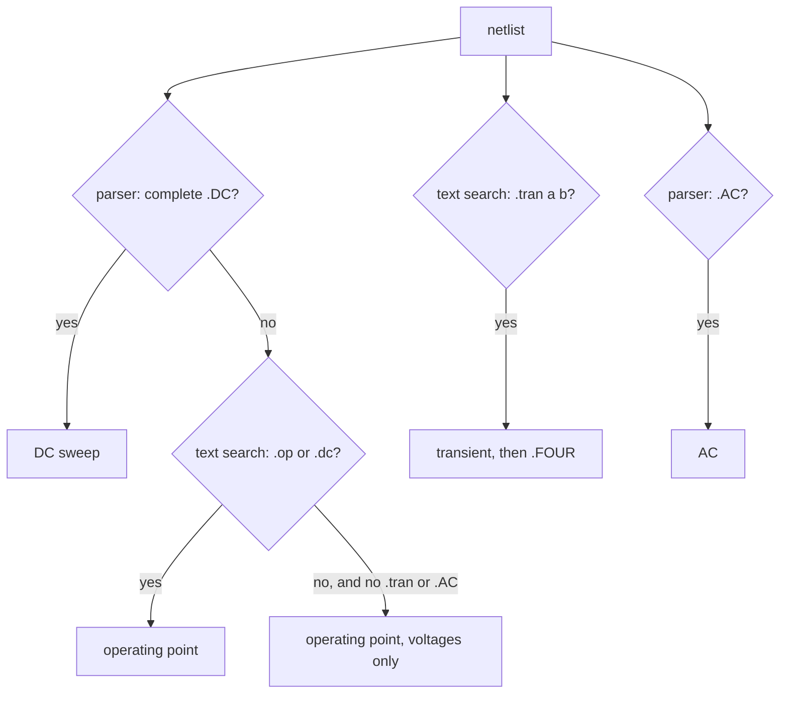

# kirimaspice Reference Manual

[日本語](REFERENCE_MANUAL.ja.md) · This English text is the main version; the Japanese version follows it, and where they differ, this text holds.

This is a reference to the command line, the netlist language and the
output files of the program `kirimaspice`. It was written on
**2026-11-14** from the source at commit `91af284`, reviewed again on
**2026-11-15** at commit `db0fef6` and updated the same day for the fixes
up to commit `eaf0629`; the behaviour it describes was checked by running
those builds (macOS 27.2, arm64, GCC 16.2.0, `kirimaspice
v0.0.0`). Where an entry was read in the code but not run, it says so. For a guided first run, use
the [User Manual](USER_MANUAL.md); for what is wrong or missing, see
[KNOWN_ISSUES.md](../KNOWN_ISSUES.md).

## Contents

- [Command line](#command-line)
- [Environment variables](#environment-variables)
- [Exit codes](#exit-codes)
- [Netlist syntax](#netlist-syntax)
- [Elements](#elements)
- [Models](#models)
- [Directives](#directives)
- [Options](#options)
- [Output formats](#output-formats)
- [Build options](#build-options)
- [Source files](#source-files)

## Command line

```text
kirimaspice <netlist> [options]
```

The netlist must be the first argument. Options that take a value accept
both `--opt value` and `--opt=value`, except `-o`, which takes only
`-o value`, and the solver options, which take only `--opt=value`.
Options the program does not know are ignored without a message.
The output options write files only for some runs; the table under
[How the program chooses analyses](#how-the-program-chooses-analyses)
says which.

| Option | Effect |
| --- | --- |
| `-h`, `--help` | print the usage and exit with 0 |
| `-o <file>` | write the operating point or transient result to `<file>` as SSF (when both run, the transient replaces the operating point in the file), and name the AC CSV after `<file>` |
| `--raw-out <file>` | write the operating point, DC sweep and transient results as an ASCII SPICE3 raw file |
| `--raw-binary-out <file>` | the same as a binary SPICE3 raw file |
| `--wav-out <file>` | write the transient result as a WAV file |
| `--wav-sample-rate <Hz>` | WAV sample rate (default 44100) |
| `--wav-bits <n>` | WAV sample size: 8, 16, 24 or 32 (default 16) |
| `--solver-backend=<name>` | linear solver: `KLU` (default) or `SUPERLU_DIST` |
| `--solver-fallback-order=<a>,<b>` | backends to try when the requested one is not built |
| `--strict-backend` | stop with an error instead of falling back |
| `--superlu-dist-topology=<t>`, `--superlu-dist-grid=<g>` | hints for SuperLU_DIST |

SuperLU_DIST is not built by default and its backend is a placeholder:
asking for it logs `Falling back to klu ...`, or, with `--strict-backend`,
stops with exit code 1.

## Environment variables

| Variable | Effect |
| --- | --- |
| `KIRIMASPICE_SOLVER_BACKEND` | backend, as `--solver-backend`; the command line takes precedence |
| `KIRIMASPICE_SOLVER_FALLBACK_ORDER` | comma-separated fallback order for the variable above (default `klu`) |
| `KIRIMASPICE_SOLVER_STRICT` | `1` makes an unavailable backend from the variable above an error |
| `KIRIMASPICE_TLINE_LOSSY_IIR` | `1` turns on a second-order IIR loss filter in `O` lines (read in the code, not run) |
| `KIRIMASPICE_DEBUG_DUMP` | for development: when set, to any value, writes the MNA system of the second Newton iteration of each DC solve to `debug_coo.txt`, `debug_csc.txt`, `debug_b.txt` and `debug_x.txt` in the current directory, each solve overwriting the last |
| `KIRIMASPICE_BSIM1_DEBUG` | for development: debug logs for BSIM1 devices (optionally only those whose name is the value) |

## Exit codes

| Code | Meaning |
| --- | --- |
| 0 | the requested analyses finished, or `--help` |
| 1 | no netlist, unreadable file, parse error, failed analysis, rejected option value, unavailable backend in strict mode |
| other | uncaught error, for example a non-numeric `--wav-sample-rate` (134 on macOS) |

A netlist that asks for no analysis returns 0 even when its operating point
does not converge.

## Netlist syntax

### Lines

- The netlist is read in this order: `.INCLUDE` files are inserted, `.LIB`
  sections are inserted, `+` continuation lines are joined to the line
  before them and empty lines are dropped, `.IF` blocks are resolved, and
  `.CONTROL` blocks are taken out. The lines that remain are read one by
  one.

  ```mermaid
  flowchart LR
    F[netlist file] --> I[".INCLUDE / .INC: insert the files"]
    I --> L[".LIB: insert the section"]
    L --> C["join + lines, drop empty lines"]
    C --> IF[".IF / .ELIF / .ELSE: keep one branch"]
    IF --> CT[".CONTROL: take out"]
    CT --> T[first line: title]
    T --> R["the other lines, one by one"]
    R --> D["elements whose model or subcircuit comes later: read again at the end"]
  ```

- An included file is found relative to the directory of the file that
  includes it. `.LIB <file>` without a section inserts the whole file; an
  `.INCLUDE` inside a `.LIB` section is dropped without a message.
- The first remaining line is the title.
- A line whose first non-blank character is `*` is a comment. `;` starts a
  comment that runs to the end of the line. There is no other comment
  character.
- A line that starts with `+` continues the line before it. Comment lines
  and empty lines between the two do not end that line, and a `;` comment
  on it ends at the end of its own line.
- A line that starts with `.` is a directive; any other line is an element,
  identified by its first letter in either case.
- Lines after `.END` are read like any other. Unknown directives are
  ignored without a message; an unknown element letter gives the warning
  `Unknown device type`.
- Line numbers in messages count the lines that remain after these steps,
  not the lines of the file. An error in `.INCLUDE`, `.LIB` or `.IF`
  itself gives the line number of the text at that step.

### Names

- Node and element names are case-sensitive; model and subcircuit names
  are not.
- `0` is ground, and so is a node named `gnd` in any case, at the top
  level and inside subcircuits.
- Nodes inside a subcircuit instance are named `<instance>.<node>`, for
  example `X1.n1`.

### Numbers

A number is a decimal or scientific number followed by an optional scale
factor, in any case, as in ngspice. Letters after the number that are not
a scale factor, and letters after a scale factor, are ignored (`10mA` is
0.01, `10MHz` is 0.01).

| Scale factor | Scale |
| --- | --- |
| `T` | 10¹² |
| `G` | 10⁹ |
| `MEG` | 10⁶ |
| `K` | 10³ |
| `MIL` | 25.4×10⁻⁶ |
| `M` | 10⁻³ |
| `U` | 10⁻⁶ |
| `N` | 10⁻⁹ |
| `P` | 10⁻¹² |
| `F` | 10⁻¹⁵ |
| `A` | 10⁻¹⁸ |

`M` is milli in either case; mega is `MEG`.

### Expressions

A value written in braces, `{...}`, is evaluated with ExprTk. It can use
the parameters defined so far, the constants `pi` and `e`, ExprTk's
built-in functions, and, in `.PARAM` only, functions defined by `.FUNC`.
Scale suffixes are not accepted inside braces (`{1m}` is an error). A brace
group is one token even if it contains spaces, and one that follows `=`
stays in the same token, so `IS={ISAT}` and `IS={a * 2}` are each one
parameter, on a `.MODEL` line too. The arguments of a source waveform may
have spaces inside braces.

## Elements

`<n+>` and `<n->` are nodes; `<value>` is a number or an expression in
braces. Parameters written `NAME=value` may appear in any order; names are
not case-sensitive. Blanks may stand on either side of the `=`, on any line
(`W = 10u`, `.param rv ={2*1000}`).

| Element | Syntax | Notes | In `.SUBCKT` |
| --- | --- | --- | --- |
| Resistor | `R<name> <n+> <n-> <value>` | further tokens are ignored | yes |
| Capacitor | `C<name> <n+> <n-> <value>` | further tokens (such as `IC=`) are ignored | yes |
| Inductor | `L<name> <n+> <n-> <value>` | further tokens are ignored | yes |
| Mutual inductance | `K<name> <L1> <L2> <k>` | `<L1>`, `<L2>` are inductor names; `<k>` outside 0 to 1 is an error | no |
| Voltage source | `V<name> <n+> <n-> [[DC] <value>] [AC [<mag> [<phase>]]] [<waveform>]` | see below | DC and AC, no waveform |
| Current source | `I<name> <n+> <n-> [[DC] <value>] [AC [<mag> [<phase>]]] [<waveform>]` | see below | DC and AC, no waveform |
| VCVS | `E<name> <n+> <n-> <nc+> <nc-> <gain>` | | no |
| CCCS | `F<name> <n+> <n-> <Vcontrol> <gain>` | `<Vcontrol>` must be a `V` source | no |
| VCCS | `G<name> <n+> <n-> <nc+> <nc-> <gm>` | | no |
| CCVS | `H<name> <n+> <n-> <Vcontrol> <r>` | `<Vcontrol>` must be a `V` source | no |
| Behavioural source | `B<name> <n+> <n-> I=<expr>` or `V=<expr>` | see below | no |
| Diode | `D<name> <anode> <cathode> [<model>] [IS=<v>] [N=<v>]` | | no |
| Bipolar transistor | `Q<name> <c> <b> <e> <NPN\|PNP\|model> [parameters]` | | no |
| MOSFET and related | `M<name> <d> <g> <s> [<b>] <NMOS\|PMOS\|model> [parameters]` | model `LEVEL` selects the device | four terminals, level 1 or BSIM4 |
| MESFET | `Z<name> <d> <g> <s> [<NMF\|PMF\|model>] [parameters]` | | no |
| SCR | `S<name> <anode> <cathode> <gate> [parameters]` | | no |
| TRIAC | `Y<name> <mt2> <mt1> <gate> [parameters]` | | no |
| Lossless line | `T<name> <a+> <a-> <b+> <b-> Z0=<v> TD=<v>` | both required and positive; `ZO` is accepted for `Z0` | no |
| Lossy line | `O<name> <a+> <a-> <b+> <b-> R=<v> L=<v> C=<v> G=<v> TD=<v>` | per unit length; `TD` required and positive | no |
| Subcircuit instance | `X<name> <nodes...> <subckt> [NAME=<v> ...]` | | yes |

Inside a subcircuit, an element marked "no" is dropped with the warning
`Subcircuit expansion: Unsupported device type`.

### Sources

- The DC value, the AC input and the waveform may come in any order, and
  each may be left out (`V1 a b` alone is an error). `DC` before the value
  is optional; `V1 a b DC` and `V1 a b AC 1` have 0 V DC. Anything else on
  the line is an error.
- As in SPICE (and ngspice-47), the operating point and `.DC` take the DC
  value, or the waveform's value at time 0 when the line has no DC value;
  a transient starts from the waveform at time 0 and follows it; AC takes
  the AC input. `.DC` sweeps the DC value of a source with a waveform too.
- The waveforms, for voltage and current sources alike:

  | Waveform | Arguments | Value |
  | --- | --- | --- |
  | `PULSE` | `V1 V2 TD TR TF PW PER`, all seven | `V1` before `TD`, then the rise, `V2` for `PW`, the fall, repeating every `PER` |
  | `SIN` | `VO VA FREQ [TD [THETA [PHASE]]]` | `VO + VA sin(PHASE)` before `TD`, then `VO + VA e^(−THETA (t − TD)) sin(2π FREQ (t − TD) + PHASE)`; `PHASE` in degrees |
  | `EXP` | `V1 V2 TD1 TAU1 TD2 TAU2`, all six | `V1` before `TD1`, then `V1 + (V2 − V1)(1 − e^(−(t − TD1)/TAU1))`, from `TD2` on plus `(V1 − V2)(1 − e^(−(t − TD2)/TAU2))` |
  | `PWL` | `T1 V1 T2 V2 ...` | linear between the points, `V1` before `T1`, the last value after the last point; times must not decrease |
  | `SFFM` | `VO VA FC [MDI FS]` | `VO + VA sin(2π FC t + MDI sin(2π FS t))` |

  The arguments are in parentheses, or follow the keyword without them,
  separated by spaces or commas; each may be an expression in braces. The
  defaults that SPICE derives from `.TRAN` (for example `TR` and `TF` of
  `PULSE`, or `FREQ` of `SIN`) are not taken: those arguments must be
  given, and a wrong number of arguments is an error. ngspice-47 gives an
  `SFFM` source without a DC value 0 V in the operating point, where
  kirimaspice takes `VO` (its value at time 0).
- Only a source whose line has `AC` is an input of AC analysis; `AC`
  without a magnitude means 1, and the phase, in degrees, defaults to 0. A
  source without `AC` has magnitude 0. Inside subcircuits the same holds.
- The current of a voltage source, and of `E`, `H` and voltage-form `B`
  sources, as printed and written, is positive when it flows into the `+`
  terminal through the source, so a source delivering current has a
  negative current. `F` and `H` use that current as their control.
- `F` and `H` name a voltage source that may appear later in the netlist.

### Behavioural sources

`B` takes the first token that starts with `V=` or `I=`; the expression may
be in braces (`V={2*V(in)}`), and without braces it must have no spaces.
It can use `V(<node>)` or `v(<node>)`, `TIME`, `pi` (not `e`) and
ExprTk's built-in functions; `.PARAM` names and `I(<source>)` are not
available. `TIME` is the time of the transient, and 0 in the operating
point (also in the one that starts a transient). An expression that
cannot be compiled is an error at the `B` line. Both forms work in the
operating point and the transient; in AC analysis a `B` source contributes
nothing and logs `AC analysis not yet supported`.

### Parameters of the simpler devices

These are the parameters the parser reads; any other parameter in the
element line or the `.MODEL` card is ignored without a message. An
instance parameter overrides the model's.

| Element | Parameters (default) |
| --- | --- |
| `D` | `IS` (1e-14 A), `N` (1) |
| `Q` | `IS` (1e-14 A), `BF` (100), `NF` from a model or `N` on the instance (1), `ISE` (0), `NE` (1.5), `ISC` (0), `NC` (2), noise `KF` (0), `AF` (1), `FF` (1) |
| `M`, level 1 | `KP` (2e-5 A/V²), `W` (10 µm), `L` (1 µm), `VTO` or `VTH` on the card and `VTH` on the element line (0.7 V for NMOS, −0.7 V for PMOS), noise `KF` (0), `AF` (1), `EF` (1), `GAMMA` (0.667) |
| `Z` | `LEVEL`/`MODEL` (formula), `BETA` (0.1), `VTO` (−2 V; +2 V when the element line says `PMF`), `LAMBDA` (0.05), `ALPHA` (2), `B` (0.3), `VP` (3 V), `CGS` (1 pF), `CGD` (0.5 pF), `CDS` (0.1 pF), `KF`, `AF`, `EF`, `TNOM` (27 °C) |
| `S` | `VBF` (400 V), `IGT` (20 mA), `IH` (10 mA), `IL` (30 mA), `VGT` (1 V), `RON` (0.1 Ω), `VTM` (1.5 V), `DV_DT` (10), `TNOM` (27 °C) |
| `Y` | `VBO` (400 V), `IGT` (20 mA), `IH` (10 mA), `VGT` (1 V), `RON` (0.1 Ω), `VTM` (1.5 V), `DV_DT` or `DVDT` (10), `TNOM` (27 °C) |

- The level-1 MOSFET has no bulk terminal in its equations, no channel
  length modulation and no capacitances. Its `GAMMA` is the coefficient of
  channel thermal noise, not the body-effect coefficient of SPICE.
- `S` and `Y` take parameters only on the element line: `.MODEL` has no
  SCR or TRIAC type, and a model name on their line that is not defined
  before them is ignored without a message.
- With three terminals, `M` ties the bulk to the source. The parser treats
  a line as four-terminal when its sixth token starts with `NMOS` or
  `PMOS` or names a model of the netlist.

## Models

```text
.MODEL <NAME> <type>(<param>=<value> ...)
.MODEL <NAME> <type> <param>=<value> ...
```

- `<type>` is `NPN`, `PNP`, `D` (or `DIODE`), `NMOS`, `PMOS`, `NMF` or
  `PMF`, in any case. Any other type is an error.
- Parameter names are not case-sensitive; `NAME = value` with spaces is
  accepted; values may be expressions in braces.
- `TNOM`, on a card or an element line, is in °C, as in SPICE, for every
  device; so are `.TEMP` and `.OPTIONS TEMP`. The default `TNOM` is 27 °C.
- Model names are compared without regard to case; a `.MODEL` whose name
  differs from an earlier one only in case replaces it.
- A `.MODEL` line applies to the whole netlist: a `D`, `Q`, `M` or `Z`
  element may come before its model. An element whose model is not
  defined anywhere is an error
  (`Undefined diode model`, `Undefined BJT model`, `Undefined MESFET
  model`, `Undefined MOSFET model`), given at the element's line.

For `NMOS` and `PMOS`, `LEVEL` selects the device:

| `LEVEL` | Device | Unknown card parameters | Element-line parameters | In `.SUBCKT` |
| --- | --- | --- | --- | --- |
| 1 (default) | level 1 (square law) | ignored without a message | `KP`, `W`, `L`, `VTH`, `KF`, `AF`, `EF`, `GAMMA` | yes, four terminals |
| 3 | SPICE's level 3 | warning | `W`, `L` | no |
| 9 | BSIM1 | warning | `W`, `L` | no |
| 8, 49 | BSIM3 | warning | `W`, `L` | no |
| 14, 54 | BSIM4 (a model card with a `VERSION` other than 4.83 gives a warning) | ignored without a message | `W`, `L`, `MULT_I`, `MULT_Q`, `MULT_FN` | yes, four terminals |
| 10 | SiC MOSFET | warning | all, by name | no |
| 11 | GaN HEMT | warning | all, by name | no |
| 12 | FinFET | warning | `L` only (others ignored without a message) | no |
| 20 | VDMOS | warning | all, by name | no |
| 21 | IGBT (`M` terminals are collector, gate, emitter) | warning | all, by name | no |

Any other `LEVEL` is an error at the `.MODEL` line, as in ngspice-47.
`AD`, `AS`,
`PD`, `PS`, `NRD` and `NRS` on the element line are ignored without a
message (read in the code).

The parameter names of levels 3, 9, 8/49 and 14/54 follow the respective
Berkeley model manuals. Level 3 computes SPICE's level 3 equations with
TOX, NSUB, NSS, TPG, XJ, LD, WD, VTO, PHI, GAMMA, UO, KP, THETA, VMAX,
ETA, KAPPA, DELTA and NFS; PHI, GAMMA and VTO that the card does not give
follow from NSUB (and TPG, NSS). LAMBDA, RS, RD, CJ, CJSW and MJSW are
accepted on a level 3 card without a warning and not used. The parameter
lists are in `parse_mosfet_device` in `src/parser/netlist_parser.cpp`, and
for BSIM4 in `bsim4_params_from_model` in
`src/devices/mosfet_bsim4_params.cpp`. Levels 10, 11, 12, 20 and 21 start
from the device's own defaults, those of its polarity, and take the
parameters of the card and then of the element line by name.

### FinFET (`LEVEL=12`)

The FinFET is kirimaspice's own simplified square-law model
(`src/devices/finfet.cpp`), not BSIM-CMG. Its terminals are drain, gate and
source; a bulk node on the `M` line is accepted and not used. Every
parameter of the `.MODEL` card goes to the device, and one that the FinFET
does not have, or a value out of range, gives a warning and is ignored. Of
the element line's parameters only `L` is read; it overrides the card.

| Parameter | Meaning | NMOS default | PMOS default |
| --- | --- | --- | --- |
| `NFIN` | number of fins | 1 | 1 |
| `HFIN` | fin height [m] | 30e-9 | 30e-9 |
| `TFIN` | fin thickness [m]; read, not used by the current | 7e-9 | 7e-9 |
| `L` | gate length [m] | 1e-6 | 1e-6 |
| `VTH`, `VTH0` or `VTO` | threshold [V], with its sign | 0.4 | −0.4 |
| `U0` | low-field mobility [m²/Vs] | 0.03 | 0.025 |
| `VSAT` | saturation velocity [m/s]; read, not used by the current | 1e5 | 8e4 |
| `SS` | subthreshold swing [V/decade] | 0.07 | 0.075 |
| `DIBL` | threshold lowering per volt of V<sub>DS</sub> [V/V] | 0.05 | 0.06 |
| `TOX` | gate oxide thickness [m] | 1e-9 | 1e-9 |
| `CGS`, `CGD` | gate–source and gate–drain capacitance [F] | 1e-15, 1e-16 | 1e-15, 1e-16 |
| `KF`, `AF` | flicker noise coefficient and exponent | 0, 1 | 0, 1 |
| `KT1` | temperature coefficient of the threshold, with its sign [V/K] | −1e-3 | 1e-3 |
| `TNOM` | nominal temperature [°C] | 27 | 27 |

The current from drain to source of an NMOS, with V<sub>GS</sub> and
V<sub>DS</sub>; a PMOS has the same equations in V<sub>SG</sub> and
V<sub>SD</sub>, with its current from source to drain:

- W<sub>eff</sub> = `NFIN`·`HFIN`, C<sub>ox</sub> = 3.9 ε<sub>0</sub>/`TOX`,
  β = `U0`·(`TNOM`/T)<sup>1.5</sup>·C<sub>ox</sub>·W<sub>eff</sub>/`L`.
- V<sub>th</sub>(T) = `VTH` + `KT1`·(T − `TNOM`), its magnitude for a PMOS;
  V<sub>th,eff</sub> = V<sub>th</sub>(T) − `DIBL`·V<sub>DS</sub> for
  V<sub>DS</sub> > 0.
- At or above the threshold, with V<sub>ov</sub> = V<sub>GS</sub> −
  V<sub>th,eff</sub>: β (V<sub>ov</sub> V<sub>DS</sub> −
  V<sub>DS</sub><sup>2</sup>/2) for V<sub>DS</sub> < V<sub>ov</sub>, and
  β V<sub>ov</sub><sup>2</sup>/2 above.
- Below the threshold: β V<sub>t</sub><sup>2</sup> exp(V<sub>ov</sub> /
  (n V<sub>t</sub>)) (1 − exp(−V<sub>DS</sub>/V<sub>t</sub>)), with
  n = `SS`/(V<sub>t</sub> ln 10), so the current changes by one decade per
  `SS` of gate voltage.
- 10<sup>−12</sup> S lies between drain and source. `CGS` and `CGD` are
  constant, and the transient integrates them by backward Euler. The noise
  sources are 4kT·(2/3)·g<sub>m</sub> and `KF`·|I<sub>D</sub>|<sup>`AF`</sup>/f.

[KNOWN_ISSUES](../KNOWN_ISSUES.md#device-models) lists what this model
leaves out.

## Directives

"Used" means the program acts on the directive. "Read only" means the
parser stores it, but the program does not use it (the library can).

| Directive | Syntax | Status |
| --- | --- | --- |
| `.OP` | `.OP` | used: operating point (found by a text search, see [below](#how-the-program-chooses-analyses)) |
| `.DC` | `.DC <src> <start> <stop> <step> [<src2> <start2> <stop2> <step2>]` | used; `<src>` is a voltage or current source and is swept for each value of `<src2>`; a zero step is an error |
| `.TRAN` | `.TRAN <tstep> <tstop> [<tstart> [<tmax>]] [UIC]` | used; the program steps by `tstep`, and `tmax` is read but has no effect; as in SPICE, the simulation runs from 0 and keeps the points from `tstart` on, with a point on `tstart` |
| `.AC` | `.AC DEC\|OCT\|LIN <n> <fstart> <fstop>` | used; `DEC`, `OCT`: round(`<n>` × the number of decades or octaves) + 1 points, evenly spaced in log from `<fstart>` to `<fstop>`, both included (`.AC DEC 3 10 50` gives 10, 22.36, 50 Hz, where ngspice-47 gives 10, 21.54, 46.42 Hz); `LIN`: `<n>` points in all |
| `.TEMP` | `.TEMP <t1> [<t2> ...]` (°C) | used; one value is `.OPTIONS TEMP=<t1>` (as in ngspice-47, which takes one value only); with several, every analysis runs at each value (see [below](#how-the-program-chooses-analyses)) |
| `.OPTIONS`, `.OPTION` | `.OPTIONS <name>=<value> ...` | used; see [Options](#options) |
| `.IC` | `.IC V(<node>)=<value> ...` | used by a transient: with `UIC` it starts from these values, without `UIC` its operating point holds the nodes at them; `V` must be upper case |
| `.NODESET` | `.NODESET V(<node>)=<value> ...` | used as the initial guess; `V` must be upper case |
| `.PARAM` | `.PARAM <name>=<value> ...` | used; the first definition of a name is kept |
| `.FUNC` | `.FUNC <name>(<a>[,<b>[,<c>]]) {<expr>}` | used in `.PARAM` expressions only; up to three arguments |
| `.MODEL` | see [Models](#models) | used |
| `.SUBCKT` / `.ENDS` | `.SUBCKT <name> <pins...> [NAME=<default> ...]` | used; no nesting of definitions; no `PARAMS:`; a `.SUBCKT` without `.ENDS` is an error |
| `.GLOBAL` | `.GLOBAL <node> ...` | used in subcircuit expansion |
| `.INCLUDE`, `.INC` | `.INCLUDE <file>` | used; relative to the netlist's directory |
| `.LIB` / `.ENDL` | `.LIB <file> [<section>]` | used; without a section, the whole file |
| `.IF` / `.ELIF` / `.ELSE` / `.ENDIF` | `.IF (<expr>)` | used, but `.PARAM` values are not visible; an expression that cannot be evaluated keeps all branches |
| `.END` | `.END` | ignored; lines after it are read |
| `.PRINT`, `.SAVE` | `.PRINT DC\|TRAN\|AC <signals>`, `.SAVE <signals>` | read only |
| `.FOUR` | `.FOUR <frequency> <signal> ...`, each `v(<node>)` or `i(<source>)` | used with `.TRAN`: prints the harmonics and the THD of the last period of each signal after the transient |
| `.STEP`, `.SENS`, `.MC`, `.TF`, `.PZ`, `.DISTO`, `.PORT`, `.WCASE`, `.OPTIMIZE` | | read only |
| `.CONTROL` / `.ENDC` | | taken out and run by the parser; the program does not take its analyses from it (see [KNOWN_ISSUES.md](../KNOWN_ISSUES.md)) |
| `.TITLE`, `.MEASURE`, others | | ignored |

### How the program chooses analyses

- The DC sweep runs when the parser has read a complete `.DC` line, and AC
  when it has read `.AC`.
- The operating point and the transient are chosen by searching each raw
  line of the netlist file (not of included files) for `.op`, `.dc`, or
  `.tran` followed by two words, in any case and anywhere in the line,
  comments included. A `.OPTIONS` line therefore selects the operating
  point. A `.DC` line selects the sweep instead of the operating point,
  also when `.OP` is there too.
- With none of these, the program computes the operating point, prints
  the node voltages only and writes no file.
- With a `.TEMP` list of several values, all of this runs once per value,
  after a line `=== Temperature <t> °C ===`. The raw files hold the plots
  of every run, one after another; the SSF, WAV and AC CSV files of a run
  carry its temperature before their extension (`out_27C.ssf`,
  `out_ac_27C.csv`).



They run in this order: DC sweep, operating point, transient, AC. What
each run prints and writes:

| Run | Standard output | `-o` (SSF) | `--raw-out`, `--raw-binary-out` | `--wav-out` | AC CSV |
| --- | --- | --- | --- | --- | --- |
| DC sweep | a summary | — | yes | — | — |
| operating point | voltages and currents | yes, replaced by a later transient | yes | — | — |
| transient | the table, then `.FOUR` | yes | yes | yes | — |
| AC | nothing | — | — | — | always, named after `-o` or the netlist |
| default operating point | voltages only | — | — | — | — |

## Options

Each option is `<name>=<value>`; names are not case-sensitive. A value is a
plain number (no scale suffix) unless the table says otherwise. A malformed
or unknown option gives a warning and is ignored.

| Option | Default | Meaning |
| --- | --- | --- |
| `TEMP` | 27 | temperature in °C |
| `GMIN` | 1e-12 | minimum conductance (S) |
| `ABSTOL` | 1e-12 | absolute current tolerance (DC and transient) |
| `RELTOL` | 1e-3 | relative tolerance (DC and transient) |
| `VNTOL` | 1e-6 | voltage tolerance (DC and transient) |
| `ITL1` | 100 | DC iteration limit |
| `ITL2` | 0 (use `ITL1`) | iteration limit per DC sweep point |
| `ITL4` | 20 | iteration limit per transient step |
| `ITL5` | 100000 | limit on transient steps |
| `ITL6` | 0 (use `ITL1`) | iteration limit per source-stepping step |
| `METHOD` | `trap` | `trap`/`trapezoidal`, `euler`/`be`/`bdf1`, `gear`/`gear2`/`bdf2`, `gear3`/`bdf3`, `tr_bdf2`/`trbdf2` |
| `MAXORD`, `MAXORDER` | 3 | highest order, 1 to 6 (no effect in the program) |
| `TRTOL` | 7 | truncation error tolerance factor (no effect in the program) |
| `CHGTOL` | 1e-14 | charge tolerance (C) (no effect in the program) |
| `LTE_ABSTOL`, `LTE_RELTOL` | 1e-6, 1e-3 | local truncation error tolerances (no effect in the program) |
| `ERROR_EST`, `ERRMETHOD` | `physical` | `physical`/`charge`/`embedded`, `predictor_corrector`/`pc`/`dvdt`, `combined`/`both` (no effect in the program) |
| `GMIN_STEPPING` | 0 | 1 turns gmin stepping on |
| `GMIN_STEPS`, `GMIN_START`, `GMIN_END` | 5, 1e-6, 1e-12 | its steps and range |
| `SOURCE_STEPPING` | 0 | 1 turns source stepping on |
| `SOURCE_STEPS`, `SOURCE_START` | 10, 0.01 | its steps and starting fraction |
| `DYN_GMIN` | 0 | 1 turns dynamic gmin on |
| `DYN_GMIN_START`, `DYN_GMIN_MIN`, `DYN_GMIN_MAX` | 1e-12, 1e-12, 1e-3 | its range |
| `DYN_GMIN_INC`, `DYN_GMIN_DEC` | 10, 0.2 | its factors |
| `DYN_GMIN_STALL`, `DYN_GMIN_IMPROVE`, `DYN_GMIN_TARGET` | 4, 0.1, 1e-9 | its control |
| `CONTINUATION` | 0 | 1 turns continuation on |
| `CONTINUATION_STEPS`, `CONTINUATION_START` | 8, 0.05 | its steps and starting value |
| `PSEUDO_TRANSIENT` | 0 | 1 turns the pseudo-transient on |
| `PSEUDO_DT`, `PSEUDO_STEPS`, `PSEUDO_CAP` | 1e-9, 30, 1e-12 | its step, count and capacitance |
| `VOLTAGE_LIMITING` | 1 | junction voltage limiting; 0 turns it off |

The options marked "no effect in the program" act only on the adaptive
time step, which the program does not use: its transient steps by
`tstep`. How each method is applied when the operating point does not
converge is in `src/solvers/dc_solver.cpp`; this manual does not describe
it.

## Output formats

### Standard output

Log lines (`[<time>] [info]`, `[warning]`, `[error]`) and results are both
written to standard output. The results are:

- operating point: `=== DC Operating Point ===`, then `V(0) = 0 V`, one
  `V(<node>) = <value> V` per node and one `I(<source>) = <value> A` per
  voltage, `E`, `H` and voltage-form `B` source;
- DC sweep: a summary only;
- transient: `=== Transient Analysis Results ===` and a tab-separated table
  with a `Time (s)` column and one `V(<node>)` column per node, `V(0)`
  included, one row per time point;
- AC: nothing.

Under a `.TEMP` list of several values, each run's results follow a line
`=== Temperature <t> °C ===`.

### SPICE3 raw, ASCII (`--raw-out`)

The header has `Title` (`kirimaspice <plot name>`, not the netlist's
title), `Date`, `Plotname`, `Flags: real`, `No. Variables`, `No. Points`
and `Variables`, followed by `Values`.

| Analysis | `Plotname` | Variables |
| --- | --- | --- |
| operating point | `DC Operating Point` | `v(<node>)`, then `i(<source>)` |
| DC sweep | `DC Sweep` or `DC Sweep (2D)` | the swept source(s) (type `sweep`), `v(<node>)`, `i(<source>)` |
| transient | `Transient Analysis` | `time`, `v(<node>)`, `i(<source>)` |

Ground (the node `0`) is not a variable. Each analysis run appends one plot
to the same file. Each point holds one value per variable, the first on the
line with the point index.

### SPICE3 raw, binary (`--raw-binary-out`)

The same header, with the names in upper case (`V(<node>)`, `I(<source>)`),
then `Binary:` and the values as 8-byte IEEE doubles in the byte order of
the machine (little-endian on x86-64 and arm64), point after point. For a
two-source DC sweep the binary file differs: its plot name is `DC Sweep`,
its title `kirimaspice DC Sweep Analysis`, and it has one sweep variable,
named `<src>-<src2>`, holding the value of `<src>`.

ngspice-47 loads both raw files: on 2026-11-14 its `load` command read a
transient plot of 502 points written by kirimaspice, ASCII and binary,
with the same values. Other plots and other readers are not confirmed.

### SSF (`-o`)

A binary file with a fixed header (`SSF`), a list of `key=value` metadata
(`file.format`, `file.version` 4.3, `file.generator`, `file.analysis`,
`file.timestamp`, `axis.0.*`, and `signal.<n>.name`, `.node` or
`.device`, `.quantity`, `.unit`; the signals include `v(0)`), and data
blocks compressed with zstd. Its specification is not
published in this repository; the writer is `src/output/ssf_writer.cpp`.

### AC CSV

The file `<base>_ac.csv`, where `<base>` is the `-o` path, or the netlist
path, without the extension of its last component (`_ac_<t>C.csv` under a
`.TEMP` list). Lines that start with `#` give
`AC Analysis Result`, the title, date, simulator, analysis type, number of
points and nodes, frequency range, status, number of linear solves and
time. Then a header and one row per
frequency:

```text
frequency,v(<node>)_real,v(<node>)_imag,v(<node>)_mag_dB,v(<node>)_phase_deg,...
```

Phases are in degrees; magnitudes in dB are 20·log₁₀|V|. Branch currents
are not written.

### WAV (`--wav-out`)

PCM, one channel per node (ground excluded). The transient result is
interpolated linearly at the sample rate. A voltage of ±1 V is full scale
and larger values are clipped. 8-bit samples are unsigned; 16-, 24- and
32-bit samples are signed integers.

## Build options

| CMake option | Default | Effect |
| --- | --- | --- |
| `CMAKE_CXX_STANDARD` | 23 | 23, or 26 to try the next standard; other values are an error |
| `BUILD_TESTS` | ON | build the tests |
| `BUILD_BENCHMARKS` | OFF | build the benchmarks |
| `ENABLE_COVERAGE` | OFF | add `--coverage` (GCC and Clang) |
| `SANITIZE_ADDRESS` | OFF | build with AddressSanitizer (GCC and Clang) |
| `KIRIMASPICE_WITH_SUPERLUDIST` | OFF | the SuperLU_DIST placeholder |
| `KIRIMASPICE_WITH_SUNDIALS` | OFF | sets a macro only |
| `KIRIMASPICE_SOLVER` | `KLU` | default backend name |

By `CMakeLists.txt`, `cmake --install build` installs `kirimaspice`, the
static library `kirimaspice_lib` and the headers under `include/` (read in
the file, not run).

## Source files

- The command line: `src/main.cpp`.
- The netlist parser: `src/parser/netlist_parser.cpp`; numbers:
  `include/kirimaspice/util/units.hpp`; defaults:
  `SimulationConfig` in `include/kirimaspice/core/types.hpp`.
- Subcircuit expansion: `src/circuit/circuit_graph.cpp`.
- Output writers: `src/output/`.
