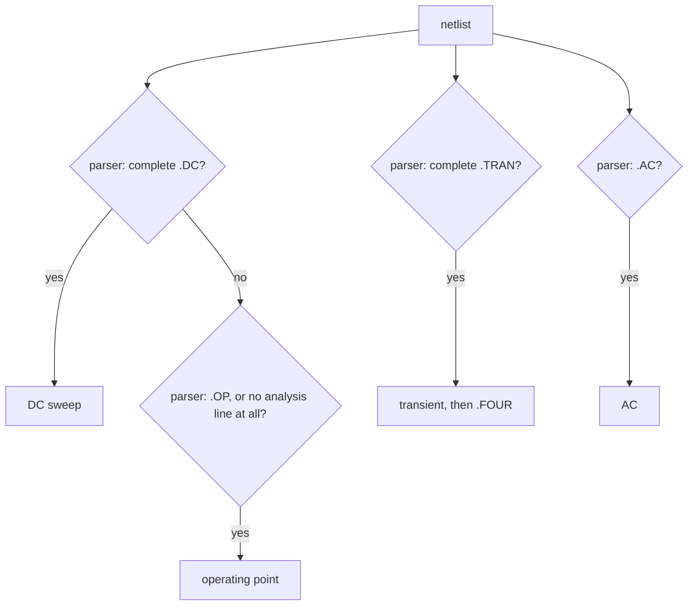

# kirimaspice Reference Manual

[日本語](REFERENCE_MANUAL.ja.md) · This English text is the main version; the Japanese version follows it, and where they differ, this text holds.

This is a reference to the command line, the netlist language and the
output files of the program `kirimaspice`. It was written on
**2026-11-14** from the source at commit `91af284`, reviewed again on
**2026-11-15** at commit `db0fef6`, and updated with the program since. On
**2026-11-21** the whole manual was reviewed again against the code and
the build of commit `2826a81` (macOS 27.2, arm64, GCC 16.2.0, `kirimaspice
0.0.0`); the entries corrected then were checked by running that build.
The entries that the fixes up to commit `9bc2043` changed were updated
on the same day.
Where an entry was read in the code but not run, it says so. For a guided first run, use
the [User Manual](USER_MANUAL.md); for what is wrong or missing, see
[KNOWN_ISSUES.md](../KNOWN_ISSUES.md).

## Contents

- [Command line](#command-line)
- [Environment variables](#environment-variables)
- [Exit codes](#exit-codes)
- [Netlist syntax](#netlist-syntax)
- [Elements](#elements)
- [Models](#models)
- [Directives](#directives)
- [Options](#options)
- [Output formats](#output-formats)
- [Build options](#build-options)
- [Source files](#source-files)

## Command line

```text
kirimaspice [options] <netlist>
kirimaspice --version | --help
```

Options may come before or after the netlist, and there is one netlist.
An option that takes a value accepts both `--opt value` and
`--opt=value` (`-o` only `-o value`). An option the program does not
know, an option without its value and a second netlist are errors: the program says which and exits with
code 2.
The output options write files only for some runs; the table under
[How the program chooses analyses](#how-the-program-chooses-analyses)
says which.

| Option | Effect |
| --- | --- |
| `-h`, `--help` | print the usage and exit with 0 |
| `--version` | print `kirimaspice <version>` and exit with 0 |
| `-o <file>` | write the operating point or transient result to `<file>` as SSF (when both run, the transient replaces the operating point in the file), and name the AC CSV after `<file>` |
| `--raw-out <file>` | write the operating point, DC sweep and transient results as an ASCII SPICE3 raw file |
| `--raw-binary-out <file>` | the same as a binary SPICE3 raw file |
| `--wav-out <file>` | write the transient result as a WAV file |
| `--wav-sample-rate <Hz>` | WAV sample rate (default 44100) |
| `--wav-bits <n>` | WAV sample size: 8, 16, 24 or 32 (default 16) |
| `--log-level <level>` | the lowest level of the messages on standard error: `error`, `warning`, `info` (default) or `debug`; another value is an error |

The linear solver is KLU. The program has no option to choose another:
the SuperLU_DIST backend of the library is a placeholder.

## Environment variables

| Variable | Effect |
| --- | --- |
| `KIRIMASPICE_DEBUG_DUMP` | for development: when set, to any value, writes the MNA system of the second Newton iteration of each DC solve to `debug_coo.txt`, `debug_csc.txt`, `debug_b.txt` and `debug_x.txt` in the current directory, each solve overwriting the last |
| `KIRIMASPICE_BSIM1_DEBUG` | for development: debug logs for BSIM1 devices (optionally only those whose name is the value) |

## Exit codes

| Code | Meaning |
| --- | --- |
| 0 | the requested analyses finished, or `--help` or `--version` |
| 1 | an analysis failed (also the operating point of a netlist without analysis lines) |
| 2 | an error of the command line or the input: no netlist, a second netlist, an unknown option or one without its value, a rejected option value such as a non-numeric `--wav-sample-rate` or an unknown `--log-level`, a file that cannot be read, a parse error, an error in building the circuit, an output file that cannot be written |
| 3 | an internal error: an exception while an analysis runs, or one not derived from `std::exception` |
| other | the program was stopped by a signal |

The codes are those of kirimasim, the sister simulator (its
`docs/spec/CLI.md` section 5), so that a script driving both reads them
alike.

## Netlist syntax

### Lines

- Lines may end with LF or with CR LF; the CR of a CR LF is removed as
  each file is read.
- The netlist is read in this order: `.INCLUDE` files are inserted, `.LIB`
  sections are inserted, `+` continuation lines are joined to the line
  before them and empty lines are dropped, `.IF` blocks are resolved, and
  `.CONTROL` blocks are taken out. The lines that remain are read one by
  one; a line that the grammar cannot read (one with a CR inside it) is a
  parse error.

  ```mermaid
  flowchart LR
    F[netlist file] --> I[".INCLUDE / .INC: insert the files"]
    I --> L[".LIB: insert the section"]
    L --> C["join + lines, drop empty lines"]
    C --> IF[".IF / .ELIF / .ELSE: keep one branch"]
    IF --> CT[".CONTROL: take out"]
    CT --> T[first line: title]
    T --> R["the other lines, one by one"]
    R --> D["elements whose model or subcircuit comes later: read again at the end"]
  ```

- An included file is found relative to the directory of the file that
  includes it; a `.LIB` file named in an included file, relative to that
  file's directory when the library is there, and otherwise, as one named
  in the netlist, relative to the netlist's directory. `.LIB <file>`
  without a section inserts the whole file; an
  `.INCLUDE` inside a `.LIB` section is not inserted, and is named in the
  warning `unknown directive .INCLUDE is ignored`.
- The first remaining line is the title.
- A line whose first non-blank character is `*` is a comment. `;` starts a
  comment that runs to the end of the line. There is no other comment
  character.
- A line that starts with `+` continues the line before it. Comment lines
  and empty lines between the two do not end that line, and a `;` comment
  on it ends at the end of its own line.
- A line that starts with `.` is a directive; any other line is an element,
  identified by its first letter in either case.
- Lines after `.END` are read like any other. A directive the parser does
  not read is ignored and named in one warning (`unknown directive`, or
  `is not supported` for `.NOISE`, `.MEASURE` and `.TITLE`), and the
  program names once each directive it reads but does not run
  (`is read, but this program does not run it`). An element of a letter not in the table
  below (such as `J`) is a parse error, `Unknown element letter`, also in
  a subcircuit body.
- Line numbers in messages count the lines that remain after these steps,
  not the lines of the file. An error in `.INCLUDE`, `.LIB` or `.IF`
  itself gives the line number of the text at that step.

### Names

- Node, element, model and subcircuit names are not case-sensitive, as in
  SPICE: `OUT` and `out` are one node, kept and written in lower case.
- `0` is ground, and so is a node named `gnd` in any case, at the top
  level and inside subcircuits.
- Nodes inside a subcircuit instance are named `<instance>.<node>`, for
  example `x1.n1`; element names keep their case, `X1.R1`.

### Numbers

A number is a decimal or scientific number followed by an optional scale
factor, in any case, as in ngspice. Letters after the number that are not
a scale factor, and letters after a scale factor, are ignored (`10mA` is
0.01, `10MHz` is 0.01). Anything else after the number is an error:
`2*1k`, `1k5` and `1.5.3k` are not numbers, where ngspice-47 reads `1k5`
as 1k and `1.5.3k` as 1.5.

| Scale factor | Scale |
| --- | --- |
| `T` | 10¹² |
| `G` | 10⁹ |
| `MEG` | 10⁶ |
| `K` | 10³ |
| `MIL` | 25.4×10⁻⁶ |
| `M` | 10⁻³ |
| `U` | 10⁻⁶ |
| `N` | 10⁻⁹ |
| `P` | 10⁻¹² |
| `F` | 10⁻¹⁵ |
| `A` | 10⁻¹⁸ |

`M` is milli in either case; mega is `MEG`.

### Expressions

A value written in braces, `{...}`, is evaluated with ExprTk. It can use
the parameters defined so far, the constants `pi` and `e`, ExprTk's
built-in functions, and, in `.PARAM` only, functions defined by `.FUNC`.
Scale suffixes are not accepted inside braces (`{1m}` is an error). A
value that starts with `{` and has no closing `}` is an error. A brace
group is one token even if it contains spaces, and one that follows `=`
stays in the same token, so `IS={ISAT}` and `IS={a * 2}` are each one
parameter, on a `.MODEL` line too. The arguments of a source waveform may
have spaces inside braces. A `.PARAM` value without braces is a number
or, failing that, an expression (`.param r = 2*1000` gives 2000, as in
ngspice-47); scale factors are not accepted in such an expression either
(`.param r = 2*1k` is an error).

## Elements

`<n+>` and `<n->` are nodes; `<value>` is a number or an expression in
braces. Parameters written `NAME=value` may appear in any order; names are
not case-sensitive. Blanks may stand on either side of the `=`, on any line
(`W = 10u`, `.param rv ={2*1000}`). Element names are not case-sensitive,
and an element name, `X` instances included, is used once: `R1` and `r1`
are the same element, and a second is an error.

| Element | Syntax | Notes |
| --- | --- | --- |
| Resistor | `R<name> <n+> <n-> <value> [TC1=<v>] [TC2=<v>]` | R(T) = R (1 + TC1 (T − TNOM) + TC2 (T − TNOM)²), TNOM 27 °C, as in SPICE; other tokens are named in a warning and not used |
| Capacitor | `C<name> <n+> <n-> <value> [IC=<V>]` | `IC=`: the voltage from `<n+>` to `<n->` at the start of a transient under `UIC`, not used without it; other tokens are named in a warning and not used |
| Inductor | `L<name> <n+> <n-> <value> [IC=<A>]` | `IC=`: the current from `<n+>` through the inductor to `<n->` at the start of a transient under `UIC`, not used without it; other tokens are named in a warning and not used |
| Mutual inductance | `K<name> <L1> <L2> <k>` | `<L1>`, `<L2>` are inductor names; `<k>` outside 0 to 1 is an error |
| Voltage source | `V<name> <n+> <n-> [[DC] <value>] [AC [<mag> [<phase>]]] [<waveform>]` | see below |
| Current source | `I<name> <n+> <n-> [[DC] <value>] [AC [<mag> [<phase>]]] [<waveform>]` | see below |
| VCVS | `E<name> <n+> <n-> <nc+> <nc-> <gain>` |
| CCCS | `F<name> <n+> <n-> <Vcontrol> <gain>` | `<Vcontrol>` must be a `V` source |
| VCCS | `G<name> <n+> <n-> <nc+> <nc-> <gm>` |
| CCVS | `H<name> <n+> <n-> <Vcontrol> <r>` | `<Vcontrol>` must be a `V` source |
| Behavioural source | `B<name> <n+> <n-> I=<expr>` or `V=<expr>` | see below |
| Diode | `D<name> <anode> <cathode> [<model>] [IS=<v>] [N=<v>]` |
| Bipolar transistor | `Q<name> <c> <b> <e> <NPN\|PNP\|model> [parameters]` |
| MOSFET and related | `M<name> <d> <g> <s> [<b>] <NMOS\|PMOS\|model> [parameters]` | model `LEVEL` selects the device |
| MESFET | `Z<name> <d> <g> <s> [<NMF\|PMF\|model>] [parameters]` |
| SCR | `S<name> <anode> <cathode> <gate> [parameters]` |
| TRIAC | `Y<name> <mt2> <mt1> <gate> [parameters]` |
| Lossless line | `T<name> <a+> <a-> <b+> <b-> Z0=<v> TD=<v>` | both required and positive; `ZO` is accepted for `Z0`; the transient takes no step longer than `TD` |
| Lossy line | `O<name> <a+> <a-> <b+> <b-> R=<v> L=<v> C=<v> G=<v> TD=<v>` | per unit length; `TD`, `L` and `C` above 0; the length is `TD`/√(`L`·`C`); DC and AC use the line's exact two-port; the transient takes up to 16 sections of the lossless line with their loss lumped at their ends, and no step longer than a section's delay ([known issues](../KNOWN_ISSUES.md#device-models)) |
| Subcircuit instance | `X<name> <nodes...> <subckt> [NAME=<v> ...]` |

An element means the same inside a subcircuit as at the top level: the
lines of a body are read by the same element parsers, with the element's
name, its nodes and the names of the elements it refers to (the control of
`F` and `H`, the inductors of `K`, the nodes of `V(...)` in `B`) renamed into
the instance, `X1.R1` and `x1.n1`.

### Sources

- The DC value, the AC input and the waveform may come in any order, and
  each may be left out (`V1 a b` alone is an error). `DC` before the value
  is optional; `V1 a b DC` and `V1 a b AC 1` have 0 V DC. Anything else on
  the line is an error.
- As in SPICE (and ngspice-47), the operating point and `.DC` take the DC
  value, or the waveform's value at time 0 when the line has no DC value;
  a transient starts from the waveform at time 0 and follows it; AC takes
  the AC input. `.DC` sweeps the DC value of a source with a waveform too.
- The waveforms, for voltage and current sources alike:

  | Waveform | Arguments | Value |
  | --- | --- | --- |
  | `PULSE` | `V1 V2 TD TR TF PW PER`, all seven | `V1` before `TD`, then the rise, `V2` for `PW`, the fall, repeating every `PER`; with a `TR` or `TF` of 0 a corner has the level before it, and the new level follows just after it (ngspice-47 ramps a zero `TR` or `TF` over `TSTEP`) |
  | `SIN` | `VO VA FREQ [TD [THETA [PHASE]]]` | `VO + VA sin(PHASE)` before `TD`, then `VO + VA e^(−THETA (t − TD)) sin(2π FREQ (t − TD) + PHASE)`; `PHASE` in degrees |
  | `EXP` | `V1 V2 TD1 TAU1 TD2 TAU2`, all six | `V1` before `TD1`, then `V1 + (V2 − V1)(1 − e^(−(t − TD1)/TAU1))`, from `TD2` on plus `(V1 − V2)(1 − e^(−(t − TD2)/TAU2))` |
  | `PWL` | `T1 V1 T2 V2 ...` | linear between the points, `V1` before `T1`, the last value after the last point; times must not decrease |
  | `SFFM` | `VO VA FC [MDI FS]` | `VO + VA sin(2π FC t + MDI sin(2π FS t))` |

  The arguments are in parentheses, or follow the keyword without them,
  separated by spaces or commas; each may be an expression in braces. The
  defaults that SPICE derives from `.TRAN` (for example `TR` and `TF` of
  `PULSE`, or `FREQ` of `SIN`) are not taken: those arguments must be
  given, and a wrong number of arguments is an error. ngspice-47 gives an
  `SFFM` source without a DC value 0 V in the operating point, where
  kirimaspice takes `VO` (its value at time 0).
- Only a source whose line has `AC` is an input of AC analysis; `AC`
  without a magnitude means 1, and the phase, in degrees, defaults to 0. A
  source without `AC` has magnitude 0. Inside subcircuits the same holds.
- The current of a voltage source, and of `E`, `H` and voltage-form `B`
  sources, as printed and written, is positive when it flows into the `+`
  terminal through the source, so a source delivering current has a
  negative current. `F` and `H` use that current as their control.
- `F` and `H` name a voltage source that may appear later in the netlist.

### Behavioural sources

`B` takes the first token that starts with `V=` or `I=`; the expression
is in braces (`V={2*V(in)}`) or, without braces, runs to the end of the
line, blanks and all (`V=V(a) + 1`), as in ngspice.
It can use `V(<node>)` or `v(<node>)`, where the node is named as on an
element line, without regard to case (`V(A)` and `V(a)` are one node, and
`V(n.1)` is a node), `V(<n1>,<n2>)`, which is V(n1) − V(n2) at the top
level and inside subcircuits (either node may be ground),
`TIME`, `pi` (not `e`) and
ExprTk's built-in functions; `.PARAM` names and `I(<source>)` are not
available. `TIME` is the time of the transient, and 0 in the operating
point (also in the one that starts a transient). An expression that
cannot be compiled is an error at the `B` line. Both forms work in the
operating point, the transient and AC; in AC analysis a `B` source is its
linearization at the operating point, with no AC input of its own. Newton's
method and AC take the derivatives of the expression by central differences.

### Parameters of the simpler devices

These are the parameters the parser reads; any other parameter in the
element line or the `.MODEL` card of `D`, `Q`, `Z` and level-1 `M` is not
used and is named in a warning: a card's once per card, an element line's
at that line. An instance parameter overrides the model's.

| Element | Parameters (default) |
| --- | --- |
| `D` | `IS` (1e-14 A), `N` (1), `CJO` or `CJ0` (0), `VJ` or `PB` (1 V), `M` or `MJ` (0.5), `RS` (0 Ω), `TT` (0 s), `BV` (none), `IBV` (1 mA), the defaults of ngspice-47; `IS` and `N` also on the element line; other names, on the card or the line, are named in a warning and not used (`TNOM`, `EG`, `XTI` and `FC` among them) |
| `Q` | `IS` (1e-14 A), `BF` (100), `NF` or `N` on the instance (1), `BR` (1), `NR` (1), `VAF` or `VA` (∞), `VAR` or `VB` (∞), `IKF` or `IK` (∞), `IKR` (∞), `RB`, `RBM`, `IRB` (0), `ISE` (0), `NE` (1.5), `ISC` (0), `NC` (2), `CJE` (0), `VJE` or `PE` (0.75 V), `MJE` or `ME` (0.33), `CJC` (0), `VJC` or `PC` (0.75 V), `MJC` or `MC` (0.33), `TF`, `TR` (0), `XTI` (3), `XTB` (0), `EG` (1.11 eV), `TNOM` (27 °C), noise `KF` (0), `AF` (1), `FF` (1); the card first, then the element line |
| `M`, level 1 | with a card, the defaults of ngspice-47: `KP` (2e-5 A/V²), `W`, `L` (100 µm), `VTO` or `VTH` on the card and `VTH` on the element line, with the device's sign (0; a positive one makes a depletion PMOS), `GAMMA` (0, the body effect), `PHI` (0.6 V), `LAMBDA` (0), noise `KF` (0), `AF` (1), `EF` (1); other names, on the card or the line (`M=` among them), are named in a warning. The line's `NMOS` or `PMOS` without a card gives `W` 10 µm, `L` 1 µm and `VTH` ±0.7 V |
| `Z` | `LEVEL`/`MODEL` (1, the default: Curtice, β v<sub>ov</sub><sup>2</sup> (1 + λ V<sub>DS</sub>) tanh(α V<sub>DS</sub>); 2: Statz, β v<sub>ov</sub><sup>2</sup>/(1 + B v<sub>ov</sub>) (1 + λ V<sub>DS</sub>) (1 − (1 − α V<sub>DS</sub>/3)<sup>3</sup>) below V<sub>DS</sub> = 3/α; [known issues](../KNOWN_ISSUES.md#device-models)), `BETA` (0.1), `VTO` (−2 V; +2 V when the element line says `PMF` or the card is a `PMF` card), `LAMBDA` (0.05), `ALPHA` (2), `B` (0.3, level 2), `CGS` (1 pF), `CGD` (0.5 pF), `CDS` (0.1 pF), `KF`, `AF`, `EF`, `TNOM` (27 °C) |
| `S` | `VBF` (400 V), `IGT` (20 mA), `IH` (10 mA), `IL` (30 mA), `VGT` (1 V), `RON` (0.1 Ω), `VTM` (1.5 V), `DV_DT` (10), `TNOM` (27 °C) |
| `Y` | `VBO` (400 V), `IGT` (20 mA), `IH` (10 mA), `VGT` (1 V), `RON` (0.1 Ω), `VTM` (1.5 V), `DV_DT` or `DVDT` (10), `TNOM` (27 °C) |

- The level-1 MOSFET is SPICE's: `Id = KP/2 W/L (VGS − Vth)² (1 + LAMBDA
  VDS)` in saturation and `KP W/L ((VGS − Vth) VDS − VDS²/2) (1 + LAMBDA
  VDS)` in the linear region, with `Vth = VTO + GAMMA (√(PHI − VBS) −
  √PHI)`, and `√PHI − VBS/(2√PHI)` in place of the root for a forward
  biased body, as ngspice-47 gives. Its channel thermal noise is
  4kT (2/3) gm. It has no capacitances and no bulk junctions. With
  temperature, KP, PHI and VTO follow SPICE's level-1 laws through the
  band gap of silicon (KP ∝ (T/TNOM)<sup>−1.5</sup>; PHI(T) and the
  built-in voltage, from which VTO(T) follows), with TNOM 27 °C.
- The diode carries 10<sup>−12</sup> S in parallel with its junction, as
  SPICE's GMIN, in DC, transient and AC; the `GMIN` option does not change
  it. With temperature, IS, VJ and CJO follow SPICE's diode laws with
  `XTI` 3, `EG` 1.11 eV and TNOM 27 °C. As in SPICE, `RS` lies between the
  anode and the internal node `<name>#internal`, and the junction between
  that node and the cathode; `TT` adds the diffusion capacitance TT·gd to
  the junction capacitance; with `BV` the diode carries `IBV` at −BV, and
  the reverse current grows by e every N·Vt below it.
- With temperature, the bipolar transistor scales IS, BF, BR, ISE and ISC
  by SPICE's Gummel–Poon laws with `XTI`, `XTB` and `EG`; its junction
  potentials and capacitances do not change
  ([known issues](../KNOWN_ISSUES.md#netlist-input)).
- `S` and `Y` take parameters only on the element line: `.MODEL` has no
  SCR or TRIAC type, and a model name on their line that is not defined
  before them is ignored without a message.
- With three terminals, `M` ties the bulk to the source. The parser treats
  a line as four-terminal when its sixth token starts with `NMOS` or
  `PMOS` or names a model of the netlist.

## Models

```text
.MODEL <NAME> <type>(<param>=<value> ...)
.MODEL <NAME> <type> <param>=<value> ...
```

- `<type>` is `NPN`, `PNP`, `D` (or `DIODE`), `NMOS`, `PMOS`, `NMF` or
  `PMF`, in any case. Any other type is an error.
- Parameter names are not case-sensitive; `NAME = value` with spaces is
  accepted; values may be expressions in braces.
- `TNOM`, on a card or an element line, is in °C, as in SPICE, for every
  device that reads it; so are `.TEMP` and `.OPTIONS TEMP`. The default
  `TNOM` is 27 °C. The diode and the level-1 MOSFET do not read it (it is
  named in a warning) and take 27 °C.
- Model names are compared without regard to case. A `.MODEL` inside a
  `.SUBCKT` is local to that subcircuit's body, where it hides a model of
  its name from the top level, and is not found outside it; one at the
  top level is seen everywhere. Of two `.MODEL` lines of a name in one
  scope, in any case, the first is used and the second is named in a
  warning, as in ngspice-47.
- A `.MODEL` line applies to the whole netlist: a `D`, `Q`, `M` or `Z`
  element may come before its model. An element whose model is not
  defined anywhere is an error
  (`Undefined diode model`, `Undefined BJT model`, `Undefined MESFET
  model`, `Undefined MOSFET model`), given at the element's line.

For `NMOS` and `PMOS`, `LEVEL` selects the device:

| `LEVEL` | Device | Unknown card parameters | Element-line parameters |
| --- | --- | --- | --- |
| 1 (default) | level 1 (square law) | warning, once per card | `KP`, `W`, `L`, `VTH`, `KF`, `AF`, `EF`; others named in a warning |
| 3 | SPICE's level 3 | warning | `W`, `L` (100 µm, SPICE's `DEFW` and `DEFL`); others named in a warning |
| 9 | BSIM1, simplified ([known issues](../KNOWN_ISSUES.md#device-models)) | warning | `W` (10 µm), `L` (1 µm); others named in a warning |
| 8, 49 | BSIM3, simplified ([known issues](../KNOWN_ISSUES.md#device-models)) | warning | `W`, `L` (5 µm); others named in a warning |
| 14, 54 | BSIM4 (a model card with a `VERSION` other than 4.8.3 or 4.83 gives a warning) | warning, once per card | `W` (the width of all `NF` fingers), `L` (5 µm), `NF`, `M`, `AS`, `AD`, `PS`, `PD`, `NRD`, `NRS`, `MULT_I`, `MULT_Q` (every capacitance), `MULT_FN`; others named in a warning |
| 10 | SiC MOSFET | warning | all, by name |
| 11 | GaN HEMT (`VTO` with the device's sign, as for the other levels: −2 V for N and +2 V for P by default; `KT1`, `KT2` move the threshold of the N-like voltages; above `VBD` the drain adds 1 mS × (V<sub>DS</sub> − `VBD`), with the channel on or off) | warning | all, by name |
| 12 | FinFET | warning | `L` only; others named in a warning |
| 20 | VDMOS | warning | all, by name |
| 21 | IGBT (`M` terminals are collector, gate, emitter; in the transient the collector carries the larger of the channel current and the stored-carrier current, which follows the channel current with the lifetime `TAU`, so it decays as exp(−t/`TAU`) after a turn-off) | warning | all, by name |

Any other `LEVEL` is an error at the `.MODEL` line, as in ngspice-47.
At levels 3, 8/49, 9 and 12, other names on the element line, `AD`, `AS`,
`PD`, `PS`, `NRD`, `NRS` and `M` among them, are named in a warning and
not used.

The parameter names of levels 3, 9, 8/49 and 14/54 follow the respective
Berkeley model manuals. Level 3 computes SPICE's level 3 equations with
TOX, NSUB, NSS, TPG, XJ, LD, WD, VTO, PHI, GAMMA, UO, KP, THETA, VMAX,
ETA, KAPPA, DELTA and NFS; PHI, GAMMA and VTO that the card does not give
follow from NSUB (and TPG, NSS). LAMBDA, RS, RD, CJ, CJSW and MJSW are
accepted on a level 3 card without a warning and not used. The parameter
lists are in `parse_mosfet_device` in `src/parser/netlist_parser.cpp`, and
for BSIM4 in `bsim4_params_from_model` in
`src/devices/mosfet_bsim4_params.cpp`. Levels 10, 11, 12, 20 and 21 start
from the device's own defaults, those of its polarity, and take the
parameters of the card and then of the element line by name.

### FinFET (`LEVEL=12`)

The FinFET is kirimaspice's own simplified square-law model
(`src/devices/finfet.cpp`), not BSIM-CMG. Its terminals are drain, gate and
source; a bulk node on the `M` line is accepted and not used. Every
parameter of the `.MODEL` card goes to the device, and one that the FinFET
does not have, or a value out of range, gives a warning and is ignored. Of
the element line's parameters only `L` is read; it overrides the card.

| Parameter | Meaning | NMOS default | PMOS default |
| --- | --- | --- | --- |
| `NFIN` | number of fins | 1 | 1 |
| `HFIN` | fin height [m] | 30e-9 | 30e-9 |
| `TFIN` | fin thickness [m]; read, not used by the current | 7e-9 | 7e-9 |
| `L` | gate length [m] | 1e-6 | 1e-6 |
| `VTH`, `VTH0` or `VTO` | threshold [V], with its sign | 0.4 | −0.4 |
| `U0` | low-field mobility [m²/Vs] | 0.03 | 0.025 |
| `VSAT` | saturation velocity [m/s]; read, not used by the current | 1e5 | 8e4 |
| `SS` | subthreshold swing [V/decade] | 0.07 | 0.075 |
| `DIBL` | threshold lowering per volt of V<sub>DS</sub> [V/V] | 0.05 | 0.06 |
| `TOX` | gate oxide thickness [m] | 1e-9 | 1e-9 |
| `CGS`, `CGD` | gate–source and gate–drain capacitance [F] | 1e-15, 1e-16 | 1e-15, 1e-16 |
| `KF`, `AF` | flicker noise coefficient and exponent | 0, 1 | 0, 1 |
| `KT1` | temperature coefficient of the threshold, with its sign [V/K] | −1e-3 | 1e-3 |
| `TNOM` | nominal temperature [°C] | 27 | 27 |

The current from drain to source of an NMOS, with V<sub>GS</sub> and
V<sub>DS</sub>; a PMOS has the same equations in V<sub>SG</sub> and
V<sub>SD</sub>, with its current from source to drain:

- W<sub>eff</sub> = `NFIN`·`HFIN`, C<sub>ox</sub> = 3.9 ε<sub>0</sub>/`TOX`,
  β = `U0`·(`TNOM`/T)<sup>1.5</sup>·C<sub>ox</sub>·W<sub>eff</sub>/`L`.
- V<sub>th</sub>(T) = `VTH` + `KT1`·(T − `TNOM`), its magnitude for a PMOS;
  V<sub>th,eff</sub> = V<sub>th</sub>(T) − `DIBL`·V<sub>DS</sub> for
  V<sub>DS</sub> > 0.
- At or above the threshold, with V<sub>ov</sub> = V<sub>GS</sub> −
  V<sub>th,eff</sub>: β (V<sub>ov</sub> V<sub>DS</sub> −
  V<sub>DS</sub><sup>2</sup>/2) for V<sub>DS</sub> < V<sub>ov</sub>, and
  β V<sub>ov</sub><sup>2</sup>/2 above.
- Below the threshold: β V<sub>t</sub><sup>2</sup> exp(V<sub>ov</sub> /
  (n V<sub>t</sub>)) (1 − exp(−V<sub>DS</sub>/V<sub>t</sub>)), with
  n = `SS`/(V<sub>t</sub> ln 10), so the current changes by one decade per
  `SS` of gate voltage.
- 10<sup>−12</sup> S lies between drain and source. `CGS` and `CGD` are
  constant, and the transient integrates them by backward Euler. The noise
  sources are 4kT·(2/3)·g<sub>m</sub> and `KF`·|I<sub>D</sub>|<sup>`AF`</sup>/f.

[KNOWN_ISSUES](../KNOWN_ISSUES.md#device-models) lists what this model
leaves out.

## Directives

"Used" means the program acts on the directive. "Read only" means the
parser stores it, but the program does not use it (the library can).

| Directive | Syntax | Status |
| --- | --- | --- |
| `.OP` | `.OP` | used: operating point (see [below](#how-the-program-chooses-analyses)) |
| `.DC` | `.DC <src> <start> <stop> <step> [<src2> <start2> <stop2> <step2>]` | used; `<src>` is a voltage or current source and is swept for each value of `<src2>`; a zero step is an error; so is a line with another number of values than four or eight (fewer than four: skipped with a warning; ngspice-47 ignores a ninth value) |
| `.TRAN` | `.TRAN <tstep> <tstop> [<tstart> [<tmax>]] [UIC]` | used; the program steps by `tstep`, or by `tmax` when it is shorter, and onto every breakpoint of a source (the corners of `PULSE` and `PWL`, the delays of `SIN` and `EXP`); as in SPICE, the simulation runs from 0 and keeps the points from `tstart` on, with a point on `tstart`; `tstart` must be less than `tstop`, a `tmax` of 0 is not given, and a negative `tmax` is an error |
| `.AC` | `.AC DEC\|OCT\|LIN <n> <fstart> <fstop>` | used; `DEC`, `OCT`: from `<fstart>` up by a fixed ratio while at most `<fstop>` + ratio × `<fstop>` × `RELTOL`, as ngspice-47: `OCT` by 2<sup>1/n</sup>; `DEC` by 10<sup>1/n</sup> when `<fstop>` is less than a decade above `<fstart>` (`.AC DEC 3 10 50` gives 10, 21.54, 46.42 Hz), and otherwise by the ratio that reaches `<fstop>` in floor(`<n>` × the number of decades) steps (`.AC DEC 2 1 50` gives 1, 3.684, 13.57, 50 Hz); `LIN`: `<n>` points in all, both ends included ([known issues](../KNOWN_ISSUES.md#analyses)); `<n>` is a whole number of at least 1, and another is an error |
| `.TEMP` | `.TEMP <t1> [<t2> ...]` (°C) | used; one value is `.OPTIONS TEMP=<t1>` (as in ngspice-47, which takes one value only); with several, every analysis runs at each value (see [below](#how-the-program-chooses-analyses)) |
| `.OPTIONS`, `.OPTION` | `.OPTIONS <name>=<value> ...` | used; see [Options](#options) |
| `.IC` | `.IC V(<node>)=<value> ...` | used by a transient: with `UIC` it starts from these values, without `UIC` its operating point holds the nodes at them; `V` must be upper case |
| `.NODESET` | `.NODESET V(<node>)=<value> ...` | used as in SPICE: the operating point is first solved with these nodes held at their values, then the hold is released and the solve goes on from there (with source or gmin stepping or continuation, the values are only the initial guess); `V` must be upper case |
| `.PARAM` | `.PARAM <name>=<value> ...` | used; the first definition of a name is kept |
| `.FUNC` | `.FUNC <name>(<a>[,<b>[,<c>]]) {<expr>}` | used in `.PARAM` expressions only; up to three arguments |
| `.MODEL` | see [Models](#models) | used |
| `.SUBCKT` / `.ENDS` | `.SUBCKT <name> <pins...> [NAME=<default> ...]` | used; no nesting of definitions; no `PARAMS:`; a `.SUBCKT` without `.ENDS` is an error |
| `.GLOBAL` | `.GLOBAL <node> ...` | used in subcircuit expansion |
| `.INCLUDE`, `.INC` | `.INCLUDE <file>` | used; relative to the directory of the file that includes it |
| `.LIB` / `.ENDL` | `.LIB <file> [<section>]` | used; without a section, the whole file |
| `.IF` / `.ELIF` / `.ELSE` / `.ENDIF` | `.IF (<expr>)` or `.IF(<expr>)`; `.ELSEIF` for `.ELIF` | used, but `.PARAM` values are not visible; an expression that cannot be evaluated keeps all branches; ngspice-47 has `.ELSEIF` and not `.ELIF` |
| `.END` | `.END` | ignored; lines after it are read |
| `.PRINT`, `.SAVE` | `.PRINT DC\|TRAN\|AC <signals>`, `.SAVE <signals>` | `.PRINT TRAN` used: its signals are the transient's table on standard output; `.PRINT DC`, `.PRINT AC` and `.SAVE` read only, named in a warning |
| `.FOUR` | `.FOUR <frequency> <signal> ...`, each `v(<node>)` or `i(<source>)` | used with `.TRAN`: prints the harmonics and the THD of the last period of each signal after the transient; the phase of each harmonic is that of a sine from the start of that period, as ngspice-47 prints it |
| `.STEP`, `.SENS`, `.MC`, `.TF`, `.PZ`, `.DISTO`, `.PORT`, `.WCASE`, `.OPTIMIZE` | | read only; named in a warning |
| `.CONTROL` / `.ENDC` | | taken out and run by the parser; of its analysis commands the program runs `dc` and `ac`, not `tran`, and `op` is named in a warning as an unknown command (see [KNOWN_ISSUES.md](../KNOWN_ISSUES.md)) |
| `.TITLE`, `.MEASURE`, `.NOISE`, others | | ignored; each name in one warning |

### How the program chooses analyses

- The program runs the analyses that the parser has read: the operating
  point for `.OP`, the DC sweep for a complete `.DC` line (or the `dc`
  command of a `.control` block), the transient
  for a complete `.TRAN` line, and AC for `.AC` (or the `ac` command of a
  `.control` block). An analysis line counts as every other directive
  does: joined to its `+` continuation lines, in the text of `.INCLUDE`
  and `.LIB` files, in the branch of `.IF` that is taken; a comment never
  counts, and `.OPTIONS` is no analysis line. A `.DC` line runs the sweep
  instead of the operating point, also when `.OP` is there too.
- With no analysis line, the program runs the operating point as for
  `.OP`: it prints the voltages and currents and writes the output files.
- With a `.TEMP` list of several values, all of this runs once per value,
  after a line `=== Temperature <t> °C ===`. The raw files hold the plots
  of every run, one after another; the SSF, WAV and AC CSV files of a run
  carry its temperature before their extension (`out_27C.ssf`,
  `out_ac_27C.csv`).



They run in this order: DC sweep, operating point, transient, AC. What
each run prints and writes:

| Run | Standard output | `-o` (SSF) | `--raw-out`, `--raw-binary-out` | `--wav-out` | AC CSV |
| --- | --- | --- | --- | --- | --- |
| DC sweep | a summary | — | yes | — | — |
| operating point | voltages and currents | yes, replaced by a later transient | yes | — | — |
| transient | the results of `.FOUR`, then the table of `.PRINT TRAN` | yes | yes | yes | — |
| AC | nothing | — | — | — | always, named after `-o` or the netlist |

## Options

Each option is `<name>=<value>`; names are not case-sensitive. A value is a
plain number (no scale suffix) unless the table says otherwise. A malformed
or unknown option gives a warning and is ignored.

| Option | Default | Meaning |
| --- | --- | --- |
| `TEMP` | 27 | temperature in °C at which every analysis evaluates the devices, also without `.TEMP` |
| `GMIN` | 1e-12 | minimum conductance (S): the least shunt of dynamic gmin, a convergence aid of the operating point; no analysis adds it from the nodes to ground |
| `ABSTOL` | 1e-12 | absolute current tolerance (DC and transient) |
| `RELTOL` | 1e-3 | relative tolerance (DC and transient) |
| `VNTOL` | 1e-6 | voltage tolerance (DC and transient) |
| `ITL1` | 100 | DC iteration limit |
| `ITL2` | 0 (use `ITL1`) | iteration limit per DC sweep point |
| `ITL4` | 20 | iteration limit per transient step |
| `ITL5` | 100000 | limit on transient steps |
| `ITL6` | 0 (use `ITL1`) | iteration limit per source-stepping step |
| `METHOD` | `trap` | `trap`/`trapezoidal`, `euler`/`be`/`bdf1`, `gear`/`gear2`/`bdf2`, `gear3`/`bdf3`, `tr_bdf2`/`trbdf2` |
| `MAXORD`, `MAXORDER` | 3 | highest order, 1 to 6 (no effect in the program) |
| `TRTOL` | 7 | truncation error tolerance factor (no effect in the program) |
| `CHGTOL` | 1e-14 | charge tolerance (C) (no effect in the program) |
| `LTE_ABSTOL`, `LTE_RELTOL` | 1e-6, 1e-3 | local truncation error tolerances (no effect in the program) |
| `ERROR_EST`, `ERRMETHOD` | `physical` | `physical`/`charge`/`embedded`, `predictor_corrector`/`pc`/`dvdt`, `combined`/`both` (no effect in the program) |
| `GMIN_STEPPING` | 0 | 1 turns gmin stepping on; it ends with a solve without its conductance |
| `GMIN_STEPS`, `GMIN_START`, `GMIN_END` | 5, 1e-6, 1e-12 | its steps and range |
| `SOURCE_STEPPING` | 0 | 1 turns source stepping on |
| `SOURCE_STEPS`, `SOURCE_START` | 10, 0.01 | its steps and starting fraction |
| `DYN_GMIN` | 0 | 1 turns dynamic gmin on; once converged, it removes its conductance and solves again |
| `DYN_GMIN_START`, `DYN_GMIN_MIN`, `DYN_GMIN_MAX` | 1e-12, 1e-12, 1e-3 | its range |
| `DYN_GMIN_INC`, `DYN_GMIN_DEC` | 10, 0.2 | its factors |
| `DYN_GMIN_STALL`, `DYN_GMIN_IMPROVE`, `DYN_GMIN_TARGET` | 4, 0.1, 1e-9 | its control |
| `CONTINUATION` | 0 | 1 turns continuation on |
| `CONTINUATION_STEPS`, `CONTINUATION_START` | 8, 0.05 | its steps and starting value |
| `PSEUDO_TRANSIENT` | 0 | 1 turns the pseudo-transient on |
| `PSEUDO_DT`, `PSEUDO_STEPS`, `PSEUDO_CAP` | 1e-9, 30, 1e-12 | its step, count and capacitance |
| `VOLTAGE_LIMITING` | 1 | junction voltage limiting; 0 turns it off |

The options marked "no effect in the program" act only on the adaptive
time step, which the program does not use: its transient steps by the
shorter of `tstep` and `tmax`, and onto the breakpoints of the sources. How each method is applied when the operating point does not
converge is in `src/solvers/dc_solver.cpp`; this manual does not describe
it.

## Output formats

### Standard output

Only results are written to standard output; the log lines go to
standard error as `kirimaspice: <level>: <text>`, after standard output
has been flushed, and `--log-level` chooses the lowest level shown. The
results are:

- operating point: `=== DC Operating Point ===`, then `V(0) = 0 V`, one
  `V(<node>) = <value> V` per node and one `I(<source>) = <value> A` per
  voltage, `E`, `H` and voltage-form `B` source;
- DC sweep: a summary only;
- transient: the results of `.FOUR`, if the netlist has it, then, with
  `.PRINT TRAN <signals>`, `=== Transient Analysis
  Results ===` and a tab-separated table with a `Time (s)` column and one
  column per signal, `v(<node>)` or `i(<voltage source>)` as written on
  the `.PRINT` line, one row per time point; a signal that names no node
  or source is left out with a warning. Without either, nothing;
- AC: nothing.

Under a `.TEMP` list of several values, each run's results follow a line
`=== Temperature <t> °C ===`.

### SPICE3 raw, ASCII (`--raw-out`)

The header has `Title` (`kirimaspice <plot name>`, and for a DC sweep
`kirimaspice <source> sweep`; not the netlist's title), `Date`, `Plotname`, `Flags: real`, `No. Variables`, `No. Points`
and `Variables`, followed by `Values`.

| Analysis | `Plotname` | Variables |
| --- | --- | --- |
| operating point | `DC Operating Point` | `v(<node>)`, then `i(<source>)` |
| DC sweep | `DC Sweep` or `DC Sweep (2D)` | the swept source(s) (type `sweep`), `v(<node>)`, `i(<source>)` |
| transient | `Transient Analysis` | `time`, `v(<node>)`, `i(<source>)` |

The names of nodes and sources are in lower case, as ngspice-47 writes
them (`v(out)`, `i(v1)`); a sweep variable keeps the source's name as
written (`V1`). Ground (the node `0`) is not a variable. Each analysis run appends one plot
to the same file. Each point holds one value per variable, the first on the
line with the point index.

### SPICE3 raw, binary (`--raw-binary-out`)

The same header and names, then `Binary:` and the values as 8-byte IEEE doubles in the byte order of
the machine (little-endian on x86-64 and arm64), point after point. For a
DC sweep the binary file's title is `kirimaspice DC Sweep Analysis`. For a
two-source DC sweep it also differs in its plot name, `DC Sweep`, and in
having one sweep variable, named `<src>-<src2>`, holding the value of
`<src>`.

ngspice-47 loads both raw files: on 2026-11-14 its `load` command read a
transient plot of 502 points written by kirimaspice, ASCII and binary,
with the same values. Other plots and other readers are not confirmed.

### SSF (`-o`)

A binary file with a fixed header (`SSF`), a list of `key=value` metadata
(`file.format`, `file.version` 4.3, `file.generator`, `file.analysis`,
`file.timestamp`, `axis.0.*`, and `signal.<n>.name`, `.node` or
`.device`, `.quantity`, `.unit`; the signals are `v(<node>)` of every node
but ground, then `i(<source>)`), and data
blocks compressed with zstd. Its specification is not
published in this repository; the writer is `src/output/ssf_writer.cpp`.

### AC CSV

The file `<base>_ac.csv`, where `<base>` is the `-o` path, or the netlist
path, without the extension of its last component (`_ac_<t>C.csv` under a
`.TEMP` list). Lines that start with `#` give
`AC Analysis Result`, the title, date, simulator, analysis type, number of
points and nodes, frequency range, status, number of linear solves and
time. Then a header and one row per
frequency:

```text
frequency,v(<node>)_real,v(<node>)_imag,v(<node>)_mag_dB,v(<node>)_phase_deg,...
```

Phases are in degrees; magnitudes in dB are 20·log₁₀|V|. Branch currents
are not written.

### WAV (`--wav-out`)

PCM, one channel per node (ground excluded). The transient result is
interpolated linearly at the sample rate. A voltage of ±1 V is full scale
and larger values are clipped. 8-bit samples are unsigned; 16-, 24- and
32-bit samples are signed integers.

## Build options

| CMake option | Default | Effect |
| --- | --- | --- |
| `CMAKE_CXX_STANDARD` | 23 | 23, or 26 to try the next standard; other values are an error |
| `BUILD_TESTS` | ON | build the tests |
| `BUILD_BENCHMARKS` | OFF | build the benchmarks |
| `ENABLE_COVERAGE` | OFF | add `--coverage` (GCC and Clang) |
| `SANITIZE_ADDRESS` | OFF | build with AddressSanitizer (GCC and Clang) |
| `KIRIMASPICE_WITH_SUPERLUDIST` | OFF | the SuperLU_DIST placeholder |
| `KIRIMASPICE_WITH_SUNDIALS` | OFF | sets a macro only |
| `KIRIMASPICE_SOLVER` | `KLU` | default backend name |

`cmake --install build` installs the program `kirimaspice` alone, to
`bin/` under the prefix (the CTest test `install_program_only` checks
this). The library and its headers are not installed: they need fmt,
spdlog, Boost, KLU and OpenMP, which are not installed with them, and no
package configuration describes the library yet.

## Source files

- The command line: `src/main.cpp`.
- The netlist parser: `src/parser/netlist_parser.cpp`; numbers:
  `include/kirimaspice/util/units.hpp`; defaults:
  `SimulationConfig` in `include/kirimaspice/core/types.hpp`.
- Subcircuit expansion: `src/circuit/circuit_graph.cpp`.
- Output writers: `src/output/`.
