# 回路方程式の解き方

[English](SOLVER_ALGORITHMS.md) · [文書の案内](README.ja.md)

電源、抵抗、コンデンサを一つずつつないだ回路を使い、ネットリストが行列になり、波形の1点になるまでを追います。
途中でダイオードを1本加えると、同じ回路でヤコビアン行列とニュートン法の役割も見えてきます。
例題のネットリスト、その電圧、歩数と反復数は kirimaspice の `3854fbd`（Linux x86-64、GCC 15.2.0）で実行し直しました。
[速度と精度の比較](#同じrc回路で速度と精度を測る)の求解時間は `770db19` で測ったものです。
図は、本文の式から計算したものか、これらの実行から描いたものです。どちらであるかは各図の下の段落に書いています。
回路図以外の図は `tools/solver_figures.py` が描き、同じ実行から引用した数値も表示します。

## 目次

- [ネットリストから波形までの道筋](#ネットリストから波形までの道筋)
- [回路を三つの方程式にする](#回路を三つの方程式にする)
- [素子のスタンプを足す](#素子のスタンプを足す)
- [ダイオードを加えるとニュートン法が必要になる](#ダイオードを加えるとニュートン法が必要になる)
- [積分法を替えると何が変わるか](#積分法を替えると何が変わるか)
- [剛性と数値安定性](#剛性と数値安定性)
- [誤差を予測して刻みを決める](#誤差を予測して刻みを決める)
- [可変ステップで計算時間を短くする](#可変ステップで計算時間を短くする)
- [DC・AC解析では同じ回路をどう解くか](#dcac解析では同じ回路をどう解くか)
- [参考文献](#参考文献)

## ネットリストから波形までの道筋

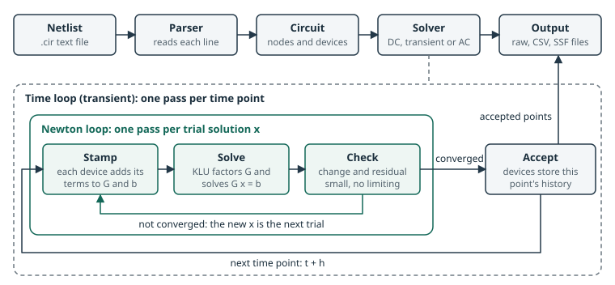

プログラムはネットリストを読み、そこから素子でできた回路を作り、解析ごとのソルバーに渡します。
過渡解析は二つのループを繰り返します。
外側のループは時刻を進めます。
内側のループはニュートン法で、素子が試行解に対する連立一次方程式 `G x = b` を書き込み、疎行列ソルバーがそれを解き、結果を判定します。
線形素子だけの回路では、最初の求解で解が得られるので、内側のループは多くても2回で終わります。
非線形素子があると方程式が試行解によって変わるため、解が変化しなくなるまで繰り返します。
動作点の計算は内側のループだけで、AC解析は周波数ごとに連立一次方程式を1回解きます（[DC・AC解析](#dcac解析では同じ回路をどう解くか)）。

| 段階 | 決めること | 節 | コード |
| --- | --- | --- | --- |
| 定式化 | 未知数と方程式の選び方 | [三つの方程式](#回路を三つの方程式にする) | [`circuit_graph.cpp`](../src/circuit/circuit_graph.cpp) |
| スタンプ | 各素子が足す係数 | [素子のスタンプ](#素子のスタンプを足す) | [`src/devices`](../src/devices) |
| 求解 | `G x = b` の解 | [連立一次方程式](#連立一次方程式を解く) | [`klu_solver.cpp`](../src/solvers/klu_solver.cpp) |
| 反復 | 次の試行解と、反復の終わり | [ニュートン法](#ダイオードを加えるとニュートン法が必要になる) | [`convergence_checker.cpp`](../src/solvers/convergence_checker.cpp) |
| 積分 | 時間微分を係数に置き換える方法 | [積分法](#積分法を替えると何が変わるか) | 各素子の `stamp_transient` |
| 刻みの制御 | 次の時刻までの幅 | [刻みの決め方](#誤差を予測して刻みを決める) | [`transient_solver.cpp`](../src/solvers/transient_solver.cpp) |

同じ道筋をクラスと関数の単位で述べたものが[設計](ARCHITECTURE.ja.md)です。
次の記号は、この文書を通じて同じ意味で使います。

| 記号 | 意味 | 単位 |
| --- | --- | --- |
| `x` | 未知数。ノード電圧、続いて枝電流 | V、A |
| `G`、`b` | 連立一次方程式 `G x = b` の行列と右辺 | — |
| `g` | `R1` のコンダクタンス `1/R` | S |
| `h` | 刻み幅 `t_{n+1} − t_n` | s |
| `v_n`、`i_n` | 時刻 `t_n` の受理済みの電圧と電流 | V、A |
| `G_C`、`G_eq`、`I_eq` | コンパニオンモデルのコンダクタンスと電流源 | S、A |
| `F(x)` | 残差。`x` を代入したときに方程式に残る不釣り合い | 行ごとに A または V |
| `J` | ヤコビアン行列 `∂F/∂x` | — |
| `u` | ニュートン反復の試行値 | V |
| `λ`、`τ`、`z` | モードの固有値、その時定数 `τ = −1/λ`、`z = hλ` | 1/s、s、— |
| `R(z)` | 1歩でモードに掛かる倍率 | — |
| `p` | 積分法の次数 | — |
| `E` | 試行した1歩の、正規化した誤差推定値 | — |

## 回路を三つの方程式にする

```spice
RC charging from an initial voltage
V1 in 0 1
R1 in out 1k
C1 out 0 1u
.IC V(in)=1 V(out)=0
.OPTIONS METHOD=BE
.TRAN 100u 300u UIC
.END
```

`V1` は `in` を1 Vに保ち、`R1` は `in` と `out` の間、`C1` は `out` と接地の間にあります。
`UIC` と `.IC` でコンデンサの初期電圧を0 Vに指定しています。
上を `build/rc-algorithm.cir` に保存し、リポジトリのルートで実行すると、各時刻の `v(in)`、`v(out)`、`i(v1)` を読めます。

```sh
build/kirimaspice build/rc-algorithm.cir --raw-out build/rc-algorithm.raw
```

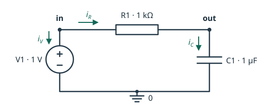

矢印は電流の正方向です。最初の充電中、抵抗には矢印の向きに電流が流れ、電源の枝電流 `i_V` は負になります。

修正節点解析（MNA）は、接地を0 Vと定め、残りのノード電圧を未知数にします。
理想電圧源は両端の電圧を指定しますが、そこを流れる電流は周りの回路が決めます。
そこで枝電流 `i_V` を未知数に加え、電源の電圧を指定する式を1本加えます。
`i_V` は電源の正端子へ流れ込む向きが正です。
`g = 1/R` とすると、キルヒホッフの電流則（KCL）と電圧源の式はこうなります。

```text
in     g(v_in − v_out) + i_V = 0
out    g(v_out − v_in) + i_C = 0
V1     v_in = V_s
```

上の2行は各ノードから出る電流の和で、単位は A です。
最後の行は V 単位の拘束条件です。
未知数は `x = [v_in, v_out, i_V]ᵀ` の三つです。

| 素子 | 加える未知数 | 加える行 |
| --- | --- | --- |
| `V`、`E`、`H`、電圧形の `B` | その枝電流 | 両端に指定する電圧の式 |
| そのほかの素子（`R`、`C`、`L`、`I`、`G`、`F`、`D`、`Q`、`M` など） | なし | なし。電流は端子のノードのKCLの行に入る |

kirimaspice の単体インダクタは端子電圧と過去の電流から電流を求めるため、インダクタ用の枝未知数は追加しません。
動作点では理想的な短絡ではなく、10⁶ S のコンダクタンス（`Inductor::kDcConductance`）です。
[電源電流の符号規約](spec/NETLIST_CONVENTIONS.ja.md) · [電圧源のスタンプ](../src/devices/voltage_source.cpp) · [インダクタ](../src/devices/inductor.cpp)

## 素子のスタンプを足す

スタンプ法では、各素子が端子のつながる行・列に自分の式の係数を加えます。
抵抗の正端子を `p`、負端子を `q` とすると、`p` から出る電流は `g(v_p − v_q)` で、`q` から出る電流はその逆符号です。
したがって `(p,p)` と `(q,q)` に `+g`、`(p,q)` と `(q,p)` に `−g` を足します。
接地に対応する行・列は省きます。
一定電流 `I` が `p` から `q` へ流れる電流源なら、右辺 `b` の `p` から `I` を引き、`q` に `I` を足します。

次に `C1` をスタンプします。
時刻 `t_n` の受理済み電圧を `v_n`、次の時刻までの幅を `h` とします。
後退Euler法（BE）で `i_C = C dv_out/dt` を離散化すると、`i_C ≈ (C/h)(v_out − v_n)` です。
これは `G_C = C/h` のコンダクタンスと、履歴で決まる電流源 `−G_C v_n` の並列回路です。
この1ステップの等価回路を**コンパニオンモデル**と呼びます。
`C1` は `out` の対角に `G_C`、右辺に `+G_C v_n` を加えます。

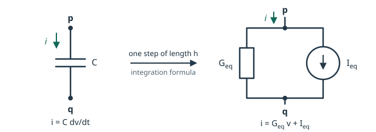

どの積分法でもコンパニオンモデルはこの形になり、違うのは `G_eq` と `I_eq` だけです（[積分法の表](#積分法を替えると何が変わるか)）。

次の表で同じ行名の寄与を縦に足すと、その下のMNA行列と右辺が得られます。ダッシュはその素子が寄与しない箇所です。

| 素子 | 方程式の行 | `v_in` 列 | `v_out` 列 | `i_V` 列 | 右辺 |
| --- | --- | ---: | ---: | ---: | ---: |
| `R1` | `in` | `+g` | `−g` | — | — |
| `R1` | `out` | `−g` | `+g` | — | — |
| `C1` (BE) | `out` | — | `+G_C` | — | `+G_C v_n` |
| `V1` | `in` | — | — | `+1` | — |
| `V1` | `V1` | `+1` | — | — | `+V_s` |

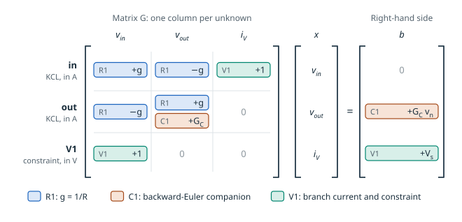

```math
\begin{bmatrix}
g & -g & 1\\
-g & g+G_C & 0\\
1 & 0 & 0
\end{bmatrix}
\begin{bmatrix}v_{\rm in}\\v_{\rm out}\\i_V\end{bmatrix}
=
\begin{bmatrix}0\\G_C v_n\\V_s\end{bmatrix}.
```

初回は `g = 1 mS`、`G_C = 10 mS`、`v_n = 0` です。
3行目から `v_in = 1 V`、2行目から `v_out = 1/11 V ≈ 0.0909091 V`、1行目から `i_V ≈ −0.909091 mA` と求まります。
負号は電源が回路に電流を供給しているためです。
次のステップでは、今求めた `1/11 V` が右辺の履歴に入ります。

| 時刻 | rawファイルの `v(out)` | 手計算 | `i(v1)` |
| ---: | ---: | --- | ---: |
| 0 | 0 V | `.IC` | 0 A |
| 100 µs | 0.0909091 V | `1/11` | −0.909091 mA |
| 200 µs | 0.173554 V | `(1 + 10/11)/11 = 21/121` | −0.826446 mA |
| 300 µs | 0.248685 V | `(1 + 210/121)/11 = 331/1331` | −0.751315 mA |

素子は係数を（行、列、値）の組として一つずつ書き込みます。
値がゼロの組も残すので、行列の非ゼロ位置の配置は反復のあいだ変わりません。
同じ位置への寄与は、線形ソルバーKLUへ渡す圧縮列形式に変換するときに足し合わされます（`SparseMatrix::to_csc`）。
[抵抗](../src/devices/resistor.cpp) · [コンデンサ](../src/devices/capacitor.cpp) · [疎行列の組み立て](../src/core/matrix_types.cpp)

## ダイオードを加えるとニュートン法が必要になる

同じ回路に `out` をアノード、接地をカソードとするダイオードを加えます。
ここでは外付けの `C1` とダイオードの伝導電流 `i_D(v)` を扱い、ダイオード自身の蓄積電荷は省きます。
既知の `v_in = V_s` を代入すると、`out` の行でゼロにしたい電流の残り（残差）は次の式です。

```math
F(v)=g(v-V_s)+G_C(v-v_n)+i_D(v).
```

反復 `k` の推定値 `u` でダイオードの接線を取り、傾きを `g_D = di_D/dv(u)` とします。
接線の式 `i_D(v) ≈ g_D v + I_eq` が点 `(u, i_D(u))` を通るには、`I_eq = i_D(u) − g_D u` が必要です。
これで先ほどと同じスタンプが使えます。
`out` の対角に `g_D` を足し、右辺から `I_eq` を引きます。
実装では接合電圧の変化を制限し（[後述](#接合電圧を制限する)）、接合に並列な 10⁻¹² S のコンダクタンス `GMIN` による電流と傾きも含めます。
[ダイオードの線形化](../src/devices/diode.cpp)

この1行のニュートン更新は `v_next = u − F(u)/(g + G_C + g_D)` です。
多変数になると、分母に相当するのが**ヤコビアン行列** `J` です。
成分 `J[i,j] = ∂F_i/∂x_j` は、未知数 `j` を少し動かしたとき、方程式 `i` の残差がどれだけ変わるかを表します。
元のMNA連立方程式では、`out` の残差を `v_out` で微分すると `g + G_C + g_D`、`v_in` で微分すると `−g` です。
電圧源の拘束行にも `∂(v_in − V_s)/∂v_in = 1` が入ります。


`v_n = 0.500 V` とし、説明用に理想ダイオード `i_D(v) = I_S (exp(v/(nV_T)) − 1)`（`I_S = 1 pA`、`nV_T = 26 mV`）を使った計算図です。
他の回路定数と刻みは最初の例題と同じです。`u = 0.550 V` での接線（破線）は `v_next ≈ 0.52736 V` で横軸を切ります。
実線の残差はそこではまだ正なので、次はその点で接線を引き直し、根 `v* ≈ 0.51246 V` に近づきます。

ニュートン法は `J(x_k) Δx = −F(x_k)` を解いて `x_next = x_k + Δx` と更新します。
実装はこれを整理した `J(x_k) x_next = J(x_k) x_k − F(x_k)` をスタンプし、未知数の次の値を直接求めます。
反復のたびに傾きと右辺を更新します。
[過渡ニュートン反復](../src/solvers/transient_solver.cpp)

`B` 電源には傾きの式がありません。
`BehavioralSource::linearize` は、式が参照する電圧と電流のそれぞれについて中心差分を取ります。
差分の幅は、電圧では 10⁻⁶ × max(1 V, |v|)、電流では 10⁻⁶ × max(1 mA, |i|) です。
[ビヘイビア電源](../src/devices/behavioral_source.cpp)

### 反復を追う

次の表は、上の計算図を `u = 0.550 V` から続けたものです。
値は上の式から計算したもので、プログラムの実行結果ではありません。

| 反復 `k` | 試行値 `u_k` | 残差 `F(u_k)` | 傾き `g_D(u_k)` | `u_{k+1}` までの変化 |
| ---: | ---: | ---: | ---: | ---: |
| 0 | 0.550000 V | 1.59 mA | 59.2 mS | 22.6 mV |
| 1 | 0.527364 V | 0.445 mA | 24.8 mS | 12.4 mV |
| 2 | 0.514923 V | 63.2 µA | 15.3 mS | 2.40 mV |
| 3 | 0.512522 V | 1.65 µA | 14.0 mS | 66.0 µV |
| 4 | 0.512456 V | 1.17 nA | 14.0 mS | 46.9 nV |
| 5 | 0.512456 V | 0.59 fA | 14.0 mS | — |

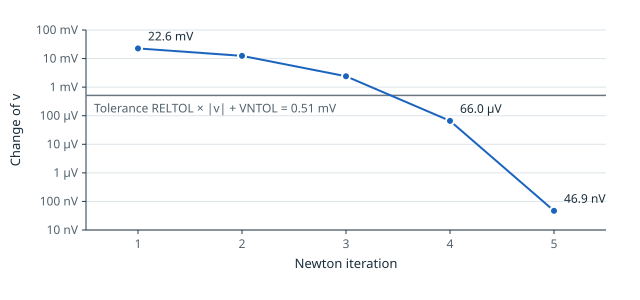

根から遠いうちは変化量の減り方が緩やかです。
根の近くでは、変化量は前回のほぼ2乗に比例して小さくなります（2.40 mV、66.0 µV、46.9 nV）。
水平線は 0.512 V のノードに対する許容値 `RELTOL × |v| + VNTOL = 0.51 mV` で、4回目の変化が初めてこれを下回ります。

### 接合電圧を制限する

指数関数のため、低い電圧で引いた接線は当てになりません。
同じ回路の動作点を `v = 0` から求めるとします。
そこではダイオードの傾きがほぼゼロなので、最初の求解はダイオードのない回路の答え `v = 1 V` を返します。
1 V では指数関数が数十 kA の電流とそれに見合う傾きを与え、その後の反復は1回あたり `nV_T` ほどしか下がりません。
そこでSPICEは、提案された電圧が前回の値から大きく離れたとき、接合を評価する電圧を変えます（`core::limit_junction_step`）。

| 前回 `v_old` に対する提案 `v_new` | 接合を評価する電圧 |
| --- | --- |
| `v_new ≤ V_crit`、または `\|v_new − v_old\| ≤ 2 nV_T` | `v_new` のまま |
| それ以外で `v_old > 0` | `v_old + nV_T ln(1 + (v_new − v_old)/nV_T)`。対数が値を持たないときは `V_crit` |
| それ以外で `v_old ≤ 0` | `nV_T ln(v_new / nV_T)` |

`V_crit = nV_T ln(nV_T / (√2 I_S))` で、`I_S = 1 pA`、`nV_T = 26 mV` なら 0.614 V です。

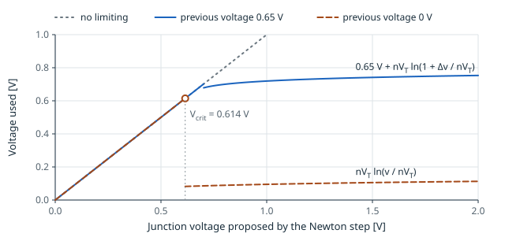

図は同じダイオードについて、上の規則から計算したものです。
前回の電圧が 0.65 V なら、提案 2 V は 0.753 V で評価されます。
前回が 0 V なら、提案 1 V は指数関数の立ち上がり付近の 0.095 V で評価され、反復はそこから上っていきます。
制限は前回の反復値に依存するので、提案と前回の値が等しい収束解では何も変えません。
素子が電圧を制限した反復は、収束したとは見なしません。
ダイオード、バイポーラトランジスタ、JFETは接合をこの規則で制限します。
電界効果トランジスタはゲートとドレインの電圧を別の規則で制限します（[設計](ARCHITECTURE.ja.md#dc-解析)）。
`.OPTIONS VOLTAGE_LIMITING=0` で制限を止められます。
[制限の規則](../include/kirimaspice/core/device_utils.hpp)

### 収束を判定する

次の判定をすべて満たした反復値を受理します。
ここでの収束は、選んだ時間刻みで立てた方程式に対するもので、その1歩の精度に対するものではありません。

| 判定 | 対象 | 合格の条件 |
| --- | --- | --- |
| 変化量（過渡の1歩） | 各ノード電圧 | `\|新値 − 旧値\| ≤ RELTOL × max(\|新値\|, \|旧値\|) + VNTOL` |
| 変化量（過渡の1歩） | 各枝電流 | `\|新値 − 旧値\| ≤ RELTOL × max(\|新値\|, \|旧値\|) + ABSTOL` |
| 変化量（動作点） | 各未知数 | `\|新値 − 旧値\| ≤ VNTOL`（枝電流は `ABSTOL`）、または `\|新値 − 旧値\| ≤ RELTOL × (\|新値\| + VNTOL)` |
| 残差 | 候補解で素子をスタンプし直したときの、各ノードの行の素子電流の和 | `\|和\| ≤ RELTOL × 最大の項 + ABSTOL` |
| 残差 | 同様に、各拘束行 | `\|和\| ≤ RELTOL × 最大の項 + VNTOL` |
| 制限 | 素子の最後のスタンプ | 電圧を制限した素子がない |

残差の判定では、丸め誤差の分として、その行の項の絶対値の和の 10⁻¹² 倍も許します。

| オプション | 既定値 | 意味 |
| --- | ---: | --- |
| `RELTOL` | 10⁻³ | 変化量と残差の相対許容値 |
| `VNTOL` | 1 µV | 電圧の絶対許容値 |
| `ABSTOL` | 1 pA | 電流の絶対許容値 |
| `ITL1` | 100 | 動作点の反復回数の上限 |
| `ITL4` | 20 | 過渡の1回の求解の反復回数の上限 |

[収束判定](../src/solvers/convergence_checker.cpp) · [ダイオード動作点のKCLテスト](../tests/unit/test_dc_convergence_kcl.cpp)

### 連立一次方程式を解く

反復は毎回、疎行列の連立一次方程式の求解で終わります。
数値分解で得るLU因子は下三角行列と上三角行列なので、求解そのものは前進代入と後退代入です。

| 手順 | いつ | 呼び出すKLUの関数 |
| --- | --- | --- |
| 書き込まれた組を圧縮列形式に変換する | 毎回の反復 | —（`SparseMatrix::to_csc`） |
| 疎行列の構造を解析する | 過渡の1歩または動作点の、最初の反復 | `klu_analyze` |
| 行列を数値分解する | 毎回の反復。2回目以降は保存した解析結果を使う | `klu_factor` |
| 前進代入と後退代入を行う | 毎回の反復 | `klu_solve` |

通常の過渡ステップでは初回にKLUが疎行列の構造を解析して数値分解し、以後は同じ構造を再利用して新しい数値を分解します。
TR-BDF2の1歩では、2段目が1段目の解析結果を再利用します。
分解の途中で行列が特異だと分かると、エラーメッセージは該当する列の未知数を `V(ノード)` または `I(電源)` の形で示します。
[KLUへのインターフェース](../src/solvers/klu_solver.cpp)

### ダイオードを試す

この効果は例題でも試せます。
`.END` の前に次の2行を挿入し、`.TRAN` の終了時刻を `300u` から `2m` に延ばします。

```spice
D1 out 0 Ddemo
.MODEL Ddemo D(IS=1p N=1 CJO=0 TT=0)
```

2 msの `v(out)` はダイオードを加える前が `0.8513564 V`、加えた後が `0.5171735 V` です。
電圧が上がるにつれ抵抗から流れ込む電流の一部がダイオードへ流れます。
電荷も非線形な多端子素子では、BEで書いた端子電流 `(Q_i(x) − Q_i(x_n))/h` が、ヤコビアンの `(i,j)` に `(∂Q_i/∂v_j)/h` を加えます。
別の端子の電圧で電荷が変われば、対角以外にも係数が入ります。
[BSIM4の端子電荷と微分のテスト](../tests/unit/test_bsim4_transient.cpp)

## 積分法を替えると何が変わるか

回路の接続は同じでも、蓄積電荷や磁束の時間微分の近似が変わると、対角などに入る係数と右辺の履歴項が変わります。
このRC回路なら、どの方法でも同じ `out` の行を使います。

- **後退Euler法**（1次）は終点の電流で `C(v_next − v_n) = h i_next` と置きます。
  **台形則**（2次）は両端の電流の平均を取り、`C(v_next − v_n) = h(i_n + i_next)/2` と置きます。
  解き直すと `i_next = (2C/h)(v_next − v_n) − i_n` です。
  対角に入るコンダクタンスはBEの2倍で、右辺には前回の電流も必要になります。
- **後退差分公式**（Gear、BDF2・BDF3）は、現在と過去の電圧を通る補間多項式から終点の傾きを求めます。
  一定刻みのBDF2なら `i_next = (C/h)(3v_next/2 − 2v_n + v_{n−1}/2)` です。
  BDF3はもう1点さかのぼります。
  刻み幅が変われば係数は過去の刻み幅から計算し直します。
- **TR-BDF2**（2次）は、`γ = 2 − √2` として時刻 `t_n + γh` まで台形則で解き、その中間値と開始値を使いBDF2の段で `t_n + h` に達します。
  各段でその時刻の電源を評価し、ニュートン反復を行います。

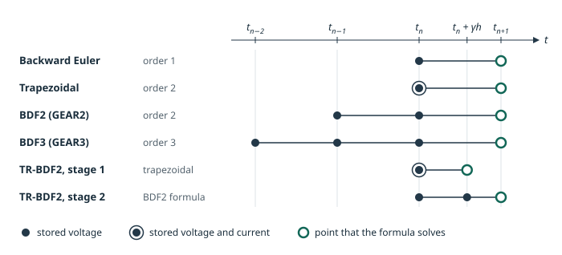

一定刻みのコンデンサでは、どの公式もコンパニオンモデル `i_next = G_eq v_next + I_eq` を与えます。
4列目は例題（`C/h = 10 mS`）での値です。

| `METHOD` | 次数 | `G_eq` | 例題での値 | `I_eq`（保存した値から） | 固定刻みでの開始手順 |
| --- | ---: | --- | ---: | --- | --- |
| `BE` | 1 | `C/h` | 10 mS | `−(C/h) v_n` | 終始BE |
| `TRAP`（既定） | 2 | `2C/h` | 20 mS | `−(2C/h) v_n − i_n` | 最初の1歩がBE |
| `GEAR2`（BDF2） | 2 | `3C/(2h)` | 15 mS | `−(C/h)(2v_n − v_{n−1}/2)` | 最初の2歩がBE |
| `GEAR3`（BDF3） | 3 | `11C/(6h)` | 18.3 mS | `−(C/h)(3v_n − 3v_{n−1}/2 + v_{n−2}/3)` | 最初の1歩がBE、続く2歩がBDF2 |
| `TR_BDF2` の1段目 | 2 | `2C/(γh)` | 34.1 mS | `−(2C/(γh)) v_n − i_n` | 最初の1歩がBE |
| `TR_BDF2` の2段目 | | `(2−γ)C/((1−γ)h)` | 34.1 mS | `−(C/h)(v_γ − (1−γ)² v_n)/(γ(1−γ))` | |

`γ = 2 − √2` のとき、TR-BDF2の二つの段のコンダクタンスは同じ `(2 + √2) C/h` になります。
`v_γ` は1段目が `t_n + γh` で求めた電圧です。

CLIの既定は台形則で、第1ステップにはBEを使って履歴を作ります。
例題は全ステップをBEに固定しています。
開始手順は電源波形の折れ点のたびに繰り返します。
折れ点の扱いと素子ごとの対応範囲は過渡解析ガイドにまとめています。
[積分法と開始手順](TRANSIENT_ANALYSIS.ja.md#積分法) · [TR-BDF2の段時刻のテスト](../tests/unit/test_tr_bdf2_accuracy.cpp)

### 刻みを半分にして次数を確かめる

RC例題を時定数と同じ1 msまで、その区間を5〜320等分する刻みで実行し、1 msの `v(out)` を厳密値 `1 − e⁻¹ = 0.632121 V` と比べます。
列ごとに変えているのは `.OPTIONS METHOD` だけです。

| 刻み | `BE` | `TRAP` | `GEAR2` | `GEAR3` | `TR_BDF2` |
| ---: | ---: | ---: | ---: | ---: | ---: |
| 200 µs | 34.0 mV | 5.56 mV | 15.2 mV | 8.43 mV | 6.07 mV |
| 100 µs | 17.7 mV | 1.45 mV | 3.54 mV | 2.38 mV | 1.59 mV |
| 50 µs | 9.01 mV | 0.372 mV | 0.859 mV | 0.627 mV | 0.410 mV |
| 25 µs | 4.55 mV | 94.4 µV | 212 µV | 160 µV | 104 µV |
| 12.5 µs | 2.29 mV | 23.8 µV | 52.9 µV | 40.5 µV | 26.2 µV |
| 6.25 µs | 1.15 mV | 5.97 µV | 13.2 µV | 10.2 µV | 6.58 µV |
| 3.125 µs | 0.574 mV | 1.49 µV | 3.30 µV | 2.56 µV | 1.65 µV |
| 最後の2行の比 | 2.00 | 3.99 | 4.00 | 3.99 | 3.99 |

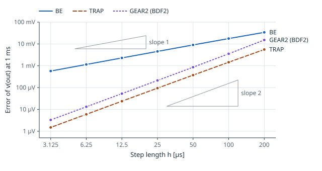

刻みを半分にすると、BEの誤差は半分に、2次の方法の誤差は4分の1になります。
図には3列だけを描いています。TR-BDF2の誤差は台形則より約10 %大きい程度です。
`GEAR3` の誤差も4分の1になります。開始時のBEとBDF2の歩を含めると、固定刻みの実行は全体として2次です。

## 剛性と数値安定性

MNAで表した過渡回路は、電荷・磁束の時間変化、KCL、電圧源の拘束を連立する**微分代数方程式**（DAE）です。
ダイオードの電流や端子電荷が電圧に非線形に依存すれば、方程式も非線形になります。
一方、**剛性**（stiffness）は時間尺度に関わります。
例えば速い過渡が消えたあと、観測したい遅い波形の精度には十分な刻みでも、積分法によっては安定に計算するためにずっと短い刻みが必要です。これは線形のRC回路でも起こります。

動作点まわりの微小変化は、電荷などの微分を集めた行列 `C` と静的な素子式のヤコビアン `G` を使い `C δx′ + G δx = 0` と表せます。電圧源の拘束のように時間微分を含まない行もあります。有限の固有値 `λ` は `(G + λC)u = 0` を満たすモード `u` に対応します。
一つの減衰モードを `y′ = λy`（`Re(λ) < 0`）で表し、`z = hλ` と置きます。
RCの放電なら `λ = −1/(RC)` です。厳密解は1歩で `exp(z)` 倍になります。
1ステップ法の増幅率を `R(z)` とすると、複素平面の左半面全体で `|R(z)| ≤ 1` を満たす方法が**A安定**です。
例えば陽的Euler法の `R(z) = 1 + z` は、実数の負の `λ` に対し `h > 2/|λ|` で振幅が増大します。
これが、波形の精度とは別に、安定性が刻みの上限を決める例です。

- **後退Euler法**の `R(z) = 1/(1−z)` はA安定で、左半面で `|z| → ∞` のとき `R(z) → 0` です。このように非常に速い減衰モードを消せる性質を、A安定性と合わせて**L安定**と呼びます。
- **台形則**の `R(z) = (1+z/2)/(1−z/2)` もA安定です。ただし `z < −2` で符号が反転し、`z → −∞` では `R(z) → −1` です。減衰モードの振幅は増えませんが、物理的には消えた信号が正負交互に何歩も残ることがあります。
- **TR-BDF2**は、この実装が使う `γ = 2 − √2` でL安定です。大きな刻みで速い成分を減衰させつつ、滑らかな解に対して2次精度を持ちます。[TR-BDF2の安定性解析](https://arxiv.org/abs/1510.04303)
- **Gear法**は複数の過去値を使うので、安定性は漸化式のすべての特性根で判定します。一定刻みの**BDF2はA安定**です。**BDF3はA(α)安定**で、負の実軸を中心とした扇形（半角約86°）が安定領域に含まれます。虚軸に近い弱減衰の振動では、刻みによってその安定領域を外れます。これらは一定刻みの公式の性質で、実際の波形には開始手順や刻みの変化も影響します。[BDFの安定領域](https://sundials.readthedocs.io/en/v6.3.0/cvode/Mathematics_link.html#bdf-stability-limit-detection) · [BDFの安定角](https://arxiv.org/abs/1901.08347)

| 方法 | 一つのモードに掛かる倍率 | `z → −∞` のとき | A安定 | 非常に速いモードを減衰させるか |
| --- | --- | --- | --- | --- |
| 陽的Euler法（比較用。選べない） | `1 + z` | 際限なく大きくなる | いいえ | いいえ |
| `BE` | `1/(1 − z)` | 0 | はい | はい（L安定） |
| `TRAP` | `(1 + z/2)/(1 − z/2)` | −1 | はい | いいえ |
| `TR_BDF2`（`γ = 2 − √2`） | `(1 + (√2 − 1)z)/(1 − (1 − 1/√2)z)²` | 0 | はい | はい（L安定） |
| `GEAR2`（BDF2） | `(3/2 − z)ξ² − 2ξ + 1/2 = 0` の根 `ξ` | 0 | はい | はい |
| `GEAR3`（BDF3） | `(11/6 − z)ξ³ − 3ξ² + 3ξ/2 − 1/3 = 0` の根 `ξ` | 0 | いいえ。A(α) 安定で α ≈ 86.03° | はい |

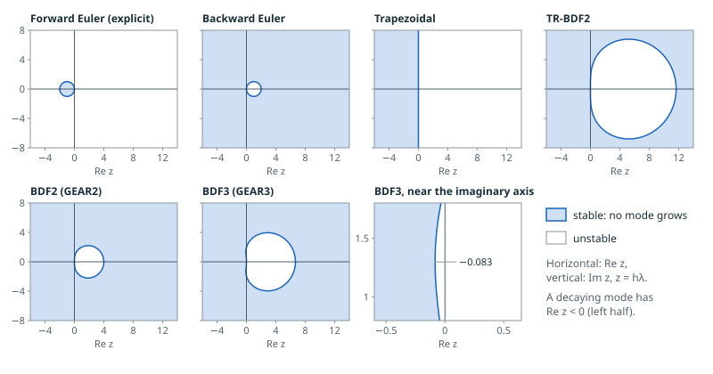

各枠は、どのモードも増大しない `z = hλ` の範囲に色を付けたもので、表の倍率と漸化式から計算しています。
減衰するモードは枠の左半分にあります。
陽的Euler法は小さな円の中でしか安定でないので、速いモードがあると短い刻みを強いられます。
陰的な方法は左半面全体で安定ですが、一つ例外があります。BDF3の境界は虚軸を越えて左半面に入り、`Im z = ±1.30` の付近で最大0.083だけ入り込み、`Im z = ±1.94` で虚軸に戻ります。
TR-BDF2の不安定な領域は `Re z = 11.7`、`Im z = ±6.8` まで広がり、台形則の不安定な領域は右半面の全体です。

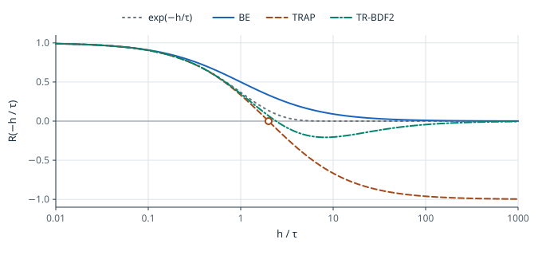

横軸は刻み幅と時定数の比 `h/τ`（対数目盛）、縦軸は1歩で電圧偏差に掛かる符号付きの倍率です。
点線は厳密解です。白丸の `h/τ = 2` を越すと台形則の符号が反転し、比が大きいほど振幅が残ります。
BEとTR-BDF2は同じ極限で速い成分を減衰させます。
TR-BDF2の倍率は `h/τ > 2.41` で負になり、`h/τ = 8.24` で最小の −0.207 になります。

### 二つの時定数で確かめる

最初のRC例題で、次の3行を元の `.IC` 行の代わりに入れます。`out` は時定数1 msで充電し、`fast` は初期値1 Vから時定数1 µsで放電します。この二つのモードは独立なので、それぞれ解析解と照合できます。

```spice
Rfast fast 0 1k
Cfast fast 0 1n
.IC V(in)=1 V(out)=0 V(fast)=1
```

刻みを100 µsのままにして `METHOD` を切り替えた、200 µs時点の実測です。3方式とも最初の1歩はBEです。

| 解または `METHOD` | `v(fast)`（速い放電） | `v(out)`（遅い充電） |
| --- | ---: | ---: |
| 解析解 | 1.38 × 10⁻⁸⁷ V | 0.181269 V |
| `BE` | +0.0980 mV | 0.173554 V |
| `TRAP` | −9.5127 mV | 0.177489 V |
| `TR_BDF2` | −0.4362 mV | 0.177454 V |

速いモードでは `z = −100` です。最初のBEのあとに残る約9.901 mVに、次の台形則が `−49/51` を掛けるため、負の電圧になります。
この枝はRとCだけで、厳密解は常に正です。遅い `out` だけを見ると、台形則とTR-BDF2の差はわずか約35 µVですが、速い枝では両者の減衰の違いが見えます。

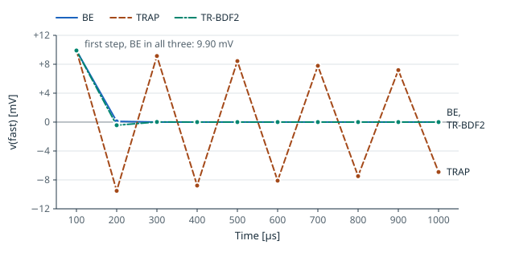

終了時刻を `1m` に延ばすと図が得られます。この目盛りでは厳密解はゼロです。
各実行で、相続く `v(fast)` の比は、その方法の倍率に一致します。

| `METHOD` | 相続く `v(fast)` の比（実測） | 式による `R(−100)` | 1 msの `v(fast)` |
| --- | ---: | ---: | ---: |
| `BE` | 0.009901 | `1/101` = 0.009901 | 9.05 × 10⁻²¹ V |
| `TRAP` | −0.960784 | `−49/51` = −0.960784 | −6.9074 mV |
| `TR_BDF2` | −0.044059 | −0.044059 | −6.19 × 10⁻¹⁵ V |

速い過渡そのものを測りたいなら、その時定数を解像するまで刻みを小さくして波形を照合します。
数値安定性は減衰モードの増幅を、ニュートン法は各時刻の方程式の収束を、次節のLTEは1歩の精度を扱います。

## 誤差を予測して刻みを決める

RC回路の厳密解は `v(t) = V_s (1 − exp(−t/(RC)))` です。
100 µsの厳密値は `0.0951626 V` で、先ほどのBEの結果には約4.25 mVの誤差があります。
`.TRAN` の刻みだけを `50u` に変えて2歩進めると、同じ100 µsで `0.0929705 V`、誤差は約2.19 mVです。
これが固定刻みのCLIでできる波形精度の確認です。
固定刻みでも折れ点に合わせて刻みを短縮したり、ニュートン反復の失敗時にBEで再試行して刻みを半減したりします。
[固定刻みの処理](TRANSIENT_ANALYSIS.ja.md#固定刻みの1ステップと収束)

局所打ち切り誤差（LTE）は、正確な開始値と履歴から1歩だけ数値積分したときに生じる解のずれです。
滑らかな解に次数 `p` の方法を適用すると、通常このずれは `O(h^(p+1))` です。
一定の時間区間を安定に積分したときの累積誤差は `O(h^p)` になります（[刻みを半分にした表](#刻みを半分にして次数を確かめる)のとおりです）。

解析解の分からない回路では、同じ時刻の値を二通りに見積もると、刻みが粗いかを判断する材料になります。
C++ライブラリでは `config.transient.use_adaptive_timestep = true` でこの判定を有効にできます。
試行した終点で二つの電圧推定値 `a` と `b` を求め、次の無次元量を計算します。

```math
E_V=\max_{\text{nodes }j}
\frac{|a_j-b_j|}
     {\mathrm{lte\_abstol}+\mathrm{lte\_reltol}\max(|a_j|,|b_j|)}.
```

絶対許容値は0 V付近でも尺度を与え、相対許容値は振幅に応じて尺度を変えます。
この最大値を取る対象はノード電圧です。
電圧の見積もり方には次の選択肢があります。

- **次数の異なる解を比べる方法**では、同じ開始時刻・素子履歴から、たとえばBEとBDF2で同じ終点を解きます。
  設定 `PHYSICAL` でもこの電圧比較を使います。
  開始時に両方がBEなら電圧差はゼロになり得ます。
- **予測子・修正子法**では、受理済みの電圧から次の値を外挿し、陰解法で解き直した値と比べます。
  履歴が2点なら、直前の変化量に「今回の刻み幅／直前の刻み幅」を掛けて外挿します。
  純粋な `PREDICTOR_CORRECTOR` はこの予測をニュートン法の初期値にも使い、履歴が足りない間は2回の求解で比較します。
  `COMBINED` は利用できる両方の推定の大きい方を使います。

例題の `METHOD=BE` と `METHOD=TRAP` を別々に実行すると、どちらも最初の100 µsはBEです。
共通の履歴から200 µsに達したとき、BEは `0.1735537 V`、台形則は `0.1774892 V` です。
この2値に既定の尺度（`1 µV`、`lte_reltol = 0.001`）を使うと `E_V ≈ 22.05` になります。
可変刻みの既定の受理条件 `E ≤ TRTOL = 7` に当てはめれば棄却です。
ここでは固定刻みの2回の実測から判定を手計算しています。

| `config.transient` の設定 | 既定値 | 役割 |
| --- | ---: | --- |
| `use_adaptive_timestep` | `false` | 可変刻みの経路を選ぶ |
| `initial_step` | 1 ns。ネットリストを読み込むと `TSTEP` | 最初に試す刻み |
| `max_step`、`min_step` | 1 µs、10⁻¹⁵ s。ネットリストを読み込むと `max_step` は `TMAX`（省略時は `TSTEP`） | 刻みの上限と下限 |
| `lte_abstol`、`lte_reltol` | 1 µV、10⁻³ | `E_V` の尺度 |
| `trtol` | 7 | `E ≤ trtol` のとき試行した1歩を受理する |
| `chgtol` | 10⁻¹⁴ C | 素子の電荷による推定の尺度 |
| `error_est` | `PHYSICAL` | 比べる電圧推定値の選び方 |
| `adaptive_order`、`max_order` | `true`、3 | 次数制御が `METHOD` の代わりに公式を選ぶ。1次はBE、2次はBDF2、3次はBDF3 |

開始または電源の折れ点から20歩を受理すると、対応する動的素子の推定値も加味します。
例えばコンデンサでは、保存した電荷と直前の電流から `Q_pred = charge_prev_ + h × current_prev_` を計算し、`Q_corr = C v_next` との差の絶対値を `max(|Q_corr|, |Q_pred|) + CHGTOL` で割ります。
この予測が現在の版でどの時点の電荷から始まるかは、[既知の問題](../KNOWN_ISSUES.ja.md#解析)に記録しています。
ソルバーは電圧と素子の推定値の最大を `E` とします。
棄却なら素子状態を戻して同じ開始時刻から再試行し、受理なら実際に進んだ刻み幅と解を履歴に加えます。

次の刻みは、受理した刻みに倍率を掛けたものです。
こうして得た局所誤差の指標から、波形全体の最大誤差は保証できません。

| 次の刻みの規則 | 値 |
| --- | --- |
| 基本倍率 | `0.9 × max(E, 10⁻¹⁰)^(−1/(p+1))`。`p` は刻み制御が使う次数 |
| 倍率の範囲 | 開始または折れ点のあと、受理した最初の10歩は 0.5〜1.1。その後は `E < 0.1` なら 0.5〜1.2、それ以外は 0.5〜1.1 |
| 刻みの範囲 | `min_step` から `max_step` まで |
| 次数が変わったとき | 刻みに 0.8 を掛ける |

[可変刻みのAPI例](TRANSIENT_ANALYSIS.ja.md#ライブラリの可変刻み) · [予測・棄却・刻み制御の実装](../src/solvers/transient_solver.cpp)

可変刻みの1歩では、ニュートン法とLTEが別々の判断をします。必要なニュートン求解がすべて収束したら、LTEを判定します。
再試行は同じ開始時刻 `t_n` から行います。
1歩で棄却が20回続くか、ニュートン法が失敗すると、試す刻みを半分にしてやり直します。これは10回まで、かつ `min_step` を下回らない範囲で行い、それでも進めなければ失敗を返します。

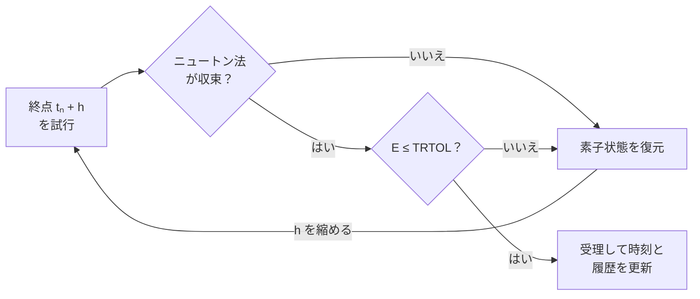

## 可変ステップで計算時間を短くする

通常のCLIは固定刻みです。`.TRAN` の `TSTEP` が基本の積分刻みで、`TMAX` がそれより短い場合は `TMAX` を使います。
それより短い伝送線路の遅延があると、解析全体の刻みがその値まで短くなります。
電源波形の折れ点や終了時刻に合わせるとき、ニュートン反復に失敗したときには、その1歩の刻みが短くなることがあります。
固定刻み経路はその後も元の時間格子を目指すため、波形が平らになってもLTEを見て格子の何点分もまとめて進むことはありません。
例えば `.TRAN 1u 10m 0 100u UIC` は、CLIでは基本的に1 µsずつ進みます。
[CLIの刻み選択](../src/main.cpp) · [固定刻みの処理](../src/solvers/transient_solver.cpp)

C++ライブラリでは `config.transient.use_adaptive_timestep = true` とし、開始刻み `initial_step` と上限 `max_step` を設定します。
ネットリストを読み込んだ場合、`TMAX` を省略すると上限も `TSTEP` になるため、開始刻みを超えて成長させるには上限を大きく取ります。
上の `.TRAN` なら開始1 µs、上限100 µsです。可変刻みを有効にするCLIオプションやネットリスト指定は現時点ではありません。
[ライブラリの設定例](TRANSIENT_ANALYSIS.ja.md#ライブラリの可変刻み) · [時間指定の読み込み](../src/parser/netlist_parser.cpp)

可変刻みでは、変化が速く推定誤差が大きい区間は短い刻みで解き、緩やかな区間では次の刻みを伸ばします。
長い刻みで進めば、同じ終了時刻までのスタンプ、行列の数値分解、ニュートン反復の回数を減らせます。
一方、既定の誤差推定では同じ終点を二つの積分公式で解き、棄却した試行も計算時間を使います。
波形の速い変化が長く続く場合や、最大刻みが小さい場合は、歩数を減らせる余地も小さくなります。

### 同じRC回路で速度と精度を測る

最初の充電回路（時定数1 ms、ダイオードなし）を10 msまで解きました。両経路を同じC++ライブラリで実行し、積分法は `GEAR2`、可変刻み側は `adaptive_order=true`、`max_order=2`、開始1 µs、上限100 µs、誤差許容値は既定のままとしました。
固定刻みは1 µsに加え、可変刻みと同程度の波形誤差が得られた15 µsでも測りました。

| 刻みの選び方 | 受理した歩数 | ニュートン反復数 | 最大電圧誤差 | 求解時間の中央値 |
| --- | ---: | ---: | ---: | ---: |
| 固定 1 µs | 10,000 | 10,692 | 0.00124 mV | 19.51 ms |
| 固定 15 µs | 667 | 1,334 | 0.282 mV | 2.01 ms |
| 可変（開始1 µs、上限100 µs） | 156 | 624 | 0.295 mV | 0.95 ms |

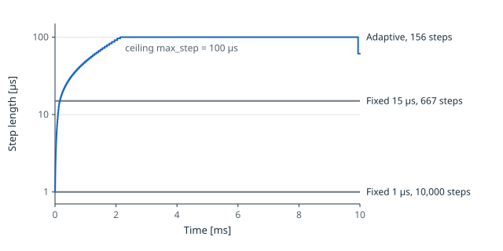

図は、可変刻みの実行が受理した各点から進んだ刻み幅です。
最初の刻みは 1、1.1、1.21、1.065、1.171 µs で、上限の1.1倍ずつ伸び、次数が変わったときに一度0.8倍になっています。
2.14 msで上限の100 µsに達し、LTEによる棄却は0回でした。
最後の1歩は、終了時刻に合わせるために短くなっています。
固定15 µsと比べて歩数は約4分の1ですが、可変刻みの1歩には誤差推定の求解も入るため、反復数と経過時間はどちらも約半分です。
誤差は両経路の `v(out)` を共通の1 µs格子に線形補間し、解析解 `1 − exp(−t/(1 ms))` Vとの差の絶対値の最大を取りました。

歩数、反復数、誤差は、`3854fbd`（Linux x86-64、GCC 15.2.0）でも同じ値でした。
求解時間はmacOS arm64、GCC 16.2.0、Releaseビルド（`770db19`）での測定で、測り直していません。
各回で新しい回路とソルバーを作り、ログを止め、`solve()` のみを計時しました。各条件で初回を除き、実行順を入れ替えた21回の中央値です。

## DC・AC解析では同じ回路をどう解くか

過渡解析のスタンプは、二つの点を変えるだけでほかの解析にも使えます。蓄積素子が書き込む内容と、解く連立方程式の数です。

| 解析 | コンデンサが書き込むもの | インダクタが書き込むもの | 連立方程式 | 求解の回数 |
| --- | --- | --- | --- | --- |
| 動作点（`.OP`） | 何も書き込まない（開放） | 10⁶ S のコンダクタンス | 非線形、実数 | ニュートン法のループを1回 |
| DCスイープ（`.DC`） | 何も書き込まない | 10⁶ S のコンダクタンス | 非線形、実数 | 電源の値ごとにループを1回。毎回、初期値から始める |
| 過渡（`.TRAN`） | コンパニオンモデル | コンパニオンモデル | 非線形、実数 | 1歩ごとにループを1回。TR-BDF2は2回 |
| AC（`.AC`） | `jωC` | `1/(jωL)` | 線形、複素数 | 周波数ごとに1回 |
| 伝達関数（`.TF`） | `ω = 0` なのでゼロ | 10⁶ S のコンダクタンス | 線形 | 2回。入力に単位の電源を置いたときと、出力に1 Aを流し込んだとき |
| 雑音（`.NOISE`） | `jωC` | `1/(jωL)` | 線形、複素数、随伴 | 周波数ごとに1回 |

### 動作点

DC動作点ではコンデンサの定常電流はゼロです。
例題の定常解は `v_out = 1 V`、`i_V = 0 A` です。
ダイオードを加えた場合は `g(v_out − V_s) + i_D(v_out) = 0` をニュートン法で満たす電圧を探します。
どちらのネットリストでも、`.TRAN` の行を `.OP` に置き換えると値が表示されます。

| 回路 | `V(out)` | `I(V1)` | ニュートン反復数 |
| --- | ---: | ---: | ---: |
| RC例題 | 1 V | 0 A | 2 |
| ダイオードを加えた回路 | 0.517174 V | −0.482826 mA | 9 |

反復は全ノードをゼロとして始めます。`.NODESET` があればその値から始めます。
線形回路は1回の求解と、それを確かめるもう1回の反復で終わります。
ダイオードがあると、最初の数回は接合電圧の制限で指数関数の立ち上がり付近にとどまります。得られる解は、上の過渡解析が2 msで達した値と同じです。
ソースステッピング、Gminステッピングなどの収束補助は、`.OPTIONS` で指定したときだけ働きます。
[DCソルバー](../src/solvers/dc_solver.cpp) · [設計のDC解析](ARCHITECTURE.ja.md#dc-解析)

### AC、伝達関数、雑音

小信号AC解析ではまずDC動作点を求め、その点での素子の傾きを使って、周波数ごとに複素数の連立方程式 `Y V = I` を解きます。
`C1` のスタンプは `jωC` となり、このRC回路では `V_out/V_in = 1/(1+jωRC)` です。
ここでの独立変数は角周波数 `ω = 2πf` です。
各周波数の解は、それ以前の時刻の履歴に依存しません。
大きさ `N` の複素数の連立方程式は、大きさ `2N` の実数の連立方程式として、同じ線形ソルバーで解きます。

```math
\begin{bmatrix}
\operatorname{Re}Y & -\operatorname{Im}Y\\
\operatorname{Im}Y & \operatorname{Re}Y
\end{bmatrix}
\begin{bmatrix}\operatorname{Re}V\\ \operatorname{Im}V\end{bmatrix}
=
\begin{bmatrix}\operatorname{Re}I\\ \operatorname{Im}I\end{bmatrix}.
```

例題の `V1` の行を `V1 in 0 DC 1 AC 1` に、`.TRAN` の行を `.AC DEC 1 15.9154943 1591.54943` に置き換えます。
三つの周波数は、`ωRC` が 0.1、1、10 になる点です。
ネットリストが `build/rc-ac.cir` なら、プログラムは `build/rc-ac_ac.csv` を書き出します。

| 周波数 | `ωRC` | CSVファイルの `v(out)` | `1/(1 + jωRC)` |
| ---: | ---: | --- | --- |
| 15.9155 Hz | 0.1 | 0.990099 − j0.0990099 | `(1 − j0.1)/1.01` |
| 159.155 Hz | 1 | 0.500000 − j0.500000 | `(1 − j)/2` |
| 1591.55 Hz | 10 | 0.00990099 − j0.0990099 | `(1 − j10)/101` |

`.TF` は同じ小信号の連立方程式を `ω = 0` で解きます。
ダイオードを加えた回路で `.TRAN` の行を `.tf v(out) V1` に置き換えると、利得 0.0508457、入力抵抗 1053.57 Ω、出力抵抗 50.8457 Ω が表示されます。
これらは動作点でのダイオードの傾き `g_D = 18.67 mS` から決まります。利得は `g/(g + g_D)`、出力抵抗は `1/(g + g_D)`、入力抵抗は `R + 1/g_D` です。
`.NOISE` は周波数ごとに随伴系を1回解きます。これで、すべての雑音源から出力への伝達が1回の求解で得られます。
[ACソルバー](../src/solvers/ac_solver.cpp) · [伝達関数](../src/solvers/transfer_function_solver.cpp) · [雑音](../src/solvers/noise_solver.cpp) · [設計のAC解析](ARCHITECTURE.ja.md#ac-解析)

## 参考文献

MNAの原論文は Ho、Ruehli、Brennan によるものです。
方程式の構成、線形・非線形の求解、数値積分をSPICEの文脈でたどるには、Nagel の技術報告も参照できます。
[MNA原論文（IBM Research）](https://research.ibm.com/publications/the-modified-nodal-approach-to-network-analysis) · [SPICE2技術報告（UC Berkeley）](https://www2.eecs.berkeley.edu/Pubs/TechRpts/1975/9602.html)
