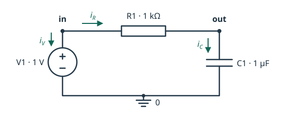
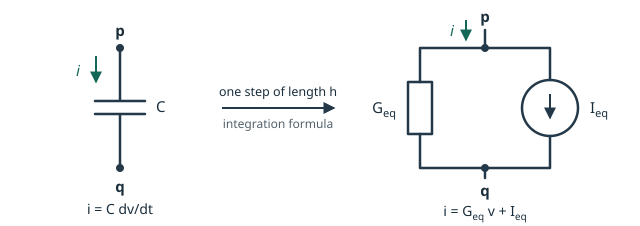
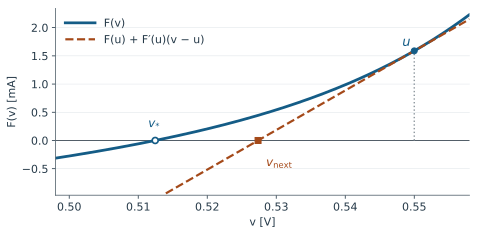
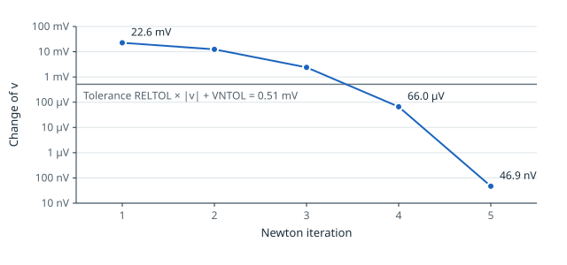
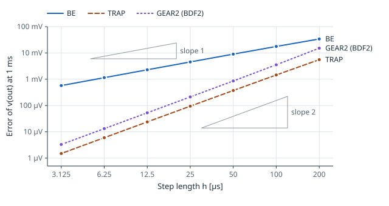
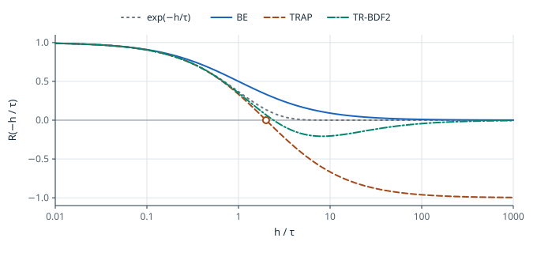
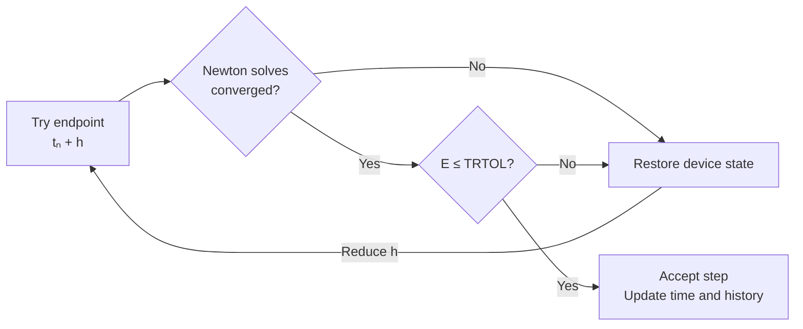

# How the circuit solver works

[日本語](SOLVER_ALGORITHMS.ja.md) · [Documentation guide](README.md)

Follow one voltage source, resistor and capacitor from a netlist to a matrix and then to one
point on a waveform. Adding a diode to the same circuit shows where the Jacobian and Newton
iteration enter the calculation. The netlist examples, their voltages and the step and iteration
counts were run again with kirimaspice at `3854fbd` (Linux x86-64, GCC 15.2.0). The solve times
in the [cost comparison](#measure-cost-and-accuracy-on-the-same-rc-circuit) are those measured
at `770db19`. Each figure is either computed from the formulas in the text or drawn from these
runs; the paragraph under it says which. `tools/solver_figures.py` draws the figures other than
the circuit and prints the numbers quoted from the same runs.

## Contents

- [The path from a netlist to a waveform](#the-path-from-a-netlist-to-a-waveform)
- [Turn the circuit into three equations](#turn-the-circuit-into-three-equations)
- [Add the device stamps](#add-the-device-stamps)
- [Add a diode and solve with Newton's method](#add-a-diode-and-solve-with-newtons-method)
- [Change the integration method](#change-the-integration-method)
- [Stiffness and numerical stability](#stiffness-and-numerical-stability)
- [Estimate the error and decide on a step](#estimate-the-error-and-decide-on-a-step)
- [When adaptive steps save simulation time](#when-adaptive-steps-save-simulation-time)
- [Solve the same circuit in DC and AC](#solve-the-same-circuit-in-dc-and-ac)
- [Further reading](#further-reading)

## The path from a netlist to a waveform


The program reads the netlist, builds a circuit of devices from it, and gives the circuit to
the solver of each analysis. A transient analysis repeats two loops. The outer loop advances
time. The inner loop is Newton's method: the devices write a linear system `G x = b` for a
trial solution, the sparse solver solves it, and the result is checked. A circuit of linear
devices needs at most two passes of the inner loop, because the first solve already gives the
solution. A nonlinear device makes the system depend on the trial solution, so the loop repeats
until the solution stops changing. An operating point is the inner loop alone, and an AC
analysis solves one linear system per frequency
([DC and AC](#solve-the-same-circuit-in-dc-and-ac)).

| Step | What it decides | Section | Code |
| --- | --- | --- | --- |
| Formulate | Which unknowns and which equations | [Three equations](#turn-the-circuit-into-three-equations) | [`circuit_graph.cpp`](../src/circuit/circuit_graph.cpp) |
| Stamp | The coefficients that each device adds | [Device stamps](#add-the-device-stamps) | [`src/devices`](../src/devices) |
| Solve | The solution of `G x = b` | [Linear solve](#solve-the-linear-system) | [`klu_solver.cpp`](../src/solvers/klu_solver.cpp) |
| Iterate | The next trial solution, and when to stop | [Newton's method](#add-a-diode-and-solve-with-newtons-method) | [`convergence_checker.cpp`](../src/solvers/convergence_checker.cpp) |
| Integrate | How a time derivative becomes coefficients | [Integration methods](#change-the-integration-method) | `stamp_transient` of each device |
| Control the step | How far the next time point is | [Step control](#estimate-the-error-and-decide-on-a-step) | [`transient_solver.cpp`](../src/solvers/transient_solver.cpp) |

[Architecture](ARCHITECTURE.md) describes the same path by class and function. The symbols
below keep one meaning throughout this document.

| Symbol | Meaning | Unit |
| --- | --- | --- |
| `x` | Unknowns: the node voltages, then the branch currents | V, A |
| `G`, `b` | Matrix and right-hand side of the linear system `G x = b` | — |
| `g` | Conductance of `R1`, `1/R` | S |
| `h` | Step length, `t_{n+1} − t_n` | s |
| `v_n`, `i_n` | Accepted voltage and current at time `t_n` | V, A |
| `G_C`, `G_eq`, `I_eq` | Conductance and current source of a companion model | S, A |
| `F(x)` | Residual: what the equations leave unbalanced at `x` | A or V per row |
| `J` | Jacobian matrix, `∂F/∂x` | — |
| `u` | Trial value of a Newton iteration | V |
| `λ`, `τ`, `z` | Eigenvalue of a mode, its time constant `τ = −1/λ`, and `z = hλ` | 1/s, s, — |
| `R(z)` | Factor by which one step multiplies a mode | — |
| `p` | Order of an integration method | — |
| `E` | Normalized error estimate of a trial step | — |

## Turn the circuit into three equations

```spice
RC charging from an initial voltage
V1 in 0 1
R1 in out 1k
C1 out 0 1u
.IC V(in)=1 V(out)=0
.OPTIONS METHOD=BE
.TRAN 100u 300u UIC
.END
```

`V1` holds `in` at 1 V. `R1` connects `in` to `out`, and `C1` connects `out` to ground. `UIC`
and `.IC` start the capacitor at 0 V. Save the netlist as `build/rc-algorithm.cir` and run the
following from the repository root. The raw file gives `v(in)`, `v(out)` and `i(v1)` at each
recorded time.

```sh
build/kirimaspice build/rc-algorithm.cir --raw-out build/rc-algorithm.raw
```



The arrows define positive current. During initial charging, the resistor carries current in
the direction shown and the source branch current `i_V` is negative.

Modified nodal analysis (MNA) sets ground to 0 V and treats the remaining node voltages as
unknowns. An ideal voltage source sets the voltage across its terminals. The surrounding circuit
determines its current. MNA therefore adds the branch current `i_V` as an unknown and adds one
equation imposing the source voltage. Positive `i_V` flows into the positive terminal. Writing
`g = 1/R`, Kirchhoff's current law (KCL) and the source constraint give

```text
in     g(v_in − v_out) + i_V = 0
out    g(v_out − v_in) + i_C = 0
V1     v_in = V_s
```

The first two rows sum the currents leaving a node, in amperes. The third row is a constraint in
volts. There are three unknowns, `x = [v_in, v_out, i_V]ᵀ`.

| Element | Unknown that it adds | Row that it adds |
| --- | --- | --- |
| `V`, `E`, `H`, and `B` in its voltage form | Its branch current | The voltage that it sets across its terminals |
| Every other element (`R`, `C`, `L`, `I`, `G`, `F`, `D`, `Q`, `M`, …) | None | None: its currents go into the KCL rows of its nodes |

A standalone inductor in kirimaspice computes its current from terminal voltage and stored
current history, so it needs no extra branch unknown. At an operating point it is a conductance
of 10⁶ S (`Inductor::kDcConductance`), not an ideal short circuit.
[Source-current convention](spec/NETLIST_CONVENTIONS.md) ·
[Voltage-source stamp](../src/devices/voltage_source.cpp) ·
[Inductor](../src/devices/inductor.cpp)

## Add the device stamps

A stamp is the set of coefficients a device adds to the rows and columns for its terminals. For
a resistor between `p` and `q`, the current leaving `p` is `g(v_p − v_q)`. The current leaving
`q` has the opposite sign. Add `+g` at `(p,p)` and `(q,q)` and `−g` at `(p,q)` and `(q,p)`. Omit
any row or column for ground. For a current source delivering a constant `I` from `p` to `q`,
subtract `I` from the right-hand side `b` at `p` and add `I` at `q`.

To stamp `C1`, let `v_n` be its accepted voltage at time `t_n` and `h` the time interval to the
next point. Backward Euler (BE) replaces `i_C = C dv_out/dt` by `i_C ≈ (C/h)(v_out − v_n)`. For
this step the capacitor acts like a conductance `G_C = C/h` in parallel with a current source of
value `−G_C v_n`. This equivalent circuit is called its **companion model**. At `out`, `C1` adds
`G_C` to the diagonal and `+G_C v_n` to the right-hand side.



Every integration method gives a companion of this shape. Only `G_eq` and `I_eq` differ
([table of the methods](#change-the-integration-method)).

Add the contributions with the same row name to obtain the matrix and right-hand side below.
A dash marks a position to which that device makes no contribution.

| Device | Equation row | `v_in` column | `v_out` column | `i_V` column | Right-hand side |
| --- | --- | ---: | ---: | ---: | ---: |
| `R1` | `in` | `+g` | `−g` | — | — |
| `R1` | `out` | `−g` | `+g` | — | — |
| `C1` (BE) | `out` | — | `+G_C` | — | `+G_C v_n` |
| `V1` | `in` | — | — | `+1` | — |
| `V1` | `V1` | `+1` | — | — | `+V_s` |


```math
\begin{bmatrix}
g & -g & 1\\
-g & g+G_C & 0\\
1 & 0 & 0
\end{bmatrix}
\begin{bmatrix}v_{\rm in}\\v_{\rm out}\\i_V\end{bmatrix}
=
\begin{bmatrix}0\\G_C v_n\\V_s\end{bmatrix}.
```

For the first step `g = 1 mS`, `G_C = 10 mS` and `v_n = 0`. Row three gives `v_in = 1 V`, row
two gives `v_out = 1/11 V ≈ 0.0909091 V`, and row one gives `i_V ≈ −0.909091 mA`. The negative
sign means the source supplies current to the circuit. The next step uses that `1/11 V` on its
right-hand side.

| Time | `v(out)` from the raw file | By hand | `i(v1)` |
| ---: | ---: | --- | ---: |
| 0 | 0 V | `.IC` | 0 A |
| 100 µs | 0.0909091 V | `1/11` | −0.909091 mA |
| 200 µs | 0.173554 V | `(1 + 10/11)/11 = 21/121` | −0.826446 mA |
| 300 µs | 0.248685 V | `(1 + 210/121)/11 = 331/1331` | −0.751315 mA |

A device writes each coefficient as a (row, column, value) entry. Entries of value zero are
kept, so the pattern of the matrix stays the same from one iteration to the next. Contributions
at the same matrix position are summed when the entries are converted to the compressed-column
form that the KLU linear solver receives (`SparseMatrix::to_csc`).
[Resistor](../src/devices/resistor.cpp) ·
[Capacitor](../src/devices/capacitor.cpp) ·
[Sparse matrix assembly](../src/core/matrix_types.cpp)

## Add a diode and solve with Newton's method

Connect a diode from `out` (anode) to ground (cathode). For this derivation, keep the external
`C1` and the diode conduction current `i_D(v)` and omit the diode's own stored charge.
Substitute the known `v_in = V_s`. The current left unbalanced at `out` is the residual that the
solver must drive to zero.

```math
F(v)=g(v-V_s)+G_C(v-v_n)+i_D(v).
```

At iteration `k` take the tangent to the diode curve at the trial voltage `u`. Its slope is
`g_D = di_D/dv(u)`. The line `i_D(v) ≈ g_D v + I_eq` passes through `(u, i_D(u))` when
`I_eq = i_D(u) − g_D u`. The same stamp rules apply. Add `g_D` to the `out` diagonal and
subtract `I_eq` from its right-hand side. The implementation limits changes in junction voltage
([below](#limit-the-junction-voltage)) and includes the current and slope of a conductance
`GMIN` of 10⁻¹² S in parallel with the junction.
[Diode linearization](../src/devices/diode.cpp)

For this one row, the Newton update is `v_next = u − F(u)/(g + G_C + g_D)`. With several
unknowns, the **Jacobian matrix** `J` plays the role of the denominator. Its entry
`J[i,j] = ∂F_i/∂x_j` tells how much the residual of equation `i` changes for a small change of
unknown `j`. In the full MNA system, the derivative of the `out` residual with respect to `v_out` is
`g + G_C + g_D` and its derivative with respect to `v_in` is `−g`. In the voltage-constraint
row, `∂(v_in − V_s)/∂v_in = 1`.



This illustration uses `v_n = 0.500 V` and an ideal diode
`i_D(v) = I_S (exp(v/(nV_T)) − 1)` with `I_S = 1 pA` and `nV_T = 26 mV`.
The other circuit values and the step are those of the first example. The dashed tangent at
`u = 0.550 V` crosses zero at `v_next ≈ 0.52736 V`. The solid residual curve is still positive
there. Taking its tangent again moves the iterate toward the root `v* ≈ 0.51246 V`.

Newton's method solves `J(x_k) Δx = −F(x_k)` and takes `x_next = x_k + Δx`. The code stamps the
rearranged equation `J(x_k) x_next = J(x_k) x_k − F(x_k)` to solve directly for the next values.
Slopes and right-hand-side values are updated at every iteration.
[Transient Newton loop](../src/solvers/transient_solver.cpp)

A `B` source has no formula for its slope. `BehavioralSource::linearize` takes a central
difference of its expression for each voltage and current that it reads, with a step of
10⁻⁶ × max(1 V, |v|) for a voltage and 10⁻⁶ × max(1 mA, |i|) for a current.
[Behavioral source](../src/devices/behavioral_source.cpp)

### Follow the iterations

The table continues the illustration from `u = 0.550 V`. Its values are computed from the
formula above, not taken from a run of the program.

| Iteration `k` | Trial `u_k` | Residual `F(u_k)` | Slope `g_D(u_k)` | Change to `u_{k+1}` |
| ---: | ---: | ---: | ---: | ---: |
| 0 | 0.550000 V | 1.59 mA | 59.2 mS | 22.6 mV |
| 1 | 0.527364 V | 0.445 mA | 24.8 mS | 12.4 mV |
| 2 | 0.514923 V | 63.2 µA | 15.3 mS | 2.40 mV |
| 3 | 0.512522 V | 1.65 µA | 14.0 mS | 66.0 µV |
| 4 | 0.512456 V | 1.17 nA | 14.0 mS | 46.9 nV |
| 5 | 0.512456 V | 0.59 fA | 14.0 mS | — |



Far from the root the change shrinks slowly. Near the root each change is roughly proportional
to the square of the one before: 2.40 mV, then 66.0 µV, then 46.9 nV. The horizontal
line is the tolerance for a node at 0.512 V, `RELTOL × |v| + VNTOL = 0.51 mV`. The fourth change
is the first below it.

### Limit the junction voltage

The exponential makes a tangent taken at a low voltage a poor guide. Take the operating point of
the same circuit and start at `v = 0`. The diode's slope there is almost zero, so the first
solve gives the answer of the circuit without the diode, `v = 1 V`. At 1 V the exponential
would give a current of tens of kiloamperes and a slope to match, and the following iterations
would come back down by about `nV_T` per iteration. SPICE therefore changes the voltage at which
a junction is evaluated when the proposal moves far from the previous one
(`core::limit_junction_step`).

| Proposal `v_new` after the previous `v_old` | Voltage at which the junction is evaluated |
| --- | --- |
| `v_new ≤ V_crit`, or `\|v_new − v_old\| ≤ 2 nV_T` | `v_new`, unchanged |
| Otherwise, with `v_old > 0` | `v_old + nV_T ln(1 + (v_new − v_old)/nV_T)`; `V_crit` when the logarithm has no value |
| Otherwise, with `v_old ≤ 0` | `nV_T ln(v_new / nV_T)` |

`V_crit = nV_T ln(nV_T / (√2 I_S))` is 0.614 V for `I_S = 1 pA` and `nV_T = 26 mV`.


The figure is computed from the rule for the same diode. From a previous voltage of 0.65 V, a
proposal of 2 V is evaluated at 0.753 V. From 0 V, a proposal of 1 V is evaluated at 0.095 V,
near the knee of the exponential, and the iteration climbs from there. The limit depends on the
previous iterate, so at a converged solution, where the proposal equals the previous voltage, it
changes nothing. An iteration in which a device limited a voltage is not accepted as converged.
The diode, the bipolar transistor and the JFET limit their junctions by this rule. Field-effect
transistors limit their gate and drain voltages by rules of their own
([Architecture](ARCHITECTURE.md#dc-analysis)). `.OPTIONS VOLTAGE_LIMITING=0` turns the limits
off. [Limiting rules](../include/kirimaspice/core/device_utils.hpp)

### Decide that the iteration has converged

An iterate is accepted when all of the tests below pass. Convergence here concerns the equations
for the chosen time step, not the accuracy of that step.

| Test | Quantity | Passes when |
| --- | --- | --- |
| Change, transient step | Each node voltage | `\|new − old\| ≤ RELTOL × max(\|new\|, \|old\|) + VNTOL` |
| Change, transient step | Each branch current | `\|new − old\| ≤ RELTOL × max(\|new\|, \|old\|) + ABSTOL` |
| Change, operating point | Each unknown | `\|new − old\| ≤ VNTOL` (`ABSTOL` for a branch current), or `\|new − old\| ≤ RELTOL × (\|new\| + VNTOL)` |
| Residual | Sum of the device currents in each node row, with the devices stamped again at the candidate solution | `\|sum\| ≤ RELTOL × largest term + ABSTOL` |
| Residual | Each constraint row, in the same way | `\|sum\| ≤ RELTOL × largest term + VNTOL` |
| Limiting | The devices' last stamps | No device limited a voltage |

The residual tests also allow 10⁻¹² of the sum of the magnitudes of a row's terms for rounding.

| Option | Default | Meaning |
| --- | ---: | --- |
| `RELTOL` | 10⁻³ | Relative tolerance of the change and of the residual |
| `VNTOL` | 1 µV | Absolute tolerance of a voltage |
| `ABSTOL` | 1 pA | Absolute tolerance of a current |
| `ITL1` | 100 | Most iterations of an operating point |
| `ITL4` | 20 | Most iterations of one transient solve |

[Convergence checks](../src/solvers/convergence_checker.cpp) ·
[Diode operating-point KCL test](../tests/unit/test_dc_convergence_kcl.cpp)

### Solve the linear system

Each iteration ends in a sparse linear solve. The numerical LU factors are lower and upper
triangular, so the solve itself is a forward and a backward substitution.

| Step | When | KLU function called |
| --- | --- | --- |
| Convert the entries to compressed columns | Every iteration | — (`SparseMatrix::to_csc`) |
| Analyze the sparse structure | First iteration of a transient step or of an operating point | `klu_analyze` |
| Factor the numerical matrix | Every iteration, with the stored analysis after the first | `klu_factor` |
| Substitute forward and backward | Every iteration | `klu_solve` |

On an ordinary transient step, KLU first analyzes the sparse structure and factors the numerical
matrix. Later iterations reuse that structure and factor the new values. The second stage of a
TR-BDF2 step reuses the analysis of the first. If the factorization finds the matrix singular,
the error message names the unknown of the failing column, as `V(node)` or `I(source)`.
[KLU interface](../src/solvers/klu_solver.cpp)

### Try the diode

Try the diode in the example by inserting these two lines before `.END` and extending the
`.TRAN` stop time from `300u` to `2m`.

```spice
D1 out 0 Ddemo
.MODEL Ddemo D(IS=1p N=1 CJO=0 TT=0)
```

At 2 ms, `v(out)` is `0.8513564 V` for the original RC circuit and `0.5171735 V` with the diode.
As the voltage rises, the diode carries part of the current supplied by the resistor. In a
multi-terminal device with nonlinear charge, a BE terminal current `(Q_i(x) − Q_i(x_n))/h`
contributes `(∂Q_i/∂v_j)/h` to Jacobian entry `(i,j)`. Charge that depends on another terminal's
voltage produces an off-diagonal coefficient.
[BSIM4 terminal-charge and derivative tests](../tests/unit/test_bsim4_transient.cpp)

## Change the integration method

Choosing an approximation to the time derivative of charge or flux changes the matrix
coefficients and the history terms on the right-hand side. The connections, and hence the `out`
equation used in this circuit, stay the same.

- **Backward Euler (first order)** uses the endpoint current in `C(v_next − v_n) = h i_next`.
  The **trapezoidal rule (second order)** averages the currents at the two endpoints, giving
  `C(v_next − v_n) = h(i_n + i_next)/2`. Solving for current gives
  `i_next = (2C/h)(v_next − v_n) − i_n`. Its diagonal conductance is twice the BE value, and the
  previous current also enters the right-hand side.
- **The backward differentiation formulas (Gear, BDF2 and BDF3)** take the endpoint slope of a
  polynomial interpolating the new and past voltages. For constant steps BDF2 gives
  `i_next = (C/h)(3v_next/2 − 2v_n + v_{n−1}/2)`. BDF3 goes back one more point. When step
  lengths vary, the solver recalculates the coefficients using the previous step lengths.
- **TR-BDF2 (second order)** first takes a trapezoidal stage to `t_n + γh`, with `γ = 2 − √2`. A
  BDF2 stage uses the intermediate and starting values to reach `t_n + h`. Each stage evaluates
  sources at its own time and runs its own Newton iteration.


For a capacitor at a constant step, each formula gives the companion `i_next = G_eq v_next + I_eq`.
The fourth column is the value for the example, where `C/h = 10 mS`.

| `METHOD` | Order | `G_eq` | In the example | `I_eq`, from stored values | Start of a fixed-step run |
| --- | ---: | --- | ---: | --- | --- |
| `BE` | 1 | `C/h` | 10 mS | `−(C/h) v_n` | BE throughout |
| `TRAP` (default) | 2 | `2C/h` | 20 mS | `−(2C/h) v_n − i_n` | First step BE |
| `GEAR2` (BDF2) | 2 | `3C/(2h)` | 15 mS | `−(C/h)(2v_n − v_{n−1}/2)` | First two steps BE |
| `GEAR3` (BDF3) | 3 | `11C/(6h)` | 18.3 mS | `−(C/h)(3v_n − 3v_{n−1}/2 + v_{n−2}/3)` | First step BE, next two BDF2 |
| `TR_BDF2`, stage 1 | 2 | `2C/(γh)` | 34.1 mS | `−(2C/(γh)) v_n − i_n` | First step BE |
| `TR_BDF2`, stage 2 | | `(2−γ)C/((1−γ)h)` | 34.1 mS | `−(C/h)(v_γ − (1−γ)² v_n)/(γ(1−γ))` | |

With `γ = 2 − √2` the two stages of TR-BDF2 have the same conductance, `(2 + √2) C/h`. Here
`v_γ` is the voltage that the first stage found at `t_n + γh`.

The CLI defaults to the trapezoidal rule with one BE startup step to establish history. The
example requests BE on every step. A startup sequence repeats after each source breakpoint. The
transient guide covers the breakpoints and device support.
[Integration methods and startup](TRANSIENT_ANALYSIS.md#integration-methods) ·
[TR-BDF2 stage-time tests](../tests/unit/test_tr_bdf2_accuracy.cpp)

### Check the order by halving the step

Run the RC example to 1 ms, one time constant, with a step that divides it into 5 to 320 parts,
and compare `v(out)` there with the exact `1 − e⁻¹ = 0.632121 V`. Each column changes only
`.OPTIONS METHOD`.

| Step | `BE` | `TRAP` | `GEAR2` | `GEAR3` | `TR_BDF2` |
| ---: | ---: | ---: | ---: | ---: | ---: |
| 200 µs | 34.0 mV | 5.56 mV | 15.2 mV | 8.43 mV | 6.07 mV |
| 100 µs | 17.7 mV | 1.45 mV | 3.54 mV | 2.38 mV | 1.59 mV |
| 50 µs | 9.01 mV | 0.372 mV | 0.859 mV | 0.627 mV | 0.410 mV |
| 25 µs | 4.55 mV | 94.4 µV | 212 µV | 160 µV | 104 µV |
| 12.5 µs | 2.29 mV | 23.8 µV | 52.9 µV | 40.5 µV | 26.2 µV |
| 6.25 µs | 1.15 mV | 5.97 µV | 13.2 µV | 10.2 µV | 6.58 µV |
| 3.125 µs | 0.574 mV | 1.49 µV | 3.30 µV | 2.56 µV | 1.65 µV |
| Ratio of the last two rows | 2.00 | 3.99 | 4.00 | 3.99 | 3.99 |



Halving the step halves the error of BE and quarters the error of the second-order methods. The
figure draws three of the columns; the TR-BDF2 errors are about 10 % above the trapezoidal ones.
`GEAR3` also quarters its error: with the BE and BDF2 steps of its startup, a fixed-step run is
second-order as a whole.

## Stiffness and numerical stability

A transient MNA model is a **differential-algebraic equation (DAE)**. It combines the time
evolution of charge and flux with KCL and the constraints imposed by voltage sources.
Diode currents and terminal charges that depend nonlinearly on voltage make these equations
nonlinear. **Stiffness** concerns time scales. Once a fast transient has decayed, a step can
be small enough for accuracy in the slow waveform of interest while still being too large for
a particular integration method to remain stable. Even a linear RC circuit can exhibit this.

Linearization at an operating point gives `C δx′ + G δx = 0` for an unforced perturbation.
Here `C` collects storage derivatives and `G` is the Jacobian of the static device terms.
A voltage constraint has no time derivative. A finite eigenvalue `λ` corresponds to a mode
`u` satisfying `(G + λC)u = 0`. Represent one decaying mode by `y′ = λy` with `Re(λ) < 0`, and let `z = hλ`. For an RC
discharge, `λ = −1/(RC)`. The exact solution is multiplied by `exp(z)` per step. A one-step
method with amplification factor `R(z)` is **A-stable** if `|R(z)| ≤ 1` throughout the left
half of the complex plane. For comparison, forward Euler gives `R(z) = 1 + z`. For real
negative `λ` its amplitude grows if `h > 2/|λ|`. Stability can therefore limit the step even
when the slow waveform would allow a larger one.

- **Backward Euler** has `R(z) = 1/(1−z)`. It is A-stable, and `R(z) → 0` as `|z| → ∞` in
  the left half-plane. This combination is called **L-stability**. Very fast decaying modes
  are strongly damped.
- **Trapezoidal integration** has `R(z) = (1+z/2)/(1−z/2)` and is also A-stable.
  Its factor changes sign for real `z < −2` and tends to `−1` as `z → −∞`. The amplitude
  stays bounded, but a physically extinguished signal can alternate in sign for many steps.
- **TR-BDF2** is L-stable with the `γ = 2 − √2` used here. It damps fast components at long
  steps and is second-order accurate for smooth solutions. [TR-BDF2 stability analysis](https://arxiv.org/abs/1510.04303)
- **Gear methods** use several past values, so stability is determined by all the roots of
  the recurrence. At a constant step **BDF2 is A-stable**. **BDF3 is A(α)-stable**. Its
  stability region includes a sector about the negative real axis with a half-angle of about
  86°. A weakly damped oscillation near the imaginary axis can fall outside the stable region
  at some step sizes. These results concern constant-step formulas. Startup and changes in
  step length also affect a computed waveform. [BDF stability regions](https://sundials.readthedocs.io/en/v6.3.0/cvode/Mathematics_link.html#bdf-stability-limit-detection) · [BDF stability angles](https://arxiv.org/abs/1901.08347)

| Method | Factor for one mode | As `z → −∞` | A-stable | Damps a very fast mode |
| --- | --- | --- | --- | --- |
| Forward Euler (not offered; for contrast) | `1 + z` | Grows without bound | No | No |
| `BE` | `1/(1 − z)` | 0 | Yes | Yes (L-stable) |
| `TRAP` | `(1 + z/2)/(1 − z/2)` | −1 | Yes | No |
| `TR_BDF2`, `γ = 2 − √2` | `(1 + (√2 − 1)z)/(1 − (1 − 1/√2)z)²` | 0 | Yes | Yes (L-stable) |
| `GEAR2` (BDF2) | Roots `ξ` of `(3/2 − z)ξ² − 2ξ + 1/2 = 0` | 0 | Yes | Yes |
| `GEAR3` (BDF3) | Roots `ξ` of `(11/6 − z)ξ³ − 3ξ² + 3ξ/2 − 1/3 = 0` | 0 | No: A(α), α ≈ 86.03° | Yes |


Each panel shades the values of `z = hλ` for which no mode grows, computed from the factors and
recurrences in the table. A decaying mode lies in the left half of a panel. Forward Euler is
stable only in a small disc, so a fast mode forces a short step. The implicit methods are
stable in the whole left half-plane, with one exception: the boundary of BDF3 crosses the
imaginary axis into the left half-plane, by at most 0.083 near `Im z = ±1.30`, and returns to
the axis at `Im z = ±1.94`. The unstable region of TR-BDF2 reaches `Re z = 11.7` and
`Im z = ±6.8`; that of the trapezoidal rule is the whole right half-plane.



The horizontal axis is the ratio of step length to time constant, `h/τ`, on a logarithmic
scale. The vertical axis is the signed factor multiplying the voltage deviation in one step.
The dotted curve gives the exact decay. Beyond the open circle at `h/τ = 2` the trapezoidal
factor reverses sign and retains more amplitude as the ratio grows. BE and TR-BDF2 damp
the fast component in that limit. The TR-BDF2 factor is negative for `h/τ > 2.41` and is
lowest, −0.207, at `h/τ = 8.24`.

### Try two time constants

In the original RC netlist, replace the `.IC` line with the three lines below. The `out`
node charges with a 1 ms time constant. The `fast` node discharges from 1 V with a 1 µs
time constant. These modes are independent, so each has an exact solution for comparison.

```spice
Rfast fast 0 1k
Cfast fast 0 1n
.IC V(in)=1 V(out)=0 V(fast)=1
```

Keep the 100 µs step and vary `METHOD`. These are measured voltages at 200 µs. All three
runs take their first step with BE.

| Solution or `METHOD` | `v(fast)` (fast decay) | `v(out)` (slow charge) |
| --- | ---: | ---: |
| Exact | 1.38 × 10⁻⁸⁷ V | 0.181269 V |
| `BE` | +0.0980 mV | 0.173554 V |
| `TRAP` | −9.5127 mV | 0.177489 V |
| `TR_BDF2` | −0.4362 mV | 0.177454 V |

For the fast mode `z = −100`. The first BE step leaves about 9.901 mV. A trapezoidal step
multiplies that by `−49/51`, producing a negative voltage in a passive RC discharge whose
exact voltage is always positive. On the slow node trapezoidal and TR-BDF2 differ by only
about 35 µV, while the fast node shows how differently they damp.


Extend the stop time to `1m` to obtain the figure. The exact voltage is zero on this scale.
The ratio of successive values of `v(fast)` in each run equals the factor of its method.

| `METHOD` | Measured ratio of successive `v(fast)` | `R(−100)` from the formula | `v(fast)` at 1 ms |
| --- | ---: | ---: | ---: |
| `BE` | 0.009901 | `1/101` = 0.009901 | 9.05 × 10⁻²¹ V |
| `TRAP` | −0.960784 | `−49/51` = −0.960784 | −6.9074 mV |
| `TR_BDF2` | −0.044059 | −0.044059 | −6.19 × 10⁻¹⁵ V |

To measure the fast transient itself, reduce the step until its time scale is resolved and
compare waveforms. Stability concerns amplification of decaying modes, Newton convergence
concerns the equations at a given time, and the LTE estimate below concerns the accuracy of one
step.

## Estimate the error and decide on a step

The exact RC response is `v(t) = V_s (1 − exp(−t/(RC)))`. At 100 µs the exact voltage is
`0.0951626 V`. The BE result above is about 4.25 mV away. Change only the `.TRAN` step to `50u`.
Two steps reach the same 100 µs at `0.0929705 V`, an error of about 2.19 mV. Repeating a run at
finer steps is a way to check waveform accuracy with the fixed-step CLI. Fixed stepping also
clips steps at breakpoints and can retry with BE and halve the step after Newton failure.
[Fixed-step control](TRANSIENT_ANALYSIS.md#one-fixed-step-and-convergence)

Local truncation error (LTE) is the error in the solution introduced by one integration step
started with exact values and history. For a smooth solution and a method of order `p`, this
error is typically `O(h^(p+1))`. With stable integration over a fixed time interval the
accumulated error is `O(h^p)`, as the [table of halved steps](#check-the-order-by-halving-the-step)
shows.

When the exact solution is unknown, two estimates at the same time give an indication of whether
the step is too large. In the C++ library, `config.transient.use_adaptive_timestep = true`
enables this decision. For voltage estimates `a` and `b` at a trial endpoint, the solver forms
the dimensionless quantity

```math
E_V=\max_{\text{nodes }j}
\frac{|a_j-b_j|}
     {\mathrm{lte\_abstol}+\mathrm{lte\_reltol}\max(|a_j|,|b_j|)}.
```

The absolute tolerance provides a scale near zero volts. The relative tolerance makes the scale
grow with signal amplitude. The maximum runs over node voltages. There are two ways to obtain
the voltage estimates.

- **Compare integration formulas.** Solve from the same time and device history to the same
  endpoint with, for example, BE and BDF2. The `PHYSICAL` setting uses this voltage comparison.
  During startup both solves can use BE and give a voltage difference of zero.
- **Predict and correct.** Extrapolate from accepted voltages and compare the prediction with
  the result of the implicit solve. With two stored points, the extrapolation scales the last
  voltage change by the trial step divided by the previous step. Pure `PREDICTOR_CORRECTOR` also
  uses the predicted solution as Newton's initial guess. While building its history it uses two
  solves for comparison. `COMBINED` uses the larger of the available estimates.

Run the example separately with `METHOD=BE` and `METHOD=TRAP`. Both take the same BE step to 100
µs. From that common history they reach 200 µs at `0.1735537 V` and `0.1774892 V` respectively.
Using the default scales of `1 µV` and `lte_reltol = 0.001` gives `E_V ≈ 22.05`. Applying the
default adaptive acceptance test `E ≤ TRTOL = 7` would reject this step. This calculation uses
two measured fixed-step runs to illustrate the decision.

| Setting in `config.transient` | Default | Role |
| --- | ---: | --- |
| `use_adaptive_timestep` | `false` | Selects the adaptive path |
| `initial_step` | 1 ns; `TSTEP` after parsing a netlist | First trial step |
| `max_step`, `min_step` | 1 µs, 10⁻¹⁵ s; `max_step` is `TMAX`, or `TSTEP` without it, after parsing | Bounds of the step |
| `lte_abstol`, `lte_reltol` | 1 µV, 10⁻³ | Scales of `E_V` |
| `trtol` | 7 | A trial step is accepted when `E ≤ trtol` |
| `chgtol` | 10⁻¹⁴ C | Scale of the devices' charge estimates |
| `error_est` | `PHYSICAL` | Which voltage estimates are compared |
| `adaptive_order`, `max_order` | `true`, 3 | The order control chooses the formula in place of `METHOD`: BE at order 1, BDF2 at order 2, BDF3 at order 3 |

After 20 accepted steps since startup or a source breakpoint, the solver also considers
estimates from dynamic devices that supply one. For example, the capacitor predicts charge from
a stored charge and its last current, `Q_pred = charge_prev_ + h × current_prev_`. It
compares that with `Q_corr = C v_next`, dividing the absolute difference by
`max(|Q_corr|, |Q_pred|) + CHGTOL`. [Known issues](../KNOWN_ISSUES.md#analyses) records which
stored charge this prediction starts from at this revision.
The solver takes the maximum of the voltage and device estimates as `E`. Rejection restores
device state and retries from the same starting time. Acceptance records the solution and the
step actually taken.

The following step is the accepted one times a multiplier. A local indicator cannot guarantee a
maximum error for the whole waveform.

| Rule for the next step | Value |
| --- | --- |
| Basic multiplier | `0.9 × max(E, 10⁻¹⁰)^(−1/(p+1))`, with `p` the order used by the controller |
| Bounds of the multiplier | 0.5 to 1.1 in the first 10 accepted steps after startup or a breakpoint; afterwards 0.5 to 1.2 when `E < 0.1`, and 0.5 to 1.1 otherwise |
| Bounds of the step | `min_step` to `max_step` |
| On a change of order | The step is multiplied by 0.8 |

[Adaptive API example](TRANSIENT_ANALYSIS.md#adaptive-stepping-in-the-library) ·
[Prediction, rejection and step control](../src/solvers/transient_solver.cpp)

An adaptive step makes two decisions, one about Newton convergence and one about LTE.
LTE is checked once all required Newton solves have converged. Each retry starts at the same
time `t_n`. After 20 rejections of one step, or a Newton failure, the solver halves the trial
step and starts again, at most 10 times and not below `min_step`. Then it returns a failure.



## When adaptive steps save simulation time

The normal CLI uses fixed stepping. Its nominal integration step is the `.TRAN` value `TSTEP`,
capped by `TMAX` when the latter is smaller. The delay of a transmission line shorter than that
lowers the step for the whole run. Source breakpoints, the stop time or a failed Newton solve
can shorten a single step. The fixed-step loop then aims for its time grid again. A flat
waveform does not cause it to skip several grid points based on LTE. For example,
`.TRAN 1u 10m 0 100u UIC` normally advances by 1 µs in the CLI.
[CLI step selection](../src/main.cpp) · [Fixed-step loop](../src/solvers/transient_solver.cpp)

The C++ library enables adaptive stepping with `config.transient.use_adaptive_timestep = true`.
Set the starting step `initial_step` and the ceiling `max_step`. In a parsed netlist, omitting
`TMAX` sets that ceiling to `TSTEP`, so allow a larger maximum to grow beyond the starting
step. The line above sets a 1 µs start and a 100 µs ceiling. At this revision the CLI and
netlist have no switch to enable adaptive stepping.
[Library configuration example](TRANSIENT_ANALYSIS.md#adaptive-stepping-in-the-library) ·
[Parsing the time settings](../src/parser/netlist_parser.cpp)

Where the waveform changes rapidly and the estimated error is large, the adaptive solver
takes short steps. During smooth intervals it can increase the next step. Reaching the same
stop time in fewer steps can save device stamps, numerical factorizations and Newton
iterations. There is also work per trial. The default error estimator solves to the same
endpoint with two integration formulas, and rejected trials consume time. A waveform with
persistent fast changes or a small step ceiling leaves less room for savings.

### Measure cost and accuracy on the same RC circuit

Use the original charging circuit (1 ms time constant, no diode) and extend the stop time to
10 ms. Both paths ran through the same C++ library with `GEAR2`. The adaptive path used
`adaptive_order=true`, `max_order=2`, a 1 µs initial step, a 100 µs ceiling and default error
tolerances. Two fixed steps were measured, 1 µs and 15 µs. The latter achieved a waveform
error comparable to the adaptive run.

| Step selection | Accepted steps | Newton iterations | Max voltage error | Median solve time |
| --- | ---: | ---: | ---: | ---: |
| Fixed 1 µs | 10,000 | 10,692 | 0.00124 mV | 19.51 ms |
| Fixed 15 µs | 667 | 1,334 | 0.282 mV | 2.01 ms |
| Adaptive, 1 µs start and 100 µs ceiling | 156 | 624 | 0.295 mV | 0.95 ms |


The figure shows the step that the adaptive run took from each accepted point. The first steps
are 1, 1.1, 1.21, 1.065 and 1.171 µs: growth by the bound of 1.1, and once a factor of 0.8 when
the order changed. The run reached its 100 µs ceiling at 2.14 ms and recorded zero LTE
rejections. Its last step is shorter, to end at the stop time. Against fixed 15 µs it took
about a quarter as many accepted steps. Its steps include error-estimation solves, so the
iteration count and elapsed time were both about half. To measure waveform error, linearly
interpolate `v(out)` for each run onto the same 1 µs grid and take the largest absolute
difference from the exact `1 − exp(−t/(1 ms))` V.

The steps, iterations and errors were the same at `3854fbd` on Linux x86-64 with GCC 15.2.0.
Timing used a macOS arm64 Release build with GCC 16.2.0 at `770db19` and was not measured again.
Each run used a fresh circuit and solver, with logging off.
Only `solve()` was timed. The reported times are medians of 21 runs per setting, rotating
the execution order after an initial warm-up for each setting.

## Solve the same circuit in DC and AC

The stamps of the transient analysis serve the other analyses with two changes: what a storage
element writes, and how many systems are solved.

| Analysis | A capacitor writes | An inductor writes | System | Solves |
| --- | --- | --- | --- | --- |
| Operating point (`.OP`) | Nothing: an open circuit | A conductance of 10⁶ S | Nonlinear, real | One Newton loop |
| DC sweep (`.DC`) | Nothing | A conductance of 10⁶ S | Nonlinear, real | One Newton loop per source value, each from the initial guess |
| Transient (`.TRAN`) | Its companion model | Its companion model | Nonlinear, real | One Newton loop per step, two for TR-BDF2 |
| AC (`.AC`) | `jωC` | `1/(jωL)` | Linear, complex | One per frequency |
| Transfer function (`.TF`) | Zero, as `ω = 0` | A conductance of 10⁶ S | Linear | Two: a unit source at the input, then 1 A into the output |
| Noise (`.NOISE`) | `jωC` | `1/(jωL)` | Linear, complex, adjoint | One per frequency |

### Operating point

At a DC operating point the capacitor's steady current is zero. The example settles at
`v_out = 1 V` and `i_V = 0 A`. With the diode added, Newton's method finds a voltage satisfying
`g(v_out − V_s) + i_D(v_out) = 0`. Replace the `.TRAN` line of either netlist by `.OP` to print
the values.

| Circuit | `V(out)` | `I(V1)` | Newton iterations |
| --- | ---: | ---: | ---: |
| RC example | 1 V | 0 A | 2 |
| With the diode | 0.517174 V | −0.482826 mA | 9 |

The iteration starts from zero at every node, or from the values of `.NODESET`. The linear
circuit needs one solve and one more pass to confirm it. With the diode, the junction limit
holds the first iterations near the knee of the exponential, and the solution is the value that
the transient run above reaches at 2 ms. Source stepping, Gmin stepping and the other
convergence aids run only when `.OPTIONS` asks for them.
[DC solver](../src/solvers/dc_solver.cpp) · [DC analysis in the architecture](ARCHITECTURE.md#dc-analysis)

### AC, transfer function and noise

Small-signal AC analysis first obtains a DC operating point, evaluates device slopes there, and
solves a complex system `Y V = I` at each frequency. The capacitor stamps `jωC` and this RC
circuit has `V_out/V_in = 1/(1+jωRC)`. The independent variable is now angular frequency
`ω = 2πf`, and no time-step history is needed. The complex system of size `N` is solved as a
real system of size `2N` by the same linear solver:

```math
\begin{bmatrix}
\operatorname{Re}Y & -\operatorname{Im}Y\\
\operatorname{Im}Y & \operatorname{Re}Y
\end{bmatrix}
\begin{bmatrix}\operatorname{Re}V\\ \operatorname{Im}V\end{bmatrix}
=
\begin{bmatrix}\operatorname{Re}I\\ \operatorname{Im}I\end{bmatrix}.
```

Replace the `V1` line of the example by `V1 in 0 DC 1 AC 1` and the `.TRAN` line by
`.AC DEC 1 15.9154943 1591.54943`. The three frequencies are those at which `ωRC` is 0.1, 1 and
10. For a netlist `build/rc-ac.cir` the program writes `build/rc-ac_ac.csv`.

| Frequency | `ωRC` | `v(out)` in the CSV file | `1/(1 + jωRC)` |
| ---: | ---: | --- | --- |
| 15.9155 Hz | 0.1 | 0.990099 − j0.0990099 | `(1 − j0.1)/1.01` |
| 159.155 Hz | 1 | 0.500000 − j0.500000 | `(1 − j)/2` |
| 1591.55 Hz | 10 | 0.00990099 − j0.0990099 | `(1 − j10)/101` |

`.TF` solves the same small-signal system at `ω = 0`. For the circuit with the diode,
`.tf v(out) V1` in place of the `.TRAN` line prints a gain of 0.0508457, an input resistance
of 1053.57 Ω and an output resistance of 50.8457 Ω. They follow from the diode's slope at the
operating point,
`g_D = 18.67 mS`: the gain is `g/(g + g_D)`, the output resistance `1/(g + g_D)` and the input
resistance `R + 1/g_D`. `.NOISE` solves the adjoint system once per frequency, which gives the
transfer from every noise source to the output in one solve.
[AC solver](../src/solvers/ac_solver.cpp) ·
[Transfer function](../src/solvers/transfer_function_solver.cpp) ·
[Noise](../src/solvers/noise_solver.cpp) · [AC analysis in the architecture](ARCHITECTURE.md#ac-analysis)

## Further reading

Ho, Ruehli and Brennan introduced the MNA formulation. For the relationship between equation
assembly, linear and nonlinear solves, and numerical integration in SPICE, see Nagel's technical
report.
[Original MNA paper (IBM Research)](https://research.ibm.com/publications/the-modified-nodal-approach-to-network-analysis) ·
[SPICE2 technical report (UC Berkeley)](https://www2.eecs.berkeley.edu/Pubs/TechRpts/1975/9602.html)
