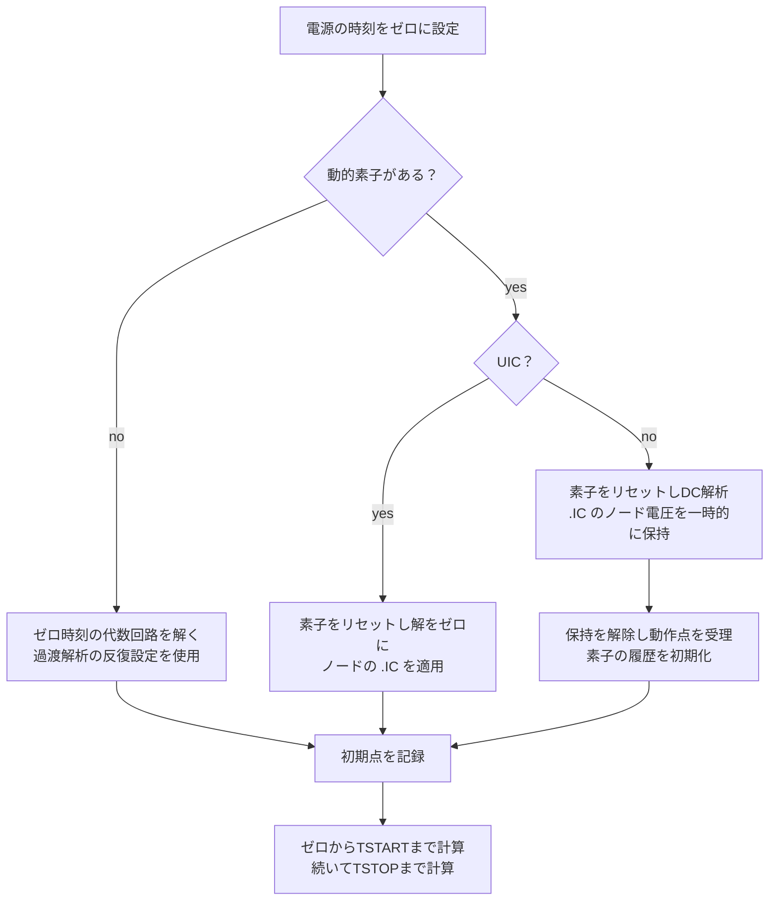
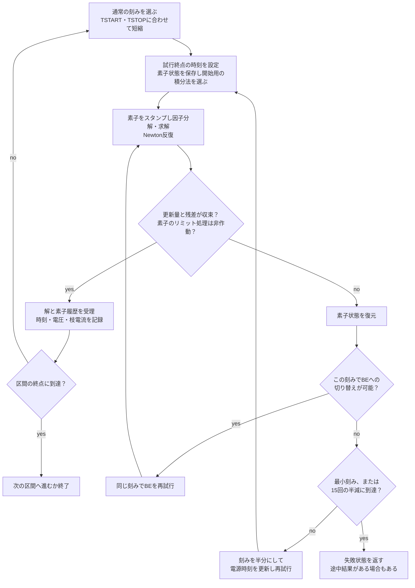
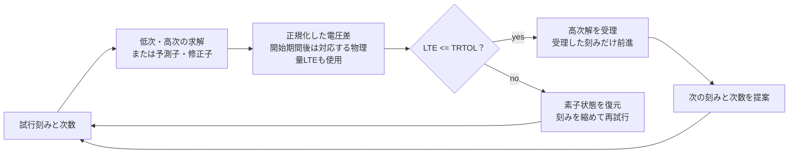

# 過渡解析（Transient analysis）

[English](TRANSIENT_ANALYSIS.md) · [文書の案内](README.ja.md) · この文書は英語版を正とします。日本語版はその訳で、両者が食い違う場合は英語版に従います。

状態：**レビュー用の作業草案**。**2026-11-15** にコミット `0cb0ac3` の macOS arm64 ビルドで
確認しました。実装と測定した動作の説明であり、新しい仕様を決める文書ではありません。
特に断りがなければ、例題と測定値は kirimaspice のものです。図はこの実装の説明用に作成したもので、
他のシミュレータのマニュアルから転載していません。この文書のためにシミュレータのコードや既存テストの
期待値は変更していません。

過渡解析は、電圧と電流が時間とともにどう変化するかを求めます。素子の方程式、蓄積した電荷や磁束、
電源波形、非線形反復、数値積分を組み合わせる処理です。解析の成功は、離散化した方程式が収束したことを
意味します。波形の精度には、時間刻みとデバイスモデルも関わります。

## 目次

- [小さな回路から始める](#小さな回路から始める)
- [時間とコマンドライン](#時間とコマンドライン)
- [初期条件](#初期条件)
- [方程式とコンパニオンモデル](#方程式とコンパニオンモデル)
- [積分法](#積分法)
- [固定刻みの1ステップと収束](#固定刻みの1ステップと収束)
- [ライブラリの可変刻み](#ライブラリの可変刻み)
- [精度を確かめる](#精度を確かめる)
- [デバイスモデルの制約](#デバイスモデルの制約)
- [出力を読み測定する](#出力を読み測定する)
- [うまく動かないとき](#うまく動かないとき)
- [実装とテストの対応](#実装とテストの対応)

## 小さな回路から始める

[通常のビルド](USER_MANUAL.ja.md#ビルド)の後、次を `build/rc-step.cir` として保存します。
最初の行はタイトルです。

```spice
RC step response
V1 in 0 PULSE(0 1 0 1n 1n 1 2)
R1 in out 1k
C1 out 0 1u
.tran 10u 5m
.end
```

リポジトリのルートから実行します。

```sh
build/kirimaspice build/rc-step.cir --raw-out build/rc-step.raw
```

RCの時定数は `tau = R C = 1 ms` です。放電したコンデンサに瞬時に1 Vを加える理想的なステップなら、
`V(out,t) = 1 - exp(-t/tau)` となります。この例の立ち上がり時間は有限の1 nsなので、この式は
エッジから離れた時刻の目安であり、立ち上がり中の厳密解ではありません。実測では0〜5 msの501点を
保持し、最後の電圧は約 `0.993261999 V` でした。既定の積分法は台形則で、最初のステップには後退Euler法を
使います。

入力エッジのない解析解と厳密に比べるには、コンデンサの放電を使います。
次を `build/rc-discharge.cir` として保存し、同じように実行してください。

```spice
RC discharge
R1 out 0 1k
C1 out 0 1u
.IC V(out)=1
.tran 10u 1m UIC
.end
```

この場合は `V(out,t) = exp(-t/1 ms)` Vで、1 msでの厳密値は `0.367879441171 V` です。
既定の積分法による実測値は `0.367894678694 V` でした。後の精度検証でもこの回路を使います。
`UIC` により初期ノード電圧を指定し、この動的回路の初期DC解析を省略しています。

## 時間とコマンドライン

```spice
.TRAN TSTEP TSTOP [TSTART [TMAX]] [UIC]
```

`TSTEP` と `TSTOP` は正の値、`TSTART` は `0 <= TSTART <= TSTOP` としてください。
時間の単位は秒で、`10u` は10マイクロ秒、`1m` は1ミリ秒です。

| 引数 | 現在のCLIの動作 |
| --- | --- |
| `TSTEP` | 出力間隔だけでなく、通常使う積分刻み |
| `TSTOP` | 解析の終了時刻。最後の刻みを縮めてこの時刻に到達する |
| `TSTART` | ゼロから解析した後、この時刻以降の点を保持する。既定値は0 |
| `TMAX` | `max_step` に読み込むが、固定刻みのCLI経路では上限として使わない |
| `UIC` | 動的回路ではDC解析を行わず、`.IC` とゼロで初期化する |

CLIは `run_fixed_timestepping` を使います。Newton反復に失敗した場合は刻みを縮めますが、
局所打ち切り誤差（LTE）による刻み制御は行いません。ライブラリには別の可変刻み経路があります。

| 動作 | CLI | `use_adaptive_timestep=true` のC++ API |
| --- | --- | --- |
| 通常の刻み | `TSTEP` | `config.transient.initial_step` から調整 |
| 非線形収束失敗時の刻み縮小 | あり | あり |
| LTEによる受理・棄却 | なし | あり |
| 最大刻みの設定 | この経路では `TMAX` は効かない | 刻み制御に使う |
| 積分次数の自動選択 | なし | `adaptive_order` で制御 |

実測した3例を示します。

| ディレクティブ | 収束の再試行がない場合に保持する時刻 |
| --- | --- |
| `.tran 30u 100u` | 0、30、60、90、100マイクロ秒 |
| `.tran 10u 1m 205u` | 205、215、…、995、1000マイクロ秒の81点 |
| `.tran 10u 1m 0 2u` | `TMAX=2u` でも0、10、…、1000マイクロ秒の101点 |

`TSTART` は実際にステップを区切る時刻です。まずそこまでの区間を計算し、次の区間へ進みます。
通常の格子にない `TSTART` を選ぶと、行の表示範囲だけでなく時間格子と数値結果も変わることがあります。
それ以前の点を捨てるのは時間積分が成功した後なので、ライブラリが失敗時に返す途中結果には、
`TSTART` より前の点が残る場合があります。

この経路には電源の変化点に刻みを合わせるスケジューラがありません。電源を評価するのは試行するステップの
終点であり、パルスのエッジやPWLの折れ点が追加の計算点を強制することはありません。細いパルスを丸ごと
見逃す場合もあります。必要なエッジ、振動、素子の動特性を解像できる `TSTEP` を選び、半分にして確かめてください。

`.TRAN` はトップレベルのファイルに1つ書いてください。CLIはそのファイルを正規表現でもう一度読み、
過渡解析を選びます。include先にしかないディレクティブでは解析が選ばれない場合があります。
コメントも検索対象で、複数の `.TRAN` は独立したジョブにはなりません。
同じ検索が `.OPTIONS` を `.OP` と誤認するため、追加されるプロットにも注意してください。

比較として、ngspiceの文書では `TSTEP` は出力間隔・計算刻みの目安、`TMAX` は積分刻みの上限です。
同じ構文でも、kirimaspiceの固定刻み経路がそのとおりに動くとは限りません。
[ngspiceマニュアルの .TRAN](https://nmg.gitlab.io/ngspice-manual/analysesandoutputcontrol_batchmode/analyses/tran_transientanalysis.html)を参照してください。

## 初期条件

`TSTART` が正でも、初期化は時刻ゼロで行います。各素子の `is_dynamic()` によって動的素子の有無を
判断するため、単体のコンデンサやインダクタだけでなく、動的な半導体モデルも対象です。



### UICを付けない場合

動的回路ではDCソルバーが開始状態を求めます。コンデンサのDC電流はゼロです。
現在のDCモデルではインダクタに `1e6 S` の大きなコンダクタンスを使うため、短絡を近似した開始状態に
なります。初期電流もそのコンダクタンスから求めます。動作点を受理した後、素子の履歴を初期化します。
相互インダクタンス素子の受理は、結合するインダクタの後です。

`.IC V(out)=1` は初期DC系に `1e10 S` の一時的なNorton保持を加え、時間積分時には解除します。
したがって、開始状態そのものを変えます。`.NODESET V(out)=1` はDC解析の初期推測です。
放電例から `UIC` を外しても、保持により約1 V（実測 `0.9999999999999 V`）から始まり、
制約のないゼロ電圧の平衡状態からは始まりませんでした。

過渡解析の初期動作点には、電源波形の時刻ゼロの値を使います。独立した `.OP` では明示したDC値を
使う場合があります。`V1 in 0 DC 2 PWL(0 0 1m 1)` で測ると、独立した動作点は2 Vでしたが、
最初の過渡解析の電源電圧は0 Vでした。追加の `.OP` プロットが過渡解析の初期状態と同じとは限りません。

### UICを付ける場合

動的回路ではノード電圧とMNAの枝電流をゼロにし、指定したノード電圧を `.IC` で上書きします。
素子の履歴もその状態から初期化します。理想電源やKCLと整合する状態を解く処理ではないため、
矛盾する初期条件は最初のステップの大電流や収束問題につながります。

入力には次の制約があります。

- `.IC` と `.NODESET` は大文字の `V(` を使い、ノードの綴りをそろえてください。
  接地ノードへの初期電圧指定は無視します。
- コンデンサやインダクタの素子行に書く `IC=` はパーサーが適用しません。
  コンデンサ電圧にはノードの `.IC` を使います。インダクタの初期電流を任意に指定する汎用の
  ネットリストインターフェースはありません。
- 動的素子がない回路では `UIC` があっても代数回路の初期化を通り、上記のUIC・ノードIC経路は使いません。

UICの有無による `.IC` の違いと `.NODESET` の初期推測という区別は、
[ngspiceマニュアルの .IC](https://nmg.gitlab.io/ngspice-manual/analysesandoutputcontrol_batchmode/initialconditions/ic_setinitialconditions.html)にも
説明されています。素子ごとの対応と有限コンダクタンスの保持は、kirimaspiceの実装の説明です。

## 方程式とコンパニオンモデル

電荷や磁束を蓄える回路は、概念的には次の微分代数方程式で表せます。

```text
d q(x,t) / dt + f(x,t) = s(t)
```

`x` は回路の未知数、`q` は蓄積量、`f` は素子の代数的な寄与、`s` は励振です。
現在の一部のモデルは、保存される端子電荷ではなく微分容量を積分します。
したがって、この式は考え方を示すもので、すべての素子が電荷保存型の定式化を実装しているという意味ではありません。

MNAの未知数は、接地以外のノード電圧と、その後に並ぶ電圧を規定する電源（`V`、`E`、`H`、電圧モードの`B`）の
枝電流です。インダクタはNortonコンパニオンモデルを使い、電流を素子内に保存します。
インダクタごとのMNA電流未知数はありません。

2端子素子の電圧と電流の正方向を、正端子から負端子へとします。
コンパニオンモデルは `i_new = G v_new + H` と書けます。
`G` をコンダクタンス行列に加え、`H` を正ノードの右辺から引き、負ノードの右辺に足します。

| 素子 | 後退Euler法 | 台形則 |
| --- | --- | --- |
| コンデンサ | `G=C/h`, `H=-G v_old` | `G=2C/h`, `H=-G v_old-i_old` |
| インダクタ | `G=h/L`, `H=i_old` | `G=h/(2L)`, `H=i_old+G v_old` |

一定の刻み `h` におけるBDF法の微分近似は次のとおりです。

```text
BDF2: (3/2 y_new - 2 y_n + 1/2 y_n-1) / h
BDF3: (11/6 y_new - 3 y_n + 3/2 y_n-1 - 1/3 y_n-2) / h
```

刻みが変わると、ソルバーは可変刻み用の係数を渡します。
BDF2では `r = h / h_previous` とすると次の形です。

```text
a0 = (1 + 2r) / (1 + r)
a1 = -(1 + r)
a2 = r*r / (1 + r)
derivative = (a0 y_new + a1 y_n + a2 y_n-1) / h
```

BDF3の係数は、保持している刻み間隔から多項式補間で求めます。
素子側が渡された係数を使う必要があります。ソルバーの積分法を選ぶだけでは、未対応の素子がその方法に
対応するわけではありません。

開発時には配列の添字にも注意してください。MNAのノード `k` は `solution[k-1]` ですが、素子の受理処理に渡す
電圧ベクトルには接地が添字0にあり、ノード `k` は添字 `k` です。スタンプと受理でこの区別をそろえます。
履歴を進めるのは受理した点で、棄却した試行が物理履歴を進めてはいけません。
積分段や誤差推定用の求解を追加するときは、各素子のsave/restoreの契約を確認してください。

## 積分法

例えば `.OPTIONS METHOD=gear` で選択します。現在のCLIでは、これによって追加の動作点プロットも
生じます。下表は固定刻みの開始処理で、可変刻みには別の次数制御があります。

| `METHOD` の名前 | 方法 | 理論上の次数 | 固定刻みの開始処理 |
| --- | --- | --- | --- |
| `euler`, `be`, `bdf1` | 後退Euler法（BE） | 1 | すべてBE |
| `trap`, `trapezoidal` | 台形則（既定） | 2 | 最初の1ステップはBE |
| `gear`, `gear2`, `bdf2` | BDF2 | 2 | 最初の2ステップはBE |
| `gear3`, `bdf3` | BDF3 | 3 | 最初はBE、次の2ステップはBDF2 |
| `tr_bdf2`, `trbdf2` | TR-BDF2 | 意図した次数は2 | 最初の1ステップはBE |

BEには数値的な減衰があり、実際の振動を弱める場合があります。台形則は数値減衰が少ない一方、急な変化の
付近で交互に振れる数値振動を生じることがあります。BDF法では減衰と精度の関係が異なります。
理論上の次数には、十分な履歴、滑らかな変化、整合した素子の離散化が必要です。
現在の開始処理を含む全体について、BDF3の3次精度が保証されるわけではありません。

TR-BDF2は `gamma = 2 - sqrt(2)` を使う2段法として実装されています。
`gamma*h` の台形則の段を計算し、修正BDF2の段で `h` の終点まで進みます。
段の間で可能な範囲のシンボリック解析を共有しますが、数値因子分解は行います。
1ステップに因子分解が1回だけという意味ではありません。現在の実装には大きく2つの制約があります。

1. 両方の段で、電源の時刻にステップ全体の終点を使います。中間段を `t + gamma*h` に設定していません。
   後のランプ実験では、この場合の誤差の減り方が1次相当になることを確認しています。
2. TR-BDF2の段の係数を使わないデバイスモデルがあります。それらを含む回路全体が一様なTR-BDF2で
   離散化されるわけではありません。

## 固定刻みの1ステップと収束



Newton反復ごとに素子の寄与を線形化し、疎行列ソルバーで `G x_new = b` を解きます。
最初の反復では行列の解析と因子分解を行い、以後は再因子分解します。
成功にはノード電圧と電源枝電流の更新量が小さいことが必要です。

```text
voltage: |new-old| <= RELTOL * max(|new|, |old|) + VNTOL
current: |new-old| <= RELTOL * max(|new|, |old|) + ABSTOL
```

さらに、同じ積分条件を使って候補解でスタンプし直し、行ごとの残差を確認します。
許容値には、素子の最大寄与を基準とする相対値、行の種類に応じた電流または電圧の絶対許容値、
小さな浮動小数点の丸め誤差分を含みます。素子の電圧リミット処理が作動中なら受理しません。
Newton更新量が小さいだけでは見逃す場合を、この残差確認で検出します。

選んだ非BEの積分法が失敗すると、固定刻みではまず同じ刻みのBEを試します。それも失敗すれば刻みを半分にし、
最大15回の半減まで再試行します。下限は `min_step`（既定 `1e-15 s`）です。
縮めた刻みを受理した後、次のステップは通常の `TSTEP` から始め直します。
したがって固定刻みと呼ぶモードでも、出力点の間隔は不均一になり得ます。

| 設定 | 既定値 | 制御するもの |
| --- | --- | --- |
| `RELTOL` | `1e-3` | Newton更新量と残差の相対許容値 |
| `VNTOL` | `1e-6 V` | 電圧の絶対許容値 |
| `ABSTOL` | `1e-12 A` | 電流の絶対許容値 |
| `ITL4` | 20 | 求解・段ごとのNewton反復回数 |
| `ITL5` | 100000 | `TSTART` より前を含む、受理した時間前進の回数 |

`ITL5` はNewton反復の総数の上限ではありません。TR-BDF2の1ステップには2段のNewton反復があり、
それぞれに `ITL4` が適用されます。オプションには
`.OPTIONS RELTOL=1e-4 VNTOL=1e-7 ITL4=40` のような通常の数値を使ってください。
オプション値のスケール接尾辞には対応していません。`RELTOL` を厳しくしても、刻み幅の検証の代わりにはならず、
CLIのLTE制御も有効になりません。

## ライブラリの可変刻み

可変刻みはC++の `SimulationConfig` で有効にします。この確認時点では、
`use_adaptive_timestep=true` にするネットリスト・CLIのスイッチはありません。
`LTE_RELTOL`、`ERROR_EST`、`MAXORD` などを読み込めても、その経路を有効にすることにはなりません。
次数選択が実装しているのは1〜3次で、パーサーがより大きな `MAXORD` を受け付けても増えません。

次の完全なAPI例は既存のライブラリに対してコンパイルし、上の放電ネットリストで実行しました。
プロジェクトのビルド設定を使って `kirimaspice_lib` にリンクしてください。
開始時の処理と次数選択を自動化し、最大次数を2にしています。既定の選択はBEからBDF2への移行です。

```cpp
#include "kirimaspice/parser/netlist_parser.hpp"
#include "kirimaspice/solvers/transient_solver.hpp"
#include <iostream>

int main(int argc, char** argv) {
    if (argc != 2) return 2;
    kirimaspice::parser::NetlistParser parser;
    auto parsed = parser.parse_file(argv[1]);
    parsed.circuit->expand_all_subcircuits();
    auto config = parsed.config;
    config.transient.use_adaptive_timestep = true;
    config.transient.adaptive_order = true;
    config.transient.max_order = 2;
    config.transient.method = kirimaspice::IntegrationMethod::GEAR2;
    config.transient.initial_step = 1e-6;
    config.transient.max_step = 1e-5;
    config.transient.min_step = 1e-12;
    kirimaspice::solvers::TransientSolver solver(*parsed.circuit, config);
    auto result = solver.solve(config.transient.start_time,
                               config.transient.end_time,
                               config.transient.initial_step);
    if (result.status != kirimaspice::ConvergenceStatus::SUCCESS) return 1;
    const auto out = parsed.circuit->get_node_id("out");
    if (out == kirimaspice::NODE_GND) return 2;
    for (const auto& point : result.timepoints) {
        std::cout << point.time << ',' << point.node_voltages.at(out - 1) << '\n';
    }
}
```

ソルバーは回路への参照を保持するため、回路を先に破棄してはいけません。設定はソルバー構築時にコピーします。
独立した解析には新しいソルバーを作り、できれば回路も新しく読み込んでください。
`solve()` は再利用時に履歴と次数の状態をすべてリセットするわけではありません。
`timepoints` を使う前に必ず `result.status` を確認します。

既定の `adaptive_order=true` では、`method` の名前を固定して使うのではなく、保持した履歴と誤差推定から
積分法を選びます。2次は通常BDF2で、`prefer_trapezoidal=true` なら台形則です。
`adaptive_order` を無効にしても、固定刻みと同じ開始処理にはなりません。
放電のプローブで、非ゼロのUIC初期値と固定GEAR2を組み合わせた可変刻みは、開始時の棄却回数の上限に
達しました。そのような組み合わせには個別の検証が必要です。



既定の `ErrorEstimation::PHYSICAL` でも、開始時は低次解と高次解の電圧差を使う埋め込み型の比較です。
`PREDICTOR_CORRECTOR` は、外挿した予測解と修正解を比較します。履歴をためる間はこの方法でも埋め込み型の
求解を使います。`COMBINED` は利用可能な推定値の大きい方を使います。埋め込み型の電圧誤差は次の形です。

```text
max over node voltages of
|V_high - V_low| / (lte_abstol + lte_reltol * max(|V_high|, |V_low|))
```

この電圧による推定に、MNAの枝電流は含みません。20ステップを受理した後は、動的素子の
`get_physical_lte()` が返す値との最大値も取ります。基底実装はゼロを返すため、対応範囲はモデル次第です。
すべての素子の電荷やエネルギー保存を保証するものではありません。

既定値は `lte_abstol=1e-6`、`lte_reltol=1e-3`、`trtol=7`、`chgtol=1e-14` です。
正規化した推定値が `TRTOL` 以下なら受理します。次の刻みは推定値1を目標に、安全係数と拡大・縮小の制限を
付けて提案し、刻みの上下限を適用します。局所的な推定値は波形全体の大域誤差の上限ではありません。
電源の変化点、素子の積分法対応、開始処理も確認してください。

`method=TR_BDF2` を設定すると、コンストラクターが `PREDICTOR_CORRECTOR` または `COMBINED` の
誤差推定を `PHYSICAL` に変更し、ログに記録します。その性能上の理由は、ここでは独立に測定していません。

## 精度を確かめる

### 3種類の誤差を分ける

| 誤差 | 変えるもの・調べるもの |
| --- | --- |
| 非線形・線形求解の誤差 | Newton許容値、残差、リミット処理、失敗状態 |
| 時間離散化の誤差 | 刻みの半減、積分法の比較、振幅・位相・エネルギー |
| 素子・モデルの誤差 | パラメータの読み込み、方程式、電荷・容量、積分法の対応範囲 |

Newton残差が小さいことだけでは、後の2種類を調べたことにはなりません。
可変刻みのLTE推定も、素子の方程式が物理的に十分であることを示すものではありません。

### 再現できる放電の検証

上の放電例の `.tran` より前に `.OPTIONS METHOD=<name>` を加え、
`TSTEP=10u`、`5u`、`2.5u` で繰り返します。rawファイルから **Transient Analysis** のプロットを
選び、ちょうど1 msでの `V(out)` を `exp(-1)` と比べます。
確認したコミットでの絶対誤差は次のとおりです。単位はVです。

| 積分法 | 10マイクロ秒 | 5マイクロ秒 | 2.5マイクロ秒 | 半減したときの誤差の減少 |
| --- | --- | --- | --- | --- |
| `euler` | `1.83177e-3` | `9.17787e-4` | `4.59371e-4` | 約2分の1 |
| `trap` | `1.52375e-5` | `3.82066e-6` | `9.56587e-7` | 約4分の1 |
| `gear` | `3.38212e-5` | `8.44250e-6` | `2.10911e-6` | 約4分の1 |
| `gear3` | `2.60034e-5` | `6.52907e-6` | `1.63578e-6` | 開始処理を含めて約4分の1 |
| `tr_bdf2` | `1.67985e-5` | `4.21301e-6` | `1.05494e-6` | この無励振の減衰では約4分の1 |

観測した次数は `p = log2(error(h) / error(h/2))` で見積もれます。
この回路・時刻・開始処理についての結果であり、すべてのモデルや波形での証明ではありません。

### 時間変化する電源で別の制約が見える

次のランプ入力を使い、実行ごとに `TSTEP` を変えます。

```spice
RC ramp
V1 in 0 PWL(0 0 1m 1)
R1 in out 1k
C1 out 0 1u
.OPTIONS METHOD=tr_bdf2
.tran 10u 1m
.end
```

この区間の厳密解は、`tau=1 ms` として
`V(out,t) = t/tau - 1 + exp(-t/tau)` Vです。1 msの値は再び `exp(-1)` Vになります。

| 刻み | 1 msでのTR-BDF2の絶対誤差 |
| --- | --- |
| 10マイクロ秒 | `9.36316e-4 V` |
| 5マイクロ秒 | `4.65525e-4 V` |
| 2.5マイクロ秒 | `2.32098e-4 V` |

誤差は約2分の1ずつで、この実験では1次相当の振る舞いです。
`solve_timestep_tr_bdf2` を読むと、両方の段で `current_time_` にステップ全体の終点が入り、
第1段の中間時刻で評価していないことが原因として考えられます。
これは測定した制約とコードに基づく説明であり、実装修正ではありません。
ほかの4つの積分法は、このランプでも放電表と同じ誤差でした。

### 実際の回路でも同じ手順で確かめる

1. コミット、ネットリスト、モデルパラメータ、温度、初期条件、出力形式を記録します。
   最初にDC動作点またはUICの開始状態を確認します。
2. `h`、`h/2`、`h/4` で実行し、終了状態と実際の時間格子を確認します。
   行番号ではなく同じ物理時刻で比べ、格子が違う場合は補間方法を意識して選びます。
3. 必要な量を測ります。ピーク電圧・電流、立ち上がり時間、整定、振動の振幅と位相、平均電力などです。
   LC回路なら `C V^2/2 + L I^2/2` に必要な相互エネルギー項を加えて調べ、物理的な電源や損失も考慮します。
4. Newton許容値の厳格化は別に試します。`h` の半減で改善しなくなったら、理論上の次数を信じるだけでなく、
   モデル・パラメータの対応範囲と求解の許容値を調べます。
5. 参照比較では相手のシミュレータの実際の版を記録し、モデル、パラメータ、温度、電源、初期状態をそろえます。
   出力補間の違いを求解誤差と取り違えないようにします。

この節の数値は解析解との比較で、他のシミュレータを正解としていません。
どの回路にも使える推奨刻みを決めるものでもありません。

## デバイスモデルの制約

特に測定と書いたもの以外は、確認したコミットのコードを読んだ結果です。
積分法のオプションはソルバーが要求する方法を選びますが、実際の離散化は各素子の実装によります。

| 素子・経路 | 過渡解析の動作・制約 |
| --- | --- |
| 単体の `C`、`L` | BE、台形則、BDF2、BDF3、TR-BDF2それぞれのコンパニオンモデルがある |
| 相互インダクタンス | インダクタの後に受理。3つ以上の結合インダクタでは、結合行列全体の逆行列でなく対ごとの補正を使う |
| ダイオード | ネットリストから読むのは `IS` と `N` のみ。`CJ0` の既定値はゼロで、モデルカードの容量指定では接合電荷の蓄積を有効にできない |
| APIで `CJ0` を指定したダイオード | 電圧依存容量があるが、台形則・TR-BDF2の段や履歴の扱いは標準的なコンパニオンモデルと異なる |
| BJT | 接合電荷でなく微分容量を積分し、交差微分の欠落がある。TR-BDF2は共通ヘルパーでBEに切り替わる |
| Level-1 MOSFET | 要求した積分法によらず、オーバーラップ容量にBEを使う |
| Level-3 MOSFET | 過渡スタンプに内部容量の寄与がない。ACの容量があることは過渡解析の対応を意味しない |
| BSIM1 | 要求した積分法によらず容量にBEを使う |
| BSIM3 / BSIM4 | 共通の容量ヘルパーはBE・台形則・BDF2・BDF3に対応するが、TR-BDF2はBEに切り替わる |
| BSIM4 | 簡略化したMeyer容量で、完全な端子電荷の定式化ではない。インバータ列の過渡参照テストは無効化されている |
| SiC、GaN、VDMOS、FinFET、MESFET | 容量の経路にBEを強制する |
| IGBT | 台形則の要求にBEの経路を使う |
| 損失のある伝送線路 | 損失処理は近似。最初の伝搬遅延時間の間、遅延波はゼロから始まる |

ダイオードには入力だけでなく数値計算の制約もあります。現在の台形則のスタンプは
`G=Cj/(2h)`、`H=-G*v_old` で、標準的なコンデンサの前時刻電流項がありません。
別のAPIプローブで、ほぼ一定の `CJ0=1e-6 F`、`M=1e-8`、1キロオームの抵抗、1 msで0から-1 Vへの
線形ランプを使ったところ、`h=10 us` の終点電圧はBEで約 `-0.369711 V`、台形則の要求では約
`-0.569003 V` でした。一定容量のRC極限では `-exp(-1) V` です。
ソルバーのオプションを変えるだけではモデルの精度が確かめられないことを示す例です。

ほかのモデルの制約は [KNOWN_ISSUES](../KNOWN_ISSUES.ja.md) を参照してください。
この表は、すべての素子を網羅して検証したものではありません。

## 出力を読み測定する

| 出力 | 用途と制約 |
| --- | --- |
| コンソールの表 | 概観向け。接地を含むノード電圧と時刻を限られた桁数で表示する |
| ASCII・バイナリraw | 受理した時刻と電源枝電流を保持する。数値比較にはこちらを使う |
| SSF | 電圧はマイクロV、電流はマイクロA、時刻は整数ナノ秒に量子化する。それより細かい精度検証には不向き |
| WAV | 音声レートへ補間し、電圧を-1〜+1の音声範囲に制限する。試聴向け |

rawの変数に接地は含みません。枝電流は電圧を規定する電源のもので、すべての抵抗・コンデンサ・インダクタの
電流を自動的に出すものではありません。電源電流の正方向は正端子から負端子です。
RC例に電力を供給する電圧源の電流は、そのため負になります。

rawファイルには複数のプロットが入ることがあります。`.OP`、`.OPTIONS` の検出不具合、ほかの解析、温度ごとの
実行で追加されます。`Plotname: Transient Analysis` と対象の実行を選んでください。
現在の `tools/kirimaspice_pyapi.py` の `parse_ascii_raw` は最初のプロットだけを読むため、上の積分法比較用の
ネットリストでは過渡解析でなく動作点を読むことがあります。最初のプロットに時間軸があるとは限りません。
読み込み側は `TSTEP` から等間隔の時刻を作り直さず、記録した時刻を保持する必要もあります。

`.PRINT` と `.SAVE` は現在のCLIの過渡出力を絞り込まず、CLIは `.MEASURE` を実行しません。
対象のrawプロットから測定するか、ライブラリを明示的に使ってください。
`.FOUR` は保持した過渡解析点を使い、最後の周期の解析に十分なデータを必要とします。
そこで使える電流は独立電圧源のもので、rawのすべての枝変数ではありません。
固有のメッセージも確認してください。過渡解析の成功だけではFourier後処理の成功まで確かめられません。

`.TEMP` の各実行には、その温度を設定した新しい過渡ソルバーを使います。rawには複数の実行が入る場合があります。
受理した点はすべてメモリに保持するため、ストリーミング型のソルバーではありません。
時間ステップは順番に進み、任意の素子スタンプ並列化があっても、時間ステップ同士が独立するわけではありません。

## うまく動かないとき

| 症状 | 最初に調べること |
| --- | --- |
| 過渡プロットがない | トップレベルの `.TRAN`、終了状態、パーサー・ソルバーのログ |
| 波形が平坦 | 初期動作点、電源値、読み込まれていない容量パラメータ、パルス幅と刻み |
| 初期電圧が違う | UICとDC保持の違い、`.IC V(` の綴り、波形のゼロ時刻値と明示DC値 |
| 減衰や振動が多すぎる | 刻み幅の検証と、素子が実際に使う積分法 |
| 特異行列 | 浮いたノード、矛盾する理想電圧の制約、未対応の回路構成 |
| 非線形収束に失敗 | 最初の失敗時刻、リミット処理、モデルパラメータ、初期状態、`ITL4` |
| ステップ回数の上限 | `ITL5`、`TSTART` より前を含む全区間、小さな受理刻みの繰り返し |
| ライブラリの棄却上限 | LTE設定、開始処理と次数の組み合わせ、最小刻み、モデル履歴の処理 |
| Pythonで `time` がない | rawの最初のプロットが動作点になっていないか |
| `TSTART` を変えたら結果が変わる | 区間境界による時間格子の変化 |

ライブラリの状態には `SUCCESS`、`MAX_ITERATIONS`、`SINGULAR_MATRIX`、
`NUMERICAL_ERROR`、`TIMESTEP_TOO_SMALL` などがあります。失敗時の点列は途中結果の場合があります。
CLIは過渡解析に失敗すると非ゼロで終了し、その過渡解析を成功結果としては出力しません。
前回の出力ファイルが残ることはあるため、別の出力先を使い、今回の終了状態を確認してください。

報告には最小ネットリスト、全オプション、最初の失敗時刻、実際の刻み列、ビルドのコミット、解析解または
版を記録した参照結果の根拠を残します。回帰テストにするときは[検証計画](VALIDATION_PLAN.ja.md)に従ってください。
既存の期待値を直す場合は、プロジェクトの決まりに従って人のレビューを受けます。

## 実装とテストの対応

| 場所 | 調べるもの |
| --- | --- |
| [TransientSolverの実装](../src/solvers/transient_solver.cpp) | `initialize_simulation`、`run_fixed_timestepping`、`run_adaptive_timestepping`、`solve_timestep`、`solve_timestep_tr_bdf2`、`check_convergence` |
| [TransientSolverのAPI](../include/kirimaspice/solvers/transient_solver.hpp) | `TimePoint`、`TransientResult`、ソルバーの所有関係と履歴メンバー |
| [設定](../include/kirimaspice/core/types.hpp) | `SimulationConfig::Transient`、`IntegrationMethod`、`ErrorEstimation` |
| [ネットリストパーサー](../src/parser/netlist_parser.cpp) | `parse_tran_directive`、`parse_options_directive`、ノード初期条件とモデルパラメータ |
| [CLI](../src/main.cpp) | `parse_analysis_commands`、`run_analyses`、出力先と終了状態 |
| [素子インターフェース](../include/kirimaspice/devices/device.hpp) | スタンプ、状態の保存・復元、受理、物理量LTEのフック |
| [共通の素子ヘルパー](../include/kirimaspice/core/device_utils.hpp) | `capacitor_companion` と積分法の切り替え |
| [単体コンデンサ](../src/devices/capacitor.cpp)、[インダクタ](../src/devices/inductor.cpp) | コンパニオン係数と電圧・電流の履歴 |
| [過渡解析テスト](../tests/unit/test_transient_solver.cpp) | RC・RLの解、初期状態、終了時刻、TSTART、再試行時の電源時刻 |
| [初期刻みのテスト](../tests/unit/test_initial_timestep_control.cpp) | 可変刻みの開始処理と刻みの拡大 |
| [LTEのテスト](../tests/unit/test_lte_tolerance.cpp)、[予測子・修正子のテスト](../tests/unit/test_predictor_corrector_lte.cpp) | 選んだ回路での誤差推定と許容値の動作 |

2026-11-15に、次の選択でコミット `0cb0ac3` の **74件を実行し、74件成功、0件失敗、0件スキップ**でした。

```sh
ctest --test-dir build -j4 --output-on-failure \
  -R '^(TransientSolver|TransientTemperatureSweep|TransientAdaptive|InitialTimestepControlTest|LTEToleranceTest|PredictorCorrectorLTETest|MOSFET_[NP]_Transient|MOSFET_Transient|MutualInductanceTransient|SourceWaveforms)\.'
```

別に、CLIの時刻・精度の実験として38ネットリストを実行しました。放電・ランプ比較30件、時間境界のプローブ3件、
導入の例題、初期化の2種類、明示DC値と波形の比較、意図した `ITL5` 失敗です。
可変刻みのAPI例と2つの積分法で比べるダイオードのプローブもコンパイルして実行しました。
選んだテストが通っても、すべてのモデル、無効化したBSIM4の列、すべてのエラー経路をカバーしたわけではありません。
上の独立したランプとダイオードの結果が、その境界を示しています。

Mermaidは構造と翻訳間の対応を確認しましたが、Mermaid対応ビューアーでの表示は**未確認**です。
公開前に、そのようなビューアーでこのファイルをプレビューして見た目を確認してください。
