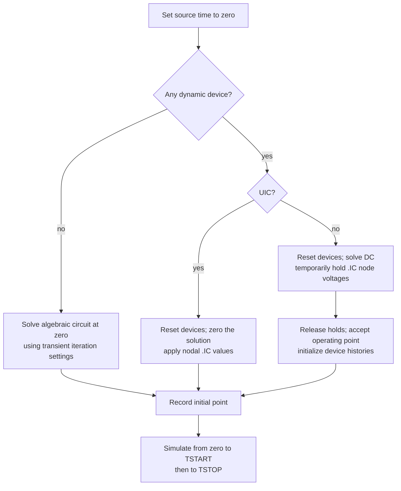
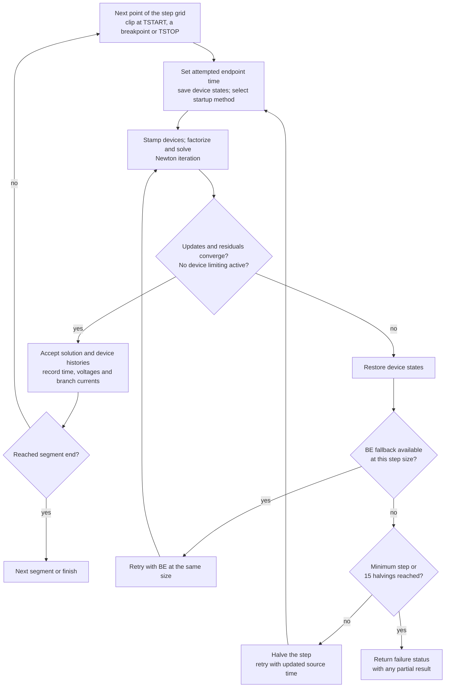
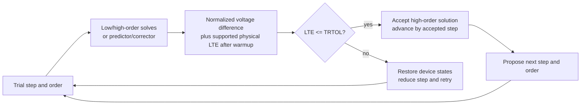

# Transient analysis

[日本語](TRANSIENT_ANALYSIS.ja.md) · [Documentation guide](README.md) · This English text is the main version; the Japanese version follows it, and where they differ, this text holds.

Status: **working draft for review**. Checked on **2026-11-15** against
commit `0cb0ac3`, on the macOS arm64 build, and reviewed again on
**2026-11-21** against commit `2826a81`: most of its measurements were run
again on that build, and those that had changed were corrected. It was
updated on **2026-11-21** at commit `9bc2043` for the fixes since
`2826a81`; the measurements those fixes changed were run again on that
build. This is a description of the
implementation and its measured behaviour, not a new specification.
Examples and measurements below use kirimaspice unless stated otherwise.
The diagrams describe this implementation; they are not copied from a
simulator manual. Simulator code and existing test expectations were not
changed to produce this document.

Transient analysis computes how voltages and currents evolve with time.
It couples device equations, stored charge and magnetic flux, source
waveforms, nonlinear iteration and numerical integration. A successful
solve establishes convergence of the discretized equations. Accuracy also
depends on the time step and the device model.

## Contents

- [Start with a small circuit](#start-with-a-small-circuit)
- [Time and the command line](#time-and-the-command-line)
- [Initial conditions](#initial-conditions)
- [Equations and companion models](#equations-and-companion-models)
- [Integration methods](#integration-methods)
- [One fixed step and convergence](#one-fixed-step-and-convergence)
- [Adaptive stepping in the library](#adaptive-stepping-in-the-library)
- [Check accuracy](#check-accuracy)
- [Device model limits](#device-model-limits)
- [Read and measure the output](#read-and-measure-the-output)
- [Troubleshoot a run](#troubleshoot-a-run)
- [Implementation and test map](#implementation-and-test-map)

## Start with a small circuit

After the [normal build](USER_MANUAL.md#build), save this as
`build/rc-step.cir`. The first line is the title.

```spice
RC step response
V1 in 0 PULSE(0 1 0 1n 1n 1 2)
R1 in out 1k
C1 out 0 1u
.tran 10u 5m
.end
```

Run from the repository root:

```sh
build/kirimaspice build/rc-step.cir --raw-out build/rc-step.raw
```

The RC time constant is `tau = R C = 1 ms`. For an ideal instantaneous
1 V step from a discharged capacitor, `V(out,t) = 1 - exp(-t/tau)`.
The example has a finite 1 ns rise time; this formula is a useful check
away from the edge, not its exact solution during the rise. The measured
run retained 502 points (the 10 µs grid and the 1 ns corner), from 0 to
5 ms, and ended at about
`0.993261999 V`. The default method is trapezoidal, with a backward Euler
startup step.

For an exact analytic check without an input edge, use a discharging
capacitor. Save as `build/rc-discharge.cir` and run it in the same way:

```spice
RC discharge
R1 out 0 1k
C1 out 0 1u
.IC V(out)=1
.tran 10u 1m UIC
.end
```

Here `V(out,t) = exp(-t/1 ms)` volts, so the exact voltage at 1 ms is
`0.367879441171 V`. The measured default-method result was
`0.367894678694 V`. This circuit is used in the accuracy study below.
`UIC` makes the initial node voltage explicit and skips the initial DC
solve for this dynamic circuit.

## Time and the command line

```spice
.TRAN TSTEP TSTOP [TSTART [TMAX]] [UIC]
```

Use positive `TSTEP` and `TSTOP`, with `0 <= TSTART < TSTOP`; a `TSTART`
that is not below `TSTOP` and a negative `TMAX` are errors. Time values
are in seconds; `10u` is 10 microseconds and `1m` is 1 millisecond.

| Field | Current CLI behaviour |
| --- | --- |
| `TSTEP` | Nominal integration step, not just the output interval |
| `TSTOP` | Last simulated time; the final step is shortened to land on it |
| `TSTART` | Retain points starting here, after simulating from zero; default 0 |
| `TMAX` | The step is `TSTEP` or `TMAX`, whichever is shorter; a `TMAX` of 0 counts as not given |
| `UIC` | For a dynamic circuit, initialize from `.IC` and zeros instead of solving DC |

The CLI uses `run_fixed_timestepping`. It reduces a step when Newton
iteration fails, but does not estimate LTE to control that step. The
library has a separate adaptive path:

| Behaviour | CLI | C++ API with `use_adaptive_timestep=true` |
| --- | --- | --- |
| Ordinary step size | `TSTEP` | Adapted from `config.transient.initial_step` |
| Shorter steps on nonlinear failure | Yes | Yes |
| LTE acceptance/rejection | No | Yes |
| Maximum step setting | The step is at most `TMAX` | Used by the step controller |
| Steps onto source breakpoints | Yes | Yes |
| Automatic integration order | No | Controlled by `adaptive_order` |

Three measured examples make the timing rules concrete:

| Directive | Retained times, without convergence retries |
| --- | --- |
| `.tran 30u 100u` | 0, 30, 60, 90, 100 microseconds |
| `.tran 10u 1m 205u` | 205, 210, 220, ..., 990, 1000 microseconds; 81 points |
| `.tran 10u 1m 0 2u` | 0, 2, ..., 1000 microseconds; 501 points |

`TSTART` is an actual step boundary: the solver first ends a segment
there, then continues. A non-grid `TSTART` therefore adds one point and
can change the numerical result slightly, rather than merely hiding some
rows; the other points stay on the grid. A source breakpoint closer to
`TSTART` or `TSTOP` than the loop can step (10<sup>−5</sup> of `TSTEP`)
merges into that end, so both ends keep their points.
Discarding the earlier points happens after successful time stepping;
partial results returned after a library failure may still contain them.

Both paths step onto every breakpoint of a source: the four corners of
each `PULSE` period, the points of `PWL` and the delays of `SIN` and
`EXP` (`Waveform::breakpoints`). A `PULSE` corner with a `TR` or `TF`
of 0 has the level before it on the corner, and the new level from the
next point on; ngspice-47 instead ramps a zero `TR` or `TF` over
`TSTEP` (for `PULSE(0 1 0 0 0 1m 2m)` into 1 kΩ and 1 µF with
`.tran 0.1m 1m`, ngspice-47 gives 0.6131 V at 1 ms, this program
0.630669 V, the ideal step 0.632121 V). The fixed step keeps its points at
multiples of the step as well, so a corner between two of them adds
points without moving the others. After a corner the next step is a
backward-Euler step and the orders of BDF build up again, as at time 0;
a trapezoidal step many time constants long would ring. The steps
between corners are still fixed: choose `TSTEP` to resolve the fastest
relevant change, oscillation and device dynamics, and verify by halving
it.

Use one `.TRAN`. The CLI runs the transient when the parser has read a
complete `.TRAN`, continued, included or in the branch of `.IF` taken, as
any directive; a comment never selects it. Several `.TRAN` lines do not
create independent jobs: the last one sets TSTEP, TSTOP and TMAX, and a
TSTART or `UIC` of an earlier line stays when the last omits it.

For comparison, ngspice documents `TSTEP` as an output/suggested computing
increment and `TMAX` as a maximum integration step; ngspice chooses its
steps, where the fixed path here takes `TSTEP` or `TMAX`.
See the [ngspice manual: .TRAN](https://nmg.gitlab.io/ngspice-manual/analysesandoutputcontrol_batchmode/analyses/tran_transientanalysis.html).

## Initial conditions

Initialization takes place at time zero, even when `TSTART` is positive.
The solver asks each device whether it is dynamic; this includes dynamic
semiconductor models as well as discrete capacitors and inductors.



### Without UIC

For a dynamic circuit, the DC solver establishes the starting point.
Capacitors contribute no DC current. An inductor uses a large conductance
of `1e6 S` in the present DC model, so its starting state approximates a
short circuit; its stored DC current is derived from that conductance.
After the operating point is accepted, device histories are initialized.
Mutual-inductance devices are accepted after their coupled inductors.

`.IC V(out)=1` adds a temporary Norton hold of `1e10 S` to the initial
DC system, then releases it for time stepping. It therefore changes the
starting state. `.NODESET V(out)=1` supplies an initial DC guess instead.
In the discharge example, removing `UIC` still started near 1 V
(`0.9999999999999 V` measured) because of the hold; it did not start at
the unconstrained zero-voltage equilibrium.

The transient operating point uses each source's waveform value at time
zero. A separate `.OP` can use its explicit DC value instead. With
`V1 in 0 DC 2 PWL(0 0 1m 1)`, the measured standalone operating point was
2 V, while the first transient source voltage was 0 V. An extra `.OP`
plot is therefore not necessarily the initial transient state.

### With UIC

For a dynamic circuit, node voltages and MNA branch currents begin at zero;
nodal `.IC` values overwrite the corresponding voltages. Device histories
are initialized from that state. This does not solve for consistency with
ideal sources or KCL. Inconsistent initial conditions can produce a large
first-step current or convergence trouble.

There are important input limits:

- Write upper-case `V(` in `.IC` and `.NODESET`, and keep node spelling
  consistent. A ground-node initial voltage is ignored.
- An inductor without `IC=` starts with no current under `UIC`.
- `IC=` on a capacitor or inductor line gives that element's voltage or
  current at the start under `UIC`, after the node voltages of `.IC`; it
  is not used without `UIC`, as in SPICE. The point at time 0 holds the
  initial node voltages, so it shows 0 V at a node that only a
  capacitor's `IC=` sets.
- A circuit with no dynamic devices takes the algebraic initialization
  path even with `UIC`; the UIC/nodal-IC path above is not used there.

The distinction between `.IC` with and without UIC and a `.NODESET` guess
also appears in the [ngspice manual: .IC](https://nmg.gitlab.io/ngspice-manual/analysesandoutputcontrol_batchmode/initialconditions/ic_setinitialconditions.html).
Device-level support and the finite hold above describe kirimaspice.

## Equations and companion models

Conceptually, a circuit with stored charge and flux is a differential
algebraic system:

```text
d q(x,t) / dt + f(x,t) = s(t)
```

`x` contains the circuit unknowns, `q` represents stored quantities, `f`
contains algebraic device contributions, and `s` is the excitation. Some
models in this implementation integrate differential capacitances rather
than conserved terminal charges, so this equation is a conceptual model,
not a claim that every device implements a charge-conserving formulation.

MNA unknowns are non-ground node voltages followed by branch currents for
voltage-defined sources (`V`, `E`, `H`, and voltage-mode `B`). Inductors use
Norton companion models and retain their currents inside the devices;
there is no MNA current unknown for each inductor.

For a two-terminal element, let voltage and current be positive from its
positive terminal to its negative terminal. A companion model has
`i_new = G v_new + H`. `G` is stamped into the conductance matrix; `H` is
subtracted from the positive-node RHS and added to the negative-node RHS.

| Element | Backward Euler | Trapezoidal |
| --- | --- | --- |
| Capacitor | `G=C/h`, `H=-G v_old` | `G=2C/h`, `H=-G v_old-i_old` |
| Inductor | `G=h/L`, `H=i_old` | `G=h/(2L)`, `H=i_old+G v_old` |

For constant step `h`, BDF methods approximate a derivative as:

```text
BDF2: (3/2 y_new - 2 y_n + 1/2 y_n-1) / h
BDF3: (11/6 y_new - 3 y_n + 3/2 y_n-1 - 1/3 y_n-2) / h
```

After a step changes, the solver supplies variable-step coefficients. For
BDF2, with `r = h / h_previous`, they are:

```text
a0 = (1 + 2r) / (1 + r)
a1 = -(1 + r)
a2 = r*r / (1 + r)
derivative = (a0 y_new + a1 y_n + a2 y_n-1) / h
```

BDF3 coefficients are computed from the available step intervals by
polynomial interpolation. Devices must consume the supplied coefficients;
choosing a method in the solver does not make an incomplete device support
that method.

For developers, the indexing convention matters: MNA node `k` is at
`solution[k-1]`, whereas the vector passed to device acceptance includes
ground at index 0 and node `k` at index `k`. Keep stamps and acceptance
consistent. Store history at accepted points; rejected attempts must not
advance physical history. Review each device's save/restore contract when
adding an integration stage or an error-estimation solve.

## Integration methods

Select a method with, for example, `.OPTIONS METHOD=gear`. The startup rules
below are for fixed stepping; the adaptive path has its own order control.

| `METHOD` names | Method | Nominal order | Fixed-step startup |
| --- | --- | --- | --- |
| `euler`, `be`, `bdf1` | Backward Euler (BE) | 1 | BE throughout |
| `trap`, `trapezoidal` | Trapezoidal rule (default) | 2 | First step BE |
| `gear`, `gear2`, `bdf2` | BDF2 | 2 | First two steps BE |
| `gear3`, `bdf3` | BDF3 | 3 | First step BE, next two BDF2 |
| `tr_bdf2`, `trbdf2` | TR-BDF2 | 2 | First step BE |

BE is dissipative and can suppress real ringing. Trapezoidal integration
has less numerical damping but can produce alternating numerical ringing
around fast changes. BDF methods provide a different damping/accuracy
tradeoff; the nominal order assumes sufficient history, smooth behaviour
and a consistent device discretization. BDF3 does not give a third-order
whole-run guarantee with the current startup sequence.

TR-BDF2 is implemented as two stages with `gamma = 2 - sqrt(2)`: a
trapezoidal stage over `gamma*h`, followed by a modified BDF2 stage to the
end of `h`. The stages share symbolic analysis where possible, but numeric
factorization still occurs; do not interpret that as one factorization per
step. The first stage stamps the sources at `t + gamma*h`, its own time,
and the second at `t + h` (`solve_timestep_tr_bdf2`); the ramp experiment
below shows second-order error reduction. The discrete capacitor and
inductor, and the diode, BJT, BSIM3, BSIM4 and IGBT through
`device_utils::capacitor_companion`, take the coefficients of each stage.
The models that use backward Euler for every method (see
[Device model limits](#device-model-limits)) do so under TR-BDF2 too, so a
circuit containing them does not use a uniform TR-BDF2 discretization.
Transmission lines keep their own clock at the time points, not at the
first stage's time.

## One fixed step and convergence



At each Newton iteration, devices linearize their contributions and the
sparse solver solves `G x_new = b`. The first iteration analyzes and
factorizes the matrix; later iterations refactorize it. Success requires
small changes in both node voltages and source branch currents:

```text
voltage: |new-old| <= RELTOL * max(|new|, |old|) + VNTOL
current: |new-old| <= RELTOL * max(|new|, |old|) + ABSTOL
```

The solver then re-stamps at the candidate solution using the same
integration context and checks row residuals. The tolerance includes a
relative scale from the largest device contribution, an absolute current
or voltage tolerance as appropriate for the row, and a small floating-point
roundoff allowance. Active device voltage limiting prevents acceptance.
This catches cases where a small Newton update alone would be misleading.

If the selected non-BE method fails, fixed stepping first tries BE at the
same size. If that fails too, it halves the step and retries, for up to
15 halvings, bounded by `min_step` (default `1e-15 s`). After accepting a
reduced step, the next steps return to the multiples of the step. Thus
even this fixed-step mode can write irregularly spaced points.

| Setting | Default | Controls |
| --- | --- | --- |
| `RELTOL` | `1e-3` | Relative Newton update and residual tolerance |
| `VNTOL` | `1e-6 V` | Absolute voltage tolerance |
| `ABSTOL` | `1e-12 A` | Absolute current tolerance |
| `ITL4` | 20 | Newton iterations per solve/stage |
| `ITL5` | 100000 | Accepted time advances, including those before `TSTART` |

`ITL5` is not a limit on the sum of Newton iterations. A TR-BDF2 step has
two Newton stages, each bounded by `ITL4`. Options use plain numeric values
such as `.OPTIONS RELTOL=1e-4 VNTOL=1e-7 ITL4=40`; scale suffixes in option
values are not supported. Tightening `RELTOL` cannot replace a time-step
study or activate LTE control in the CLI.

## Adaptive stepping in the library

Adaptive stepping must be enabled through `SimulationConfig` in C++.
There is no netlist/CLI switch that sets `use_adaptive_timestep=true` at
this baseline. Options such as `LTE_RELTOL`, `ERROR_EST` and `MAXORD` can
be parsed without activating that path. The order selector currently
implements orders 1 through 3, even though the parser accepts larger
`MAXORD` values.

This complete API example was compiled against the existing library and
run on the discharge netlist above. Link it with `kirimaspice_lib` using the
project's build configuration. It enables automatic startup/order selection
and caps the order at 2; that selector chooses BE then BDF2 by default.

```cpp
#include "kirimaspice/parser/netlist_parser.hpp"
#include "kirimaspice/solvers/transient_solver.hpp"
#include <iostream>

int main(int argc, char** argv) {
    if (argc != 2) return 2;
    kirimaspice::parser::NetlistParser parser;
    auto parsed = parser.parse_file(argv[1]);
    parsed.circuit->expand_all_subcircuits();
    auto config = parsed.config;
    config.transient.use_adaptive_timestep = true;
    config.transient.adaptive_order = true;
    config.transient.max_order = 2;
    config.transient.method = kirimaspice::IntegrationMethod::GEAR2;
    config.transient.initial_step = 1e-6;
    config.transient.max_step = 1e-5;
    config.transient.min_step = 1e-12;
    kirimaspice::solvers::TransientSolver solver(*parsed.circuit, config);
    auto result = solver.solve(config.transient.start_time,
                               config.transient.end_time,
                               config.transient.initial_step);
    if (result.status != kirimaspice::ConvergenceStatus::SUCCESS) return 1;
    const auto out = parsed.circuit->get_node_id("out");
    if (out == kirimaspice::NODE_GND) return 2;
    for (const auto& point : result.timepoints) {
        std::cout << point.time << ',' << point.node_voltages.at(out - 1) << '\n';
    }
}
```

The circuit must outlive the solver, which holds a reference to it. The
configuration is copied when the solver is constructed. Construct a fresh
solver for each independent run, preferably from a fresh parsed circuit:
`solve()` does not reset all solver history/order state for reuse.
Always inspect `result.status` before consuming `timepoints`.

With `adaptive_order=true` (the default), the selector determines the method
from available history and error estimates, rather than preserving the
named `method`. Order 2 normally selects BDF2, or trapezoidal when
`prefer_trapezoidal=true`. Turning `adaptive_order` off is not equivalent
to the fixed-step startup path: fixed GEAR2 with nonzero UIC in the
discharge probe exhausted its startup rejection limit. Such combinations
need separate validation before use.



The default `ErrorEstimation::PHYSICAL` uses an embedded low/high-order
voltage comparison during startup. `PREDICTOR_CORRECTOR` compares an
extrapolated solution with the corrected one; it also uses embedded solves
while building history. `COMBINED` takes the larger available estimate.
The embedded voltage estimate is:

```text
max over node voltages of
|V_high - V_low| / (lte_abstol + lte_reltol * max(|V_high|, |V_low|))
```

MNA branch currents are not part of that voltage estimate. After 20
accepted steps since time 0 or the last source breakpoint, the solver also takes the maximum with dynamic devices'
`get_physical_lte()` results; the base implementation returns zero, so
coverage depends on the model. This is not an all-device charge/energy
conservation guarantee.

Defaults are `lte_abstol=1e-6`, `lte_reltol=1e-3`, `trtol=7` and
`chgtol=1e-14`. A step is accepted when its normalized estimate is at most
`TRTOL`; the step proposal aims at an estimate of 1, with a safety factor
and limited growth/shrinkage, then applies step bounds. A local estimate
does not bound the global error of a whole waveform. Device method
support and startup still require checks.

If `method=TR_BDF2` is set, the constructor changes
`PREDICTOR_CORRECTOR` or `COMBINED` estimation to `PHYSICAL` and logs the
change. Its performance rationale has not been independently measured here.

## Check accuracy

### Separate three sources of error

| Error | What to vary or inspect |
| --- | --- |
| Nonlinear/linear solve error | Newton tolerances, residuals, limiting and failure status |
| Time discretization error | Halve the step, compare methods, check amplitude/phase/energy |
| Device/model error | Parameter parsing, equations, charge/capacitance and method coverage |

A small Newton residual does not test the last two. An adaptive LTE
estimate does not establish that the device equations are physically
complete.

### Reproducible discharge study

Use the exact discharge deck above, add `.OPTIONS METHOD=<name>` before
`.tran`, and repeat with `TSTEP=10u`, `5u` and `2.5u`. Select the
**Transient Analysis** plot from the raw file. Compare `V(out)` at exactly
1 ms with `exp(-1)`. These absolute errors, in volts, were measured at the
baseline commit:

| Method | 10 microseconds | 5 microseconds | 2.5 microseconds | Reduction when halved |
| --- | --- | --- | --- | --- |
| `euler` | `1.83177e-3` | `9.17787e-4` | `4.59371e-4` | About 2 |
| `trap` | `1.52375e-5` | `3.82066e-6` | `9.56587e-7` | About 4 |
| `gear` | `3.38212e-5` | `8.44250e-6` | `2.10911e-6` | About 4 |
| `gear3` | `2.60034e-5` | `6.52907e-6` | `1.63578e-6` | About 4, including startup |
| `tr_bdf2` | `1.67985e-5` | `4.21301e-6` | `1.05494e-6` | About 4 for this source-free decay |

An observed order can be estimated as
`p = log2(error(h) / error(h/2))`. This is evidence about this circuit,
time and startup, not proof for all models or waveforms.

### A time-dependent source exposes a different limit

Use this ramp, with `TSTEP` changed between runs:

```spice
RC ramp
V1 in 0 PWL(0 0 1m 1)
R1 in out 1k
C1 out 0 1u
.OPTIONS METHOD=tr_bdf2
.tran 10u 1m
.end
```

Over this interval, the exact solution is
`V(out,t) = t/tau - 1 + exp(-t/tau)` volts, with `tau=1 ms`.
At 1 ms it is again `exp(-1)` volts.

| Step | TR-BDF2 absolute error at 1 ms |
| --- | --- |
| 10 microseconds | `1.67985e-5 V` |
| 5 microseconds | `4.21301e-6 V` |
| 2.5 microseconds | `1.05494e-6 V` |

The error drops by about 4 when the step is halved, second-order
behaviour. Until commit `d251cbd` both stages took the sources at the end
of the step, and this ramp gave `9.36316e-4 V`, `4.65525e-4 V` and
`2.32098e-4 V`, an error that halved with the step. Every method now gives
the discharge table's errors for this ramp.

### Apply the same procedure to a real circuit

1. Record the commit, netlist, model parameters, temperature, initial
   conditions and output format. First establish the expected initial DC
   or UIC state.
2. Run at `h`, `h/2`, and `h/4`. Check all return statuses and actual time
   grids. Compare at common physical times, interpolating deliberately
   when grids differ; do not compare row numbers.
3. Measure what matters: peak voltage/current, rise time, settling,
   oscillation amplitude and phase, and average power. For LC networks,
   inspect `C V^2/2 + L I^2/2` with any required mutual-energy terms;
   allow for physical sources and losses.
4. Tighten Newton tolerances separately. If halving `h` no longer helps,
   inspect model/parameter coverage and solve tolerances rather than
   assuming a method's nominal order.
5. For a reference comparison, record the other simulator's actual version
   and align models, parameters, temperature, sources and initial state.
   Different output interpolation must not be mistaken for solve error.

The numbers in this section use analytic solutions, not another simulator
as an oracle. They do not establish a universal recommended step size.

## Device model limits

The following are code-inspection findings at the baseline unless a
measurement is explicitly stated. A method option controls the solver's
request; each device determines its actual discretization.

| Device/path | Relevant transient behaviour or limitation |
| --- | --- |
| Discrete `C`, `L` | Dedicated BE, trapezoidal, BDF2, BDF3 and TR-BDF2 companions |
| Mutual inductance | Accepted after inductors; networks with more than two coupled inductors use pairwise corrections rather than a full coupled inverse; `k = 1` keeps the magnetizing inductance |
| Diode | A card sets `CJO`, `VJ` and `M`, so the capacitance depends on the voltage; the shared capacitor helper integrates it for every method |
| BJT | Integrates differential capacitances rather than junction charge, through the shared helper for every method; a cross derivative is missing |
| Level-1 MOSFET | No capacitance from a netlist (the parser names `CGSO`, `CGDO` and `CGBO` as not used); overlap capacitors set through the API use BE regardless of the requested method |
| Level-3 MOSFET | Transient stamp has no intrinsic capacitance contribution; AC capacitances do not establish transient support |
| BSIM1 | Capacitances use BE regardless of the requested method |
| BSIM3 / BSIM4 | Shared capacitor helper for every method |
| BSIM4 | Simplified Meyer capacitances, not a complete terminal-charge formulation; inverter-chain transient reference test is disabled |
| SiC, GaN, VDMOS, FinFET, MESFET | Capacitance paths force BE |
| IGBT | `CGE` and `CCE` through the shared capacitor helper for every method; the tail current depends on the step |
| Lossless transmission line | Delays by the step when the step is longer than `TD` |
| Lossy transmission line | Wrong: the arriving wave lacks the delayed current term; delayed waves start at zero during the first propagation delay |

A netlist probe checks the diode against a capacitor: with nearly
constant `CJO=1e-6`, `M=1e-8`, a 1 kohm resistor and a 0 to -1 V linear
ramp over 1 ms, the final node voltages at `h=10 us` are `-0.369711 V`
with BE, `-0.367895 V` with the trapezoidal rule, `-0.367913 V` with
BDF2, `-0.367905 V` with BDF3 and `-0.367896 V` with TR-BDF2, those of a
1 µF capacitor in its place; the constant-capacitance RC limit is
`-exp(-1) V`. Until commits `b9f980a` and `514ec66` the diode wrote its
own companion, and the trapezoidal rule gave `-0.569003 V` and TR-BDF2
`-0.500217 V`: changing the solver option alone cannot establish model
accuracy.

For broader model limits see [KNOWN_ISSUES](../KNOWN_ISSUES.md). This table
is not an exhaustive validation of every device.

## Read and measure the output

| Output | Suitable use and limits |
| --- | --- |
| Console table | Only with `.PRINT TRAN`: time and the listed `v()` and `i()` signals, with 6 digits |
| ASCII/binary raw | Preserve accepted timepoints and source branch currents; use for numerical comparisons |
| SSF | Quantizes voltages to microvolts, currents to microamps and times to whole nanoseconds; unsuitable for finer accuracy checks |
| WAV | Interpolated audio-rate samples, with voltages clipped to the audio range of -1 to +1; use for listening |

Raw variables omit ground. Branch-current variables cover voltage-defined
sources; they are not an automatic list of every resistor, capacitor and
inductor current. The positive source-current direction is from its
positive terminal to its negative terminal. A voltage source delivering
power to the RC example therefore has negative current.

Raw files can contain several plots. `.OP`, other requested analyses and
temperature runs can add plots. Select by
`Plotname: Transient Analysis` and the intended run. The current
`parse_ascii_raw` helper in `tools/kirimaspice_pyapi.py` reads only the first plot;
when the netlist also has `.OP` or `.DC`, that plot comes first and is
read instead of the transient. Do not assume that a raw file's first plot has
a time axis. A reader must also preserve the recorded times rather than
reconstructing a uniform grid from `TSTEP`.

The CLI prints the signals of `.PRINT TRAN` after a transient, and
nothing without it; `.SAVE` does not filter the raw, SSF or WAV files,
and the CLI does not run `.MEASURE`. Compute measurements from the desired
raw plot or use the library explicitly. `.FOUR` operates on the retained
transient points and needs sufficient data for its last-period analysis;
currents are supported there for independent voltage sources, not every
raw branch variable. Check its own messages: a successful transient status
alone does not establish successful Fourier postprocessing.

Each `.TEMP` run uses a new transient solver with that run's temperature.
Raw output may contain multiple runs. All accepted points are retained
in memory; this is not a streaming solver. Steps advance sequentially;
optional parallel device stamping does not make time steps independent.

## Troubleshoot a run

| Symptom | Check first |
| --- | --- |
| No transient plot | Top-level `.TRAN`, command exit status, parser/solver log |
| Flat waveform | Initial operating point, waveform values, missing capacitance parameters, step size versus pulse width |
| Wrong initial voltage | UIC versus DC hold, `.IC V(` spelling, waveform-at-zero versus explicit DC |
| Too much damping or ringing | Step-size study and actual device integration method |
| Singular matrix | Floating nodes, inconsistent ideal voltage constraints and unsupported topology |
| Nonlinear failure | First failing time, limiting, model parameters, initial state and `ITL4` |
| Step-count exhaustion | `ITL5`, total interval including time before `TSTART`, repeated small accepted steps |
| Library rejection exhaustion | LTE settings, startup/order combination, minimum step and model history handling |
| Missing `time` in Python | First raw plot may be an operating point |
| Different results after changing `TSTART` | Its segment boundary adds a step |

Library status values include `SUCCESS`, `MAX_ITERATIONS`,
`SINGULAR_MATRIX`, `NUMERICAL_ERROR` and `TIMESTEP_TOO_SMALL`.
On failure, returned points may be partial. The CLI returns a nonzero
status for transient failure and does not write that transient as a
successful result. Output files from an earlier run may still exist;
use distinct output paths and inspect the current exit status.

For a report, keep a minimal netlist, the full option set, the first
failing time, the actual step sequence, the build commit and the analytic
or versioned reference grounds. Follow the [validation plan](VALIDATION_PLAN.md)
when turning a finding into a regression test. A correction to existing
expected values needs human review under the project rules.

## Implementation and test map

| Location | What to inspect |
| --- | --- |
| [TransientSolver implementation](../src/solvers/transient_solver.cpp) | `initialize_simulation`, `run_fixed_timestepping`, `run_adaptive_timestepping`, `solve_timestep`, `solve_timestep_tr_bdf2`, `check_convergence` |
| [TransientSolver API](../include/kirimaspice/solvers/transient_solver.hpp) | `TimePoint`, `TransientResult`, solver ownership and history members |
| [Configuration](../include/kirimaspice/core/types.hpp) | `SimulationConfig::Transient`, `IntegrationMethod`, `ErrorEstimation` |
| [Netlist parser](../src/parser/netlist_parser.cpp) | `parse_tran_directive`, `parse_options_directive`, nodal initial conditions and model parameters |
| [CLI](../src/main.cpp) | `run_analyses`, output routing and exit status |
| [Device interface](../include/kirimaspice/devices/device.hpp) | Stamping, state save/restore, acceptance and physical LTE hooks |
| [Shared device helpers](../include/kirimaspice/core/device_utils.hpp) | `capacitor_companion` and method fallback |
| [Discrete capacitor](../src/devices/capacitor.cpp), [inductor](../src/devices/inductor.cpp) | Companion coefficients and stored voltage/current history |
| [Transient tests](../tests/unit/test_transient_solver.cpp) | RC/RL solutions, initial states, endpoints, TSTART and retried source time |
| [Initial step tests](../tests/unit/test_initial_timestep_control.cpp) | Adaptive startup and step growth |
| [LTE tests](../tests/unit/test_lte_tolerance.cpp), [predictor/corrector tests](../tests/unit/test_predictor_corrector_lte.cpp) | Error estimator and tolerance behaviour in selected circuits |

On 2026-11-15, the following targeted selection ran **74 tests: 74 passed,
0 failed, 0 skipped** at `0cb0ac3`:

```sh
ctest --test-dir build -j4 --output-on-failure \
  -R '^(TransientSolver|TransientTemperatureSweep|TransientAdaptive|InitialTimestepControlTest|LTEToleranceTest|PredictorCorrectorLTETest|MOSFET_[NP]_Transient|MOSFET_Transient|MutualInductanceTransient|SourceWaveforms)\.'
```

Separately, the documented CLI timing/accuracy experiments ran 38 netlists:
30 discharge/ramp comparisons, three time-boundary probes, the quickstart,
two initialization variants, the explicit-DC/waveform comparison and an
intentional `ITL5` failure. The adaptive API example and two-method diode
probe were compiled and run. Passing the selected tests does not cover all
models, the disabled BSIM4 chain, or every error path; the ramp and diode
errors described above, which those tests did not catch, illustrate that
boundary.

Mermaid blocks were checked for structure and translation consistency;
rendering in a Mermaid-capable viewer is **not confirmed**. To verify the
visual appearance, preview this file in such a viewer before publication.
