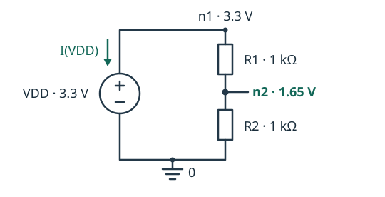

# kirimaspice ユーザーマニュアル

[English](USER_MANUAL.md) · この文書は英語版を正とします。日本語版はその訳で、両者が食い違う場合は英語版に従います。

このマニュアルでは、kirimaspice のビルド、ネットリストの書き方、プログラムが行う解析の実行、
結果の読み方を説明します。**2026-11-14** にコミット `91af284` で確かめ、**2026-11-15** にコミット
`db0fef6` でもう一度見直し、同じ日にコミット `eaf0629` までの修正に合わせて更新しました。どれも
macOS 27.2（arm64）と GCC 16.2.0 でビルドし、プログラムは `kirimaspice v0.0.0` と表示しました。
**2026-11-21** にコミット `2826a81` でもう一度見直し、例が示す値はそのビルドを実行して確かめました。

オプション、素子、ディレクティブ、出力形式を引くときは[リファレンスマニュアル](REFERENCE_MANUAL.ja.md)を
使ってください。間違っていることや足りないことは [KNOWN_ISSUES.md](../KNOWN_ISSUES.ja.md) にあります。
下の決まりのうち、そこにある問題を避けるためだけのものには、そう書いてあります。

## 目次

- [ビルド](#ビルド)
- [最初のシミュレーション](#最初のシミュレーション)
- [ネットリストを書く](#ネットリストを書く)
- [解析を選ぶ](#解析を選ぶ)
- [結果を保存する](#結果を保存する)
- [Python のツールを使う](#python-のツールを使う)
- [ネットリストの部品を使い回す](#ネットリストの部品を使い回す)
- [動作点を収束させる](#動作点を収束させる)
- [終了コードとメッセージ](#終了コードとメッセージ)
- [困ったとき](#困ったとき)
- [問題を報告する](#問題を報告する)

## ビルド

CMake 3.25 以上、C++23 のコンパイラ、Ninja、Python 3、SuiteSparse の開発用ファイル（KLU 2.3.2 以上。
SuiteSparse 7.6.1 に含まれる版）、Git が必要です。最初の configure で、CMake は指定された版の Boost のアーカイブと、
ほかの依存の指定された Git コミットを取得します。このときはネットワーク接続が必要です。

Ubuntu 24.04 では、CI が入れるパッケージ（CI は Clang のジョブのために `clang` も入れます）と、CI の
ランナーには最初から入っている Git を入れます。

```sh
sudo apt install build-essential cmake ninja-build python3 libsuitesparse-dev git
```

そのうえで、ソースのディレクトリで次を実行します。

```sh
cmake -S . -B build -G Ninja -DCMAKE_BUILD_TYPE=Release
cmake --build build
ctest --test-dir build --output-on-failure
```

- ビルドディレクトリはどこに置いてもかまいません。ここのコマンドは `build/` を使います。
- SuiteSparse が CMake の探さない場所にある場合は、最初のコマンドに `-DCMAKE_PREFIX_PATH=<その場所>`
  を加えます。
- `python3 tools/local_ci.py` はビルドとテストを実行し、失敗・スキップ・無効の件数を報告します。
  最新の実測値は [README の「現状」](../README.ja.md#現状) にあります。

プログラムは `build/kirimaspice` です。`build/kirimaspice --version` が版を表示します（例：`kirimaspice 0.0.0`）。
実行のときに最初に出すログの行にも版があります。結果を再現したいときは、版とビルドしたコミットを結果と
一緒に残してください。

## 最初のシミュレーション

リポジトリの `examples/test_simple_divider.sp` に、小さな分圧回路があります。

```spice
* Simple voltage divider test
* Expected: V(n2) = 1.65V (half of 3.3V)

.title Simple Voltage Divider

VDD n1 0 DC 3.3
R1 n1 n2 1k
R2 n2 0 1k

.op

.end
```



実行します。

```sh
build/kirimaspice examples/test_simple_divider.sp
```

プログラムは、結果を標準出力に出します。

```text
=== DC Operating Point ===
V(0) = 0 V
V(n1) = 3.3 V
V(n2) = 1.65 V
I(VDD) = -0.00165 A
```

ログの行（`kirimaspice: info: ...` など）は標準エラーに出るので、
`build/kirimaspice examples/test_simple_divider.sp > out.txt` で結果だけを残せます。`--log-level warning` にすると、
`info` の行を出しません。

電源が回路に電流を供給しているので、`I(VDD)` は負です。SPICE と同じく、電圧源の電流は、`+` 端子から
電源の中を通る向きを正とします。

ほかのネットリストと、その解析解、プログラムの結果は [examples/](../examples/README.ja.md) にあります。

## ネットリストを書く

ネットリストはテキストファイルです。下の決まりは、ほかの SPICE シミュレータを使ってきた人が
よく驚くものです。すべての決まりは[リファレンスマニュアル](REFERENCE_MANUAL.ja.md#ネットリストの書式)にあります。

- **1 行目がタイトルです。** ngspice と同じく、中身は問わず、空でもタイトルです。空の行で始まるネットリストは
  タイトルが空で、2 行目は回路の行として読みます。`.title` は無視します。
- **コメント：** 最初の空白でない文字が `*` の行と、行の中の `;` から後ろです。
- **継続：** `+` で始まる行は、前の行の続きです。間にコメントの行や空の行があっても、前の行は
  終わりません。前の行の `;` のコメントは、その行の終わりまでです。
- **グラウンドは `0` です。** 大文字小文字を問わず、`gnd` という名前のノードもグラウンドです。
- **名前は大文字と小文字を区別しません。** `OUT` と `out` は同じノードで、ノードの名前は小文字で
  書き出します。素子の名前、モデル名、`DC`、`AC`、`PULSE` などのキーワード、ディレクティブの名前も
  区別しません。
- **数**には、ngspice と同じく、倍率 `T`、`G`、`MEG`、`K`、`MIL`、`M`、`U`、`N`、`P`、`F`、`A` を
  大文字でも小文字でも付けられます。**`M` は大文字でも小文字でもミリ**で、10⁶ は `1MEG` と書きます。
  数や倍率の後ろの文字は無視するので、`10mA` は 0.01、`1kHz` は 1000、`10MHz` は 0.01、`1A` は 10⁻¹⁸ です。
  数の後ろのそれ以外のものはエラーです（`2*1k`、`1.5.3k`）。式（`{2*1k}` は 2000）と `.OPTIONS` の値
  （`ITL1=1k` は 1000）も倍率を取ります。
- **`.MODEL` の行は、ネットリストのどこに置いても構いません。** それを使う素子の前でも後でも
  使えます。
- **電源は、DC の値、AC の入力、波形（`PULSE`、`SIN`、`EXP`、`PWL`、`SFFM`）を取り、どれも
  省けます：** `V1 in 0 DC 0 AC 1 PULSE(0 1 0 1n 1n 1 2)`。`PULSE(0 1)` と書くと、遅延は 0、立ち上がり・立ち下がり時間は
  `TSTEP`、パルス幅と周期は `TSTOP` になります。各時間が波形のどこにあたるかは
  [リファレンスマニュアルの図](REFERENCE_MANUAL.ja.md#電源)を参照してください。
- `.END` でファイルは終わりません。その後の行も読みます。

過渡解析の例として、ステップで充電する RC 回路です。

```spice
RC step response
V1 in 0 DC 0 PULSE(0 1 0 1n 1n 1 2)
R1 in out 1k
C1 out 0 1u
.tran 10u 5m
.end
```

## 解析を選ぶ

まず調べたいことから主な解析を選びます。詳しい構文、温度ごとの実行、高調波の指定は後の表にあります。

| 調べたいこと | 主な解析 |
| --- | --- |
| バイアスの電圧と電流 | 動作点：`.OP` |
| 電源値を変えたときの応答 | 電源スイープ：`.DC` |
| 時間に対する波形 | 過渡解析：`.TRAN` |
| 周波数に対する小信号の振幅と位相 | AC 解析：`.AC` |

プログラムが実行する解析は次のとおりです。

| 書くもの | プログラムが実行するもの |
| --- | --- |
| `.op`（または何も書かない） | DC 動作点 |
| `.DC <電源> <開始> <終了> <刻み>` | 電源の DC スイープ |
| `.DC <電源1> ... <電源2> <開始2> <終了2> <刻み2>` | 入れ子のスイープ。2 つ目の電源の値ごとに 1 つ目の電源を掃引 |
| `.TRAN <tstep> <tstop> [<tstart> [<tmax>]] [UIC]` | 過渡解析 |
| `.AC DEC\|OCT\|LIN <n> <fstart> <fstop>` | 小信号 AC 解析 |
| `.TF v(<ノード>) <電源>` | 電源から出力への小信号の直流の利得と、入力と出力の抵抗 |
| `.NOISE V(<出力>) <電源> DEC\|OCT\|LIN <n> <fstart> <fstop>` | 周波数ごとの出力の雑音と入力換算の雑音 |
| `.TEMP <t1> <t2> ...`（°C） | 各温度でのすべての解析（下を参照） |
| `.FOUR <f> v(<ノード>) ...` | 過渡解析の後に、それぞれの信号の高調波 |

1 つのネットリストで複数を指定できます。実行の順は、DC スイープ、動作点、伝達関数、過渡解析、AC、ノイズです。
`.OP` と `.DC` の両方があると、ngspice と同じく両方を実行します。何も指定しないネットリストでは、`.OP` が
あるものとして動作点を実行し、電圧と電流を表示して、出力ファイルも書きます。

プログラムは、パーサーが読んだ解析を実行します。解析の行は、`+` の継続行をつないだ後のもの、
`.INCLUDE` と `.LIB` のファイルの中のもの、`.IF` で選ばれた分岐のものを数え、コメントの中のものは
数えません。`.OPTIONS` は解析の行ではありません。`.control` のブロックの解析のコマンド `op`、`dc`、`tran`、`ac` は、
ディレクティブと同じく解析を求めます。プログラムは、それらを自分の順で、種類ごとに 1 回実行します。[リファレンスマニュアル](REFERENCE_MANUAL.ja.md#プログラムが解析を選ぶ仕組み)に、この決まりを図にした
ものがあります。

値が 1 つの `.TEMP` は、その値の `.OPTIONS TEMP` と同じです。複数の値では、すべての解析をそれぞれの
値で実行します。それぞれの実行は `=== Temperature <t> °C ===` の行の後に続き、その実行の SSF、WAV、
AC の CSV のファイルは名前に温度が入ります（[結果を保存する](#結果を保存する)を参照）。

`.TF <出力> <電源>` は、電源から `v(<ノード>)`、`v(<ノード>,<ノード>)`、`i(<電圧源>)` への小信号の直流の利得と、入力と出力の
抵抗を、`=== Transfer Function ===` の下に表示します。ライブラリにあるほかの解析（極零点、ひずみ、感度、
S パラメータ、モンテカルロ、ワーストケース、最適化）は、プログラムからは実行しません。`.PZ`、`.DISTO`、`.SENS`、`.PORT`、
`.MC`、`.WCASE`、`.OPTIMIZE` は読みますが実行せず、
それぞれ警告を 1 回出します。`.MEASURE` は警告を出して無視します。
`.NOISE V(<出力>[,<基準>]) <電源> <DEC|OCT|LIN> <点数> <開始周波数> <終了周波数>` は、`=== Noise Analysis ===` の下に、
周波数ごとの出力の雑音と入力換算の雑音を V/√Hz（電流源なら A/√Hz）で、続いて掃引全体の雑音 `onoise_total` と
`inoise_total` を、ngspice と同じ名前で表示します。

### 動作点

結果を表示します。ノードごとに `V(<ノード>)` の行、電圧源（と `E`、`H`、電圧の形の `B` 電源）ごとに
`I(<電源>)` の行です。

### DC スイープ

プログラムは要約（電源、範囲、解けた点の数）を表示します。値は raw ファイルにだけ書くので、
ネットリストの後ろに `--raw-out` を付けてください。

```sh
build/kirimaspice examples/diode_iv.sp --raw-out diode_iv.raw
```

### 過渡解析

`.PRINT TRAN` がなければ表は表示しません。`.PRINT TRAN v(<ノード>) i(<電源>) ...` があると、
`Time (s)` の列と信号ごとの列からなる表を、時点ごとに 1 行で表示します。raw と SSF は各信号の波形を記録します。
WAV はノード電圧を音声のサンプルレートで取り直して保存します。プログラムは `tstep`（`tmax` が短ければ `tmax`）で刻み、電源の角（`PULSE`、`PWL`、
`SIN`、`EXP` の折れ点）にも点を置きます。SPICE と同じく、
シミュレーションは 0 から行い、`tstart` 以降の結果を残します。`tstart` ちょうどにも点を置きます。
`UIC` を付けると、動作点からではなく、`.IC` の値と、キャパシタ（電圧）とインダクタ（電流）の
`IC=` から始めます。`.IC` は `.IC V(out)=1` のように大文字の `V` で書く必要があります。
`UIC` がないと、過渡解析を始める動作点で `.IC` のノードをその値に固定し、過渡解析ではそれを外します。
ngspice と同じです。

上の RC の例では、1 ms の `V(out)` は 0.632105 V です。立ち上がり時間を 0 とした理想ステップの解析解は 1 − e⁻¹ ≈ 0.632121 V です。

### AC

AC の結果は表示しません。常に CSV ファイルに書きます（[結果を保存する](#結果を保存する)を参照）。
AC 解析の入力になるのは、`AC [<振幅> [<位相>]]` を書いた電源だけです。振幅を省いた `AC` は振幅 1 です。
DC 値だけを指定した電源も動作点を決めます。ソルバーはその動作点で非線形素子を線形化します。
この電源自身の小信号振幅は 0 です。

1 kΩ と 1 µF の RC 低域通過フィルタを `AC 1` で駆動すると、1 kHz で −16.072 dB、−80.96° になります。
[例題のボード線図](../examples/README.ja.md#rc-低域通過フィルタ)で、この点と遮断周波数の位置を確認できます。

## 結果を保存する

| オプション | ファイル |
| --- | --- |
| `--raw-out <ファイル>` | SPICE3 raw、ASCII |
| `--raw-binary-out <ファイル>` | SPICE3 raw、バイナリ |
| `-o <ファイル>` | SSF |
| `--wav-out <ファイル>` | WAV 音声 |
| （常に） | AC の結果の CSV |

どの実行でもすべてのファイルを書くわけではありません。

| 実行 | raw ファイル | SSF（`-o`） | WAV | AC の CSV |
| --- | --- | --- | --- | --- |
| 動作点 | 書く | 書く | — | — |
| DC スイープ | 書く | — | — | — |
| 過渡解析 | 書く | 書く | 書く | — |
| AC | — | — | — | 書く |

解析の行がないネットリストは、`.OP` があるものとして動作点を実行します。

`.TEMP` に複数の値を並べると、raw ファイルにはすべての温度のプロットが順に入り、ほかのファイルは
温度ごとに 1 回、拡張子の前に `_<t>C` を付けて書きます：`out_27C.ssf`、`out_100C.ssf`、
`out_ac_27C.csv`。

- 1 つのネットリストで複数の解析を実行すると、raw ファイルには解析ごとのプロットが順に入ります。
  SSF ファイルに入るのは 1 つの解析です。動作点と過渡解析の両方があると、動作点の代わりに
  過渡解析が入ります。
- AC の CSV の名前は、`-o` のパス（`-o` がなければネットリストのパス）から最後の要素の拡張子を除き、
  `_ac.csv` を付けたものです。`circuit.cir` なら、同じ場所に `circuit_ac.csv` ができます。
- WAV ファイルはノードごとに 1 チャンネルです。ノード電圧 ±1 V が最大振幅で、その範囲を超える
  電圧は切り詰めます。`--wav-sample-rate`（既定 44100）と `--wav-bits`（8、16、24、32。既定 16）で
  形式を決めます。

これらのファイルの中身の並びは[リファレンスマニュアル](REFERENCE_MANUAL.ja.md#出力形式)にあります。

## Python のツールを使う

`tools/` にある 3 つの Python 3 スクリプトが、プログラムを代わりに動かします。必要なのは標準ライブラリだけで、
pandas、matplotlib、numpy が入っていると機能が増えます。どれもプログラムを `build/kirimaspice` に探し、
ほかの場所なら `--binary <パス>` で指定します。CTest がそれぞれのテストを実行します（`python_tools_*`）。

| スクリプト | 用途 | 読むもの | あれば使うもの |
| --- | --- | --- | --- |
| `kirimaspice_pyapi.py` | Python からネットリストを実行する | ASCII の raw ファイルの最初のプロット | pandas（`to_dataframe`、`--csv`） |
| `kirimaspice_repl.py` | 対話的なシェル | `run` ごとの raw ファイル | matplotlib（`plot`）、numpy（`expr`） |
| `ngspice_shim.py` | `ngspice -b` を呼ぶツール | —（raw ファイルを書く） | — |

### Python からネットリストを実行する

`tools/kirimaspice_pyapi.py` は、一時ディレクトリでネットリストを `--raw-out` 付きで実行し、ASCII の
raw ファイルを読みます。

```python
from pathlib import Path
from tools.kirimaspice_pyapi import KirimaspiceSession

session = KirimaspiceSession()   # build/kirimaspice。または KirimaspiceSession(Path(...))
result = session.run_netlist(Path("examples/rc_step.sp").read_text())
time, vout = result.series("time"), result.series("v(out)")
print(vout[time.index(1e-3)])    # 0.6321053249481
```

- ソースの最上位で実行するか、ソースのディレクトリを `PYTHONPATH` に入れてください。
- 信号の名前は小文字です。`time`、`v(out)`、`i(v1)` のようになります。
- プログラムが失敗すると、`run_netlist` は例外を投げます。プログラム自身の出力は取り込みません。単独で
  動かしたときと同じく、結果は標準出力に、ログの行は標準エラーに出ます。
- raw ファイルの最初のプロットだけを読みます。`.op` と `.tran` のあるネットリストでは、結果は動作点で、
  過渡解析ではありません。
- `result.to_dataframe()` には pandas が要ります。

コマンドラインから `python3 tools/kirimaspice_pyapi.py <ネットリスト>` と実行すると、信号の名前と、
最初の信号の最初のいくつかの値を表示します。`--csv <ファイル>`（pandas が要ります）を付けると、全部を
CSV に書きます。ネットリストは一時ディレクトリにコピーしてそこで実行するので、相対パスの `.INCLUDE` と
AC の CSV は、そのディレクトリが基準になります（コードを読んで確かめたもので、実行はしていません）。

### 対話的に使う

`python3 tools/kirimaspice_repl.py [<ネットリスト>]` で小さなシェルが始まります。

| コマンド | すること |
| --- | --- |
| `load <ファイル>` | ネットリストを選ぶ |
| `run [<オプション>]` | オプションを足してプログラムを実行する |
| `list` | 最後の実行の信号を一覧にする |
| `plot [--x <名前>] <信号>...` | matplotlib で描く。なければ最初の 10 点を表示する |
| `expr <名前> = <式>` | numpy で、ほかの波形から波形を定義する |
| `let <名前> <値>`、`vars` | 変数を設定し、一覧にする。あとの `run` のオプションの中の `{名前}` が値に置き換わる |
| `shell <コマンド>`、`open` | シェルのコマンドを実行する。`$EDITOR` でネットリストを編集する |
| `recent`、`help`、`quit` | 今のファイルを表示する。コマンドを一覧にする。終わる |

シェルは結果を、今のディレクトリの下の `bench_out/repl/session.raw` に書き、コマンドの履歴を
`~/.kirimaspice_history` に残します。

### ngspice の代わりに呼ばれる

`tools/ngspice_shim.py` は、ngspice のコマンドラインのオプション `-b`、`-r <raw>`、`-o <ログ>` を受け付け、
それぞれのネットリストを `--raw-out` 付きで実行します。

```sh
python3 tools/ngspice_shim.py -b -r out.raw circuit.cir
```

- `-r` がないと、raw ファイルはネットリストの名前に `.raw` を付けたものになります。`-r` とネットリストが
  複数あると、それぞれ `<raw の名前>_<ネットリストの名前>.raw` になります。
- `-o` はプログラムの出力をログファイルにまとめます。ほかのオプションは、メッセージを出して無視します。
- `KIRIMASPICE_BIN` は、`--binary` と同じくプログラムを指定します。
- ネットリストを読むのは kirimaspice なので、その制限があります。たとえば、`.control` の中の解析は
  プログラムの順で実行され、そのほかのコマンドは実行されません。
- スクリプトのヘルプには KiCad と Qucs-S のためとありますが、それらと使えるかは未確認です。

## ネットリストの部品を使い回す

### パラメーター

```spice
.PARAM RLOAD=2k VIN=4
.FUNC HALF(x) {x/2}
.PARAM VH={HALF(VIN)}
V1 in 0 DC {VH}
R1 in out 1k
R2 out 0 {RLOAD}
```

- 波かっこで囲んだ値は式です。それより前に定義したパラメーター、`pi`、`e`、よく使う数学の関数を
  使えます。`.PARAM` の値は、波かっこがなくても式です（`.param r = 2*1000`）。
- `.FUNC` で定義した関数は、上の `.PARAM VH={HALF(VIN)}` や `R1 in out {HALF(2k)}` のように波かっこで
  囲んだどの値の中でも、`B` 電源の式の中でも呼べます。`.FUNC` の行の位置は問いません。
- 同じパラメーターを 2 回定義すると、最初の値が残ります。

### サブサーキット

```spice
.SUBCKT DIV a b RTOP=1k
R1 a b {RTOP}
R2 b 0 1k
.ENDS DIV
X1 in xout DIV RTOP=3k
X2 in yout DIV
```

`X` の行に書いた最初のノードが端子 `a`、次のノードが端子 `b` につながります。
`V(in) = 2 V` でどちらの出力にも負荷をつながないとき、それぞれの出力電圧は抵抗の比で決まります。
`R2` はどちらも端子 `b` とグラウンドの間の 1 kΩ です。

| インスタンス | 端子 `a` | 端子 `b` | `a` と `b` の間の `R1` | 端子 `b` の出力電圧 |
| --- | --- | --- | --- | --- |
| `X1` | `in` | `xout` | 3 kΩ（`RTOP=3k` で指定） | 2 V × 1/(3 + 1) = 0.5 V |
| `X2` | `in` | `yout` | 1 kΩ（既定値） | 2 V × 1/(1 + 1) = 1 V |

[`X1` を使った回路例](../examples/params_subckt.sp)をそのまま実行できます。

- パラメーターの既定値は、ピンの後ろに `名前=値` で書きます。インスタンスでも同じ形で上書きします。
  その前の `PARAMS:` というキーワードは、ngspice と同じく、あってもなくてもかまいません。
- サブサーキットの本体からは、グローバルの `.PARAM` の値が見えます。`.SUBCKT` の行の既定値と `X` の行の
  値が、それより優先します。`.SUBCKT` の中に書いた `.PARAM` は、そのサブサーキットの中だけで効き、
  インスタンスごとに評価します。
- サブサーキットの中の素子は、波形やモデルも含めて、トップレベルと同じに読みます。
- `.GLOBAL <ノード> ...` は、ノードをすべてのサブサーキットの中から見えるようにします。

### インクルードファイルとライブラリ

- `.INCLUDE <ファイル>` は、別のファイルをその場所に読み込みます。相対パスは、その `.INCLUDE` を
  書いたファイルのディレクトリから数えます。
- `.LIB <ファイル> <セクション>` は、`<ファイル>` のうち `.LIB <セクション>` から `.ENDL` までを
  読み込みます。
- `.IF` と `.ELSEIF` の条件では、後の行で定義したグローバルの `.PARAM` も使えます。
  分岐の中に書いたグローバル定義も、どの分岐を選ぶかを決める前に読みます。
  評価する条件に未定義の名前があると、構文エラーで停止します。

## 動作点を収束させる

動作点が収束しないときは、次の `.OPTIONS` で、動作点を求めるための別の方法を有効にできます。
どれも `<名前>=<値>` の形で、値は数です。倍率を付けても構いません。

| オプション | 効果 |
| --- | --- |
| `GMIN_STEPPING=1` | グラウンドへの大きなコンダクタンスから始めて小さくする |
| `SOURCE_STEPPING=1` | 電源を値の一部から上げていく |
| `DYN_GMIN=1` | 反復の途中でグラウンドへのコンダクタンスを調整する |
| `CONTINUATION=1` | ホモトピー連続法 |
| `PSEUDO_TRANSIENT=1` | グラウンドへの小さなキャパシタで疑似的な過渡解析を進める |
| `ITL1=<n>` | 反復の上限（既定 100） |

`.NODESET V(<ノード>)=<値>` は初期値を与えます。`.IC` と同じく、大文字の `V` が必要です。
許容誤差、積分法、そのほかのオプションは[リファレンスマニュアル](REFERENCE_MANUAL.ja.md#オプション)に
あります。

## 終了コードとメッセージ

| 終了コード | 意味 |
| --- | --- |
| 0 | 指定した解析が終わった、または `--help`、`--version` |
| 1 | 解析が失敗した（解析の行がないネットリストの動作点も） |
| 2 | コマンドラインかネットリストの誤り：ネットリストがない、2 つ目のネットリスト、知らないオプションや値のないオプション、オプションの値が受け付けられなかった（数でない `--wav-sample-rate` など）、ファイルを読めない、ネットリストを解釈できない、出力ファイルを書けない |
| 3 | プログラムの内部の誤り |
| そのほか | シグナルでプログラムが止まった |

解釈のエラーは行を示します：`Parse error at line 3: ...`。この番号は、`.INCLUDE` と `.LIB` の
ファイルを入れ、継続行をつなぎ、空の行を除き、`.IF` のブロックを解決し、`.CONTROL` のブロックを
取り出した後の行を数えたものなので、エディタの行番号と違うことがあります。

警告は `kirimaspice: warning:` で始まります。読んでください。いくつかの間違い（知らない `.OPTIONS` の名前、
接尾辞を付けられない場所の接尾辞、デバイスが使わないモデルカードのパラメーター）は警告だけを出し、
その設定や素子なしで実行を続けます。

## 困ったとき

### `Undefined diode model`、`Undefined BJT model`、`Undefined MOSFET model` が出る

ネットリストに、その名前の `.MODEL` がありません。綴りを確かめてください（大文字と小文字は
問いません）。モデルのあるファイルを `.INCLUDE` や `.LIB` で読み込んでいるかも確かめてください。
モデルが定義されていない 4 端子の MOSFET の行は、パーサーが 3 端子の行とみなすので、メッセージには
モデルの代わりにバルクのノードの名前が出ます。`M1 a a 0 0 NOM` では `Undefined MOSFET model: 0` に
なります。

### `PULSE takes 2 to 7 arguments` が出る

`PULSE(0 1)` のように、最初の値とパルス中の値を指定します。その後に、時間を表す引数を順に 5 個まで書けます。
ほかの波形が受け付ける引数の範囲は[リファレンスマニュアル](REFERENCE_MANUAL.ja.md#電源)にあります。

### `singular matrix: check V(<ノード>)` や `check I(<電源>)` が出る

メッセージの最後は、ソルバーが行列の特異を見つけた未知数です。`V(<ノード>)` なら、そのノード、または
それを含むノードの集まりに、グラウンドへの DC の経路がありません。`I(<電源>)` なら、その電圧源が電圧源の
ループ（`E`、`H` の電源と電圧の形の `B` 電源も含みます）の中にあります。名前の出たノードや電源は、
関わるものの 1 つで、直すべきものとは限りません。

### `B` 電源で `cannot compile the expression` が出る

式に ExprTk の知らないもの（パラメーターでも関数でもない名前など）があります。倍率は原因になりません。
`V={V(a)*1m}` は ngspice と同じく読みます。`I(<名前>)` は、端子のあるどの素子の電流も読めます。`K` の行や、
どの素子にもない名前では、エラーがそのことを告げます。

### 値がとても小さい

SPICE と同じく、`M` は大文字でも小文字でもミリで、`1M` は 10⁻³ です。メガは `MEG` と書いてください。
`A` はアトなので、1 アンペアは `1A` ではなく `1` と書いてください。

### ほかのシミュレータと結果が違う

まず [KNOWN_ISSUES.md](../KNOWN_ISSUES.ja.md) にある違い、とくにパーサーが読まないデバイスの
パラメーターと、kirimaspice が ngspice に合わせている点を書いた
[NETLIST_CONVENTIONS.md](spec/NETLIST_CONVENTIONS.ja.md) を確かめてください。そのうえで、解析解が
あればそれと比べてください。

## 問題を報告する

GitHub に Issue を立ててください。ネットリスト（できるだけ小さくしたもの）、コマンドライン、
プログラムがログに出した版の行、ビルドしたコミット、OS、コンパイラと SuiteSparse の版、
何を期待したかとその理由を書いてください。受け付けるものは [CONTRIBUTING.md](../CONTRIBUTING.ja.md)
にあります。脆弱性は [SECURITY.md](../SECURITY.ja.md) のとおりに報告してください。
