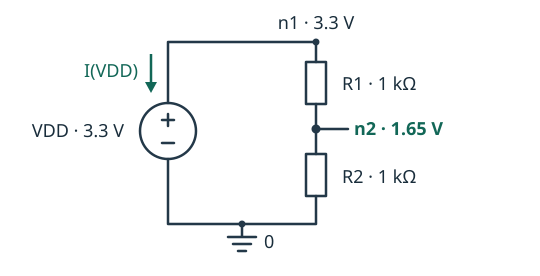

# kirimaspice User Manual

[日本語](USER_MANUAL.ja.md) · This English text is the main version; the Japanese version follows it, and where they differ, this text holds.

This manual covers building kirimaspice, writing a netlist, running the
analyses the program offers and reading the results. It was checked on
**2026-11-14** against commit `91af284`, reviewed again on **2026-11-15**
at commit `db0fef6` and updated the same day for the fixes up to commit
`eaf0629`, built on macOS 27.2 (arm64) with GCC 16.2.0; the program
reported `kirimaspice v0.0.0`. On **2026-11-21** it was reviewed again
against commit `2826a81`, and the values its examples show were checked
by running that build.

For lookup by option, element, directive or output format, use the
[Reference Manual](REFERENCE_MANUAL.md). For what is known to be wrong or
missing, see [KNOWN_ISSUES.md](../KNOWN_ISSUES.md); this manual points to it
where a rule below exists only to avoid one of those problems.

## Contents

- [Build](#build)
- [Run your first simulation](#run-your-first-simulation)
- [Write a netlist](#write-a-netlist)
- [Choose the analyses](#choose-the-analyses)
- [Save the results](#save-the-results)
- [Use the Python tools](#use-the-python-tools)
- [Reuse parts of a netlist](#reuse-parts-of-a-netlist)
- [Help the operating point converge](#help-the-operating-point-converge)
- [Interpret exit codes and messages](#interpret-exit-codes-and-messages)
- [Troubleshoot](#troubleshoot)
- [Report a problem](#report-a-problem)

## Build

You need CMake 3.25 or later, a C++23 compiler, Ninja, Python 3 and the
development files of SuiteSparse (KLU 2.3.2 or later, the version in
SuiteSparse 7.6.1), and Git. During the first configure, CMake downloads a pinned Boost
archive and fetches fixed Git revisions for the remaining dependencies,
so that step needs a network connection.

On Ubuntu 24.04, these are the packages CI installs (it adds `clang` for
its Clang job), and Git, which its runners already have:

```sh
sudo apt install build-essential cmake ninja-build python3 libsuitesparse-dev git
```

Then, from the source tree:

```sh
cmake -S . -B build -G Ninja -DCMAKE_BUILD_TYPE=Release
cmake --build build
ctest --test-dir build --output-on-failure
```

- The build directory may be anywhere; the commands here use `build/`.
- If SuiteSparse is installed somewhere CMake does not search, add
  `-DCMAKE_PREFIX_PATH=<its prefix>` to the first command.
- `python3 tools/local_ci.py` builds the project, runs the tests and reports
  failures, skips and disabled cases. See the [README status](../README.md#status)
  for the latest measured totals.

The program is `build/kirimaspice`; `build/kirimaspice --version` prints
its version, for example `kirimaspice 0.0.0`, and the first line it logs
in a run gives it too. Keep the version, and the commit you built, with
any result you want to reproduce.

## Run your first simulation

The repository has a small voltage divider in
`examples/test_simple_divider.sp`:

```spice
* Simple voltage divider test
* Expected: V(n2) = 1.65V (half of 3.3V)

.title Simple Voltage Divider

VDD n1 0 DC 3.3
R1 n1 n2 1k
R2 n2 0 1k

.op

.end
```



Run it:

```sh
build/kirimaspice examples/test_simple_divider.sp
```

The program writes the result to standard output:

```text
=== DC Operating Point ===
V(0) = 0 V
V(n1) = 3.3 V
V(n2) = 1.65 V
I(VDD) = -0.00165 A
```

Its log lines, `kirimaspice: info: ...` and the like, go to standard
error, so `build/kirimaspice examples/test_simple_divider.sp > out.txt`
keeps the result alone; `--log-level warning` leaves out the `info`
lines.

`I(VDD)` is negative because the source delivers current to the circuit:
as in SPICE, the current of a voltage source is positive when it flows
into its `+` terminal through the source.

More netlists, each with its analytic solution and the result the program
gives, are in [examples/](../examples/README.md).

## Write a netlist

A netlist is a text file. The rules below are the ones that most often
surprise someone who has used another SPICE simulator; the
[Reference Manual](REFERENCE_MANUAL.md#netlist-syntax) has the full list.

- **The first line is the title**, whatever it contains, also when it is
  empty, as in ngspice: a netlist that starts with an empty line has an
  empty title, and its second line is read as a line of the circuit.
  `.title` is ignored.
- **Comments:** a line whose first non-blank character is `*`, and anything
  after `;` on a line.
- **Continuation:** a line that starts with `+` continues the line before
  it. Comment lines and empty lines between the two do not end that line,
  and a `;` comment on it ends at the end of its own line.
- **Ground is `0`,** and a node named `gnd` in any case is ground too.
- **Names are not case-sensitive:** `OUT` and `out` are one node, and node
  names are written in lower case. Element names, model names, keywords
  such as `DC`, `AC`, `PULSE` and directive names are not case-sensitive
  either.
- **Numbers** take the scale factors `T`, `G`, `MEG`, `K`, `MIL`, `M`, `U`,
  `N`, `P`, `F` and `A` in either case, as in ngspice. **`M` is milli
  whatever its case**: write `1MEG` for 10⁶. Letters after a number or a
  scale factor are ignored, so `10mA` is 0.01, `1kHz` is 1000, and `10MHz`
  is 0.01 and `1A` is 10⁻¹⁸; anything else after a number is an error
  (`2*1k`, `1.5.3k`). Expressions (`{2*1k}` is 2000) and `.OPTIONS`
  values (`ITL1=1k` is 1000) take scale factors too.
- **A `.MODEL` line may stand anywhere** in the netlist, before or after
  the elements that use it.
- **A source takes a DC value, an AC input and a waveform** (`PULSE`,
  `SIN`, `EXP`, `PWL` or `SFFM`), each optional:
  `V1 in 0 DC 0 AC 1 PULSE(0 1 0 1n 1n 1 2)`. For `PULSE(0 1)`, the delay
  defaults to zero, both edge times to `TSTEP`, and the width and period to
  `TSTOP`. The [Reference Manual](REFERENCE_MANUAL.md#sources) illustrates
  all five intervals.
- `.END` does not end the file: lines after it are read too.

A transient example, an RC circuit charged through a step:

```spice
RC step response
V1 in 0 DC 0 PULSE(0 1 0 1n 1n 1 2)
R1 in out 1k
C1 out 0 1u
.tran 10u 5m
.end
```

## Choose the analyses

Choose the main question first; the detailed syntax and the directives
for temperature runs and harmonics follow below.

| What do you want to inspect? | Main analysis |
| --- | --- |
| Bias voltages and currents | operating point: `.OP` |
| Response to a changing source value | source sweep: `.DC` |
| A waveform over time | transient: `.TRAN` |
| Small-signal magnitude and phase over frequency | AC: `.AC` |

The program runs these analyses:

| You write | The program runs |
| --- | --- |
| `.op` (or nothing) | DC operating point |
| `.DC <source> <start> <stop> <step>` | DC sweep of a source |
| `.DC <src1> ... <src2> <start2> <stop2> <step2>` | nested sweep; the first source is swept for each value of the second |
| `.TRAN <tstep> <tstop> [<tstart> [<tmax>]] [UIC]` | transient |
| `.AC DEC\|OCT\|LIN <n> <fstart> <fstop>` | small-signal AC |
| `.TEMP <t1> <t2> ...` (°C) | every analysis at each temperature (see below) |
| `.FOUR <f> v(<node>) ...` | the harmonics of each signal, after the transient |

A netlist can ask for more than one; they run in the order DC sweep,
operating point, transient, AC. With both `.OP` and `.DC`, both run, as
in ngspice. A netlist that asks for none runs the operating point as for `.OP`:
it prints the voltages and currents and writes the output files.

The program runs the analyses the parser read. An analysis line counts
after its `+` continuation lines are joined, in the text of `.INCLUDE` and
`.LIB` files, and in the branch of `.IF` that is taken, never in a
comment; `.OPTIONS` is no analysis line. The analysis commands `op`,
`dc`, `tran` and `ac` of a `.control` block ask for their analyses as the
directives do; the program runs them in its own order, each kind once. The [Reference Manual](REFERENCE_MANUAL.md#how-the-program-chooses-analyses)
draws these rules as a chart.

`.TEMP` with one value means `.OPTIONS TEMP` with that value. With several
values, every analysis runs at each of them, each run after a line
`=== Temperature <t> °C ===`, and its SSF, WAV and AC CSV files carry the
temperature in their names (see [Save the results](#save-the-results)).

The other analyses in the library (noise, transfer function, pole-zero,
distortion, sensitivity, S-parameters, Monte Carlo, worst case,
optimization) are not run by the program. `.TF`, `.PZ`, `.DISTO`, `.SENS`,
`.PORT`, `.MC`, `.WCASE` and `.OPTIMIZE` are read and not run,
each named once in a warning; noise has
no directive here, and `.NOISE` and `.MEASURE` are ignored with a warning.

### Operating point

The result is printed: one `V(<node>)` line per node and one `I(<source>)`
line per voltage source (and per `E`, `H` and voltage-form `B` source).

### DC sweep

The program prints a summary (source, range, number of points solved). The
values are written only to a raw file, so add `--raw-out` after the
netlist:

```sh
build/kirimaspice examples/diode_iv.sp --raw-out diode_iv.raw
```

### Transient

Without `.PRINT TRAN` the program prints no table; with `.PRINT TRAN
v(<node>) i(<source>) ...` it prints a `Time (s)` column and one column per
signal, one row per time point. Raw and SSF record the signal traces. WAV resamples node voltages
at the audio sample rate. The program steps by `tstep`, or by `tmax` when that is shorter,
and puts a point on each corner of the sources (the breakpoints of
`PULSE`, `PWL`, `SIN` and `EXP`). As in SPICE,
the simulation runs from 0 and the results are kept from `tstart` on, with
a point on `tstart`. With `UIC`,
the transient starts from the values in `.IC` and the `IC=` of capacitors
(a voltage) and inductors (a current) instead of from an operating
point; `.IC` must be written with an upper-case `V`, as in
`.IC V(out)=1`. Without `UIC`, the operating point that starts the
transient holds the `.IC` nodes at their values, and the transient then
releases them, as in ngspice.

For the RC example above, `V(out)` is 0.632105 V at 1 ms. An ideal instantaneous step gives
1 − e⁻¹ ≈ 0.632121 V.

### AC

The AC result is not printed. It is always written to a CSV file (see
[Save the results](#save-the-results)). Only the sources written with
`AC [<mag> [<phase>]]` are inputs of the AC analysis; `AC` without a
magnitude means 1. A supply with only a DC value still sets the bias point at which
the solver linearizes nonlinear devices. Its small-signal excitation is zero.

For an RC low-pass filter (1 kΩ, 1 µF) driven with `AC 1`, the program gave
−16.072 dB and −80.96° at 1 kHz. The [worked example](../examples/README.md#rc-low-pass-filter)
shows where this point falls on the gain and phase curves.

## Save the results

| Option | File |
| --- | --- |
| `--raw-out <file>` | SPICE3 raw, ASCII |
| `--raw-binary-out <file>` | SPICE3 raw, binary |
| `-o <file>` | SSF |
| `--wav-out <file>` | WAV audio |
| (always) | CSV of the AC result |

Not every run writes every file:

| Run | Raw files | SSF (`-o`) | WAV | AC CSV |
| --- | --- | --- | --- | --- |
| operating point | yes | yes | — | — |
| DC sweep | yes | — | — | — |
| transient | yes | yes | yes | — |
| AC | — | — | — | yes |

A netlist without an analysis line runs the operating point, as if it had
`.OP`.

Under a `.TEMP` list of several values, the raw files hold the plots of
every temperature in turn, and the other files are written once per
temperature, with `_<t>C` before the extension: `out_27C.ssf`,
`out_100C.ssf`, `out_ac_27C.csv`.

- When a netlist runs more than one analysis, the raw file holds one plot
  per analysis, one after another. The SSF file holds one analysis: with
  both an operating point and a transient, the transient replaces the
  operating point.
- The AC CSV is named by taking the `-o` path, or the netlist path if there
  is no `-o`, removing the extension of its last component, and adding
  `_ac.csv`.
  `circuit.cir` gives `circuit_ac.csv` next to it.
- The WAV file has one channel per node. A node voltage of ±1 V is full
  scale, and voltages outside that range are clipped. `--wav-sample-rate`
  (default 44100) and `--wav-bits` (8, 16, 24 or 32; default 16) set the
  format.

The layouts of these files are in the
[Reference Manual](REFERENCE_MANUAL.md#output-formats).

## Use the Python tools

Three Python 3 scripts in `tools/` run the program for you. They need only
the standard library; pandas, matplotlib and numpy add features when they
are installed. Each looks for the program at `build/kirimaspice` and takes
`--binary <path>` for another place. CTest runs a test of each
(`python_tools_*`).

| Script | For | Reads | Optional |
| --- | --- | --- | --- |
| `kirimaspice_pyapi.py` | running a netlist from Python | the first plot of the ASCII raw file | pandas (`to_dataframe`, `--csv`) |
| `kirimaspice_repl.py` | an interactive shell | the raw file of each `run` | matplotlib (`plot`), numpy (`expr`) |
| `ngspice_shim.py` | tools that call `ngspice -b` | — (writes the raw file) | — |

### Run a netlist from Python

`tools/kirimaspice_pyapi.py` runs a netlist with `--raw-out` in a temporary
directory and reads the ASCII raw file:

```python
from pathlib import Path
from tools.kirimaspice_pyapi import KirimaspiceSession

session = KirimaspiceSession()   # build/kirimaspice, or KirimaspiceSession(Path(...))
result = session.run_netlist(Path("examples/rc_step.sp").read_text())
time, vout = result.series("time"), result.series("v(out)")
print(vout[time.index(1e-3)])    # 0.6321053249481
```

- Run it from the top of the source tree, or put the tree on `PYTHONPATH`.
- Signal names are in lower case: `time`, `v(out)`, `i(v1)`.
- `run_netlist` raises an exception when the program fails. The program's
  own output is not captured: its results go to standard output and its
  log lines to standard error, as when it runs alone.
- Only the first plot of the raw file is read: for a netlist with `.op` and
  `.tran`, the result holds the operating point and not the transient.
- `result.to_dataframe()` needs pandas.

From the command line, `python3 tools/kirimaspice_pyapi.py <netlist>`
prints the names of the signals and the first samples of the first signal,
and `--csv <file>` (with pandas) writes all of them to a CSV file. The
netlist is copied to a temporary directory and run there, so a relative
`.INCLUDE` path and the AC CSV refer to that directory (read in the code,
not run).

### Work interactively

`python3 tools/kirimaspice_repl.py [<netlist>]` starts a small shell:

| Command | Does |
| --- | --- |
| `load <file>` | choose the netlist |
| `run [<options>]` | run the program, adding the options |
| `list` | list the signals of the last run |
| `plot [--x <name>] <signal>...` | plot with matplotlib; without it, print the first ten points |
| `expr <name> = <expression>` | define a waveform from others with numpy |
| `let <name> <value>`, `vars` | set and list variables; `{name}` in the options of a later `run` is replaced by the value |
| `shell <command>`, `open` | run a shell command; edit the netlist in `$EDITOR` |
| `recent`, `help`, `quit` | show the current files; list the commands; leave |

The shell writes the results to `bench_out/repl/session.raw` under the
current directory and keeps its command history in `~/.kirimaspice_history`.

### Stand in for ngspice

`tools/ngspice_shim.py` accepts the options `-b`, `-r <raw>` and
`-o <log>` of the ngspice command line and runs each netlist with
`--raw-out`:

```sh
python3 tools/ngspice_shim.py -b -r out.raw circuit.cir
```

- Without `-r`, the raw file takes the netlist's name with `.raw`. With
  `-r` and several netlists, each gets `<raw stem>_<netlist stem>.raw`.
- `-o` collects the program's output in a log file; other options are
  ignored with a message.
- `KIRIMASPICE_BIN` names the program, as `--binary` does.
- The netlists are read by kirimaspice, with its limits: for example,
  the analyses inside `.control` run in the program's order, and its
  other commands are not run.
- The script's help says it is meant for KiCad and Qucs-S. Use with them
  is not confirmed.

## Reuse parts of a netlist

### Parameters

```spice
.PARAM RLOAD=2k VIN=4
.FUNC HALF(x) {x/2}
.PARAM VH={HALF(VIN)}
V1 in 0 DC {VH}
R1 in out 1k
R2 out 0 {RLOAD}
```

- A value in braces is an expression. It can use parameters defined
  earlier, `pi`, `e` and the usual mathematical functions. A `.PARAM`
  value is an expression without braces too (`.param r = 2*1000`).
- A function defined with `.FUNC` can be called in any value in braces,
  as in `.PARAM VH={HALF(VIN)}` above or in `R1 in out {HALF(2k)}`, and in
  the expression of a `B` source, wherever its `.FUNC` line is.
- If a parameter is defined twice, the first value is kept.

### Subcircuits

```spice
.SUBCKT DIV a b RTOP=1k
R1 a b {RTOP}
R2 b 0 1k
.ENDS DIV
X1 in xout DIV RTOP=3k
X2 in yout DIV
```

The first node on each `X` line connects to pin `a` and the second to `b`.
With `V(in) = 2 V` and both outputs unloaded, each instance divides the
input by its own resistor ratio. `R2` is 1 kΩ from `b` to ground in both.

| Instance | Pin `a` | Pin `b` | `R1` between `a` and `b` | Output voltage at `b` |
| --- | --- | --- | --- | --- |
| `X1` | `in` | `xout` | 3 kΩ (from `RTOP=3k`) | 2 V × 1/(3 + 1) = 0.5 V |
| `X2` | `in` | `yout` | 1 kΩ (default) | 2 V × 1/(1 + 1) = 1 V |

The [runnable example](../examples/params_subckt.sp) includes `X1`.

- Default parameter values follow the pins as `NAME=value`; an instance
  overrides them the same way. The keyword `PARAMS:` before them is
  optional, as in ngspice.
- A subcircuit body sees the global `.PARAM` values; the defaults of the
  `.SUBCKT` line and the values on the `X` line come before them. A
  `.PARAM` written inside a `.SUBCKT` is local to the subcircuit and is
  evaluated for each instance.
- Elements inside a subcircuit are read as at the top level, with their
  waveforms and models.
- `.GLOBAL <node> ...` makes a node visible inside every subcircuit.

### Include files and libraries

- `.INCLUDE <file>` reads another file in place. A relative path is taken
  from the directory of the file that holds the `.INCLUDE`.
- `.LIB <file> <section>` reads the part of `<file>` between
  `.LIB <section>` and `.ENDL`.
- A condition in `.IF` or `.ELSEIF` can use a global `.PARAM` defined anywhere
  in the netlist. Global definitions are read before branch selection, even
  inside a branch. An undefined name in a condition that is evaluated stops
  the run with a parse error.

## Help the operating point converge

When the operating point does not converge, the following `.OPTIONS` turn
on further methods for finding it. Each takes
`<name>=<value>`; a value is a number, with a scale factor if you like.

| Option | Effect |
| --- | --- |
| `GMIN_STEPPING=1` | start with a large conductance to ground and reduce it |
| `SOURCE_STEPPING=1` | ramp the sources up from a fraction of their value |
| `DYN_GMIN=1` | adjust the conductance to ground while iterating |
| `CONTINUATION=1` | homotopy continuation |
| `PSEUDO_TRANSIENT=1` | march a pseudo-transient with small capacitors to ground |
| `ITL1=<n>` | the iteration limit (default 100) |

`.NODESET V(<node>)=<value>` gives a starting guess; like `.IC`, it needs
an upper-case `V`. The tolerances, the integration method and the other
options are listed in the
[Reference Manual](REFERENCE_MANUAL.md#options).

## Interpret exit codes and messages

| Exit code | Meaning |
| --- | --- |
| 0 | the requested analyses finished, or `--help` or `--version` |
| 1 | an analysis failed (also the operating point of a netlist without analysis lines) |
| 2 | the command line or the netlist is wrong: no netlist was given, a second netlist, an unknown option or an option without its value, a rejected option value (for example a non-numeric `--wav-sample-rate`), a file that could not be read, a netlist that could not be parsed, or an output file that could not be written |
| 3 | an internal error of the program |
| other | the program was stopped by a signal |

A parse error names a line: `Parse error at line 3: ...`. The number counts
lines after `.INCLUDE` and `.LIB` files have been inserted, continuation
lines joined, empty lines dropped, `.IF` blocks resolved and `.CONTROL`
blocks taken out, so it can differ from the line number in your editor.

Warnings start with `kirimaspice: warning:`. Read them: several mistakes (an unknown
`.OPTIONS` name, a value with a suffix where none is allowed, a card
parameter that the device does not use) produce only a warning and the
run continues without that setting or element.

## Troubleshoot

### `Undefined diode model`, `Undefined BJT model` or `Undefined MOSFET model`

No `.MODEL` in the netlist has that name. Check the spelling (case does not
matter), and check that the file holding the model is read with
`.INCLUDE` or `.LIB`. On a four-terminal MOSFET line whose model is not
defined, the parser takes the line as three-terminal, so the message names
the bulk node instead: `M1 a a 0 0 NOM` gives `Undefined MOSFET model: 0`.

### `PULSE takes 2 to 7 arguments`

Give both levels, for example `PULSE(0 1)`. Up to five timing arguments
can follow them in order. Check the accepted ranges for other waveforms
in the [Reference Manual](REFERENCE_MANUAL.md#sources).

### `singular matrix: check V(<node>)` or `check I(<source>)`

The message ends with the unknown where the solver found the matrix
singular. At `V(<node>)`, that node, or a group of nodes it belongs to,
has no DC path to ground; at `I(<source>)`, that voltage source is in a
loop of voltage sources (also `E` and `H` sources and voltage-form `B`
sources). The node or source named is one of those involved, not always
the one to change.

### A `B` source gives `cannot compile the expression`

The expression uses something ExprTk does not know, such as a name that
is neither a parameter nor a function. Scale factors are not a cause:
`V={V(a)*1m}` is read as in ngspice. `I(<name>)` reads the current of a
voltage source or of an `E`, `H` or voltage-form `B` source; for another
element, such as a resistor, the error says that it is not one.

### A value is far too small

`M` is milli in either case, as in SPICE: `1M` is 10⁻³. Write `MEG` for
mega. `A` is atto, so write a current of one ampere as `1`, not `1A`.

### Results differ from another simulator

Check the differences listed in [KNOWN_ISSUES.md](../KNOWN_ISSUES.md)
first, in particular the device parameters the parser does not read, and
[NETLIST_CONVENTIONS.md](spec/NETLIST_CONVENTIONS.md) for the points where
kirimaspice follows ngspice. Then compare with an analytic solution where
one exists.

## Report a problem

Open an issue on GitHub with the netlist (as small as you can make it),
the command line, the version line the program logged, the commit you
built, your operating system, compiler and SuiteSparse version, and what
you expected and why. [CONTRIBUTING.md](../CONTRIBUTING.md) says what is
accepted; report a vulnerability as [SECURITY.md](../SECURITY.md) says.
