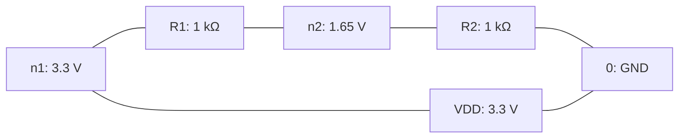

# 例題

[English](README.md) · [プロジェクトの README](../README.ja.md) · この文書は英語版を正とします。日本語版はその訳で、両者が食い違う場合は英語版に従います。

機能を 1 つずつ見せる小さなネットリストです。どれにも解析解があり、CTest がそれぞれを実行して、
表に書いたその例の許容誤差の範囲で解析解と比べます（`tests/scripts/test_examples.py`、テスト `example_*`）。
下に書いたプログラムの値は、コミット `db0fef6` で実行したときのものです。CTest が比べるのは解析解で、
これらの桁ではありません。[ビルド](../docs/USER_MANUAL.ja.md#ビルド)してから、ソースの最上位で
例を実行します。

| ファイル | 見せるもの | 解析 | 確かめる量 | 解析解 | プログラム | CTest の許容誤差 |
| --- | --- | --- | --- | --- | --- | --- |
| [test_simple_divider.sp](test_simple_divider.sp) | [ユーザーマニュアル](../docs/USER_MANUAL.ja.md#最初のシミュレーション)の最初の実行 | 動作点 | V(n2) | 1.65 V | 1.65 V | 1e-6 V |
| [params_subckt.sp](params_subckt.sp) | `.PARAM`、`.FUNC`、パラメータ付きのサブ回路 | 動作点 | V(out) | 1.33333 V | 1.33333 V | 1e-5 V |
| [diode_iv.sp](diode_iv.sp) | `.MODEL`、DC スイープ、電源の電流の符号 | DC スイープ | 0.6 V の i(V1) | −1.18719×10⁻⁴ A | −1.18719×10⁻⁴ A | 相対 1e-6 |
| [rc_step.sp](rc_step.sp) | `PULSE` 電源と raw 出力 | 過渡解析 | 1 ms の V(out) | 0.632121 | 0.632105 | 5e-5 |
| [rc_discharge.sp](rc_discharge.sp) | `UIC` 付きの `.IC` と、積分法 | 過渡解析 | 1 ms の V(out) | 0.367879 | 0.367895（trap） | 5e-5（trap）、1e-4（gear）、3e-3（euler） |
| [rc_lowpass_ac.sp](rc_lowpass_ac.sp) | AC 解析の入力と AC の CSV | AC | 1 kHz の \|V(out)\| | −16.0722 dB | −16.0722 dB | 1e-6 dB |

## 分圧回路

`test_simple_divider.sp` の接続です。線は電気的な接続を表し、電流の向きを指定しません。



```sh
build/kirimaspice examples/test_simple_divider.sp
```

3.3 V に 1 kΩ の抵抗を 2 つつなぐので、`V(n2) = 1.65 V`、`I(VDD) = -0.00165 A` です。電圧源の電流は
`+` 端子に流れ込む向きを正とするので、電流を供給する電源は負の値になります
（[NETLIST_CONVENTIONS](../docs/spec/NETLIST_CONVENTIONS.ja.md) の規則 3）。

## パラメータ、関数、サブ回路

```sh
build/kirimaspice examples/params_subckt.sp
```

`VH = HALF(VIN) = 2 V` が 1 kΩ と 2 kΩ の分圧回路を駆動するので、`V(out) = 1.33333 V` です。`X1` は
`RTOP=3k` を与えたサブ回路 `DIV` で、3 kΩ と 1 kΩ の分圧回路なので、`V(xout) = 0.5 V` です。`V1` は
2/3 mA + 1/2 mA を供給するので、`I(V1) = -0.00116667 A` です。`X` の行に書いたパラメータは、`.SUBCKT`
の行の既定値に代わります。

## ダイオードの I–V 特性

```sh
build/kirimaspice examples/diode_iv.sp --raw-out diode_iv.raw
```

プログラムはスイープの要約しか表示しないので、値は raw ファイルにあります。27 °C で `IS=1e-14`、`N=1` の
とき、電流は I = IS·(exp(V/V<sub>T</sub>) − 1)、V<sub>T</sub> = kT/q = 25.865 mV に従い、`i(V1)` は −I
です。スイープのどの点でも、プログラムはこの式と 100 万分の 1 より良く一致します。たとえば 0.6 V で
−1.18719×10⁻⁴ A、0.8 V で −0.270827 A です。ngspice-47 は −1.18720×10⁻⁴ A と −0.270830 A で、
値に対して最大 1.1×10⁻⁵ の差があります。これが ngspice の k と q の値によるものかは未確認です。約 0.73 V より上では、
SPICE と同じく、Newton 法の 1 回ごとに接合電圧が動く幅を制限しますが、収束した結果は式のとおりです。

## RC のステップ応答

```sh
build/kirimaspice examples/rc_step.sp --raw-out rc_step.raw
```

1 kΩ と 1 µF（RC = 1 ms）を 0 V から 1 V へのステップで駆動します。1 ms での厳密な値は
1 − e⁻¹ = 0.632121 で、既定の台形則、`tstep` = 10 µs のプログラムの値は 0.632105 です。差の大部分は、
最初のステップが後退オイラー法であることによります。

## RC の放電と積分法

```sh
build/kirimaspice examples/rc_discharge.sp --raw-out rc_discharge.raw
```

コンデンサは `.IC V(out)=1` により 1 V から始まります。`.TRAN` の行の `UIC` により、過渡解析は動作点では
なく `.IC` から始まります。`UIC` がないと、SPICE と同じく、過渡解析を始める動作点で V(out) を 1 V に固定し、過渡解析ではそれを外す
ので、結果は同じです（CTest が両方を確かめます）。

1 ms での厳密な値は e⁻¹ = 0.367879 です。`.OPTIONS` の行の `METHOD` を変えると、方法を比べられます。

| `METHOD` | 方法 | 次数 | 1 ms の V(out) |
| --- | --- | --- | --- |
| `trap`（既定） | 台形則 | 2 | 0.367895 |
| `gear` | BDF2 | 2 | 0.367913 |
| `euler` | 後退オイラー法 | 1 | 0.369711 |

## RC 低域通過フィルタ

```sh
build/kirimaspice examples/rc_lowpass_ac.sp -o rc_lowpass
```

AC 解析の結果は表示されず、`rc_lowpass_ac.csv` に書かれます。`AC 1` により `V1` が入力になります。
1 kHz で応答 1/(1 + j2πfRC) は −16.0722 dB、−80.957° です。CSV には 16 桁が書かれ、式と合うのは
約 10 桁です。残りは、ノード `out` にある 10⁻¹² S の GMIN によるもので、式にそれを加えると再現します。
CSV の見出しの行の `Simulator: kirimaspice v0.27` は既知の問題で、版は 0.0.0 です。
