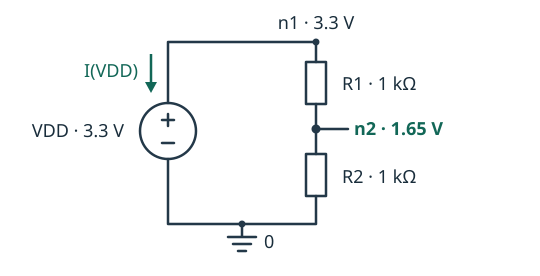
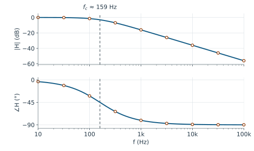

# Examples

[日本語](README.ja.md) · [Project README](../README.md) · This English text is the main version; the Japanese version follows it, and where they differ, this text holds.

Small netlists that show one feature each. Every one has an analytic
solution, and CTest runs each one and compares the result with it, within
the tolerance given for that example in the table
(`tests/scripts/test_examples.py`, tests `example_*`). The program's values quoted below are from a run at commit
`db0fef6`; CTest checks them against the analytic values, not these
digits. Run the examples from the top of the source tree after
[building](../docs/USER_MANUAL.md#build).

| File | Shows | Analysis | Checked quantity | Analytic value | Program | CTest tolerance |
| --- | --- | --- | --- | --- | --- | --- |
| [test_simple_divider.sp](test_simple_divider.sp) | the first run of the [User Manual](../docs/USER_MANUAL.md#run-your-first-simulation) | operating point | V(n2) | 1.65 V | 1.65 V | 1e-6 V |
| [params_subckt.sp](params_subckt.sp) | `.PARAM`, `.FUNC` and a subcircuit with a parameter | operating point | V(out) | 1.33333 V | 1.33333 V | 1e-5 V |
| [diode_iv.sp](diode_iv.sp) | a `.MODEL`, a DC sweep and the sign of a source current | DC sweep | i(v1) at 0.6 V | −1.18719×10⁻⁴ A | −1.18719×10⁻⁴ A | 1e-6 relative |
| [rc_step.sp](rc_step.sp) | a `PULSE` source and the raw output | transient | V(out) at 1 ms | 0.632121 | 0.632105 | 5e-5 |
| [rc_discharge.sp](rc_discharge.sp) | `.IC` with `UIC`, and the integration methods | transient | V(out) at 1 ms | 0.367879 | 0.367895 (trap) | 5e-5 (trap), 1e-4 (gear), 3e-3 (euler) |
| [rc_lowpass_ac.sp](rc_lowpass_ac.sp) | an AC input and the AC CSV | AC | \|V(out)\| at 1 kHz | −16.0722 dB | −16.0722 dB | 1e-6 dB |

## Voltage divider



```sh
build/kirimaspice examples/test_simple_divider.sp
```

Two 1 kΩ resistors across 3.3 V: `V(n2) = 1.65 V`, and `I(VDD) =
-0.00165 A`. The current of a voltage source is positive into its `+`
terminal, so a source that delivers current shows a negative value
([NETLIST_CONVENTIONS](../docs/spec/NETLIST_CONVENTIONS.md), rule 3).

## Parameters, a function and a subcircuit

```sh
build/kirimaspice examples/params_subckt.sp
```

`VH = HALF(VIN) = 2 V` drives a 1 kΩ / 2 kΩ divider, so `V(out) =
1.33333 V`. `X1` is the subcircuit `DIV` with `RTOP=3k`, a 3 kΩ / 1 kΩ
divider, so `V(xout) = 0.5 V`. `V1` delivers 2/3 mA + 1/2 mA, so `I(V1) =
-0.00116667 A`. A parameter given on the `X` line replaces the default of
the `.SUBCKT` line.

## Diode I–V curve

```sh
build/kirimaspice examples/diode_iv.sp --raw-out diode_iv.raw
```

The program prints only a summary of a sweep; the values are in the raw
file. With `IS=1e-14` and `N=1` at 27 °C the current follows
I = IS·(exp(V/V<sub>T</sub>) − 1) + GMIN·V, V<sub>T</sub> = kT/q = 25.865 mV,
with SPICE's GMIN of 10⁻¹² S in parallel with the junction, and
`i(v1)` is −I. The program agrees with this to better than one part in a
million at every point of the sweep, for example −1.18719×10⁻⁴ A at 0.6 V
and −0.270827 A at 0.8 V. ngspice-47 gives −1.18720×10⁻⁴ A and −0.270830 A,
up to 1.1×10⁻⁵ apart relative to the value; whether that comes from its values of k and q is not
confirmed. Above about 0.73 V
the Newton iteration limits how far the junction voltage moves per step,
as SPICE does; the converged result is still that of the equation.

## RC step response

```sh
build/kirimaspice examples/rc_step.sp --raw-out rc_step.raw
```

1 kΩ and 1 µF (RC = 1 ms) driven by a 0-to-1 V step. For an ideal instantaneous step,
the value at 1 ms is 1 − e⁻¹ ≈ 0.632121 V. The example has a 1 ns rise
time and gives 0.632105 V with the default trapezoidal rule and `tstep` = 10 µs.

## RC discharge and the integration methods

```sh
build/kirimaspice examples/rc_discharge.sp --raw-out rc_discharge.raw
```

The capacitor starts at 1 V from `.IC V(out)=1`; `UIC` on the `.TRAN` line
makes the transient start from `.IC` instead of from an operating point.
Without `UIC`, the operating point that starts the transient holds V(out)
at 1 V and the transient releases it, as in SPICE, so the result is the
same (CTest checks both).

The exact value at 1 ms is e⁻¹ = 0.367879. Change `METHOD` on the
`.OPTIONS` line to compare the methods:

| `METHOD` | Method | Order | V(out) at 1 ms |
| --- | --- | --- | --- |
| `trap` (default) | trapezoidal | 2 | 0.367895 |
| `gear` | BDF2 | 2 | 0.367913 |
| `euler` | backward Euler | 1 | 0.369711 |

## RC low-pass filter

```sh
build/kirimaspice examples/rc_lowpass_ac.sp -o rc_lowpass
```

Open `rc_lowpass_ac.csv`. With a unit input (`AC 1`), compare `v(out)_mag_dB`
with the gain in the upper plot and `v(out)_phase_deg` with the phase in the
lower plot. The solver includes a 10⁻¹² S shunt (`GMIN`) at node `out`,
which affects the last digits of the CSV.



The solid curves show the analytic response of the ideal RC filter. The circles
show every fifth point in the AC CSV, starting at 10 Hz.

| Frequency | Gain | Phase | Where to find it |
| --- | ---: | ---: | --- |
| Cutoff ≈ 159.15 Hz | −3.010 dB | −45° | The vertical dashed line. This frequency, $1/(2\pi RC)$, lies between sweep points. |
| 1 kHz | −16.072 dB | −80.96° | The CSV row with `frequency` equal to 1000 Hz. CTest checks both gain and phase. |
